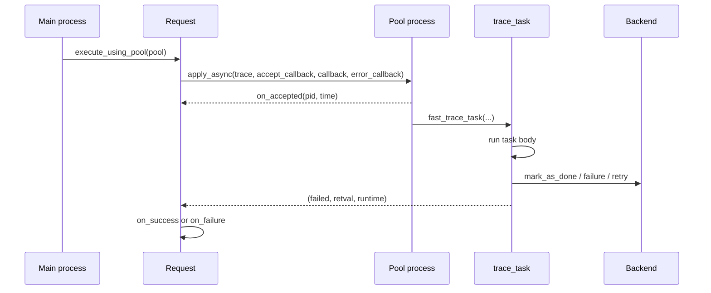

## Overview

Once the consumer's strategy ([[The Consumer: From Broker Message to Pool]]) has a `Request`, the main worker process does no more work on the task body. It submits a trace function to the pool, and the pool process runs the task, records its outcome and reports back through callbacks. Those callbacks decide when the broker message is acknowledged. This page follows that path: submission, the tracer that runs inside the pool process, outcome handling, acknowledgement rules, timeouts and revocation. Where the result is stored is the topic of [[Task Results, States and Result Backends]]; the pool types are in [[Worker Pool Implementations]].

Sources: [celery/worker/request.py:341-372](repo://celery/worker/request.py#L341-L372), [celery/app/trace.py:735-790](repo://celery/app/trace.py#L735-L790)

Sources: [celery/worker/request.py:341-372](repo://celery/worker/request.py#L341-L372), [celery/worker/request.py:515-527](repo://celery/worker/request.py#L515-L527), [celery/worker/request.py:596-611](repo://celery/worker/request.py#L596-L611)

## The Request object

`Request` wraps one received message. Its constructor copies the message headers into `_request_dict`, keeps the body undecoded (it is decoded in the pool), takes `id` from the headers, and takes `name` from `shadow` when set. It parses `eta` and `expires` from ISO strings into aware datetimes and raises `InvalidTaskError` if they are malformed. It records delivery info (exchange, routing key, priority, redelivered flag) and the message properties, including `reply_to` and `correlation_id`.

Sources: [celery/worker/request.py:90-176](repo://celery/worker/request.py#L90-L176)

Worker-wide bookkeeping lives in `celery.worker.state`: `task_reserved` records the request in `requests` and `reserved_requests`; `task_accepted` adds it to `active_requests` and counts it; `task_ready` removes it from all of these and, on success, remembers the id in `successful_requests`. The `revoked` set is a `LimitedSet` capped at 50,000 entries (`CELERY_WORKER_REVOKES_MAX`) that expire after 3 hours.

Sources: [celery/worker/state.py:35-72](repo://celery/worker/state.py#L35-L72), [celery/worker/state.py:96-140](repo://celery/worker/state.py#L96-L140)

## Submitting to the pool

`execute_using_pool` first raises `TaskRevokedError` if `revoked()` says so. Otherwise it picks `fast_trace_task` when `app.use_fast_trace_task` is set (the worker enables this), else `trace_task_ret`, and calls `pool.apply_async` with the type, id, request dict, body and content type, plus four callbacks: `accept_callback=on_accepted`, `timeout_callback=on_timeout`, `callback=on_success`, `error_callback=on_failure`. Time limits come from the message (`timelimit`) and fall back to the task's. It keeps a weak reference to the pool's result so the request can be terminated later.

Sources: [celery/worker/request.py:341-372](repo://celery/worker/request.py#L341-L372)

`setup_worker_optimizations`, called when the worker is initialised, finalizes the app, sets it as current and default for all threads, installs a stack-protection patch on `Task.__call__`, and stores `[app._tasks, accept_content, hostname]` in a module-level `_localized` list. `fast_trace_task` reads that list instead of looking up the app. If it is empty (a process that was spawned rather than forked, such as the default prefork pool on Windows), it raises a `RuntimeError` suggesting `--pool=solo` or `--pool=threads`.

Sources: [celery/app/trace.py:804-832](repo://celery/app/trace.py#L804-L832), [celery/app/trace.py:757-789](repo://celery/app/trace.py#L757-L789)

Both trace entry points deserialize the body with the accepted content types, update the request dict with `args`, `kwargs`, the embedded `callbacks`, `errbacks`, `chain` and `chord`, then call the task's tracer. The return value is a tuple: `(1, exception_info, runtime)` if the trace failed and `(0, repr_of_result, runtime)` otherwise.

Sources: [celery/app/trace.py:735-789](repo://celery/app/trace.py#L735-L789)

## The tracer

### Building the tracer

`build_tracer(name, task, ...)` builds one `trace_task` function per task, with attributes resolved once:

Sources: [celery/app/trace.py:344-424](repo://celery/app/trace.py#L344-L424)

- it calls `task.run` directly unless the task defines a custom `__call__`;
- it resolves the optional hooks `before_start`, `on_success` and `after_return` only if the class overrides them;
- it checks whether it should deduplicate successful tasks: `task_acks_late` or the task's `acks_late`, `worker_deduplicate_successful_tasks` and a persistent backend;
- it captures the signal receivers, so signals with no receivers cost nothing.

Sources: [celery/app/trace.py:344-424](repo://celery/app/trace.py#L344-L424)

The `trace_task` function itself is unrolled for speed. The comment in the code says it "is very long because we've unrolled all the calls for performance reasons". For one invocation it does the following:

Sources: [celery/app/trace.py:475-487](repo://celery/app/trace.py#L475-L487)

1. Builds a `Context` from the request dict and decides `ignore_result`, `track_started` and whether to publish a result.
2. If the message was redelivered and deduplication is on, checks the backend: when the task already finished `SUCCESS`, it dispatches any callbacks or chain that were not yet sent, remembers the id and returns without running the body. A dispatch failure raises `Reject(requeue=True)`.
3. Pushes the task and request on their stacks, sends `task_prerun`, calls the loader's `on_task_init`, and if `track_started` is on stores a `STARTED` state with the process id and hostname.
4. Calls `before_start` if defined, then `fun(*args, **kwargs)`.
5. Handles the outcome, below.
6. In `finally`, sends `task_postrun`, pops the stacks, and, when not eager, calls `backend.process_cleanup()` and the loader's `on_process_cleanup`.

Sources: [celery/app/trace.py:475-560](repo://celery/app/trace.py#L475-L560), [celery/app/trace.py:560-600](repo://celery/app/trace.py#L560-L600), [celery/app/trace.py:645-687](repo://celery/app/trace.py#L645-L687)

### Outcomes of the task body

| Raised or returned | State | What the tracer does |
| --- | --- | --- |
| Returns normally | `SUCCESS` | Dispatches callbacks and chain, then `backend.mark_as_done`, then the `on_success` hook and `task_success` signal |
| `Reject` | `REJECTED` | `handle_reject` logs it; the request later rejects the message |
| `Ignore` | `IGNORED` | `handle_ignore` logs it; no state stored |
| `Retry` | `RETRY` | `on_error` with `call_errbacks=False`: `mark_as_retry`, `on_retry`, `task_retry` signal |
| Any other `Exception` | `FAILURE` | `on_error`: `mark_as_failure`, `on_failure`, `task_failure` signal, error log |
| `BaseException` | n/a | Propagates out of the tracer |

Sources: [celery/app/trace.py:582-632](repo://celery/app/trace.py#L582-L632), [celery/app/trace.py:179-282](repo://celery/app/trace.py#L179-L282)

On success the order matters: the comment says callback tasks "must be applied before the result is stored, so that result.children is populated". `_dispatch_callbacks_and_chain` sends each `link` callback (several are sent as one group) with the return value as the first argument, then, if the message carries a `chain`, applies the last chain element with the rest of the chain attached. Its docstring notes that dispatch is not atomic and that a redelivery may resend callbacks, "acceptable under Celery's at-least-once delivery model". An `EncodeError` while storing the result is turned into a failure.

Sources: [celery/app/trace.py:426-473](repo://celery/app/trace.py#L426-L473), [celery/app/trace.py:615-640](repo://celery/app/trace.py#L615-L640)

`TraceInfo.handle_error_state` decides whether to store errors: if the result is ignored it stores errors only when `store_errors_even_if_ignored` is set; eager runs store them only with `store_eager_result`; otherwise it stores unless eager. `handle_failure` makes the exception pickleable (`get_pickleable_exception`), calls `backend.mark_as_failure`, then the task's `on_failure` and the `task_failure` signal, then logs, and clears traceback frames to avoid memory leaks. Exceptions raised outside the body (for example while storing) fire `task_internal_error` and are reported as failures.

Sources: [celery/app/trace.py:188-204](repo://celery/app/trace.py#L188-L204), [celery/app/trace.py:242-282](repo://celery/app/trace.py#L242-L282), [celery/app/trace.py:696-733](repo://celery/app/trace.py#L696-L733)

## Acknowledgement and outcome callbacks

By default a message is acknowledged as early as possible. `on_accepted`, called when the pool process starts the job, records the pid and start time, marks the request active, calls `acknowledge()` unless the task has `acks_late`, and sends `task-started`. If a termination was requested before the job started, it is applied now.

Sources: [celery/worker/request.py:515-527](repo://celery/worker/request.py#L515-L527)

`on_success` receives the tracer's tuple. If it signals failure, `SystemExit` and `KeyboardInterrupt` are re-raised, and anything else is passed to `on_failure(..., return_ok=True)`. On success it calls `task_ready(successful=True)`, acknowledges if `acks_late`, and sends `task-succeeded`. `on_retry` acknowledges if `acks_late` and sends `task-retried`.

Sources: [celery/worker/request.py:596-620](repo://celery/worker/request.py#L596-L620)

`on_failure` is the full failure policy. It always calls `task_ready` and unwraps the exception, then:

Sources: [celery/worker/request.py:622-640](repo://celery/worker/request.py#L622-L640)

- `Terminated`: if neither cancelled nor revoked yet, it announces the task revoked and returns.
- `MemoryError`: re-raised so the process is replaced.
- `Reject`: when not requeueing, it records `FAILURE` and fires `task_failure` so the task does not stay pending forever; it then rejects the message with the requested `requeue`.
- `Ignore`: acknowledges.
- `Retry`: calls `on_retry`.
- Anything else with `acks_late`: if `reject_on_worker_lost` and the error is `WorkerLostError`, or it is a timeout whose `acks_on_timeout` is false, it requeues the message and sends no failure event; if the matching `acks_on_failure` or `acks_on_timeout` is true it acknowledges; otherwise it rejects without requeue.

Sources: [celery/worker/request.py:622-690](repo://celery/worker/request.py#L622-L690)

If the message was not requeued, and either the worker was lost or the pool reported the error (`return_ok` false), the request marks the failure in the backend itself, because the pool process may not have had time to. It also fires `task_failure`, sends `task-failed` and logs `Task handler raised error`. During cold shutdown (`state.should_terminate`) the event is suppressed.

Sources: [celery/worker/request.py:682-728](repo://celery/worker/request.py#L682-L728)

> [!WARNING]
> With `acks_late` and `reject_on_worker_lost`, a task that kills its process is requeued and may run again indefinitely; the task attribute's own comment warns that this "can cause message loops".

Sources: [celery/app/task.py:349-359](repo://celery/app/task.py#L349-L359)

## Time limits

The hard and soft limits travel in the message `timelimit` header and are passed to the pool as `timeout` and `soft_timeout`. When the pool calls `on_timeout`, a soft limit only logs a warning. A hard limit calls `task_ready`, builds `TimeLimitExceeded`, stores a failure, runs `on_failure` and `after_return` hooks, fires `task_failure` and `task-failed`, and clears the traceback to break reference cycles. For `acks_late` tasks it then acknowledges when `acks_on_timeout` is true, otherwise it rejects with requeue.

Sources: [celery/worker/request.py:529-594](repo://celery/worker/request.py#L529-L594), [celery/worker/request.py:354-361](repo://celery/worker/request.py#L354-L361)

## Revocation, termination and cancellation

`Request.revoked()` is called by the strategy, and again before submission. A task is dropped if it was already marked revoked, if `maybe_expire` finds `expires` in the past (which also adds it to `revoked_tasks`), if its id is in the `revoked` set, or if one of its stamped headers matches a revoked stamp. A discarded task goes through `_announce_revoked`: it sends `task-revoked`, stores `REVOKED` in the backend, acknowledges the message and fires `task_revoked`.

Sources: [celery/worker/request.py:408-414](repo://celery/worker/request.py#L408-L414), [celery/worker/request.py:457-510](repo://celery/worker/request.py#L457-L510)

`terminate(pool, signal)` kills the pool process with `pool.terminate_job` if the task has started and announces it revoked as terminated; if it has not started it remembers `_terminate_on_ack` so `on_accepted` does it. `cancel` also kills the job but only announces cancellation, optionally storing `RETRY` so another worker can take the message: this is what the consumer uses on connection loss. Remote revoke commands that reach these methods are in [[Remote Control, Events and Signals]].

Sources: [celery/worker/request.py:416-456](repo://celery/worker/request.py#L416-L456)
