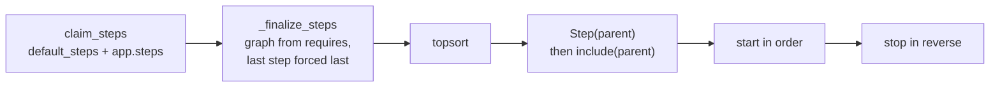

## Overview

`celery worker` creates a `Worker` (a `WorkController`), which does not start its parts by hand. It describes them as bootsteps, small objects that declare what they `require`, and lets a `Blueprint` sort and run them. The same mechanism builds the consumer ([[The Consumer: From Broker Message to Pool]]), so understanding it here pays off there. This page covers the startup sequence, the bootstep machinery, the steps of the worker blueprint, and shutdown. The pool classes that the `Pool` step creates are described in [[Worker Pool Implementations]].

Sources: [celery/worker/worker.py:63-100](repo://celery/worker/worker.py#L63-L100), [celery/bootsteps.py:74-110](repo://celery/bootsteps.py#L74-L110)

## From the command to a WorkController

The `worker` click command prepares the app and then does three things in order: applies extra `--name=value` options with `config_from_cmdline` (namespace `worker`), drops privileges with `maybe_drop_privileges`, and builds `app.Worker(...)`. It calls `worker.start()` and exits with `worker.exitcode`. With `--detach` it re-launches itself as a daemon instead.

Sources: [celery/bin/worker.py:324-371](repo://celery/bin/worker.py#L324-L371)

`app.Worker` is `celery.apps.worker:Worker`, the command-line flavour of `WorkController`; `app.WorkController` is the embeddable one. Both are created with `subclass_with_self`, so the class is bound to the app.

Sources: [celery/app/base.py:1430-1447](repo://celery/app/base.py#L1430-L1447)

`WorkController.__init__` runs these stages:

Sources: [celery/worker/worker.py:90-100](repo://celery/worker/worker.py#L90-L100)

1. `app.loader.init_worker()` imports the default task modules.
2. `on_before_init`: for the program, this installs task tracing optimisations, sends `celeryd_init` and checks privileges against `accept_content`.
3. `setup_defaults`: each setting is resolved with `app.either`, which uses an explicit argument if one is truthy and otherwise the configuration key (for example `concurrency` falls back to `worker_concurrency`).
4. `on_after_init`.
5. `setup_instance`.

Sources: [celery/worker/worker.py:90-100](repo://celery/worker/worker.py#L90-L100), [celery/apps/worker.py:91-120](repo://celery/apps/worker.py#L91-L120), [celery/worker/worker.py:351-398](repo://celery/worker/worker.py#L351-L398), [celery/app/base.py:1210-1218](repo://celery/app/base.py#L1210-L1218)

`setup_instance` selects and deselects queues from `-Q` and `-X` (an unknown queue raises `ImproperlyConfigured`, and `worker_direct` adds a per-worker queue), records the task modules in `conf.include` so an `execv` re-imports them, and defaults `concurrency` to the CPU count (2 if that cannot be determined). It builds a connection object only to read transport parameters, decides whether to use the event loop (`should_use_eventloop`), sends `worker_init`, resolves the pool class by name, and finally builds the blueprint and applies it.

Sources: [celery/worker/worker.py:101-139](repo://celery/worker/worker.py#L101-L139), [celery/worker/worker.py:167-193](repo://celery/worker/worker.py#L167-L193)

The event loop is used only when the environment is the default one (no eventlet/gevent patching), the transport supports asynchronous I/O and the platform is not Windows.

Sources: [celery/worker/worker.py:239-242](repo://celery/worker/worker.py#L239-L242)

## How bootsteps work

A `Step` declares `requires` (steps that must start first, within one blueprint), may set `conditional`, `enabled` or override `include_if` to opt out, and has a `create(parent)` hook. `StepType` gives each step class a qualified `name` from its module. `StartStopStep` adds `start`, `stop`, `close` and `terminate` that delegate to the object returned by `create`; its `include` stores that object and appends the step to `parent.steps`.

Sources: [celery/bootsteps.py:266-346](repo://celery/bootsteps.py#L266-L346), [celery/bootsteps.py:355-384](repo://celery/bootsteps.py#L355-L384)

`Blueprint.apply(parent)` does the planning:

Sources: [celery/bootsteps.py:186-212](repo://celery/bootsteps.py#L186-L212)

1. `claim_steps` loads each step class by name from the blueprint's `default_steps` plus any extra steps in `app.steps[...]`.
2. `_finalize_steps` follows `requires` (pulling in required steps that were not listed), builds a `DependencyGraph`, and, if one step has `last = True`, adds an edge from it to every other step so it sorts last. A missing dependency raises `KeyError('unknown bootstep: ...')`.
3. It sorts topologically, instantiates each step with `S(parent, **kwargs)`, and calls `include(parent)` on each in that order.

Sources: [celery/bootsteps.py:186-212](repo://celery/bootsteps.py#L186-L212), [celery/bootsteps.py:221-256](repo://celery/bootsteps.py#L221-L256)

Starting walks `parent.steps` in order, recording how many started; stopping goes through the shared state `RUN`, `CLOSE`, `TERMINATE`. Only steps that were included are in `parent.steps`, so a disabled step is simply absent.

Sources: [celery/bootsteps.py:109-117](repo://celery/bootsteps.py#L109-L117), [celery/bootsteps.py:155-176](repo://celery/bootsteps.py#L155-L176)

Sources: [celery/bootsteps.py:186-256](repo://celery/bootsteps.py#L186-L256)

Applications extend a worker by adding steps to `app.steps['worker']` or `app.steps['consumer']`; the worker passes `steps=self.app.steps['worker']` to its blueprint, and the blueprint unions them with its defaults.

Sources: [celery/worker/worker.py:132-138](repo://celery/worker/worker.py#L132-L138), [celery/bootsteps.py:99-107](repo://celery/bootsteps.py#L99-L107)

## The worker blueprint

The worker's default steps are `Hub`, `Pool`, `Beat`, `Timer`, `StateDB`, `Consumer` and the autoscaler component. Their dependency order is set by `requires`: `Hub` requires `Timer`, `Pool` requires `Hub`, the autoscaler requires `Pool`, and `Consumer` is `last = True`.

Sources: [celery/worker/worker.py:76-88](repo://celery/worker/worker.py#L76-L88), [celery/worker/components.py:60-68](repo://celery/worker/components.py#L60-L68)

| Step | Included when | What it creates |
| --- | --- | --- |
| `Timer` | always | A timer. With the event loop, a plain timer of max interval 10s; otherwise the pool's `Timer` class with `timer_precision` |
| `Hub` | the event loop is in use | The kombu event loop hub (reusing an existing one if set, or the connection's `requires_hub`); also swaps in dummy locks for the app clock and billiard's pool |
| `Pool` | always | The pool instance, built from `pool_cls` with concurrency, limits and a semaphore |
| `Beat` | `-B` given | An `EmbeddedService` running the beat scheduler in the worker |
| `StateDB` | `statedb` set | A persistent store for revoked tasks and clock, saved at exit |
| `Consumer` | always, last | The consumer and its own blueprint |
| Autoscaler | `autoscale` set | An `Autoscaler` thread, or timer callbacks with the event loop |

Sources: [celery/worker/components.py:41-100](repo://celery/worker/components.py#L41-L100), [celery/worker/components.py:186-246](repo://celery/worker/components.py#L186-L246), [celery/worker/autoscale.py:31-58](repo://celery/worker/autoscale.py#L31-L58)

The `Pool` step reads `--autoscale max,min` into `max_concurrency` and `min_concurrency`. When the event loop is used and the pool uses a semaphore, it creates a `LaxBoundedSemaphore(procs)`, so tasks are only sent to the pool when a slot is free, and caps process restarts at 100. It passes `maxtasksperchild`, `max_memory_per_child`, the time limits, `lost_worker_timeout` and the app to the pool. It also tells the rest of Celery whether joining a result inside a task would block (`task_join_will_block`).

Sources: [celery/worker/components.py:101-183](repo://celery/worker/components.py#L101-L183)

The `Beat` step refuses to run with the eventlet or gevent pools, raising `ImproperlyConfigured`; see [[Beat: Periodic Task Scheduling]].

Sources: [celery/worker/components.py:186-210](repo://celery/worker/components.py#L186-L210)

The `Consumer` step computes the initial prefetch count as `max_concurrency` (or `concurrency`) times `prefetch_multiplier`, then instantiates `consumer_cls` with the task handler `process_task`, the pool, timer, hub and options. `prefetch_multiplier` defaults to 4. The consumer's blueprint then starts the connection, mingle, events, heartbeat, task consumer and event loop.

Sources: [celery/worker/components.py:222-246](repo://celery/worker/components.py#L222-L246), [celery/app/defaults.py:356-356](repo://celery/app/defaults.py#L356-L356), [celery/worker/consumer/consumer.py:171-186](repo://celery/worker/consumer/consumer.py#L171-L186)

## Starting the worker

`WorkController.start` calls `blueprint.start(self)` and turns outcomes into shutdown: `WorkerTerminate` leads to `terminate()`, any other exception is logged as critical and calls `stop(exitcode=EX_FAILURE)`, `SystemExit` stops with its code, and `KeyboardInterrupt` stops with `EX_FAILURE`.

Sources: [celery/worker/worker.py:201-212](repo://celery/worker/worker.py#L201-L212)

When the blueprint starts, `on_start` runs first. For the command-line worker it creates the pidfile lock, sends `celeryd_after_setup`, optionally purges messages, prints the banner, sets the process status, installs signal handlers and redirects stdout. `on_stopped` stops the timer, shuts the consumer down and releases the pidfile.

Sources: [celery/worker/worker.py:150-165](repo://celery/worker/worker.py#L150-L165), [celery/apps/worker.py:128-166](repo://celery/apps/worker.py#L128-L166)

## Shutdown

Warm shutdown is `stop`: if the blueprint is running it closes the consumer so no new tasks are received, then `_shutdown(warm=True)` calls `blueprint.stop(self, terminate=False)` and waits on `blueprint.join()`. Cold shutdown is `terminate`, the same with `terminate=True`. In a signal handler the shutdown only proceeds if the pool is `signal_safe`. `stop` also sends the `worker_shutdown` signal.

Sources: [celery/worker/worker.py:233-267](repo://celery/worker/worker.py#L233-L267), [celery/worker/worker.py:198-200](repo://celery/worker/worker.py#L198-L200)

`Blueprint.stop` returns at once if already closing; if not all steps had started it marks the blueprint terminated without running step stops; otherwise it calls `close` on all steps (in start order), sets `CLOSE`, then `stop` or `terminate` on all steps in reverse order, logging rather than raising per-step errors. It finally runs `on_stopped` and sets `shutdown_complete`.

Sources: [celery/bootsteps.py:128-176](repo://celery/bootsteps.py#L128-L176)

Signal handlers choose which shutdown runs. `_shutdown_handler` installs a handler that, in the main process, sends `worker_shutting_down` and sets `state.should_stop` (warm) or `state.should_terminate` (cold) to the exit code. The cold-shutdown handler `on_cold_shutdown` first calls `worker.wait_for_soft_shutdown()`, which sleeps for `worker_soft_shutdown_timeout` when that is positive and tasks are active (or `worker_enable_soft_shutdown_on_idle` is set), so short tasks can finish. It then cancels the task consumer, cancels active requests, sets `state.should_terminate` and stops the pool. A second signal during that wait is handled by `during_soft_shutdown` and then `on_hard_shutdown`, which raises `WorkerTerminate`.

Sources: [celery/apps/worker.py:288-322](repo://celery/apps/worker.py#L288-L322), [celery/apps/worker.py:403-430](repo://celery/apps/worker.py#L403-L430), [celery/worker/worker.py:412-435](repo://celery/worker/worker.py#L412-L435), [celery/apps/worker.py:325-366](repo://celery/apps/worker.py#L325-L366)
