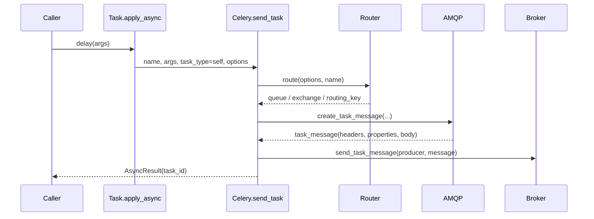

## Overview

Calling `task.delay(...)` or `task.apply_async(...)` ends with one message published to the broker. Two functions do the work: `Task.apply_async` validates the call and merges the task's own options, and `Celery.send_task` resolves defaults, routes the message, builds it with the AMQP helper and publishes it through a producer from the connection pool. `send_task` is also usable on its own to call a task by name when the task code is not importable. This page follows that path; where the message goes is on [[Routing and Queues]], and what the worker does with it starts at [[The Consumer: Receiving Tasks]].

Sources: [celery/app/task.py:523-535](repo://celery/app/task.py#L523-L535), [celery/app/base.py:846-865](repo://celery/app/base.py#L846-L865)

Sources: [celery/app/task.py:659-708](repo://celery/app/task.py#L659-L708), [celery/app/base.py:931-1042](repo://celery/app/base.py#L931-L1042)

## What apply_async does first

`delay(*args, **kwargs)` is `apply_async(args, kwargs)` and takes no extra options. `apply_async` first raises `ValueError` if the task's `soft_time_limit` exceeds its `time_limit`. If `typing` is on it calls the signature-derived `__header__` with the arguments, so a bad call fails at the caller with `TypeError`. It then computes the shadow name, merges the task's execution options with the call's options (call options win), sets `ignore_result` from the task unless given, and sets `priority` from the task when it has one.

Sources: [celery/app/task.py:523-535](repo://celery/app/task.py#L523-L535), [celery/app/task.py:659-681](repo://celery/app/task.py#L659-L681)

With `task_always_eager`, no message is sent: the arguments are serialized and deserialized with the task's serializer (so eager mode exercises serialization too) and `apply` runs the task inline with joins denied. Otherwise `apply_async` calls `app.send_task(self.name, ..., task_type=self, result_cls=self.AsyncResult, ...)`.

Sources: [celery/app/task.py:683-708](repo://celery/app/task.py#L683-L708)

## Inside send_task

`send_task(name, args, kwargs, ...)` accepts the same options as `apply_async` plus `result_cls` and `route_name`. It generates a `task_id` (a uuid) unless one was passed, takes the producer (or the deprecated `publisher`), and warns with `AlwaysEagerIgnored` when `task_always_eager` is set, since it has no effect here.

Sources: [celery/app/base.py:846-873](repo://celery/app/base.py#L846-L873)

**Registry defaults.** When the caller gave no `task_type` (a plain `send_task("name")`), the task is looked up directly in `self._tasks`, deliberately without auto-finalizing, so names that are not registered locally still work. If found, its non-`None` execution options become defaults under the explicit options. A comment explains the skip when `task_type` is given: `apply_async` already merged them, and merging again would override explicit caller values.

Sources: [celery/app/base.py:875-908](repo://celery/app/base.py#L875-L908)

**Limits and expiry.** `time_limit`, `soft_time_limit` and `expires` use an `_OMITTED` sentinel: an omitted value falls back to the task-level option popped from `options`, while an explicit `None` clears it. `expires` may be seconds, a `datetime` or an ISO string; it is converted to seconds from now and put in `options['expiration']`. An expiry already in the past is logged and clamped to 0.

Sources: [celery/app/base.py:910-929](repo://celery/app/base.py#L910-L929), [celery/app/base.py:968-992](repo://celery/app/base.py#L968-L992)

**Routing.** `ignore_result` is popped, then `router.route(options, route_name or name, args, kwargs, task_type)` returns the options with `queue`, `exchange` and `routing_key` filled in. See [[Routing and Queues]].

Sources: [celery/app/base.py:930-933](repo://celery/app/base.py#L930-L933)

**Native delayed delivery.** For `eta` or `countdown` on a broker with quorum queues, and when the destination exchange is not `direct`, the countdown is converted to a routing key for the `celery_delayed_27` topic exchange and the queue is dropped from the options, so the broker holds the message instead of a worker. A direct exchange logs a warning that this is unsupported and that the task may block a worker until the ETA arrives.

Sources: [celery/app/base.py:934-966](repo://celery/app/base.py#L934-L966)

**Lineage.** If no `root_id` or `parent_id` was passed, they are taken from `current_worker_task`: root is the parent's root or id, parent is the parent's id. With `task_inherit_parent_priority`, the parent's delivery priority is the default priority.

Sources: [celery/app/base.py:994-1005](repo://celery/app/base.py#L994-L1005)

**Publish and result.** `amqp.create_task_message(...)` builds the message. With an explicit `connection`, a producer is created on it with `auto_declare=False`; otherwise one is acquired from the pool. Inside `_reraise_as_library_errors`, unless the result is ignored, `backend.on_task_call(P, task_id)` runs (for example to subscribe to results before the task can finish), then `send_task_message` publishes. The method returns `AsyncResult(task_id)` (or `result_cls`), flags `ignored`, and appends it to the current worker task's trail if there is one.

Sources: [celery/app/base.py:1007-1042](repo://celery/app/base.py#L1007-L1042)

## The task message

The protocol is selected by `task_protocol`: `AMQP.create_task_message` is `as_task_v1` or `as_task_v2`, and v2 is the format the worker reads natively. `as_task_v2` checks that `args` is a list or tuple and `kwargs` a mapping, converts `countdown` to an ISO `eta` and numeric `expires` to an ISO timestamp (both rejected if out of range by `_verify_seconds`), builds `argsrepr`/`kwargsrepr` capped at 1024 characters, and defaults `root_id` to the task id.

Sources: [celery/app/amqp.py:257-268](repo://celery/app/amqp.py#L257-L268), [celery/app/amqp.py:326-369](repo://celery/app/amqp.py#L326-L369), [celery/app/amqp.py:480-483](repo://celery/app/amqp.py#L480-L483)

| Part | Contents |
| --- | --- |
| Headers | `lang`, `task`, `id`, `shadow`, `eta`, `expires`, `group`, `group_index`, `retries`, `timelimit`, `root_id`, `parent_id`, `argsrepr`, `kwargsrepr`, `origin`, `ignore_result`, `replaced_task_nesting`, `stamped_headers`, `stamps` |
| Properties | `correlation_id` (the task id) and `reply_to` |
| Body | A tuple of `args`, `kwargs`, and an embed dict with `callbacks`, `errbacks`, `chain`, `chord` |
| Sent event | A `task-sent` event payload, only when `task_send_sent_event` is on |

Sources: [celery/app/amqp.py:370-418](repo://celery/app/amqp.py#L370-L418)

Everything the worker needs to choose a strategy, apply a time limit or check expiry is in the headers, so the body can stay encoded until the pool process runs it. Callbacks and the remaining chain ride in the body, which is how [[Canvas: Signatures, Chains and Groups]] continue after a task finishes.

Sources: [celery/app/amqp.py:371-418](repo://celery/app/amqp.py#L371-L418)

## Publishing the message

`AMQP.send_task_message` is a closure built once by `_create_task_sender`, capturing the signal senders and defaults from configuration (`task_publish_retry`, `task_publish_retry_policy`, `task_default_delivery_mode`, `task_serializer`, `task_compression`). Given the routing options it resolves the queue and exchange (see [[Routing and Queues]]), merges the retry policy and then:

1. sends `before_task_publish` if any receiver is connected;
2. calls `producer.publish(body, exchange=..., routing_key=..., serializer=..., compression=..., retry=..., headers=..., **properties)`;
3. sends `after_task_publish`, and the deprecated `task_sent` signal in the format matching the protocol;
4. if the message carries a `sent_event`, fills in queue, exchange and routing key and publishes a `task-sent` event with the event dispatcher.

Sources: [celery/app/amqp.py:485-505](repo://celery/app/amqp.py#L485-L505), [celery/app/amqp.py:555-605](repo://celery/app/amqp.py#L555-L605)

The signals are described on [[Signals]] and events on [[Events and Monitoring]].

Sources: [celery/app/amqp.py:558-604](repo://celery/app/amqp.py#L558-L604)

## Connections and producers

`producer_or_acquire` yields the producer you pass, or acquires one from the app's producer pool; `connection_or_acquire` does the same for connections. `connection_for_read` and `connection_for_write` use the broker URLs configured for consuming and publishing, which may differ.

Sources: [celery/app/base.py:1043-1058](repo://celery/app/base.py#L1043-L1058), [celery/app/base.py:1148-1190](repo://celery/app/base.py#L1148-L1190)
