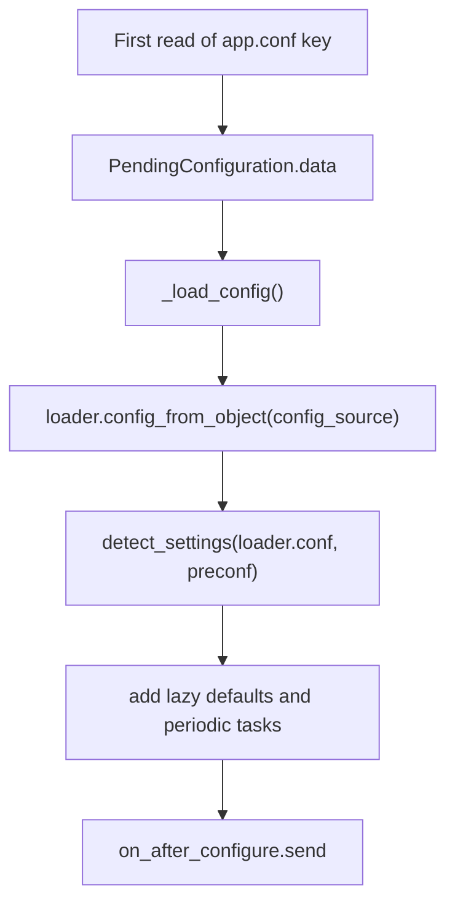

## Overview

The `Celery` class is the single object a program creates before it defines or sends any task. It holds the task registry, the configuration, the choice of loader and fix-ups, and exposes the messaging, result, control, event and logging helpers as lazily created attributes. Client code and the worker share this object, which is why `celery -A proj worker` only needs to find one variable. This page covers how the app is built, how it defers work until first use, and how configuration is read; tasks themselves are on [[Defining Tasks and the Task Class]] and publishing is on [[Calling Tasks: apply_async and send_task]].

Sources: [celery/app/base.py:252-290](repo://celery/app/base.py#L252-L290), [celery/app/base.py:1535-1600](repo://celery/app/base.py#L1535-L1600)

## Construction and lazy components

`Celery.__init__` takes the constructor keywords (`broker`, `backend`, `include`, `loader`, `amqp`, `events`, `log`, `control`, `tasks`, `fixups`, `task_cls`, `autofinalize`, `namespace`, and so on). Class-valued options are stored as dotted names, for example `amqp_cls = 'celery.app.amqp:AMQP'` and `task_cls = 'celery.app.task:Task'`, and are only instantiated when the matching property is first read.

Sources: [celery/app/base.py:309-320](repo://celery/app/base.py#L309-L320), [celery/app/base.py:343-370](repo://celery/app/base.py#L343-L370)

The registry class is resolved immediately and wraps the `tasks` argument; the `broker`, `backend` and `include` keywords, plus any extra keyword arguments, go through `__autoset`, which records them in a pre-configuration dict (`_preconf`) and remembers which keys were set that way. They become the settings `broker_url`, `result_backend` and `include`.

Sources: [celery/app/base.py:383-402](repo://celery/app/base.py#L383-L402), [celery/app/base.py:447-450](repo://celery/app/base.py#L447-L450)

Properties such as `amqp`, `control`, `events`, `loader` and `log` instantiate their class on first access, and `tasks` is special: reading it calls `finalize(auto=True)`. `backend` is created by `_get_backend`, which resolves `backend_cls` or the `result_backend` setting through `backends.by_url`; the instance is cached on the app when the backend reports `thread_safe`, and in thread-local storage otherwise.

Sources: [celery/app/base.py:1224-1228](repo://celery/app/base.py#L1224-L1228), [celery/app/base.py:1535-1566](repo://celery/app/base.py#L1535-L1566), [celery/app/base.py:1601-1609](repo://celery/app/base.py#L1601-L1609)

The app also owns four signals the rest of the code listens to: `on_configure`, `on_after_configure`, `on_after_finalize` and `on_after_fork`. The constructor ends by registering the app in the global app set.

Sources: [celery/app/base.py:415-435](repo://celery/app/base.py#L415-L435)

## Finalization and lazy tasks

`app.task` has two modes. For an app that is not yet finalized (and `lazy` not disabled) it returns a `PromiseProxy` around `_task_from_fun` and appends it to `_pending`; if the app is already finalized, or `lazy=False`, it builds the task at once. With `shared=True`, the default, it also registers a constructor with `connect_on_app_finalize` so every future app gets a copy.

Sources: [celery/app/base.py:547-585](repo://celery/app/base.py#L547-L585), [celery/_state.py:36-45](repo://celery/_state.py#L36-L45)

`finalize()` runs once under a mutex: it flips `finalized`, announces the app to the registered finalizers (which creates shared and built-in tasks), evaluates every pending proxy, binds each registered task and sends `on_after_finalize`. With `autofinalize=False`, finalizing automatically (via `tasks` or building a task from a function) raises `RuntimeError('Contract breach: app not finalized')`.

Sources: [celery/app/base.py:657-677](repo://celery/app/base.py#L657-L677), [celery/app/base.py:590-596](repo://celery/app/base.py#L590-L596)

`shared_task` is the variant for libraries that must work with any app. It registers the function with every active finalized app and with future ones, and returns a `Proxy` that looks the task up in the current app's registry by name each time it is used.

Sources: [celery/app/__init__.py:24-76](repo://celery/app/__init__.py#L24-L76)

The registry itself is a `TaskRegistry` dict: a missing name raises `NotRegistered`, and `register` requires a `name` and applies autoretry behaviour before storing the task.

Sources: [celery/app/registry.py:14-47](repo://celery/app/registry.py#L14-L47)

## Reading configuration

Until configuration is needed, `app.conf` is a `Settings` over a `PendingConfiguration`. Assignments such as `app.conf.update(...)` go into the pre-configuration dict; the first read of any key calls the callback `_finalize_pending_conf`, which loads the real configuration.

Sources: [celery/app/base.py:208-250](repo://celery/app/base.py#L208-L250), [celery/app/base.py:1230-1245](repo://celery/app/base.py#L1230-L1245)

Sources: [celery/app/base.py:1247-1280](repo://celery/app/base.py#L1247-L1280)

`_load_config` sends `on_configure`, applies the source given to `config_from_object` through the loader, marks the app configured, and passes the loader's settings, the pre-configuration and the namespace prefix to `detect_settings`. That function accepts new-style lowercase names or old-style uppercase names but refuses a mix, raising `ImproperlyConfigured` with rename suggestions. It then layers the user's values over the defaults and returns a `Settings`. Afterwards `_load_config` merges lazy defaults registered with `add_defaults`, registers periodic tasks queued before configuration, and sends `on_after_configure`.

Sources: [celery/app/base.py:1247-1280](repo://celery/app/base.py#L1247-L1280), [celery/app/utils.py:232-286](repo://celery/app/utils.py#L232-L286)

Three entry points feed the loader:

Sources: [celery/app/base.py:703-748](repo://celery/app/base.py#L703-L748)

| Method | Source | Notes |
| --- | --- | --- |
| `config_from_object(obj)` | A module name, module or object | Lazy unless `force=True` or already configured; accepts a `namespace` prefix |
| `config_from_envvar(name)` | A module name stored in an environment variable | Raises `ImproperlyConfigured` if unset, unless `silent` |
| `config_from_cmdline(argv)` | `key=value` arguments | Updates `conf` using the loader's command-line parser, default namespace `celery` |

Sources: [celery/app/base.py:703-748](repo://celery/app/base.py#L703-L748)

Defaults live in `celery/app/defaults.py` as nested `Namespace` dictionaries of `Option` objects (default value, type, old names, deprecation info). `flatten` turns them into `DEFAULTS` (for example `beat_schedule_filename`) and into old-to-new and new-to-old key maps such as `CELERYBEAT_*` or `CELERYD_*`, which `Settings` uses to translate names. `find_deprecated_settings` warns for options marked with `deprecate_by` or `remove_by`.

Sources: [celery/app/defaults.py:36-79](repo://celery/app/defaults.py#L36-L79), [celery/app/defaults.py:382-424](repo://celery/app/defaults.py#L382-L424)

## Loaders and task discovery

A loader is the app's bridge to its environment. `BaseLoader` reads configuration (`config_from_object` imports a dotted path with `_smart_import` and stores it as a mapping), defines the per-task and per-worker hooks (`on_task_init`, `on_process_cleanup`, `on_worker_init`, `on_worker_shutdown`, `on_worker_process_init`), and imports task modules. `import_default_modules` sends the `import_modules` signal, re-raises any exception a receiver returned, then imports every default module; `init_worker` runs it once.

Sources: [celery/loaders/base.py:33-117](repo://celery/loaders/base.py#L33-L117), [celery/loaders/base.py:119-137](repo://celery/loaders/base.py#L119-L137)

Two loaders ship by alias: `app` (`AppLoader`, used when an app is created explicitly) and `default` (reads `celeryconfig` or the module named by `CELERY_CONFIG_MODULE`). The app picks its loader from the `CELERY_LOADER` environment variable (set by the `--loader` CLI option), then `loader_cls`, then `AppLoader`.

Sources: [celery/loaders/__init__.py:10-18](repo://celery/loaders/__init__.py#L10-L18), [celery/loaders/default.py:19-44](repo://celery/loaders/default.py#L19-L44), [celery/app/base.py:436-443](repo://celery/app/base.py#L436-L443)

`autodiscover_tasks(packages, related_name='tasks')` is lazy by default: it connects a receiver to `import_modules`, so the search runs when the loader imports default modules, or immediately with `force=True`. With no package list it asks the fix-ups (such as Django) for package names. `find_related_module` imports `package.tasks`, returns nothing when that module does not exist, and is guarded by a flag against re-entrant discovery.

Sources: [celery/app/base.py:782-844](repo://celery/app/base.py#L782-L844), [celery/loaders/base.py:239-275](repo://celery/loaders/base.py#L239-L275)

## Fix-ups and the Django integration

At construction the app instantiates every dotted name in `builtin_fixups`, which holds `celery.fixups.django:fixup`. That function installs `DjangoFixup` only when `DJANGO_SETTINGS_MODULE` is set and the loader is not already Django-based; it warns with `FixupWarning` when Django is not importable and requires Django 1.11 or later.

Sources: [celery/app/base.py:82-84](repo://celery/app/base.py#L82-L84), [celery/app/base.py:411-413](repo://celery/app/base.py#L411-L413), [celery/fixups/django.py:42-70](repo://celery/fixups/django.py#L42-L70)

`DjangoFixup.install` puts the working directory first on `sys.path`, replaces the loader's `now`, switches `task_cls` to `DjangoTask` unless a custom task class was given, and connects to the `import_modules` and `worker_init` signals. `import_modules` runs `django.setup()` and Django's checks (skipped when `CELERY_SKIP_CHECKS` is set) before task modules load. The worker fix-up connects to `task_prerun`, `task_postrun`, `worker_process_init` and `beat_embedded_init` to close stale database connections and caches around tasks and in forked children. See [[Signals]] for those hooks.

Sources: [celery/fixups/django.py:73-114](repo://celery/fixups/django.py#L73-L114), [celery/fixups/django.py:146-185](repo://celery/fixups/django.py#L146-L185)

## Current app and finding the app

`set_current` makes the app the thread's current app; `current_app` and `current_task` are proxies over that state in `celery._state`, and `get_current_worker_task` is what `send_task` uses to find the parent of a new task. `-A proj` on the command line resolves to an app through `find_app`, described in [[Quickstart]] and [[The celery Command Line]].

Sources: [celery/app/base.py:452-458](repo://celery/app/base.py#L452-L458), [celery/_state.py:86-145](repo://celery/_state.py#L86-L145), [celery/app/utils.py:378-415](repo://celery/app/utils.py#L378-L415)
