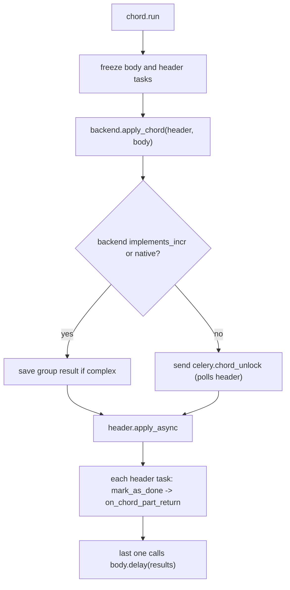

## Overview

A chord is a barrier: a header group runs in parallel, and a body task runs once with the list of all header results. The hard part is not sending the messages (a chord is mostly a group, see [[Canvas: Signatures, Chains and Groups]]) but knowing, from inside whichever worker finishes last, that every header member is done. Celery has two answers, chosen by the result backend: a polling task for backends without native support, and a counter updated by each finishing header task for backends that can increment atomically. This page follows the chord from `run` through both completion strategies and then through the failure paths.

Sources: [celery/canvas.py:1971-1996](repo://celery/canvas.py#L1971-L1996), [celery/backends/base.py:826-868](repo://celery/backends/base.py#L826-L868)

Sources: [celery/canvas.py:2226-2287](repo://celery/canvas.py#L2226-L2287), [celery/backends/base.py:864-867](repo://celery/backends/base.py#L864-L867)

## Building and starting a chord

`chord(header, body)` stores the header as a `group` and the body as a signature in the kwargs of a signature named `celery.chord`. Its `__or__` attaches a following task to the body (`chord | task` becomes a chord whose body is `body | task`), `freeze` freezes the header first and then the body, and links the body result's first parentless node to the header result so that `body_result.parent` is the header's `GroupResult`. A chord also appears implicitly: `group | task` inside a chain is upgraded by `prepare_steps`.

Sources: [celery/canvas.py:2064-2125](repo://celery/canvas.py#L2064-L2125), [celery/canvas.py:1120-1235](repo://celery/canvas.py#L1120-L1235)

`apply_async` clones the body with the call's options, builds or clones the header group, runs eagerly under `task_always_eager` (header applied locally, then the body applied with the joined values), and otherwise calls `run`. `run` does the following:

1. Takes the header's `task_id` as the group id and the body's `root_id`.
2. Freezes the body with a new or given task id and the group id, so the body result id is known in advance.
3. Removes `chain`, `chord` and `task_id` from the options so they do not leak into the header tasks (the comments cite issue #3771 and nested chords).
4. Freezes the header tasks with `chord=body`, giving each header message the body signature in its `chord` field, and calls `backend.apply_chord(header_result_args, body, interval, countdown, max_retries)` when the header is non-empty.
5. Calls `header.apply_async`, and sets `bodyres.parent = header_result`.
6. If the header is empty, nothing will ever trigger the body, so `run` calls `body.delay([])` itself.

Sources: [celery/canvas.py:2153-2178](repo://celery/canvas.py#L2153-L2178), [celery/canvas.py:2226-2287](repo://celery/canvas.py#L2226-L2287)

`_chord._descend` counts how many completions a header contributes, which matters for nested structures: each simple signature counts as one, a group counts the sum of its members, a chain counts only its last non-empty element, and a nested chord counts its body. `group._apply_tasks` accumulates this while publishing and, on the last member of a chord header, calls `backend.set_chord_size(group_id, chord_size)`. The Redis backend stores that size under the group's `.s` key; backends that do not override `set_chord_size` ignore it.

Sources: [celery/canvas.py:2190-2224](repo://celery/canvas.py#L2190-L2224), [celery/canvas.py:1790-1813](repo://celery/canvas.py#L1790-L1813)

## Strategy 1: polling with chord_unlock

The base `Backend.apply_chord` checks that chords are allowed (`ensure_chords_allowed`: the `DisabledBackend` and RPC backend raise), rebuilds the header `GroupResult` and calls `fallback_chord_unlock`. That sends the built-in `celery.chord_unlock` task with `(group_id, body)`, the header results as tuples, a `countdown` of 1 second, and the body's queue and priority (so the unlock task runs where the body will run).

Sources: [celery/backends/base.py:838-867](repo://celery/backends/base.py#L838-L867), [celery/backends/rpc.py:214-215](repo://celery/backends/rpc.py#L214-L215), [celery/backends/base.py:1271-1272](repo://celery/backends/base.py#L1271-L1272)

`celery.chord_unlock` is an ordinary bound task with `max_retries=None` and `default_retry_delay` from `result_chord_retry_interval`. Each run rebuilds the `GroupResult` and checks `deps.ready()`; if not ready (or the check raises) it retries itself after `interval`. Once ready it joins the results (`join_native` if supported) under `allow_join_result`, with `result_chord_join_timeout`, and calls `callback.delay(ret)`. A join failure or a callback failure becomes a `ChordError` handed to `backend.chord_error_from_stack`.

Sources: [celery/app/builtins.py:37-99](repo://celery/app/builtins.py#L37-L99)

This strategy needs no support from the store beyond reading results, at the cost of one polling task per chord.

Sources: [celery/app/builtins.py:37-58](repo://celery/app/builtins.py#L37-L58)

## Strategy 2: counting with on_chord_part_return

When a header task finishes, `mark_as_done`, `mark_as_failure` and `mark_as_revoked` call `on_chord_part_return(request, state, result)` if the request carries a chord. The base implementation does nothing; key/value backends with `implements_incr` replace `apply_chord` with a version that saves the header `GroupResult` and use this counter path.

Sources: [celery/backends/base.py:176-187](repo://celery/backends/base.py#L176-L187), [celery/backends/base.py:1183-1190](repo://celery/backends/base.py#L1183-L1190), [celery/backends/base.py:971-978](repo://celery/backends/base.py#L971-L978)

In the generic key/value version, the finishing task restores the saved group (a failure to restore becomes a `ChordError`), increments the chord key, and compares it with `request.chord['chord_size']` (falling back to the number of dependencies). When the count equals the size, it joins the group results with `propagate=True` and calls `callback.delay(ret)`; errors become `ChordError` with the cause attached. In `finally` it deletes the group result and the counter. Otherwise it refreshes the counter's expiry. A counter above the size logs a warning.

Sources: [celery/backends/base.py:1188-1257](repo://celery/backends/base.py#L1188-L1257)

The Redis backend uses its own more efficient scheme (see [[Result Backend Catalogue]]). Each finishing task pushes `[1, task_id, state, result]` into `<group>.j` (a sorted set by group index, or a list) and, in the same pipeline, reads the count and the `.t` and `.s` keys. The chord is complete when the count equals the stored size plus the `.t` adjustment. It then either restores a complex saved header and joins it, or reads the stashed results straight from the set. `Task.add_to_chord` raises that adjustment, which is why it is Redis-only. Failed dependencies raise a `ChordError` while unpacking.

Sources: [celery/backends/redis.py:554-592](repo://celery/backends/redis.py#L554-L592), [celery/backends/redis.py:593-686](repo://celery/backends/redis.py#L593-L686), [celery/app/task.py:1097-1119](repo://celery/app/task.py#L1097-L1119)

## When part of a chord fails

If a header task fails, its `mark_as_failure` still calls `on_chord_part_return`, so the counter or join sees the failure; joining with `propagate=True` raises, and the result becomes a chord error. `chord_error_from_stack(callback, exc)` is the common sink. It finds the backend for the callback's task, then:

1. For a group body, it calls `_handle_group_chord_error`: freezes the group, revokes every member, calls each member's errbacks (continuing past errback failures), marks each member failed with the original exception (taken from the `ChordError`'s `__cause__`), and marks the group itself failed. Any failure while doing so falls back to failing the whole callback.
2. Otherwise it ensures the callback has an id, builds a fake request carrying the callback's errbacks (`link_error`) so new-style errbacks still run, calls them, and finally calls `fail_from_current_stack`, which stores a FAILURE for the callback's id, so `get()` on the body raises instead of hanging.

Sources: [celery/backends/base.py:68-79](repo://celery/backends/base.py#L68-L79), [celery/backends/base.py:325-358](repo://celery/backends/base.py#L325-L358), [celery/backends/base.py:360-426](repo://celery/backends/base.py#L360-L426), [celery/backends/base.py:428-445](repo://celery/backends/base.py#L428-L445)

## Failures inside chains

A task that is in the middle of a chain has no one waiting on its own result: what a later step or an enclosing chord waits for is the last chain element's result. So `mark_as_failure` walks the `chain` field of the failed request (a deque of signature dictionaries) and, for each element, builds a `Context` carrying its options; stores the failure under the element's `task_id` if it has one and the state is in `PROPAGATE_STATES`; and calls `on_chord_part_return` if the element is itself a chord member. That keeps the last chain element, which controls completion of the chain, from staying pending.

Sources: [celery/backends/base.py:188-250](repo://celery/backends/base.py#L188-L250)

The most recent fix (issue #9674) extends this to chord steps. A chord step in a chain completes only when its body does, and the result a later step or an outer chord polls is the body's id, not the chord's own. Previously a failure was stored only under the chord step's id, so the outer chord waited forever (and `chord_unlock` retried forever). Now, when a chain element's `subtask_type` is `chord`, `mark_as_failure` appends the chord's `body` to the work queue, so the same loop marks the body (and any chain in the body) failed too. Errbacks fire last, after the walk.

Sources: [celery/backends/base.py:233-252](repo://celery/backends/base.py#L233-L252)

> [!NOTE]
> Because the loop uses a deque and the body is appended while iterating, a chord nested inside a chord body is handled by the same code with no recursion.

Sources: [celery/backends/base.py:213-252](repo://celery/backends/base.py#L213-L252)
