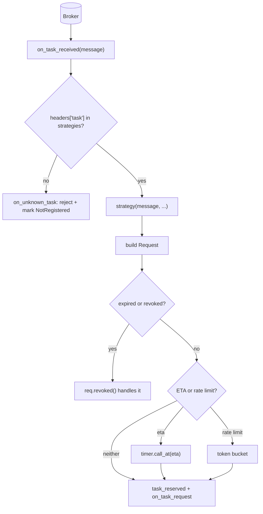

## Overview

The `Consumer` is the worker component that talks to the broker. It owns the connection, consumes the task queues, and turns each delivered message into a `Request` that it hands to the worker's `process_task` callback, which sends it to the pool (see [[Task Execution, Tracing and Acknowledgement]]). It is built from its own blueprint of bootsteps in the same framework as the worker (see [[Worker Architecture and Bootsteps]]), restarts that blueprint when the broker connection is lost, and applies ETA, rate-limit and prefetch rules before a task may run.

Sources: [celery/worker/consumer/consumer.py:145-190](repo://celery/worker/consumer/consumer.py#L145-L190), [celery/worker/components.py:221-246](repo://celery/worker/components.py#L221-L246)

Sources: [celery/worker/consumer/consumer.py:723-786](repo://celery/worker/consumer/consumer.py#L723-L786), [celery/worker/strategy.py:131-209](repo://celery/worker/strategy.py#L131-L209)

## The consumer blueprint

`Consumer.Blueprint` lists ten default steps. `Consumer.__init__` stores the connection info and error classes, a restart-frequency guard (`restart_state(maxR=5, maxT=1)`), a rate-limit token bucket per task name, the prefetch settings and the choice of loop (`asynloop` with a hub, else `synloop`), then applies the blueprint with the user's `app.steps['consumer']`.

Sources: [celery/worker/consumer/consumer.py:176-189](repo://celery/worker/consumer/consumer.py#L176-L189), [celery/worker/consumer/consumer.py:191-255](repo://celery/worker/consumer/consumer.py#L191-L255)

| Step | What it does |
| --- | --- |
| `Connection` | Opens the broker connection with `c.connect()`; on shutdown closes it and sets `c.connection = None` so the green control thread exits |
| `Mingle` | At start and on every consumer restart, asks neighbour workers (`inspect.hello`) for their logical clock and revoked task ids; only on `amqp`, `redis` and `gcpubsub` transports |
| `Events` | Creates the event dispatcher; flushes events buffered while the connection was down |
| `Gossip` | Consumes events from other workers to keep the logical clock current; `amqp` and `redis` only |
| `Heart` | Sends a `worker-heartbeat` event every n seconds (not the AMQP-level heartbeat) |
| `Control` | Starts the remote-control mailbox; see [[Remote Control: Inspect and Control]] |
| `Tasks` | Builds the task consumer, sets QoS and prefetch, and fills the strategies table |
| `DelayedDelivery` | Declares native delayed-delivery exchanges and binds queues; included only if quorum queues are detected |
| `Evloop` | `last = True`; runs the event loop |
| `Agent` | Starts a `cell` actor agent if `worker_agent` is set |

Sources: [celery/worker/consumer/connection.py:13-45](repo://celery/worker/consumer/connection.py#L13-L45), [celery/worker/consumer/mingle.py:13-56](repo://celery/worker/consumer/mingle.py#L13-L56), [celery/worker/consumer/events.py:15-55](repo://celery/worker/consumer/events.py#L15-L55), [celery/worker/consumer/gossip.py:23-34](repo://celery/worker/consumer/gossip.py#L23-L34), [celery/worker/consumer/heart.py:10-36](repo://celery/worker/consumer/heart.py#L10-L36), [celery/worker/consumer/delayed_delivery.py:39-64](repo://celery/worker/consumer/delayed_delivery.py#L39-L64), [celery/worker/consumer/agent.py:9-21](repo://celery/worker/consumer/agent.py#L9-L21)

The events steps feed [[Events and Monitoring]].

Sources: [celery/worker/consumer/events.py:35-52](repo://celery/worker/consumer/events.py#L35-L52)

## Starting the task consumer

The `Tasks` step's `start` calls `update_strategies`, which for every registered task stores `task.start_strategy(app, consumer)` in `consumer.strategies` and replaces `task.__trace__` with a freshly built tracer. It then sets the initial QoS with `basic_qos` (global or per-consumer depending on `qos_global`, which depends on the broker and queue type), creates `app.amqp.TaskConsumer` with `on_decode_error`, and wraps the prefetch value in a `QoS` object capped by `worker_eta_task_limit`.

Sources: [celery/worker/consumer/tasks.py:25-58](repo://celery/worker/consumer/tasks.py#L25-L58), [celery/worker/consumer/consumer.py:716-721](repo://celery/worker/consumer/consumer.py#L716-L721)

With `worker_disable_prefetch` on a Redis broker, `Tasks` patches the channel's `can_consume` so no more messages are fetched while the number of reserved requests is at the limit (the autoscaler's `max_concurrency` or the pool size). For other brokers it logs a warning and ignores the setting.

Sources: [celery/worker/consumer/tasks.py:59-83](repo://celery/worker/consumer/tasks.py#L59-L83)

## The connection-restart loop

`Consumer.start` loops while the blueprint is not stopping. On each pass it checks for a pending shutdown, steps the restart-frequency guard (logging "Frequent restarts detected" and sleeping a second if exceeded), and starts the blueprint. A connection error (plus channel errors if `broker_channel_error_retry` is on) is handled this way: if the matching retry setting (`broker_connection_retry_on_startup` for a failure at startup, otherwise `broker_connection_retry`) is false, the worker logs and raises `WorkerShutdown(1)`; "too many open files" raises `WorkerTerminate(1)`; otherwise it reports the error, calls `on_close` and restarts the blueprint.

Sources: [celery/worker/consumer/consumer.py:366-415](repo://celery/worker/consumer/consumer.py#L366-L415)

After a connection is lost, `on_connection_error_after_connected` collects and closes the broken connection, and with `worker_cancel_long_running_tasks_on_connection_loss` cancels active `acks_late` requests that have not been acknowledged (those messages will be redelivered). With `worker_enable_prefetch_count_reduction` it temporarily lowers the prefetch count by the number of active tasks so the worker does not over-fetch, and restores it gradually as tasks finish; this is skipped when per-consumer QoS is in effect, because updates would not reach the running consumer. `on_close` clears rate-limit buckets and the semaphore, and keeps only still-active requests as reserved.

Sources: [celery/worker/consumer/consumer.py:419-492](repo://celery/worker/consumer/consumer.py#L419-L492), [celery/worker/consumer/consumer.py:532-547](repo://celery/worker/consumer/consumer.py#L532-L547)

## From message to strategy

`create_task_handler` returns `on_task_received`, the callback the loop attaches to the task consumer. For each message it reads the task name from `message.headers['task']` (protocol 2); if the header is missing it decodes the body and reads `payload['task']` (protocol 1); a message that is neither goes to `on_unknown_message`. It then looks up `strategies[name]`.

Sources: [celery/worker/consumer/consumer.py:723-751](repo://celery/worker/consumer/consumer.py#L723-L751)

With a strategy found, it builds two promises: one that acknowledges the message and one that rejects it, both calling `call_soon_ack` so the broker frame is written immediately rather than at the next loop iteration, and both restoring the prefetch count on error. The strategy is called with the message, payload, those two callbacks and the `on_task_message` callbacks. `InvalidTaskError` or `ContentDisallowed` leads to `on_invalid_task`; `DecodeError` to `on_decode_error`.

Sources: [celery/worker/consumer/consumer.py:752-786](repo://celery/worker/consumer/consumer.py#L752-L786), [celery/worker/consumer/consumer.py:264-286](repo://celery/worker/consumer/consumer.py#L264-L286)

Bad messages are handled without crashing the loop:

| Case | Handler | Effect |
| --- | --- | --- |
| Not a task message | `on_unknown_message` | Logs, rejects, sends `task_rejected` |
| Task name not registered | `on_unknown_task` | Logs, rejects, marks the task `NotRegistered` in the backend, sends a `task-failed` event and `task_unknown` |
| Invalid task or disallowed content type | `on_invalid_task` | Logs, rejects, sends `task_rejected` |
| Body cannot be decoded | `on_decode_error` | Logs critically and acknowledges, so the message does not loop |

Sources: [celery/worker/consumer/consumer.py:516-530](repo://celery/worker/consumer/consumer.py#L516-L530), [celery/worker/consumer/consumer.py:672-714](repo://celery/worker/consumer/consumer.py#L672-L714)

## The default strategy

`Task.Strategy` is `'celery.worker.strategy:default'`. `default(task, app, consumer)` runs once per task at `update_strategies`, precomputing everything it can: the event dispatcher, the `Request` class (via `create_request_cls`), the revoked set, and the rate-limit bucket getter. It returns `task_message_handler`, which for each message:

1. Converts the message to a protocol-2 body and headers (`proto1_to_proto2` or `hybrid_to_proto2` for older formats; for v2 the body stays undecoded).
2. Creates the request, logging "Received task" at INFO level.
3. Returns early if the request has expired or its id is in the revoked set and `req.revoked()` confirms it.
4. Sends `task_received` and, if the task sends events, a `task-received` event.
5. Converts a non-null ETA to a timestamp; an unconvertible ETA rejects the message without requeue.
6. Routes by gate: ETA plus rate limit goes to `call_at(eta, limit_post_eta)`; ETA alone to `call_at(eta, apply_eta_task)`, both incrementing the QoS prefetch so ETA tasks do not hold up other messages; a rate limit alone goes to `_limit_task`; otherwise `task_reserved(req)`, the message callbacks, and `handle(req)`, which is `process_task` on the worker.

Sources: [celery/worker/strategy.py:80-209](repo://celery/worker/strategy.py#L80-L209), [celery/app/task.py:520-522](repo://celery/app/task.py#L520-L522)

Rate limits use a `TokenBucket` per task name from `reset_rate_limits` (limit from the task's `rate_limit`, capacity 1). `_limit_task` queues the request in the bucket and `_schedule_bucket_request` releases requests while tokens last; otherwise it re-queues at the head to keep order and sets a timer for when tokens will be available. `apply_eta_task` marks the task reserved, passes it on and decrements the QoS.

Sources: [celery/worker/consumer/consumer.py:296-364](repo://celery/worker/consumer/consumer.py#L296-L364), [celery/worker/consumer/consumer.py:659-663](repo://celery/worker/consumer/consumer.py#L659-L663)

Worker-global bookkeeping lives in `celery.worker.state`: `task_reserved` records a request in `requests` and `reserved_requests`, `task_accepted` (when a pool process starts it) adds it to `active_requests` and counts it, and `task_ready` removes it everywhere and records the id in `successful_requests` if it succeeded. `maybe_shutdown` raises `WorkerTerminate` or `WorkerShutdown` when the signal handlers have set the flags.

Sources: [celery/worker/state.py:49-130](repo://celery/worker/state.py#L49-L130)

## The event loops

`Evloop`, always last, calls `c.loop(*c.loop_args())` after replacing the QoS mutex with a dummy lock.

Sources: [celery/worker/consumer/consumer.py:857-872](repo://celery/worker/consumer/consumer.py#L857-L872), [celery/worker/consumer/consumer.py:511-514](repo://celery/worker/consumer/consumer.py#L511-L514)

`asynloop` is the non-blocking loop used when the worker has a hub. It enables AMQP heartbeats via a repeating timer, sets `consumer.on_message = on_task_received`, registers the controller and consumer with the hub, starts consuming and calls `on_ready`, which fires the worker's ready callback. On the first start it verifies the pool processes started (`WorkerLostError` otherwise), and for AMQP drains pending events once. Each iteration of its loop checks for shutdown, re-raises any heartbeat error, applies QoS changes only when there are no more messages to read (so control commands take priority over task messages), then advances the hub loop. On an exception it resets the hub and clears its timers so stale entries cannot fire against the dead connection after reconnection, then re-raises.

Sources: [celery/worker/loops.py:28-47](repo://celery/worker/loops.py#L28-L47), [celery/worker/loops.py:50-143](repo://celery/worker/loops.py#L50-L143)

`synloop` is the blocking fallback for transports without async support and for the green pools. It consumes, and in each cycle checks heartbeat errors, updates QoS, runs the pending operations queued by `call_soon`, and calls `connection.drain_events(timeout=2.0)`. It resets the hub on error as well. Which pool is in use, and why green pools take this path, is on [[Execution Pools]].

Sources: [celery/worker/loops.py:146-183](repo://celery/worker/loops.py#L146-L183), [celery/worker/consumer/consumer.py:239-241](repo://celery/worker/consumer/consumer.py#L239-L241)
