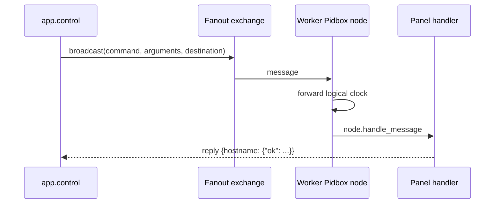

## Overview

Remote control lets you talk to running workers: ask what they are doing (inspect) or change their behaviour (control), without restarting them. The client side is `app.control`, which broadcasts a command message on a fanout exchange; each worker's control step, built on kombu's pidbox, receives it, looks the command up in a registry of functions, runs it against the worker's live state and sends a reply. This page follows a command from `app.control` to the worker's `Panel` and lists the built-in commands by purpose. The `celery inspect`, `celery control` and `celery status` subcommands are thin wrappers over these calls (see [[The celery Command Line]]).

Sources: [celery/app/control.py:426-460](repo://celery/app/control.py#L426-L460), [celery/worker/control.py:39-77](repo://celery/worker/control.py#L39-L77), [celery/worker/pidbox.py:20-55](repo://celery/worker/pidbox.py#L20-L55)

Sources: [celery/app/control.py:755-790](repo://celery/app/control.py#L755-L790), [celery/worker/pidbox.py:37-53](repo://celery/worker/pidbox.py#L37-L53)

## The client: Control and Inspect

`Control(app)` builds a kombu `Mailbox` on the `control_exchange` as a **fanout** exchange, using the app's `accept_content`, the task serializer and the producer pool, with queue options from `control_queue_ttl`, `control_queue_expires`, `control_queue_exclusive` and `control_queue_durable`. It refuses to start if the queue is configured both durable and exclusive, since exclusive queues are auto-deleted.

Sources: [celery/app/control.py:426-456](repo://celery/app/control.py#L426-L456)

Everything goes through `broadcast(command, arguments, destination, connection, reply, timeout, limit, callback, pattern, matcher)`. It acquires a connection and calls the mailbox's `_broadcast`; `destination` restricts the message to named workers, `reply=True` waits up to `timeout` seconds (default 1.0) and `limit` caps the number of replies, and `callback` is called on each reply as it arrives. The named methods on `Control` are broadcasts with fixed arguments:

| Method | Command | Notes |
| --- | --- | --- |
| `revoke`, `terminate` | `revoke` | `terminate` is `revoke` with termination and a signal |
| `revoke_by_stamped_headers` | `revoke_by_stamped_headers` | Revokes by stamp header values (see [[Canvas: Signatures, Chains and Groups]]) |
| `ping` | `ping` | Waits for replies from all or the destination workers |
| `rate_limit`, `time_limit` | same | Per task name |
| `add_consumer`, `cancel_consumer` | same | Start or stop consuming from a queue |
| `enable_events`, `disable_events` | same | Toggle the event dispatcher |
| `pool_grow`, `pool_shrink`, `pool_restart`, `autoscale` | same | Resize or restart the pool |
| `shutdown`, `heartbeat`, `election` | same | Worker lifecycle and gossip |
| `purge` | not a broadcast | Deletes all waiting task messages from the broker queues |

Sources: [celery/app/control.py:462-754](repo://celery/app/control.py#L462-L754), [celery/app/control.py:755-790](repo://celery/app/control.py#L755-L790)

`Inspect` is a read-only proxy created by `app.control.inspect(destination, timeout, callback, connection, limit, pattern, matcher)`. Each method (`active`, `scheduled`, `reserved`, `stats`, `revoked`, `registered`, `ping`, `active_queues`, `query_task`, `conf`, `clock`, `report`, `hello`, `memsample`, `memdump`, `objgraph`) calls `_request`, which broadcasts with `reply=True`. `_prepare` flattens the list of per-node replies into one dict `{hostname: reply}` (warning with `DuplicateNodenameWarning` if two nodes share a name), returns just that node's reply when `destination` is a single name, and applies the `pattern` filter otherwise.

Sources: [celery/app/control.py:38-125](repo://celery/app/control.py#L38-L125), [celery/app/control.py:138-420](repo://celery/app/control.py#L138-L420)

## The worker side: Pidbox and Panel

The consumer's `Control` step is included only if `worker_enable_remote_control` is on and the transport supports fanout exchanges; it requires the `Tasks` step and delegates `start`, `stop` and `shutdown` to a `Pidbox` (or `gPidbox` when the pool is green, see [[Execution Pools]]). The `Pidbox` creates a mailbox node named for the worker's hostname, with `Panel.data` as its handlers and a state object carrying the app, hostname and consumer.

Sources: [celery/worker/consumer/control.py:18-33](repo://celery/worker/consumer/control.py#L18-L33), [celery/worker/pidbox.py:20-35](repo://celery/worker/pidbox.py#L20-L35)

`Pidbox.on_message` forwards the app's logical clock (clients have no valid clock, so each command ticks it), then lets the node handle the message. An unknown command logs "No such control command"; any other exception logs the error and calls `reset`, which restarts the pidbox consumer. `start` opens a channel and listens with that callback; `stop` cancels the consumer and closes the channel. The green variant runs a loop in a greenlet that drains events with a one-second timeout, and re-creates its consumer on reset.

Sources: [celery/worker/pidbox.py:37-75](repo://celery/worker/pidbox.py#L37-L75), [celery/worker/pidbox.py:75-126](repo://celery/worker/pidbox.py#L75-L126)

Commands live in `Panel`, a class-level registry. The decorators `@control_command(...)` and `@inspect_command(...)` call `Panel.register`, which stores the function under its name (and optional `alias`) in `Panel.data` and its metadata (type `control` or `inspect`, visibility, default timeout, help text from the docstring's first line, a CLI `signature`, positional `args` and `variadic`) in `Panel.meta`. The CLI uses the metadata to build its argument parsing. A command is a function `fn(state, **arguments)` returning `ok(value)`, which is `{'ok': value}`, or `nok(value)`, which is `{'error': value}`.

Sources: [celery/worker/control.py:31-77](repo://celery/worker/control.py#L31-L77)

## Built-in commands

**Task state.** `revoke` records the ids in the worker's revoked set and tries to mark each `REVOKED` in the backend (failure to do so is only logged); with `terminate` it finds the active requests with those ids and calls `request.terminate` on the pool using the given signal (default TERM), answering "terminate: tasks unknown" if none are active. Revoked ids are checked when a message arrives and before execution, see [[The Consumer: Receiving Tasks]] and [[Task Execution, Tracing and Acknowledgement]]; neighbours exchange them at start-up through `hello` (Mingle). `revoke_by_stamped_headers` does the same keyed by stamp.

Sources: [celery/worker/control.py:138-157](repo://celery/worker/control.py#L138-L157), [celery/worker/control.py:214-247](repo://celery/worker/control.py#L214-L247), [celery/worker/control.py:382-398](repo://celery/worker/control.py#L382-L398)

**Per-task settings.** `rate_limit` validates the rate string, sets the task's `rate_limit` and calls `consumer.reset_rate_limits()`; an empty value disables it. `time_limit` sets `soft_time_limit` and `time_limit` on the task class. Unknown tasks reply with an error.

Sources: [celery/worker/control.py:259-319](repo://celery/worker/control.py#L259-L319)

**Pool and consumers.** `pool_grow` and `pool_shrink` change the pool and the prefetch count, but reply with an error if the autoscaler is on; `autoscale` updates the autoscaler's max and min and raises if autoscaling is off; `pool_restart` reloads task modules but only if `worker_pool_restarts` is set; `shutdown` raises `WorkerShutdown`. `add_consumer` and `cancel_consumer` schedule `add_task_queue` and `cancel_task_queue` on the consumer, which add or remove the queue from the consumer set.

Sources: [celery/worker/control.py:545-596](repo://celery/worker/control.py#L545-L596), [celery/worker/control.py:610-630](repo://celery/worker/control.py#L610-L630), [celery/worker/consumer/consumer.py:632-657](repo://celery/worker/consumer/consumer.py#L632-L657)

**Introspection and events.** `ping` answers `ok('pong')`; `stats` returns the worker's `info()`; `active`, `reserved`, `scheduled` and `revoked` read the global request sets and the timer; `registered` lists task names; `query_task` reports state by id; `active_queues` lists consumed queues; `conf` returns the configuration; `report` the bug-report text; `clock` the logical clock. `enable_events` and `disable_events` turn the event dispatcher on and off, and `heartbeat` sends a heartbeat immediately (used by `EventReceiver.capture` to prompt workers; see [[Events and Monitoring]]).

Sources: [celery/worker/control.py:80-135](repo://celery/worker/control.py#L80-L135), [celery/worker/control.py:326-380](repo://celery/worker/control.py#L326-L380), [celery/worker/control.py:400-495](repo://celery/worker/control.py#L400-L495), [celery/worker/control.py:630-637](repo://celery/worker/control.py#L630-L637)

**Debugging.** `memsample`, `memdump` and `objgraph` are marked as debugging aids; the last two are excluded from coverage.

Sources: [celery/worker/control.py:496-543](repo://celery/worker/control.py#L496-L543)
