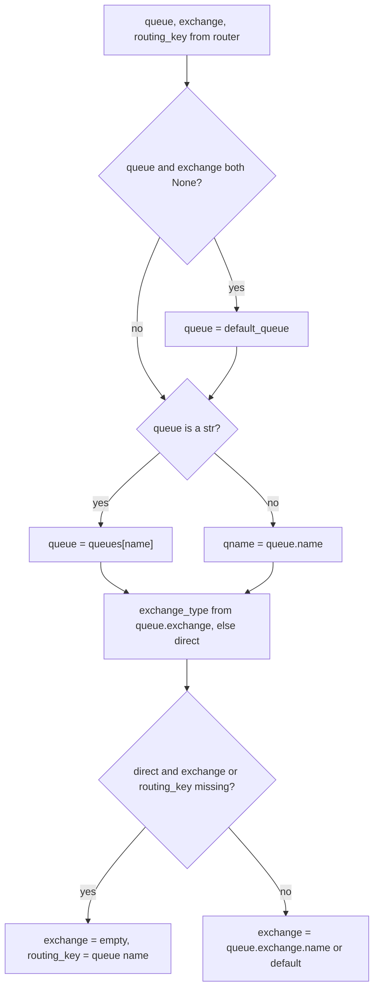

## Overview

Before a task message is published, Celery must decide which queue it goes to, and through which exchange and routing key. Two objects make that decision: the `Queues` registry, which knows every declared queue and which of them a worker consumes from, and the `Router`, which applies the `task_routes` setting to a task name and its options. Both are created lazily by the `AMQP` helper on the app. `send_task` calls the router, and the publisher then turns the result into a concrete exchange and routing key. The message itself is described on [[Calling Tasks: apply_async and send_task]].

Sources: [celery/app/amqp.py:608-642](repo://celery/app/amqp.py#L608-L642), [celery/app/base.py:930-933](repo://celery/app/base.py#L930-L933)

## The Queues registry

`Queues` is a `dict` from queue name to a kombu `Queue`. It is built by `AMQP.Queues` from the `task_queues` setting, using defaults from configuration: `task_create_missing_queues`, `task_create_missing_queue_type`, `task_create_missing_queue_exchange_type`, `task_queue_max_priority` and `task_default_routing_key`. If no queues are configured but `task_default_queue` is set, that queue is created with the default exchange (as a quorum queue when `task_default_queue_type` is `quorum`).

Sources: [celery/app/amqp.py:273-306](repo://celery/app/amqp.py#L273-L306), [celery/app/amqp.py:612-615](repo://celery/app/amqp.py#L612-L615)

Adding a queue fills in anything it lacks: `_add` gives a queue with no exchange (or an empty exchange name) the default exchange, gives it the default routing key if it has none, and applies `x-max-priority` when `max_priority` is set and the queue does not set one already. `add_compat` accepts dict declarations, treating `binding_key` as the old name for `routing_key` and using the queue name when no key is given. Queues with an `alias` can be looked up by that alias.

Sources: [celery/app/amqp.py:92-146](repo://celery/app/amqp.py#L92-L146)

When a name is not found, `__missing__` creates it if `create_missing` is on, with an exchange of the same name (or the configured missing-queue exchange type), a routing key equal to the queue name and, for `quorum`, an `x-queue-type` argument; an invalid queue type raises `ValueError`. With `create_missing` off it raises `KeyError`.

Sources: [celery/app/amqp.py:99-102](repo://celery/app/amqp.py#L99-L102), [celery/app/amqp.py:201-216](repo://celery/app/amqp.py#L201-L216)

A second concern is which queues a worker consumes. `select(include)` sets a subset (what `-Q` does), `deselect(exclude)` removes names (`--exclude-queues`), `select_add` adds a queue that stays active even when a subset was selected, and `consume_from` returns the selected subset or the default set. Queues outside the subset are still used for routing. The worker applies these in `setup_queues` and adds a per-worker direct queue when `worker_direct` is set; see [[Worker Architecture and Bootsteps]].

Sources: [celery/app/amqp.py:159-199](repo://celery/app/amqp.py#L159-L199), [celery/app/amqp.py:218-222](repo://celery/app/amqp.py#L218-L222), [celery/worker/worker.py:167-182](repo://celery/worker/worker.py#L167-L182)

`AMQP.TaskConsumer` builds a consumer for `queues` or, by default, every queue in `consume_from`, accepting the configured `accept_content`.

Sources: [celery/app/amqp.py:317-324](repo://celery/app/amqp.py#L317-L324)

## The Router

`AMQP.Router` returns a `Router(routes, queues, create_missing, app)`, where `routes` is `task_routes` expanded by `prepare`. The router is rebuilt when `task_routes` changes (`_handle_conf_update` flushes the cached table and creates a new router).

Sources: [celery/app/amqp.py:308-315](repo://celery/app/amqp.py#L308-L315), [celery/app/amqp.py:659-663](repo://celery/app/amqp.py#L659-L663)

`prepare` accepts a single route or a list, and turns each entry into a callable:

| Entry in `task_routes` | Becomes |
| --- | --- |
| A mapping, list or tuple | `MapRoute` |
| A string | A lazily imported router class or function (instantiated if it has `route_for_task`, the pre-4.0 style) |
| Anything else | Used as is, called as `router(name, args, kwargs, options, task=task_type)` |

Sources: [celery/app/routes.py:98-136](repo://celery/app/routes.py#L98-L136)

`MapRoute` keeps exact names in a dict and glob-style names (containing `*`) or compiled regular expressions in an ordered list of patterns. A lookup tries the exact name first and then the patterns in order; a route value that is not a dict-like is treated as a queue name, so `{'tasks.add': 'math'}` routes to the `math` queue.

Sources: [celery/app/routes.py:26-53](repo://celery/app/routes.py#L26-L53)

`Router.route(options, name, args, kwargs, task_type)` does this, in order:

1. `expand_destination(options)` turns a `queue` option into a `Queue`: a string is looked up in the `Queues` registry (raising `QueueNotFound` if it is missing from `task_queues`), and a `Queue` instance is used as is. A bare string option means a queue name.
2. If there are routes, `lookup_route` asks each in order and takes the first non-`None` answer, expanding its destination and merging it with the options with `lpmerge`, so options passed in the call take precedence over the route.
3. If no queue was selected, the `task_default_queue` is expanded and merged under the options.

Sources: [celery/app/routes.py:56-112](repo://celery/app/routes.py#L56-L112)

Because the call's options are merged last, an explicit `queue=` in `apply_async` wins over `task_routes`, and a route can set only `routing_key` while borrowing the exchange from a configured queue.

Sources: [celery/app/routes.py:66-95](repo://celery/app/routes.py#L66-L95)

## From route to exchange and routing key

The routed options reach `send_task_message` (see [[Calling Tasks: apply_async and send_task]]), which settles the final destination:

Sources: [celery/app/amqp.py:506-553](repo://celery/app/amqp.py#L506-L553)

For a direct exchange without both an exchange and a routing key, the message goes to the anonymous (empty-name) exchange with the queue name as routing key. Otherwise a missing exchange comes from the queue's exchange, then `task_default_exchange`, and the routing key from the option, the queue's key, or `task_default_routing_key`. `delivery_mode` defaults to the queue's exchange setting, then `task_default_delivery_mode`. Unless the caller passed `declare`, the queue is declared with the publish, except for `Broadcast` queues.

Sources: [celery/app/amqp.py:530-555](repo://celery/app/amqp.py#L530-L555)

> [!NOTE]
> When `eta` or `countdown` is used on a quorum-queue broker with a non-direct exchange, `send_task` removes `queue` and replaces the exchange and routing key with the `celery_delayed_27` topic exchange, so the routing described here is bypassed for the delay.

Sources: [celery/app/base.py:934-966](repo://celery/app/base.py#L934-L966)
