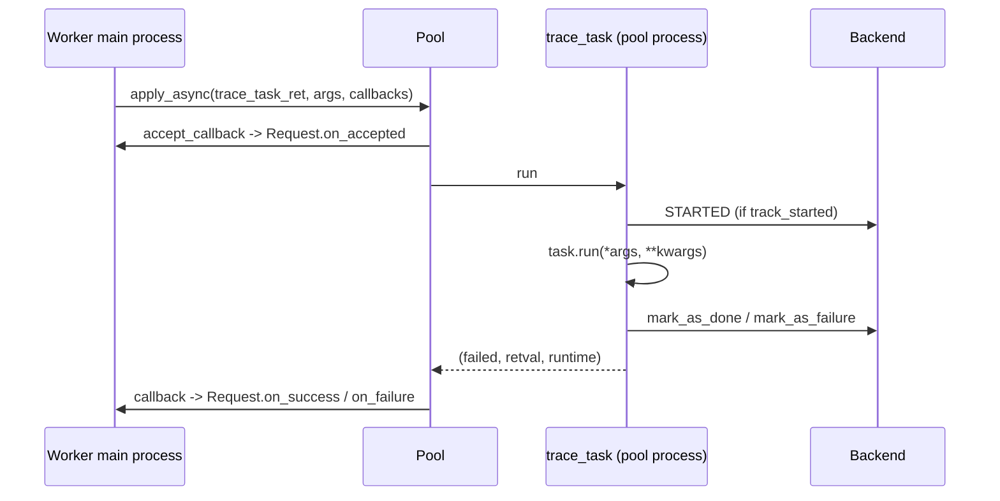

## Overview

Once the consumer's strategy has built a `Request` (see [[The Consumer: Receiving Tasks]]), three things must happen: the task body runs in a pool process, its outcome is recorded in the result backend, and the broker message is acknowledged at the right moment. The `Request` object lives in the worker's main process and manages the message, the pool call and the callbacks. The tracer, built by `build_tracer`, runs inside the pool process and is the state machine around the task function. This page follows a request through both, then the rules that decide acknowledgement. Which pool runs the call is on [[Execution Pools]], and how results are stored is on [[Results, AsyncResult and the Result Backend]].

Sources: [celery/worker/request.py:67-90](repo://celery/worker/request.py#L67-L90), [celery/app/trace.py:344-373](repo://celery/app/trace.py#L344-L373)

Sources: [celery/worker/request.py:341-372](repo://celery/worker/request.py#L341-L372), [celery/worker/request.py:515-527](repo://celery/worker/request.py#L515-L527), [celery/app/trace.py:735-754](repo://celery/app/trace.py#L735-L754)

## Handing a request to the pool

The worker's `process_task` calls `req.execute_using_pool(pool)`. If the request is revoked it raises `TaskRevokedError` (the worker then releases the semaphore slot). Otherwise it picks the trace function: `fast_trace_task` when `app.use_fast_trace_task` is set, which `setup_worker_optimizations` does at worker start, else `trace_task_ret`. It calls `pool.apply_async` with the task type, id, request dictionary, still-encoded body, content type and encoding, plus four callbacks and the timeouts:

| Pool argument | Handler | Called when |
| --- | --- | --- |
| `accept_callback` | `Request.on_accepted` | A pool process picks the job up |
| `callback` | `Request.on_success` | The pool returns a result tuple (success or handled failure) |
| `error_callback` | `Request.on_failure` | The job fails outside the tracer, for example the process died |
| `timeout_callback` | `Request.on_timeout` | A soft or hard time limit is reached |

Sources: [celery/worker/request.py:341-372](repo://celery/worker/request.py#L341-L372), [celery/worker/worker.py:223-232](repo://celery/worker/worker.py#L223-L232)

Time limits come from the message's `timelimit` header, falling back to the task's `time_limit` and `soft_time_limit`. `create_request_cls` builds a per-task `Request` subclass in which these are captured as constants, as an optimization.

Sources: [celery/worker/request.py:818-874](repo://celery/worker/request.py#L818-L874)

The pool process then calls `trace_task_ret` (or `fast_trace_task`), which decodes the body with the configured `accept_content`, merges the embedded callbacks, errbacks, chain and chord into the request dict along with `args`, `kwargs`, `hostname` and `is_eager=False`, runs the tracer and returns `(1, exc_info, runtime)` on failure or `(0, repr_of_result, runtime)` on success. `fast_trace_task` uses the registry saved in `_localized` by `setup_worker_optimizations`, and raises a clear `RuntimeError` if that was never populated (for example in a spawned process on Windows).

Sources: [celery/app/trace.py:735-788](repo://celery/app/trace.py#L735-L788), [celery/app/trace.py:804-831](repo://celery/app/trace.py#L804-L831)

## Accepting, timing out and revoking

`on_accepted` records the pool pid and start time, adds the request to the active set (`task_accepted`) and, unless the task is `acks_late`, acknowledges the message now; it then sends `task-started`. If a terminate was requested before the task started, it is carried out here.

Sources: [celery/worker/request.py:515-527](repo://celery/worker/request.py#L515-L527)

`on_timeout` only logs a warning for a soft limit. For a hard limit it marks the task failed in the backend with `TimeLimitExceeded`, runs `on_failure`, `after_return` (if overridden), sends `task_failure` and `task-failed`, then, for `acks_late` tasks, acknowledges if `acks_on_timeout` is true and otherwise rejects with requeue. Hard-timeout handling is skipped during cold shutdown.

Sources: [celery/worker/request.py:529-594](repo://celery/worker/request.py#L529-L594)

`revoked()` is checked before execution: an expired `expires` adds the id to the revoked set, and a task is revoked if its id is in the set or one of its stamp headers matches a revoked stamp. A revoked or expired request is announced (`task_ready`, a `task-revoked` event, `backend.mark_as_revoked`, an acknowledgement, and the `task_revoked` signal) and never reaches the pool. `terminate` kills the pool job with a signal if it has started, otherwise waits for acceptance; `cancel` does the same but announces `task-cancelled` and a retry state so the message can be redelivered.

Sources: [celery/worker/request.py:408-509](repo://celery/worker/request.py#L408-L509)

## The tracer

`build_tracer(name, task, ...)` pre-computes everything it can (the function to call, the loader hooks, whether `before_start`, `on_success` and `after_return` are overridden, signal receivers, whether deduplication applies) and returns `trace_task`, deliberately long and unrolled for speed. It does the following for each call:

1. Builds a `Context` from the request dict and decides `ignore_result`, `track_started` and whether to publish the result.
2. **Deduplication.** If `worker_deduplicate_successful_tasks` is on (with `acks_late` and a persistent backend) and the message was redelivered, it returns without running when the id was already seen or the backend state is already `SUCCESS`. For a stored success it re-dispatches callbacks and chain only if the stored result has no children, and a dispatch failure becomes `Reject(requeue=True)`.
3. Pushes the task and request, sends `task_prerun`, calls `loader.on_task_init`, and stores `STARTED` with pid and hostname if `track_started`.
4. Runs `before_start` if overridden, then `task.run`.
5. Maps the outcome to a state: `Reject` to `REJECTED`, `Ignore` to `IGNORED`, `Retry` to `RETRY`, any other exception to `FAILURE`.
6. On success it dispatches callbacks and the next chain step first, then calls `backend.mark_as_done`, so `result.children` is populated before the result is stored; an `EncodeError` becomes a failure. Then `on_success` and `task_success`.
7. For states outside the ignore set it calls `after_return`; the `finally` sends `task_postrun`, pops the stack, and runs backend and loader cleanup.

Sources: [celery/app/trace.py:344-415](repo://celery/app/trace.py#L344-L415), [celery/app/trace.py:475-562](repo://celery/app/trace.py#L475-L562), [celery/app/trace.py:563-687](repo://celery/app/trace.py#L563-L687)

Callbacks and the chain are sent by `_dispatch_callbacks_and_chain`: a single callback is applied with the return value as its first argument; several are split into groups and plain signatures, the latter wrapped in one group; and the chain's last element is applied with the remaining chain as `chain=`, which is how [[Canvas: Signatures, Chains and Groups]] move forward. Dispatch is not atomic, and a comment states that a redelivery may re-send callbacks, which is acceptable under at-least-once delivery.

Sources: [celery/app/trace.py:426-474](repo://celery/app/trace.py#L426-L474)

`TraceInfo.handle_error_state` chooses whether to store the error: tasks with ignored results store errors only if `store_errors_even_if_ignored`, eager tasks only if `store_eager_result`, and normal tasks always. `handle_retry` stores the RETRY state, calls `on_retry`, sends `task_retry`, and logs; `handle_failure` makes the exception picklable, calls `backend.mark_as_failure` (which also walks the chain, see [[Chords: Header, Body and Completion]]), then `on_failure`, sends `task_failure`, and logs according to the task's `throws` policy. Failures in the tracer itself send `task_internal_error` and return a failed `TraceInfo`, so the worker never loses the pool process over them.

Sources: [celery/app/trace.py:179-312](repo://celery/app/trace.py#L179-L312), [celery/app/trace.py:689-732](repo://celery/app/trace.py#L689-L732)

## Acknowledgement rules

By default a message is acknowledged when the task is accepted (`on_accepted`), so a crash while it runs loses the task; with `acks_late` acknowledgement waits until the outcome is known. The handlers in `Request` implement the rest:

`on_success` unpacks `(failed, retval, runtime)`. A tracer-reported failure goes to `on_failure(return_ok=True)`; otherwise it calls `task_ready(successful=True)`, acknowledges for `acks_late`, and sends `task-succeeded`.

Sources: [celery/worker/request.py:596-611](repo://celery/worker/request.py#L596-L611)

`on_failure` branches on the exception:

| Exception | Behaviour |
| --- | --- |
| `Terminated` | If not already cancelled or revoked, announces the task revoked, then returns |
| `MemoryError` | Re-raised in the main process |
| `Reject` | Without requeue, records a FAILURE result and sends `task_failure` and `task-failed`; then rejects with `requeue` as given |
| `Ignore` | Acknowledges |
| `Retry` | `on_retry`: acknowledges for `acks_late`, sends `task-retried` |
| anything else | See below |

Sources: [celery/worker/request.py:622-690](repo://celery/worker/request.py#L622-L690)

For other exceptions with `acks_late`, `reject_on_worker_lost` and a `WorkerLostError` (or a timeout when `acks_on_timeout` is false) reject with requeue and suppress the failed event; otherwise `acks_on_failure` acknowledges, and if that is false the message is rejected without requeue. The failure is stored with `mark_as_failure` and `task_failure` is sent unless the message was requeued, or the failure was already handled in the tracer (`return_ok`) and the process did not die. During a cold shutdown (`state.should_terminate`) the result is not written and no failed event is sent.

Sources: [celery/worker/request.py:691-745](repo://celery/worker/request.py#L691-L745)

> [!WARNING]
> With `acks_late`, a task that is requeued after a worker crash may run again, so such tasks should be idempotent. The deduplication option above only helps when the backend is persistent and result storage is on.

Sources: [celery/app/trace.py:362-366](repo://celery/app/trace.py#L362-L366), [celery/worker/request.py:709-728](repo://celery/worker/request.py#L709-L728)
