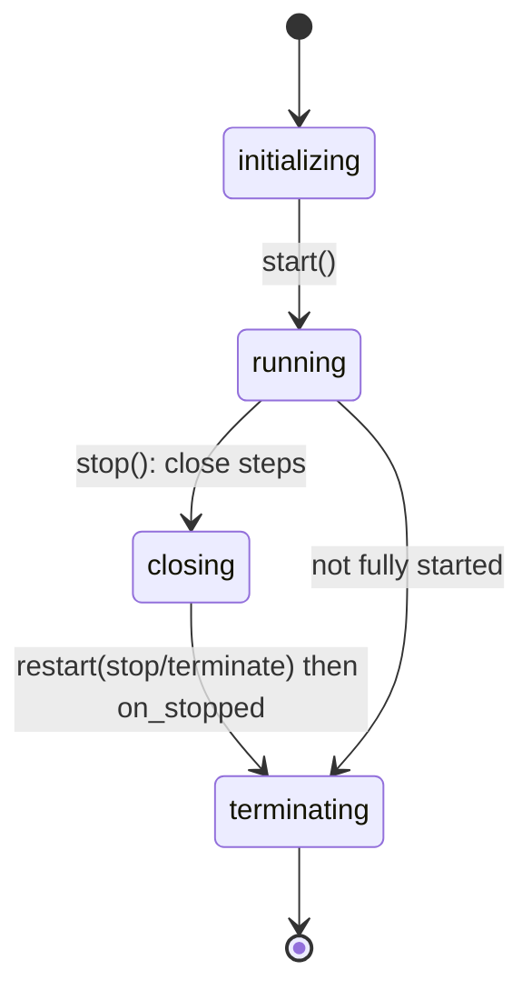

## Overview

A worker is an object, `WorkController`, assembled from small start/stop components called bootsteps. The same mechanism builds the worker's own pieces (event hub, process pool, timer, optional embedded beat, state database, autoscaler, and the consumer) and, one level down, the consumer's pieces (broker connection, heartbeat, task queues, remote control and so on). This page explains the bootstep framework, the worker's blueprint and its start-up and shutdown sequence. How tasks are received is on [[The Consumer: Receiving Tasks]]; what pools do is on [[Execution Pools]].

Sources: [celery/worker/worker.py:63-100](repo://celery/worker/worker.py#L63-L100), [celery/bootsteps.py:74-110](repo://celery/bootsteps.py#L74-L110)

## From the command line to a WorkController

`celery worker` ends in the `worker` click command, which handles `--detach` (re-running itself under a daemon), applies any extra `key=value` command-line settings in the `worker` namespace, drops privileges if asked, then creates `app.Worker(...)` with the parsed options and calls `worker.start()`, exiting with `worker.exitcode`. A `SecurityError` prints its message and exits with status 1. See [[The celery Command Line]].

Sources: [celery/bin/worker.py:307-371](repo://celery/bin/worker.py#L307-L371)

`app.Worker` is `celery.apps.worker.Worker`, a subclass of `WorkController` that adds what a command-line program needs. `WorkController.__init__` runs the loader's `init_worker`, the `on_before_init` hook, `setup_defaults`, `on_after_init` and `setup_instance`. In `Worker.on_before_init`, the app's trace optimizations are installed, the `celeryd_init` signal is sent and the privilege check runs for the configured `accept_content`.

Sources: [celery/worker/worker.py:90-100](repo://celery/worker/worker.py#L90-L100), [celery/apps/worker.py:91-110](repo://celery/apps/worker.py#L91-L110)

`setup_defaults` resolves each worker option from an explicit argument or else from configuration with `app.either`: concurrency (`worker_concurrency`), pool (`worker_pool`), consumer class, timer class, autoscaler class, `worker_prefetch_multiplier`, time limits, `worker_max_tasks_per_child`, `worker_max_memory_per_child` and others. `setup_instance` then selects queues (`-Q`, `--exclude-queues`), imports `include` modules, defaults concurrency to the CPU count (or 2 if it cannot be determined), chooses whether to use the event loop, sends `worker_init`, resolves the pool class by name, and applies the blueprint.

Sources: [celery/worker/worker.py:351-410](repo://celery/worker/worker.py#L351-L410), [celery/worker/worker.py:101-139](repo://celery/worker/worker.py#L101-L139)

The event loop is used only when the environment is the default one (no eventlet or gevent patching), the broker transport supports asynchronous operation, and the platform is not Windows.

Sources: [celery/worker/worker.py:239-243](repo://celery/worker/worker.py#L239-L243)

## The bootstep framework

A `Step` is bound to a parent object when the blueprint is applied: its `__init__` can set attributes on the parent, `include_if(parent)` decides whether it participates (defaulting to `enabled`), and `create(parent)` builds whatever the step provides. It can declare `requires` (steps that must start first, in the same blueprint), `conditional`, and `last`, which is reserved for the consumer and which makes every other step precede it. `StartStopStep` adds `start`, `stop`, `close` and `terminate` that delegate to the object `create` returned, and registers itself in `parent.steps` when included. `ConsumerStep` is a `StartStopStep` that requires the `Connection` step and consumes from the channels returned by `get_consumers`.

Sources: [celery/bootsteps.py:288-352](repo://celery/bootsteps.py#L288-L352), [celery/bootsteps.py:355-415](repo://celery/bootsteps.py#L355-L415)

`Blueprint.apply(parent)` claims the step classes (the union of the blueprint's `default_steps` and any extra `steps`), pulls in transitive `requires`, builds a `DependencyGraph`, adds an edge from the `last` step to every other, topologically sorts it, instantiates each step on the parent and calls `include`. An unknown dependency raises `KeyError('unknown bootstep: ...')`.

Sources: [celery/bootsteps.py:186-212](repo://celery/bootsteps.py#L186-L212), [celery/bootsteps.py:221-256](repo://celery/bootsteps.py#L221-L256)

Sources: [celery/bootsteps.py:74-122](repo://celery/bootsteps.py#L74-L122), [celery/bootsteps.py:155-176](repo://celery/bootsteps.py#L155-L176)

`start` sets the state to `RUN`, calls `on_start`, then starts each included step in order, tracking how many started. `stop` does nothing if already closing; if the blueprint was not fully started it just moves to `TERMINATE`; otherwise it calls `close` on every step, moves to `CLOSE`, calls `stop` (or `terminate`) on the steps in reverse order via `send_all`, runs `on_stopped` and finishes in `TERMINATE`. `send_all` logs and continues past a step's exception when `propagate` is false, so one failing step does not block the rest of the shutdown.

Sources: [celery/bootsteps.py:104-122](repo://celery/bootsteps.py#L104-L122), [celery/bootsteps.py:124-176](repo://celery/bootsteps.py#L124-L176)

## The worker's default steps

`WorkController.Blueprint` is named `Worker` and lists seven steps; `app.steps['worker']` adds user steps. The consumer blueprint is covered on [[The Consumer: Receiving Tasks]].

| Step | Role | Notes |
| --- | --- | --- |
| `Timer` | Schedules ETA tasks and periodic internal callbacks | With the event loop, uses a hub-driven timer; otherwise a timer class from the pool (`pool_cls.Timer`) |
| `Hub` | Provides the kombu event loop | Included only if `use_eventloop`; requires `Timer` |
| `Pool` | Creates the execution pool | Requires `Hub`; see [[Execution Pools]] |
| `Beat` | Embeds the beat scheduler | Conditional on `-B`; refused with gevent/eventlet pools |
| `StateDB` | Persists revoked task ids between restarts in a shelve file | Enabled only if a state db file is configured |
| `Consumer` | Instantiates the consumer | `last = True` |
| `Autoscaler` | Grows and shrinks the pool | Conditional on `--autoscale`; requires `Pool` |

Sources: [celery/worker/worker.py:76-88](repo://celery/worker/worker.py#L76-L88), [celery/worker/components.py:32-75](repo://celery/worker/components.py#L32-L75), [celery/worker/components.py:101-135](repo://celery/worker/components.py#L101-L135), [celery/worker/components.py:181-246](repo://celery/worker/components.py#L181-L246), [celery/worker/autoscale.py:31-58](repo://celery/worker/autoscale.py#L31-L58)

The `Pool` step's `create` does the sizing work. It warns if the `worker_pool` setting selects a green pool (eventlet/gevent must be chosen with `-P` so patching happens early), uses a threaded pool when the event loop is off (or on Windows), and otherwise creates a `LaxBoundedSemaphore` of the pool size, takes `semaphore.acquire/release` as the quick acquire/release hooks, and switches `process_task` to a semaphore-guarded version when the pool uses a semaphore. It then instantiates the pool with the minimum concurrency, `maxtasksperchild`, `max_memory_per_child`, hard and soft time limits and the lost-worker wait.

Sources: [celery/worker/components.py:138-172](repo://celery/worker/components.py#L138-L172)

The `Consumer` step sets the initial prefetch count: `max(max_concurrency, 1) * prefetch_multiplier` when autoscaling, else `concurrency * prefetch_multiplier`. It passes the consumer the worker's `process_task` callback, pool, timer, hub and options.

Sources: [celery/worker/components.py:221-246](repo://celery/worker/components.py#L221-L246)

The autoscaler compares the number of reserved requests with the pool size: it grows towards `min(qty, max_concurrency)` immediately and shrinks towards `max(qty, min_concurrency)` only if the last scale-up was more than `keepalive` seconds ago (30 by default, `AUTOSCALE_KEEPALIVE` in the environment). With the event loop it is driven by `maybe_scale` on every task message and by a repeating timer; otherwise it runs as a background thread.

Sources: [celery/worker/autoscale.py:28-31](repo://celery/worker/autoscale.py#L28-L31), [celery/worker/autoscale.py:61-132](repo://celery/worker/autoscale.py#L61-L132), [celery/worker/autoscale.py:148-154](repo://celery/worker/autoscale.py#L148-L154)

## Startup callbacks

`WorkController.start` calls `blueprint.start(self)` and converts exits into shutdown: `WorkerTerminate` terminates, any other `Exception` is logged as unrecoverable and stops with `EX_FAILURE`, `SystemExit` stops with its code, and `KeyboardInterrupt` stops with `EX_FAILURE`. The blueprint's `on_start` creates the pidfile lock; the command-line `Worker.on_start` additionally sends `celeryd_after_setup`, purges queues for `--purge`, prints the banner, sets the process title, installs signal handlers and redirects stdout/stderr if configured. `on_consumer_ready` sends `worker_ready`. See [[Signals]].

Sources: [celery/worker/worker.py:150-166](repo://celery/worker/worker.py#L150-L166), [celery/worker/worker.py:201-215](repo://celery/worker/worker.py#L201-L215), [celery/apps/worker.py:128-182](repo://celery/apps/worker.py#L128-L182)

## Shutdown

`stop` is the warm shutdown: if running, it closes the consumer and runs `_shutdown(warm=True)`, then sends `worker_shutdown`. `terminate` is the cold shutdown (`warm=False`). `_shutdown` stops the blueprint under a socket-timeout guard and joins it; `on_stopped` stops the timer, shuts the consumer down and releases the pidfile. When called from a signal handler, shutdown happens only if the pool is `signal_safe`.

Sources: [celery/worker/worker.py:157-166](repo://celery/worker/worker.py#L157-L166), [celery/worker/worker.py:244-267](repo://celery/worker/worker.py#L244-L267)

The signal handlers installed at start-up do not shut down directly: `_shutdown_handler` records the request by setting `state.should_stop` (warm) or `state.should_terminate` (cold) to the exit code, and the event loop's `maybe_shutdown` call acts on it. `SIGTERM` requests a warm shutdown; `SIGQUIT` and `SIGINT` request a cold one, and a repeated signal during a soft shutdown switches to a hard shutdown that raises `WorkerTerminate(EX_FAILURE)`. With `worker_soft_shutdown_timeout` set and active requests, `wait_for_soft_shutdown` sleeps for that period before the cold shutdown proceeds. Without a terminal, `SIGHUP` restarts the worker.

Sources: [celery/apps/worker.py:254-274](repo://celery/apps/worker.py#L254-L274), [celery/apps/worker.py:288-366](repo://celery/apps/worker.py#L288-L366), [celery/worker/worker.py:412-435](repo://celery/worker/worker.py#L412-L435)

## Extending the worker

User steps are registered in `app.steps['worker']` (or `'consumer'`), and `Blueprint` merges them with the defaults when applied, so a custom step can declare `requires` on built-in ones. `app.user_options` similarly adds command-line options to `worker`, `beat` and `events` when the CLI starts.

Sources: [celery/worker/worker.py:129-139](repo://celery/worker/worker.py#L129-L139), [celery/bin/celery.py:158-163](repo://celery/bin/celery.py#L158-L163)
