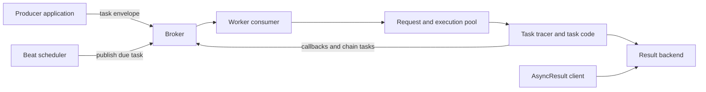

# System boundaries and task flow

Celery coordinates distributed task execution. A producer publishes a task name and arguments; a worker resolves that name in its own registry and executes the local implementation. Broker delivery, Python execution, result storage, and monitoring have separate owners and failure modes.

## Responsibilities

| Component | Responsibility | Main implementation |
| --- | --- | --- |
| Application | Configuration, task registration, service factories, publication API | [app/base.py](../../celery/app/base.py) |
| Messaging layer | Routes, queues, task envelopes, producer publication through Kombu | [app/amqp.py](../../celery/app/amqp.py) |
| Worker controller | Builds and runs bootsteps for the pool, timer, consumer, and optional components | [worker/worker.py](../../celery/worker/worker.py) |
| Consumer and request | Receive messages, select task strategy, schedule execution, acknowledge or reject delivery | [consumer.py](../../celery/worker/consumer/consumer.py), [request.py](../../celery/worker/request.py) |
| Task tracer | Calls task code, manages request context, dispatches continuations, records outcomes | [app/trace.py](../../celery/app/trace.py) |
| Result backend | Persists or transports task metadata and coordinates supported chords | [backends/base.py](../../celery/backends/base.py) |
| Beat | Checks periodic schedules and publishes due tasks | [beat.py](../../celery/beat.py) |

Kombu supplies the messaging connection, transport, and serialization APIs used here; Billiard is the process-pool dependency and Vine supplies asynchronous primitives. Their dependency constraints live in [requirements/default.txt](../../requirements/default.txt). Broker servers and optional backend services run outside this Python package.

## A task's path through the system

1. The calling API merges execution options and routes a message. Publication returns an `AsyncResult` identified by task ID, not the task's return value.
2. The consumer uses the task name to choose a strategy. Unknown task names are rejected and reported as `NotRegistered`.
3. A request mediates pool execution and delivery acknowledgement. The tracer installs task/request context, runs hooks and user code, and handles retry, ignore, rejection, or failure.
4. On ordinary success, the tracer dispatches callbacks and the next chain task before marking the result done. This ordering records child-task trails. Backend completion also notifies chord coordination when applicable.
5. A result client reads or waits on the selected backend. Monitoring events and remote control use separate messaging paths; they are not the result database.

## State and failure boundaries

The application registry and active/reserved worker sets are process-local structures. The broker owns queued deliveries. The backend owns result metadata according to its implementation and expiration policy. Beat's default scheduler keeps schedule history in a local shelve file. These stores do not form one atomic transaction.

Consequently, a task ID is correlation information rather than a universal exactly-once guarantee. User side effects, continuation publication, backend writes, and broker acknowledgement can fail at different points. Review [delivery and retries](../workflows/task-delivery.md), [worker acknowledgements](worker.md), and [backend behavior](../integrations/result-backends.md) together when designing recovery.

## Navigating implementation changes

Start with [application lifecycle](application.md) for import/configuration problems, [worker execution](worker.md) for acceptance and failure handling, and [Canvas](../workflows/canvas.md) for workflow composition. Representative boundary tests are [task tracing](../../t/unit/tasks/test_trace.py), [consumer dispatch](../../t/unit/worker/test_consumer.py), and [integration task execution](../../t/integration/test_tasks.py). Deployment entrypoints and observability are covered in [worker operations](../operations/workers.md).
