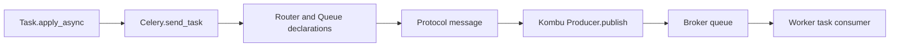

# Task publication, routing, and transport

Celery builds task messages and chooses destinations; Kombu supplies connections, producers, consumers, declarations, and transport implementations. The class named `AMQP` is the application's messaging adapter even when the configured broker uses a different transport. Broker transport code is a dependency boundary, not implemented under `celery/backends/`, which contains result storage adapters.

## Submission and option precedence

`delay(*args, **kwargs)` is the convenience interface; use `apply_async()` for queue, serializer, priority, timing, and callback options. `Task.apply_async()` checks arguments when task typing is enabled, merges task execution defaults with call options, then delegates to `send_task()` with the task instance. Its eager branch instead serializes/deserializes the arguments and executes locally.

`app.send_task('package.task', ...)` can publish a name the producer has not imported. This checkout also consults the existing local registry for task execution defaults when no task instance was supplied, without automatically finalizing the registry. Explicit call options override those defaults. For `time_limit`, `soft_time_limit`, and `expires`, omission uses the task default, while explicit `None` clears it. `send_task()` warns that `task_always_eager` has no effect on this API.

The send path resolves a task ID, routes the options, creates the protocol message, invokes the backend's prepublication hook when results are enabled, publishes with an acquired producer, and returns an `AsyncResult`. Returning that handle means publication completed through this path; it does not mean a worker accepted or completed execution.

## Routing to queues

`Router.route()` expands queue names into Kombu `Queue` declarations, asks configured routers in order for the first non-`None` route, and merges caller options over route defaults. When no queue is selected it supplies `task_default_queue`. Map routes support exact names, glob patterns, and regular expressions; callable routers can use task arguments and options.

`task_queues` defines known destinations. With automatic creation enabled, the queue mapping can synthesize missing queues; otherwise expansion of an unknown name raises `QueueNotFound`. Worker queue selection is independent of producer routing: a correctly published message can sit indefinitely if no worker consumes its destination.

## Protocol and publication

Protocol 2 puts task identity, timing, lineage, retry count, and stamps in headers. The body holds arguments, keyword arguments, and embedded callbacks, errbacks, chain, and chord metadata. Properties carry correlation ID and reply-to information. Protocol 1 remains available through `task_protocol`.

The task sender resolves exchange/routing key and declarations, applies serializer/compression settings, merges publication retry policy, and calls `Producer.publish()`. `before_task_publish` and `after_task_publish` bracket publication; the optional sent event is a separate observation. Publication retries address sending failures, while [task retries](../workflows/task-execution.md) schedule another execution attempt.

Read and write connections can use separate URLs. `CELERY_BROKER_URL`, `CELERY_BROKER_READ_URL`, and `CELERY_BROKER_WRITE_URL` participate in settings resolution; inspect these when producers and workers unexpectedly use different brokers.

## ETA and quorum queue behavior

Ordinary countdown values are encoded as ETA timestamps and handled by [worker scheduling](workers.md). For detected RabbitMQ quorum queues, positive delayed sends on compatible non-direct exchanges can be routed through Kombu's native delayed delivery exchange hierarchy. Direct exchanges trigger a warning because this mechanism does not support them.

The worker's `DelayedDelivery` bootstep declares the hierarchy and binds application queues. It validates configuration, retries setup per broker URL, and logs if setup fails everywhere; a running worker alone does not prove the delayed topology was successfully installed. Queue type, exchange type, publisher configuration, and consumer QoS must be considered together when changing a deployment to quorum queues.

## Verification and next steps

Read [routing code](../../celery/app/routes.py), [protocol/sender code](../../celery/app/amqp.py), and [submission code](../../celery/app/base.py). Focused coverage lives in [route tests](../../t/unit/app/test_routes.py), [messaging tests](../../t/unit/app/test_amqp.py), the `test_send_task*` tests in [application tests](../../t/unit/app/test_app.py), and [delayed delivery tests](../../t/unit/worker/test_native_delayed_delivery.py). See [serialization and trust](../security/serialization.md) for accepted content, and [worker lifecycle](workers.md) for the receiving side.
