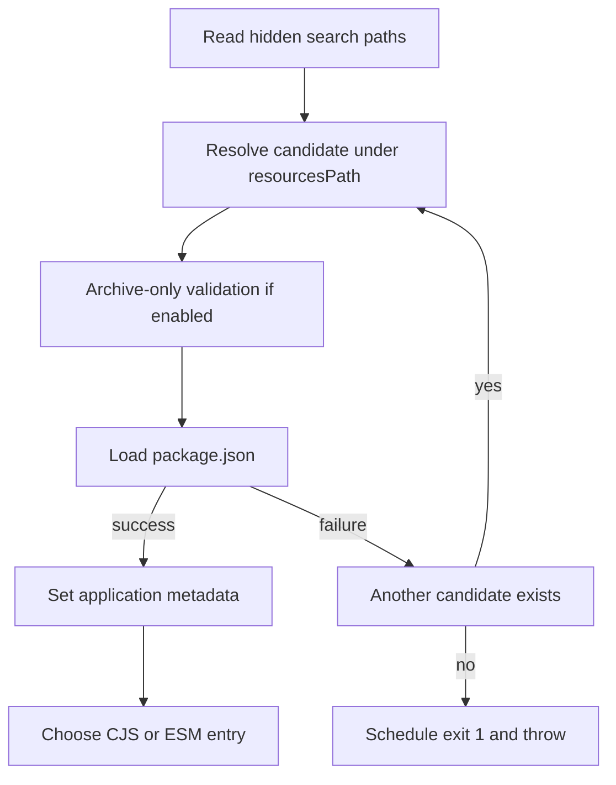

## Overview

Electron bootstrap connects native process initialization to the application's JavaScript entry point. The browser startup script configures process behavior, finds the application package, establishes dependent APIs and loads the entry module. This page follows that handoff; the ready-time window creation shown in [[Quickstart]] begins in application code after the runtime has selected and executed that module.

Sources: [lib/browser/init.ts:12-45](repo://lib/browser/init.ts#L12-L45), [lib/browser/init.ts:82-114](repo://lib/browser/init.ts#L82-L114), [lib/browser/init.ts:141-163](repo://lib/browser/init.ts#L141-L163), [lib/browser/init.ts:204-222](repo://lib/browser/init.ts#L204-L222), [docs/fiddles/quick-start/main.js:16-24](repo://docs/fiddles/quick-start/main.js#L16-L24)

## Enter the native runtime

The Linux executable first fixes standard streams, prepares arguments with libuv and initializes Chromium and Electron command-line state. It selects Node-only execution only when the run-as-Node fuse is enabled and the corresponding environment variable is nonempty. Otherwise it creates `ElectronMainDelegate` and enters Chromium through `content::ContentMain`. This is a platform-specific entry trace; the subsequent browser initialization provides the Node environment used by application code.

Sources: [shell/app/electron_main_linux.cc:20-44](repo://shell/app/electron_main_linux.cc#L20-L44), [shell/browser/electron_browser_main_parts.cc:225-258](repo://shell/browser/electron_browser_main_parts.cc#L225-L258)

In `PostEarlyInitialization`, the browser creates its JavaScript environment after the proxy resolver's V8 setup to avoid conflicts. It initializes Node bindings, creates the environment, binds Electron's process extensions, creates an explicit microtasks runner and connects the environment to the libuv loop. It then loads the environment and waits for application code with `JoinAppCode`. After that wait, it reinitializes the feature list so switches changed by application JavaScript are included.

Sources: [shell/browser/electron_browser_main_parts.cc:225-271](repo://shell/browser/electron_browser_main_parts.cc#L225-L271)

## Find the application package

`NodeBindings::CreateEnvironment` selects the internal initialization module according to browser, renderer, worker or utility process type. For the browser it stores hidden application search paths on the global object. Normal lookup tries `app.asar`, `app`, then `default_app.asar`; the only-load-app-from-ASAR fuse replaces that list with only `app.asar` and records that archive validation is required. The internal module name is inserted into the Node argument list before loading begins.

Sources: [shell/common/node_bindings.cc:653-704](repo://shell/common/node_bindings.cc#L653-L704)

The browser script removes the inserted argument and reads those hidden values. Under `process.resourcesPath`, it joins each candidate path, optionally verifies that an archive can be opened, then attempts to load its `package.json`. A failed candidate is skipped, including an exception during metadata loading. If no candidate succeeds, startup schedules exit code 1 and throws `Unable to find a valid app`; it does not continue with invented package metadata.

Sources: [lib/browser/init.ts:12-17](repo://lib/browser/init.ts#L12-L17), [lib/browser/init.ts:82-114](repo://lib/browser/init.ts#L82-L114)

Sources: [lib/browser/init.ts:82-141](repo://lib/browser/init.ts#L82-L141), [lib/browser/init.ts:204-222](repo://lib/browser/init.ts#L204-L222)

## Establish metadata and module dependencies

Version metadata is applied when present. Product name takes precedence over package name, and both are converted to strings and trimmed. A supplied desktop name is used directly; otherwise Electron derives one from the application name. V8 flags load the V8 module lazily so applications without that field avoid its loading cost. Finally `app.setAppPath` records the selected package directory for later operations, including the relative file resolution described in [[Windows and Navigation]].

Sources: [lib/browser/init.ts:116-141](repo://lib/browser/init.ts#L116-L141), [lib/browser/api/web-contents.ts:324-337](repo://lib/browser/api/web-contents.ts#L324-L337)

Bootstrap loads the RPC server and guest-view manager before package discovery. After metadata, it loads developer-tools support and initializes protocol, service-worker, WebContents and WebFrameMain modules before readiness. WebContentsView is explicitly loaded because BrowserWindow construction depends on its inheritance setup. The main startup filename comes from the package's `main` field, falling back to `index.js`.

Sources: [lib/browser/init.ts:73-80](repo://lib/browser/init.ts#L73-L80), [lib/browser/init.ts:141-163](repo://lib/browser/init.ts#L141-L163)

Common initialization also connects Node scheduling to Chromium's event loop. Wrappers around `process.nextTick`, `setImmediate` and timer functions call `process.activateUvLoop()` before invoking the original operation. The comments explain why: the libuv loop runs on requests, so callbacks could otherwise wait for unrelated activity, and timers need a chance to recalculate polling timeouts. Global timeout and interval functions are replaced for browser and utility processes.

Sources: [lib/common/init.ts:8-62](repo://lib/common/init.ts#L8-L62)

## Execute CommonJS or ECMAScript modules

An entry ending in `.mjs` uses the ESM path. A package declaring `type` as `module` also uses it unless the entry ends in `.cjs`. Electron converts the absolute entry path to a file URL and invokes Node's ESM entry loader. It signals `appCodeLoaded` after the import resolves; if import fails, it still signals completion and emits `uncaughtException`. That completion signal ensures the native startup wait is released on either outcome.

Sources: [lib/browser/init.ts:201-217](repo://lib/browser/init.ts#L201-L217), [shell/browser/electron_browser_main_parts.cc:257-261](repo://shell/browser/electron_browser_main_parts.cc#L257-L261)

The CommonJS branch signals `appCodeLoaded` before calling `Module._load` with the absolute entry filename and the main-module flag. The comment identifies this ordering as safe because loading is synchronous. The initialization script removes the temporary `process.appCodeLoaded` property before either branch. The default application's command-line loader is another layer: it resolves the supplied app or script path, sets `app.getAppPath()`'s backing value and imports the resolved entry, which is the launch path used in [[Quickstart]].

Sources: [lib/browser/init.ts:201-222](repo://lib/browser/init.ts#L201-L222), [default_app/main.ts:126-141](repo://default_app/main.ts#L126-L141)

## Lifecycle defaults and failures

Bootstrap maps `process.exit` to `app.exit` and emits the process `exit` event when the application emits `quit`. Its uncaught-exception handler leaves behavior to application handlers when additional listeners exist; otherwise it imports `dialog` and presents the error stack in a main-process error box. The import is inside the handler because bootstrap is itself responsible for establishing the Electron require hook. Native initialization also sets unhandled rejections to `warn-with-error-code` rather than crashing the main process.

Sources: [lib/browser/init.ts:21-45](repo://lib/browser/init.ts#L21-L45), [lib/browser/init.ts:73-74](repo://lib/browser/init.ts#L73-L74), [shell/browser/electron_browser_main_parts.cc:243-246](repo://shell/browser/electron_browser_main_parts.cc#L243-L246)

The default menu is scheduled for `will-finish-launching`, which the source notes precedes `ready`, so it is installed before user windows are created. [[Native Menus]] explains how application code can supply its own menu and suppress default installation. Window shutdown policy remains overridable by registering an additional `window-all-closed` listener, as the platform-specific behavior in [[Quickstart]] demonstrates.

Sources: [lib/browser/init.ts:186-199](repo://lib/browser/init.ts#L186-L199), [lib/browser/api/menu.ts:171-188](repo://lib/browser/api/menu.ts#L171-L188), [docs/fiddles/quick-start/main.js:26-30](repo://docs/fiddles/quick-start/main.js#L26-L30)
