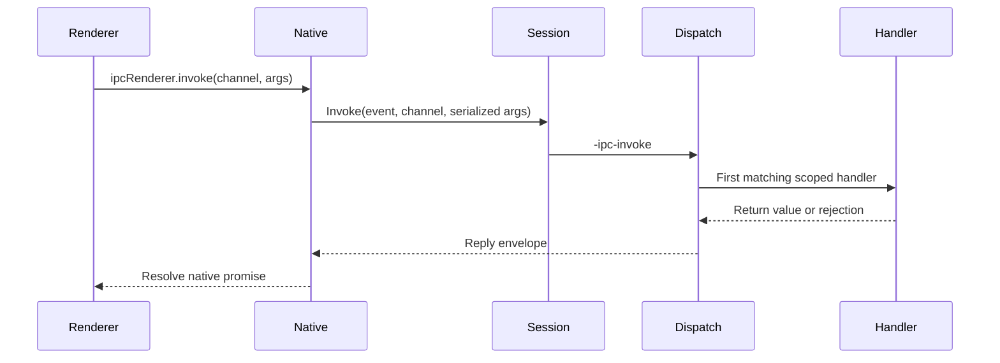

## Overview

Electron IPC carries renderer messages to main-process event emitters and returns invocation results through reply channels. Public `ipcRenderer` methods share a cached native implementation but select distinct message, synchronous-message, invocation and port-transfer operations. The bridge used to expose a renderer-facing capability belongs to [[Preload and Context Isolation]]; this page starts when that capability calls an IPC method.

Sources: [lib/renderer/api/ipc-renderer.ts:1-34](repo://lib/renderer/api/ipc-renderer.ts#L1-L34), [lib/renderer/ipc-renderer-bindings.ts:1-17](repo://lib/renderer/ipc-renderer-bindings.ts#L1-L17), [shell/common/api/api.mojom:28-56](repo://shell/common/api/api.mojom#L28-L56)

## Public operations and registration

| Operation | Renderer behavior | Main-side behavior |
| --- | --- | --- |
| `send` | Sends a channel and argument array | Emits to relevant listeners |
| `invoke` | Awaits a result envelope and throws if it contains an error | Selects one registered handler and awaits its return value |
| `sendSync` | Uses the synchronous native operation | Supplies a `returnValue` setter backed by the reply channel |
| `postMessage` | Sends a message with optional transferred ports | Wraps ports as MessagePortMain instances before emission |
| `sendToHost` | Uses the host-message operation | Emits the host-message event on the sender WebContents |

Sources: [lib/renderer/api/ipc-renderer.ts:8-31](repo://lib/renderer/api/ipc-renderer.ts#L8-L31), [lib/browser/ipc-dispatch.ts:10-22](repo://lib/browser/ipc-dispatch.ts#L10-L22), [lib/browser/ipc-dispatch.ts:58-108](repo://lib/browser/ipc-dispatch.ts#L58-L108), [lib/browser/ipc-dispatch.ts:110-150](repo://lib/browser/ipc-dispatch.ts#L110-L150)

`IpcMainImpl` stores invoke handlers in a map separate from EventEmitter listeners. `handle` rejects a duplicate channel and requires a function; `removeHandler` deletes its entry. `handleOnce` removes the entry before invoking the supplied callback, so another invocation cannot select the same once-handler while its asynchronous result is pending. An empty listener for the event name `error` prevents EventEmitter's special unhandled-error behavior for a channel with that name.

Sources: [lib/browser/ipc-main-impl.ts:5-34](repo://lib/browser/ipc-main-impl.ts#L5-L34)

## Cross the native boundary

The renderer binding factory chooses either a render-frame or service-worker implementation from `process.type` and caches it. Other process types produce an error. The public wrapper passes `internal = false`; framework-internal traffic is distinguished separately by the transport. In the native invoke method, a released context is rejected before sending, arguments are serialized into a Blink CloneableMessage, and a native promise resolves when the Mojo invocation callback receives its response.

Sources: [lib/renderer/ipc-renderer-bindings.ts:1-17](repo://lib/renderer/ipc-renderer-bindings.ts#L1-L17), [lib/renderer/api/ipc-renderer.ts:5-26](repo://lib/renderer/api/ipc-renderer.ts#L5-L26), [shell/renderer/api/electron_api_ipc_renderer.cc:82-105](repo://shell/renderer/api/electron_api_ipc_renderer.cc#L82-L105)

For a render-frame invocation, `ElectronApiIPCHandlerImpl` locates the session through the frame's browser context, constructs an event with sender and frame identifiers, attaches the reply channel and forwards to the session's invocation dispatcher. Session initialization installs the JavaScript dispatch listeners. This establishes the event's identity before application handlers are selected; a handler receives the originating frame information with its arguments.

Sources: [shell/browser/electron_api_ipc_handler_impl.cc:57-70](repo://shell/browser/electron_api_ipc_handler_impl.cc#L57-L70), [shell/browser/electron_api_ipc_handler_impl.cc:121-125](repo://shell/browser/electron_api_ipc_handler_impl.cc#L121-L125), [shell/browser/electron_api_ipc_handler_impl.cc:161-180](repo://shell/browser/electron_api_ipc_handler_impl.cc#L161-L180), [lib/browser/api/session.ts:25-26](repo://lib/browser/api/session.ts#L25-L26)

Sources: [lib/renderer/api/ipc-renderer.ts:21-27](repo://lib/renderer/api/ipc-renderer.ts#L21-L27), [shell/renderer/api/electron_api_ipc_renderer.cc:82-105](repo://shell/renderer/api/electron_api_ipc_renderer.cc#L82-L105), [shell/browser/electron_api_ipc_handler_impl.cc:57-70](repo://shell/browser/electron_api_ipc_handler_impl.cc#L57-L70), [shell/browser/api/ipc_dispatcher.h:39-45](repo://shell/browser/api/ipc_dispatcher.h#L39-L45), [lib/browser/ipc-dispatch.ts:76-108](repo://lib/browser/ipc-dispatch.ts#L76-L108)

## Select the destination

Frame events use a cached emitter array ordered as frame IPC, sender WebContents IPC and global ipcMain. Frame lookup uses FrameTreeNode ID so events sent during unloading can still be delivered after a frame swap. For ordinary messages, dispatch emits on the sender's `ipc-message` event and then on every available scoped emitter. Invocations instead select the first emitter with a handler registered for that channel, so a frame handler takes precedence over a matching WebContents or global handler.

Sources: [lib/browser/ipc-dispatch.ts:33-73](repo://lib/browser/ipc-dispatch.ts#L33-L73), [lib/browser/ipc-dispatch.ts:85-107](repo://lib/browser/ipc-dispatch.ts#L85-L107)

Internal traffic targets `ipcMainInternal` directly. Service-worker traffic obtains the worker from the event's session and version ID, adds a lazy `serviceWorker` property and targets that worker's IPC emitter. It does not use the frame-to-global fallback sequence. Thus the same channel name can have different destinations according to event origin and whether the message is internal.

Sources: [lib/browser/ipc-dispatch.ts:24-31](repo://lib/browser/ipc-dispatch.ts#L24-L31), [lib/browser/ipc-dispatch.ts:58-73](repo://lib/browser/ipc-dispatch.ts#L58-L73), [lib/browser/ipc-dispatch.ts:85-107](repo://lib/browser/ipc-dispatch.ts#L85-L107)

## Return results and errors

The invocation dispatcher awaits `Promise.resolve(handler(event, ...args))`, supporting both immediate values and promises. A successful result is wrapped under `result`. Exceptions are logged and returned under `error` using `error.toString()`; no matching handler produces the same error reply path. The renderer unwraps the response and constructs a new Error including the channel name when the error field is present. The returned exception is therefore a renderer-side Error built from a string, not the original main-process object.

Sources: [lib/browser/ipc-dispatch.ts:76-108](repo://lib/browser/ipc-dispatch.ts#L76-L108), [lib/renderer/api/ipc-renderer.ts:21-27](repo://lib/renderer/api/ipc-renderer.ts#L21-L27)

Frame message events receive a `reply` function that sends to the originating process/frame pair. Synchronous messages additionally receive the `returnValue` setter, which immediately calls the reply channel. When a frame makes a synchronous call with no sender-level or scoped listeners, dispatch logs a warning before emitting the event. Setting a synchronous reply is distinct from returning a value from an ordinary EventEmitter callback.

Sources: [lib/browser/ipc-dispatch.ts:10-22](repo://lib/browser/ipc-dispatch.ts#L10-L22), [lib/browser/ipc-dispatch.ts:110-133](repo://lib/browser/ipc-dispatch.ts#L110-L133)

## Transfer message ports

Native `postMessage` serializes the message, validates the transfer list and extracts a MessagePortChannel from each transferred object. An invalid list or element raises `Invalid value for transfer`; successful channels are attached to the TransferableMessage. Main-side dispatch converts received ports to MessagePortMain wrappers and emits the message on the relevant frame or service-worker emitters.

Sources: [shell/renderer/api/electron_api_ipc_renderer.cc:108-146](repo://shell/renderer/api/electron_api_ipc_renderer.cc#L108-L146), [lib/browser/ipc-dispatch.ts:139-150](repo://lib/browser/ipc-dispatch.ts#L139-L150)

MessagePortMain forwards `start` and `close` to its underlying port. Incoming port messages recursively wrap their transferred ports; outgoing transfers unwrap MessagePortMain instances back to internal ports. This keeps the public interface consistent when a port itself carries further ports, while leaving native ownership transfer to the underlying implementation.

Sources: [lib/browser/message-port-main.ts:3-27](repo://lib/browser/message-port-main.ts#L3-L27)
