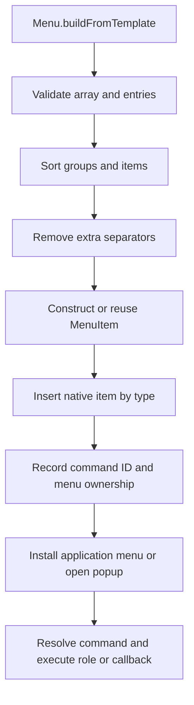

## Overview

Electron's menu pipeline transforms a declarative template into MenuItem objects, inserts them into a native menu model and routes selected commands back to JavaScript. The same Menu object can be installed as the application menu or shown as a popup. [[Windows and Navigation]] describes the window objects used to host menus; this page follows template validation, ordering, item state and execution.

Sources: [lib/browser/api/menu.ts:69-98](repo://lib/browser/api/menu.ts#L69-L98), [lib/browser/api/menu.ts:127-156](repo://lib/browser/api/menu.ts#L127-L156), [lib/browser/api/menu.ts:171-212](repo://lib/browser/api/menu.ts#L171-L212), [shell/browser/api/electron_api_menu.cc:55-67](repo://shell/browser/api/electron_api_menu.cc#L55-L67)

## Build and validate a template

`Menu.buildFromTemplate` requires an array and validates every entry before building. The actual entry predicate requires a nonnull object with its own label or role property, or a separator type. It then sorts the template, removes extra separators and appends existing MenuItem instances or constructs new ones from options. Submenu arrays are sorted recursively. Invalid template shape or entries produce TypeErrors before the native menu is populated.

Sources: [lib/browser/api/menu.ts:190-232](repo://lib/browser/api/menu.ts#L190-L232)

MenuItem construction preserves extra user fields, lowercases string roles and obtains a default submenu from the role when needed. A submenu array becomes a Menu through the same template builder. If a submenu exists without an explicit type, the type becomes `submenu`; an explicit submenu type without a valid Menu throws. The constructor then supplies defaults for labels, visibility, enabled state and checked state, and rejects unknown item types.

Sources: [lib/browser/api/menu-item.ts:7-43](repo://lib/browser/api/menu-item.ts#L7-L43)

Sources: [lib/browser/api/menu.ts:190-232](repo://lib/browser/api/menu.ts#L190-L232), [lib/browser/api/menu.ts:127-156](repo://lib/browser/api/menu.ts#L127-L156), [lib/browser/api/menu.ts:251-299](repo://lib/browser/api/menu.ts#L251-L299), [lib/browser/api/menu.ts:54-98](repo://lib/browser/api/menu.ts#L54-L98), [lib/browser/api/menu.ts:171-188](repo://lib/browser/api/menu.ts#L171-L188), [lib/browser/api/menu-item.ts:56-71](repo://lib/browser/api/menu-item.ts#L56-L71)

## Resolve ordering constraints

Sorting first divides entries into groups using separators that have no ordering constraints. Item-level `before` and `after` references can cause groups to merge, then entries within each group are topologically sorted by those references. Group-level `beforeGroupContaining` and `afterGroupContaining` references establish a second ordering across groups. Finally the groups are rejoined with separators, reusing original separator objects when available.

Sources: [lib/browser/api/menu-utils.ts:18-29](repo://lib/browser/api/menu-utils.ts#L18-L29), [lib/browser/api/menu-utils.ts:74-127](repo://lib/browser/api/menu-utils.ts#L74-L127), [lib/browser/api/menu-utils.ts:129-179](repo://lib/browser/api/menu-utils.ts#L129-L179)

The topological traversal marks nodes before following edges, and its comment explicitly states that encountered cycles are broken. Missing item IDs do not produce edges. These behaviors mean inconsistent ordering references are not reported as template-validation errors by this sorter. After sorting, cleanup folds adjacent separators and removes edge separators, while entries with `visible === false` are retained by those filters.

Sources: [lib/browser/api/menu-utils.ts:49-72](repo://lib/browser/api/menu-utils.ts#L49-L72), [lib/browser/api/menu-utils.ts:101-126](repo://lib/browser/api/menu-utils.ts#L101-L126), [lib/browser/api/menu.ts:251-265](repo://lib/browser/api/menu.ts#L251-L265)

## Insert items and preserve identity

Appending calls `insert` at the current item count. Insertion requires a MenuItem and a position between zero and the current count, inclusive. The implementation inserts a native item according to type, applies sublabel, tooltip, icon and role when provided, associates the item with the menu and records it in both the ordered item list and the command map. MenuItem command IDs increase at construction and are nonwritable properties, providing the lookup key used by command execution.

Sources: [lib/browser/api/menu.ts:123-156](repo://lib/browser/api/menu.ts#L123-L156), [lib/browser/api/menu-item.ts:45-45](repo://lib/browser/api/menu-item.ts#L45-L45), [lib/browser/api/menu-item.ts:91-97](repo://lib/browser/api/menu-item.ts#L91-L97)

| Item type | Native insertion and state behavior |
| --- | --- |
| normal | Inserts a command item |
| header | Inserts a command item and applies the custom header type |
| checkbox | Inserts a check item |
| separator | Inserts a separator without a command label |
| submenu | Inserts a submenu backed by another Menu |
| palette | Inserts a submenu and applies the custom palette type |
| radio | Assigns a group and inserts a radio item |

Sources: [lib/browser/api/menu.ts:141-148](repo://lib/browser/api/menu.ts#L141-L148), [lib/browser/api/menu.ts:267-299](repo://lib/browser/api/menu.ts#L267-L299)

## Radio selection and native queries

Radio insertion searches neighboring entries up to a separator to find a group ID, or creates a new group. Its checked property is replaced with a getter backed by a WeakMap and a setter that clears other members before selecting the current item. The setter does not use an assigned false value to clear the group. Before showing a menu, `_menuWillShow` ensures that every recorded radio group has at least one selected member, choosing its first member if necessary.

Sources: [lib/browser/api/menu.ts:61-67](repo://lib/browser/api/menu.ts#L61-L67), [lib/browser/api/menu.ts:234-249](repo://lib/browser/api/menu.ts#L234-L249), [lib/browser/api/menu.ts:275-296](repo://lib/browser/api/menu.ts#L275-L296)

The native menu model asks JavaScript for checked, enabled and visible state through command IDs. JavaScript retrieves the corresponding MenuItem from the command map, returning false when absent. Accelerator lookup prefers an explicit accelerator and can fall back to the role's default. This query path keeps state decisions in the JavaScript item layer while the native model owns presentation.

Sources: [shell/browser/api/electron_api_menu.cc:77-123](repo://shell/browser/api/electron_api_menu.cc#L77-L123), [lib/browser/api/menu.ts:21-46](repo://lib/browser/api/menu.ts#L21-L46)

## Install or show the menu

`setApplicationMenu` validates the supplied menu, stores it and records that application code has set the menu. On macOS it calls menu-will-show hooks and the native application-menu binding for a nonnull menu. On other platforms it applies the menu to every existing BaseWindow. The default menu initializer checks the recorded flag and returns if application code already set a menu, tying this override into [[Application Startup]].

Sources: [lib/browser/api/menu.ts:171-188](repo://lib/browser/api/menu.ts#L171-L188), [lib/browser/default-menu.ts:6-13](repo://lib/browser/default-menu.ts#L6-L13), [lib/browser/init.ts:193-199](repo://lib/browser/init.ts#L193-L199)

A popup requires an options object and selects an available BaseWindow. It uses the requested window when present in the window list, otherwise the focused window, otherwise the first available window. If none exists, it throws. Coordinates and positioning item default to -1, source type defaults to mouse and an absent callback becomes a no-op. `closePopup` closes the runner for a supplied BaseWindow or uses the invalid ID -1 to close all runners belonging to that menu.

Sources: [lib/browser/api/menu.ts:69-108](repo://lib/browser/api/menu.ts#L69-L108)

## Execute the selected command

`_executeCommand` looks up the command ID and supplies the focused BaseWindow and WebContents to the item's click implementation. Checkbox and radio state is flipped first unless the role overrides check status. Role execution gets the first opportunity to handle the action; only when it returns false does the item call the custom click callback. A macOS selector is a final fallback when no callback function was supplied. This precedence explains why supplying a role and a click callback does not guarantee both actions run.

Sources: [lib/browser/api/menu.ts:54-59](repo://lib/browser/api/menu.ts#L54-L59), [lib/browser/api/menu-item.ts:56-71](repo://lib/browser/api/menu-item.ts#L56-L71)
