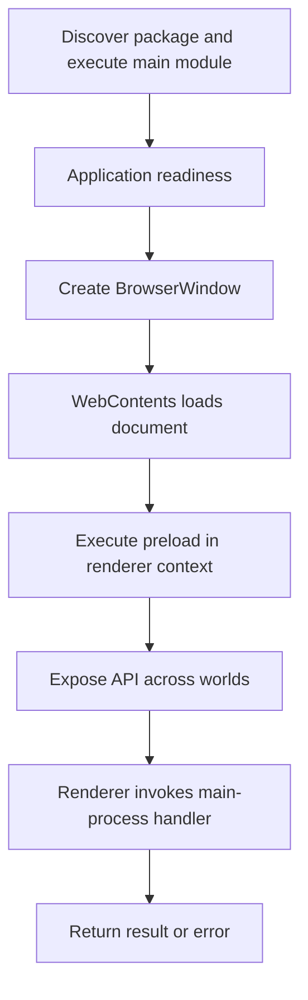

## Overview

Electron builds desktop applications with JavaScript, HTML and CSS by combining Chromium and Node.js. This repository contains the framework runtime, its JavaScript interfaces, native implementations, example applications and contributor tooling. The checked-in package is private and identifies itself as a development version; running an application with a prebuilt Electron binary and compiling this framework are separate workflows. [[Quickstart]] follows the example application, while [[Building and Testing]] follows the framework build.

Sources: [README.md:9-12](repo://README.md#L9-L12), [README.md:22-34](repo://README.md#L22-L34), [package.json:1-6](repo://package.json#L1-L6), [package.json:60-94](repo://package.json#L60-L94), [docs/development/build-instructions-gn.md:1-21](repo://docs/development/build-instructions-gn.md#L1-L21)

## Systems and responsibilities

| Area | What it does | Page |
| --- | --- | --- |
| Example application | Creates a window after readiness, loads local HTML and handles shutdown | [[Quickstart]] |
| Application bootstrap | Finds package metadata, configures the app and executes its entry module | [[Application Startup]] |
| Windows and content | Connects desktop windows to WebContents and asynchronous navigation | [[Windows and Navigation]] |
| Process communication | Routes renderer messages and invocation results to scoped main-process handlers | [[IPC Dispatch]] |
| Renderer worlds | Executes sandboxed preloads and exposes selected values across contexts | [[Preload and Context Isolation]] |
| Session requests | Adapts fetch and protocol handlers to session-owned networking | [[Sessions and Networking]] |
| Native menus | Turns menu templates into items, native menus and command callbacks | [[Native Menus]] |
| Contributor validation | Builds binaries and runs API specifications and documentation checks | [[Building and Testing]] |
| Release publication | Validates artifacts and checksums before publishing the release | [[Release Pipeline]] |

Sources: [docs/fiddles/quick-start/main.js:1-30](repo://docs/fiddles/quick-start/main.js#L1-L30), [lib/browser/init.ts:82-114](repo://lib/browser/init.ts#L82-L114), [lib/browser/api/browser-window.ts:131-155](repo://lib/browser/api/browser-window.ts#L131-L155), [lib/browser/ipc-dispatch.ts:58-108](repo://lib/browser/ipc-dispatch.ts#L58-L108), [lib/sandboxed_renderer/init.ts:16-71](repo://lib/sandboxed_renderer/init.ts#L16-L71), [lib/renderer/api/context-bridge.ts:1-20](repo://lib/renderer/api/context-bridge.ts#L1-L20), [lib/browser/api/session.ts:44-46](repo://lib/browser/api/session.ts#L44-L46), [lib/browser/api/protocol.ts:111-147](repo://lib/browser/api/protocol.ts#L111-L147), [lib/browser/api/menu.ts:171-212](repo://lib/browser/api/menu.ts#L171-L212), [package.json:61-94](repo://package.json#L61-L94), [script/release/release.ts:414-432](repo://script/release/release.ts#L414-L432)

## Main application flow

Sources: [lib/browser/init.ts:204-222](repo://lib/browser/init.ts#L204-L222), [docs/fiddles/quick-start/main.js:4-24](repo://docs/fiddles/quick-start/main.js#L4-L24), [lib/browser/api/browser-window.ts:131-143](repo://lib/browser/api/browser-window.ts#L131-L143), [lib/sandboxed_renderer/init.ts:58-71](repo://lib/sandboxed_renderer/init.ts#L58-L71), [lib/renderer/api/context-bridge.ts:7-19](repo://lib/renderer/api/context-bridge.ts#L7-L19), [lib/renderer/api/ipc-renderer.ts:21-27](repo://lib/renderer/api/ipc-renderer.ts#L21-L27), [lib/browser/ipc-dispatch.ts:76-108](repo://lib/browser/ipc-dispatch.ts#L76-L108)

[[Application Startup]] begins with package discovery and ends when Electron hands control to the application entry module. [[Quickstart]] supplies the next step: its main script waits for `app.whenReady()` before creating the first window and registers an activation handler that can recreate it. This separates executing application setup code from the point at which that example creates desktop UI.

Sources: [lib/browser/init.ts:82-114](repo://lib/browser/init.ts#L82-L114), [lib/browser/init.ts:204-222](repo://lib/browser/init.ts#L204-L222), [docs/fiddles/quick-start/main.js:16-24](repo://docs/fiddles/quick-start/main.js#L16-L24)

[[Windows and Navigation]] follows the window's delegation to WebContents, which resolves a local filename against the application path and starts a URL load. [[Preload and Context Isolation]] then follows the sandboxed renderer's script setup and the bridge that can expose an API into world zero. The bridge step is an available extension to the example's simple preload, rather than something its version-display script already uses.

Sources: [lib/browser/api/browser-window.ts:131-143](repo://lib/browser/api/browser-window.ts#L131-L143), [lib/browser/api/web-contents.ts:324-337](repo://lib/browser/api/web-contents.ts#L324-L337), [lib/sandboxed_renderer/init.ts:58-71](repo://lib/sandboxed_renderer/init.ts#L58-L71), [lib/renderer/api/context-bridge.ts:7-19](repo://lib/renderer/api/context-bridge.ts#L7-L19), [docs/fiddles/quick-start/preload.js:1-10](repo://docs/fiddles/quick-start/preload.js#L1-L10)

[[IPC Dispatch]] completes the communication path: renderer invocation awaits a native response, main-side dispatch finds a registered handler, and a result or stringified error comes back. From application code, [[Sessions and Networking]] provides session-bound requests, while [[Native Menus]] provides desktop commands that receive the focused window and WebContents. These services attach to the application flow at the point where its main code calls them.

Sources: [lib/renderer/api/ipc-renderer.ts:21-27](repo://lib/renderer/api/ipc-renderer.ts#L21-L27), [lib/browser/ipc-dispatch.ts:76-108](repo://lib/browser/ipc-dispatch.ts#L76-L108), [lib/browser/api/session.ts:44-46](repo://lib/browser/api/session.ts#L44-L46), [lib/browser/api/menu.ts:54-59](repo://lib/browser/api/menu.ts#L54-L59)

## Decisions that cross system boundaries

JavaScript wrappers and native bindings share responsibility for an API. BrowserWindow's wrapper obtains the native constructor, establishes BaseWindow inheritance and adds forwarding and event behavior; its load methods delegate to WebContents. WebContents attaches load listeners before invoking the native load method. That ordering lets the promise observe events generated during the native call, including immediate failures. A change to navigation behavior therefore needs to account for both the wrapper's promise and the native loader's events.

Sources: [lib/browser/api/browser-window.ts:1-38](repo://lib/browser/api/browser-window.ts#L1-L38), [lib/browser/api/browser-window.ts:131-143](repo://lib/browser/api/browser-window.ts#L131-L143), [lib/browser/api/web-contents.ts:410-432](repo://lib/browser/api/web-contents.ts#L410-L432), [shell/browser/api/electron_api_web_contents.cc:2331-2337](repo://shell/browser/api/electron_api_web_contents.cc#L2331-L2337)

Initialization order is explicit where APIs depend on each other. The WebContents module imports session to initialize it first, and browser startup loads WebContentsView before application code because constructing BrowserWindow uses its inheritance setup. These are functional dependencies: moving imports can affect constructor behavior even when a binding appears otherwise unused.

Sources: [lib/browser/api/web-contents.ts:8-17](repo://lib/browser/api/web-contents.ts#L8-L17), [lib/browser/init.ts:146-163](repo://lib/browser/init.ts#L146-L163)

IPC routing preserves frame identity through lifecycle changes. Dispatch looks up frames by FrameTreeNode ID so messages sent during unloading can still arrive after a frame swap. Its cached emitter array avoids frequent allocations and fixes the priority order at frame, WebContents, then global ipcMain. The separate internal branch routes framework messages directly to the internal emitter; it does not pass them through public frame handlers.

Sources: [lib/browser/ipc-dispatch.ts:33-73](repo://lib/browser/ipc-dispatch.ts#L33-L73), [lib/browser/ipc-dispatch.ts:85-107](repo://lib/browser/ipc-dispatch.ts#L85-L107)

Native operations can synchronously reenter JavaScript. The navigation implementation explicitly captures a weak pointer before calling Chromium's loader because emitted events may destroy the WebContents. After that call, it checks lifetime before notifying user activation. This makes callback-induced destruction part of the normal implementation contract rather than an exceptional assumption that objects survive until a method returns.

Sources: [shell/browser/api/electron_api_web_contents.cc:2374-2404](repo://shell/browser/api/electron_api_web_contents.cc#L2374-L2404)

Contributor and release workflows also preserve ordering. [[Building and Testing]] includes generated TypeScript definitions before the npm test command, and [[Release Pipeline]] places the live version index upload just before publication. The release code explains the tradeoff: upload late to reduce references to failed releases, but upload before publication so downstream projects never see a published release missing from that index.

Sources: [package.json:79-92](repo://package.json#L79-L92), [script/release/release.ts:414-432](repo://script/release/release.ts#L414-L432)
