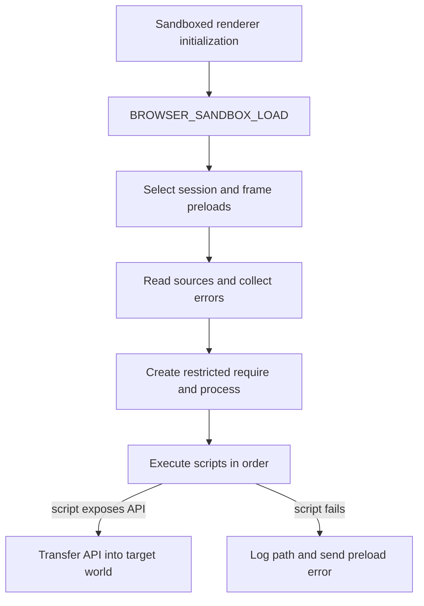

## Overview

Sandboxed renderer initialization obtains preload source from the browser, creates a restricted execution environment and runs each script. The context bridge then provides explicit operations for exposing values into another JavaScript world. This is separate from the cross-process transport in [[IPC Dispatch]]: a bridge changes which context can access a value, while an IPC call carries a message to the main process.

Sources: [lib/sandboxed_renderer/init.ts:16-71](repo://lib/sandboxed_renderer/init.ts#L16-L71), [lib/renderer/api/context-bridge.ts:1-20](repo://lib/renderer/api/context-bridge.ts#L1-L20), [lib/renderer/api/ipc-renderer.ts:8-31](repo://lib/renderer/api/ipc-renderer.ts#L8-L31)

## Preference defaults

WebContents preferences initialize Node integration, subframe Node integration and worker Node integration to false, and context isolation to true. The sandbox setting initially has no explicit value. `IsSandboxed` honors an explicitly supplied value; otherwise it enables sandboxing unless Node integration or worker Node integration is enabled. These are distinct settings with a defined default relationship, rather than interchangeable names for one mode.

Sources: [shell/browser/web_contents_preferences.cc:111-127](repo://shell/browser/web_contents_preferences.cc#L111-L127), [shell/browser/web_contents_preferences.cc:280-286](repo://shell/browser/web_contents_preferences.cc#L280-L286)

Every public contextBridge entry checks `process.contextIsolated` and throws if it is false. `exposeInMainWorld` targets world zero, `exposeInIsolatedWorld` accepts a world ID, and `executeInMainWorld` delegates execution to world zero. The check occurs in the JavaScript wrapper before calling the native binding, so disabling isolation prevents these public bridge operations at their entry point.

Sources: [lib/renderer/api/context-bridge.ts:1-20](repo://lib/renderer/api/context-bridge.ts#L1-L20)

## Collect preload scripts

The browser RPC server chooses the session from the event: service-worker events carry one directly, while frame events use the sender's session. It filters registered preloads by frame or service-worker type. For frames, it appends the WebContents preference preload after the session registrations. It then excludes relative paths, with a comment explaining that the filter supports the deprecated registration API until its removal.

Sources: [lib/browser/rpc-server.ts:52-70](repo://lib/browser/rpc-server.ts#L52-L70)

For the sandbox-load request, the browser reads every selected script as UTF-8 and returns the script metadata with either contents or a captured read error. `Promise.all` collects those reads into the original script order. The response also provides process architecture, platform, an environment copy, version information and the helper executable path. The nonsandbox-load handler instead returns paths, so the source-transfer flow described here specifically belongs to sandboxed preload execution.

Sources: [lib/browser/rpc-server.ts:72-107](repo://lib/browser/rpc-server.ts#L72-L107)

Sources: [lib/sandboxed_renderer/init.ts:16-71](repo://lib/sandboxed_renderer/init.ts#L16-L71), [lib/browser/rpc-server.ts:52-102](repo://lib/browser/rpc-server.ts#L52-L102), [lib/sandboxed_renderer/preload.ts:87-100](repo://lib/sandboxed_renderer/preload.ts#L87-L100), [lib/renderer/api/context-bridge.ts:7-15](repo://lib/renderer/api/context-bridge.ts#L7-L15)

## Restricted modules and globals

The preload module map contains `electron`, `electron/common`, `electron/renderer`, `events` and `node:events`. A separate lazy map supports `timers`, `node:timers`, `url` and `node:url`. `preloadRequire` checks the loaded map first, loads and caches a lazy entry when present, and throws `module not found` for any other name. It does not fall through to arbitrary Node module resolution when a name is absent.

Sources: [lib/sandboxed_renderer/init.ts:24-39](repo://lib/sandboxed_renderer/init.ts#L24-L39), [lib/sandboxed_renderer/preload.ts:46-57](repo://lib/sandboxed_renderer/preload.ts#L46-L57)

The preload process object begins as an EventEmitter. It supplies `getProcessMemoryInfo` through an internal invocation and forwards the `noDeprecation` property to the underlying process. Native process properties and the browser's process snapshot are assigned onto it during initialization. A testing switch can expose `_linkedBinding`; the source explicitly identifies that as access to test-only bindings rather than part of the ordinary preload environment.

Sources: [lib/sandboxed_renderer/preload.ts:19-43](repo://lib/sandboxed_renderer/preload.ts#L19-L43), [lib/sandboxed_renderer/init.ts:41-53](repo://lib/sandboxed_renderer/init.ts#L41-L53)

Each preload is wrapped in a function with `require`, `process`, `exports`, `module` and configured global arguments. The renderer supplies Buffer, globalThis, setImmediate and clearImmediate. The wrapper is created in window scope and invoked with the restricted require and process object, so it cannot close over the implementation's current scope. Its exports object is fresh for that invocation.

Sources: [lib/sandboxed_renderer/preload.ts:59-82](repo://lib/sandboxed_renderer/preload.ts#L59-L82), [lib/sandboxed_renderer/init.ts:58-71](repo://lib/sandboxed_renderer/init.ts#L58-L71)

## Bridge values into the destination world

Native `ExposeAPIInWorld` finds the source context and resolves the destination before transferring the API. For window contexts, world zero selects the main-world context and other IDs select isolated worlds. A preload realm supports only the main-world target, resolved to its initiator context; another world ID throws an error. The native expose operation also refuses to overwrite an existing property on the destination global object.

Sources: [shell/renderer/api/electron_api_context_bridge.cc:740-755](repo://shell/renderer/api/electron_api_context_bridge.cc#L740-L755), [shell/renderer/api/electron_api_context_bridge.cc:775-823](repo://shell/renderer/api/electron_api_context_bridge.cc#L775-L823)

Primitive values can pass directly because the source comments identify them as using the current context's prototype. Objects use a cache of previously proxied values. Functions receive proxies with their original function and receiver recorded privately; when a function is sent back to its creation context, the implementation can return the original function instead of another proxy. Plain objects use `CreateProxyForAPI`, while the generic serializable-object path clones through a Blink message and caches the result.

Sources: [shell/renderer/api/electron_api_context_bridge.cc:178-235](repo://shell/renderer/api/electron_api_context_bridge.cc#L178-L235), [shell/renderer/api/electron_api_context_bridge.cc:432-465](repo://shell/renderer/api/electron_api_context_bridge.cc#L432-L465)

Normally, exposure recursively freezes object values except typed arrays and installs the API as a read-only, nonconfigurable global property. When the context-bridge mutability feature is enabled, the code instead sets the transferred value directly and returns before the freezing path. Recursive freezing tracks visited object identities to avoid revisiting them. Value transfer separately rejects nesting at the recursion limit with an error explaining that objects deeper than 1000 are unsupported.

Sources: [shell/renderer/api/electron_api_context_bridge.cc:66-89](repo://shell/renderer/api/electron_api_context_bridge.cc#L66-L89), [shell/renderer/api/electron_api_context_bridge.cc:165-175](repo://shell/renderer/api/electron_api_context_bridge.cc#L165-L175), [shell/renderer/api/electron_api_context_bridge.cc:758-767](repo://shell/renderer/api/electron_api_context_bridge.cc#L758-L767)

## Failure and continuation

Preloads execute sequentially in a loop. Nonempty contents are executed; a captured file error is rethrown into that script's catch block. A failure logs the script path and error, sends `BROWSER_PRELOAD_ERROR`, and allows the loop to continue to subsequent scripts. An empty file without an error is skipped. This explains why one failing registered preload need not prevent another preload from executing, even though the failed script's API may be absent.

Sources: [lib/sandboxed_renderer/preload.ts:87-100](repo://lib/sandboxed_renderer/preload.ts#L87-L100)

The version-display preload in [[Quickstart]] only waits for DOM readiness and updates text from `process.versions`. When extending it with a main-process operation, keep the world exposure and transport steps explicit: the bridge exposes a value or function, and an IPC method inside that function supplies the request/response semantics documented in [[IPC Dispatch]]. A successful bridge exposure alone does not register a main-process channel handler.

Sources: [docs/fiddles/quick-start/preload.js:1-10](repo://docs/fiddles/quick-start/preload.js#L1-L10), [lib/renderer/api/context-bridge.ts:7-19](repo://lib/renderer/api/context-bridge.ts#L7-L19), [lib/renderer/api/ipc-renderer.ts:21-27](repo://lib/renderer/api/ipc-renderer.ts#L21-L27), [lib/browser/ipc-main-impl.ts:15-23](repo://lib/browser/ipc-main-impl.ts#L15-L23)
