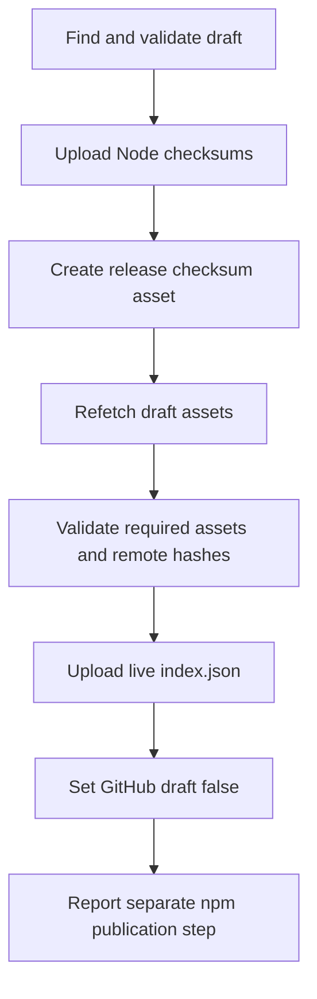

## Overview

Electron releases move through version preparation, tagged CI builds, artifact validation and publication. The preparation entry creates a draft and requests builds; the publication entry merges checksums, verifies assets, updates the live version index and publishes the draft. [[Building and Testing]] covers producing and testing a local binary. This page explains the release scripts' ordering and failure conditions after those development workflows.

Sources: [script/release/prepare-release.ts:213-222](repo://script/release/prepare-release.ts#L213-L222), [script/release/release.ts:414-432](repo://script/release/release.ts#L414-L432)

## Entry points and configuration

The preparation and version-preview entry points accept a positional bump type: stable, minor, beta, alpha or nightly, plus an optional branch. They reject missing or invalid types. Stable and minor select a non-prerelease; nightly selects the nightly release repository. The preview calls `printNextVersion`, which runs the version bumper with its dry-run option. Preparation first computes that preview but then performs a real bump, creates a draft, pushes and requests builds.

Sources: [script/release/bin/prepare-for-release.ts:6-32](repo://script/release/bin/prepare-for-release.ts#L6-L32), [script/release/bin/print-next-version.ts:6-32](repo://script/release/bin/print-next-version.ts#L6-L32), [script/release/prepare-release.ts:29-55](repo://script/release/prepare-release.ts#L29-L55), [script/release/prepare-release.ts:76-86](repo://script/release/prepare-release.ts#L76-L86), [script/release/prepare-release.ts:208-222](repo://script/release/prepare-release.ts#L208-L222)

| Entry file | Operation |
| --- | --- |
| `script/release/bin/print-next-version.ts` | Print the dry-run version calculation |
| `script/release/bin/prepare-for-release.ts` | Prepare a version, draft and CI builds |
| `script/release/bin/validate-before-publish.ts` | Validate the selected draft and required prepublication assets |
| `script/release/bin/publish-to-github.ts` | Run the checksum and publication pipeline |

Sources: [script/release/bin/print-next-version.ts:23-32](repo://script/release/bin/print-next-version.ts#L23-L32), [script/release/bin/prepare-for-release.ts:23-32](repo://script/release/bin/prepare-for-release.ts#L23-L32), [script/release/bin/validate-before-publish.ts:1-6](repo://script/release/bin/validate-before-publish.ts#L1-L6), [script/release/bin/publish-to-github.ts:1-6](repo://script/release/bin/publish-to-github.ts#L1-L6)

GitHub authentication first uses `ELECTRON_GITHUB_TOKEN` if present, otherwise a configured exchange URL and exchange token. Tokens are cached by repository; missing credentials or unsuccessful exchange responses raise errors. Checksum merging separately requires `ELECTRON_ARTIFACTS_BLOB_STORAGE`, and remote hashing passes `ELECTRON_HASHER_FUNCTION_KEY` to the hasher service. These are inputs to different stages, so a valid GitHub token alone does not satisfy artifact verification.

Sources: [script/release/github-token.ts:6-38](repo://script/release/github-token.ts#L6-L38), [script/release/release.ts:278-296](repo://script/release/release.ts#L278-L296), [script/release/get-url-hash.ts:5-20](repo://script/release/get-url-hash.ts#L5-L20)

## Prepare the draft and builds

Preparation chooses the explicit target branch or reads the current branch. The real version bump precedes release-note generation and annotated tagging. Nightlies use a fixed note explaining that tags should be compared; other releases call the notes generator and print any warning it returns. After tagging, preparation checks GitHub for an existing draft with the same version and exits if one exists. That check happens after local version and tag work, so preparation is not a transactional no-change operation on failure.

Sources: [script/release/prepare-release.ts:58-110](repo://script/release/prepare-release.ts#L58-L110), [script/release/prepare-release.ts:192-205](repo://script/release/prepare-release.ts#L192-L205), [script/release/prepare-release.ts:213-222](repo://script/release/prepare-release.ts#L213-L222)

The draft records the version tag, generated body, prerelease flag and target commitish; nightly uses main as that target. The next step pushes HEAD to the chosen branch with follow-tags, then requests release CI with `ghRelease` enabled. Workflow dispatch uses the new version's tag as its ref. Requesting a workflow and finding a queued or running run is not completion of all release artifacts: the preparation output explicitly tells the operator to wait for builds before releasing.

Sources: [script/release/prepare-release.ts:146-190](repo://script/release/prepare-release.ts#L146-L190), [script/release/run-release-ci-jobs.ts:29-80](repo://script/release/run-release-ci-jobs.ts#L29-L80), [script/release/run-release-ci-jobs.ts:107-118](repo://script/release/run-release-ci-jobs.ts#L107-L118)

## Validate the selected draft

The publication module derives its version from repository version metadata and chooses the nightly or normal repository accordingly. Draft lookup requires exactly one matching draft. Beta versions must have the prerelease flag, and notes must be longer than 50 characters without the placeholder marker. The check helper accumulates failures and exits when invoked with its fatal flag, so invalid draft metadata stops the publication sequence before checksum construction.

Sources: [script/release/release.ts:25-67](repo://script/release/release.ts#L25-L67), [script/release/release.ts:118-126](repo://script/release/release.ts#L118-L126)

Asset validation compares the uploaded names against an explicit versioned list covering Electron binaries, symbols, chromedriver, FFmpeg, snapshots, declarations, API JSON and supporting archives. The standalone prepublication validation mode omits the merged `SHASUMS256.txt` requirement and, for a draft, skips the hash-verification branch. Full publication validation requires that checksum asset and verifies the remote files. Thus a passing standalone validation does not mean the later checksum verification has already run.

Sources: [script/release/release.ts:82-115](repo://script/release/release.ts#L82-L115), [script/release/release.ts:128-207](repo://script/release/release.ts#L128-L207), [script/release/release.ts:408-421](repo://script/release/release.ts#L408-L421)

## Construct and verify checksums

`makeRelease` first uploads Node checksum files, then creates the release checksum asset. Checksum merging reads `.sha256sum` blobs under the version prefix from the `checksums-scratchpad` container and concatenates their trimmed ASCII contents. If the draft already contains `SHASUMS256.txt`, that asset is deleted before replacement. The merged text is written to a temporary file and uploaded to GitHub as a text asset with its actual byte length.

Sources: [script/release/release.ts:250-263](repo://script/release/release.ts#L250-L263), [script/release/release.ts:278-359](repo://script/release/release.ts#L278-L359), [script/release/release.ts:362-379](repo://script/release/release.ts#L362-L379), [script/release/release.ts:414-417](repo://script/release/release.ts#L414-L417)

Draft GitHub assets require authenticated download resolution. The verifier sends HEAD requests to the release-asset endpoints with authorization, expects a 301 or 302 redirect and hashes the resulting locations. It excludes checksum files from the data files being hashed, requests SHA-256 values and compares each with the parsed mapping. A mismatch is fatal. Node artifacts from the headers store are additionally verified against SHA-1 mappings.

Sources: [script/release/release.ts:438-479](repo://script/release/release.ts#L438-L479), [script/release/release.ts:518-587](repo://script/release/release.ts#L518-L587), [script/release/release.ts:210-233](repo://script/release/release.ts#L210-L233)

The hasher helper sends the asset URL and algorithm to the remote hashing function. It rejects non-200 responses and empty bodies, parses the returned hash and retries failed calls while attempts remain, starting with three attempts by default. Checksum-map retrieval separately requires HTTP 200 and parses nonempty lines into filename-to-hash entries. Verification depends on both retrieval paths succeeding before any comparison can establish integrity.

Sources: [script/release/get-url-hash.ts:8-49](repo://script/release/get-url-hash.ts#L8-L49), [script/release/release.ts:481-507](repo://script/release/release.ts#L481-L507)

## Publish in the required order

Sources: [script/release/release.ts:38-67](repo://script/release/release.ts#L38-L67), [script/release/release.ts:382-432](repo://script/release/release.ts#L382-L432)

After checksum upload, the script refetches the draft to include its latest asset list and performs full validation. It uploads the live index only then, immediately before publishing. The source explains both sides of this ordering: delaying the index reduces references to releases that fail, while placing it before publication prevents downstream projects from seeing a published version absent from the index. This is an ordered workflow with multiple external writes, not a single atomic commit.

Sources: [script/release/release.ts:414-428](repo://script/release/release.ts#L414-L428)

Publication updates the GitHub release with `draft: false`. For non-prereleases, it compares the version against the current latest release and requests latest status only when the new version is greater than or equal; prereleases are not marked latest by this path. A GitHub update failure exits with code 1. On success, the script reports that npm publication remains a separate step, rather than claiming the GitHub operation has also published the npm package.

Sources: [script/release/release.ts:382-405](repo://script/release/release.ts#L382-L405), [script/release/release.ts:428-432](repo://script/release/release.ts#L428-L432)
