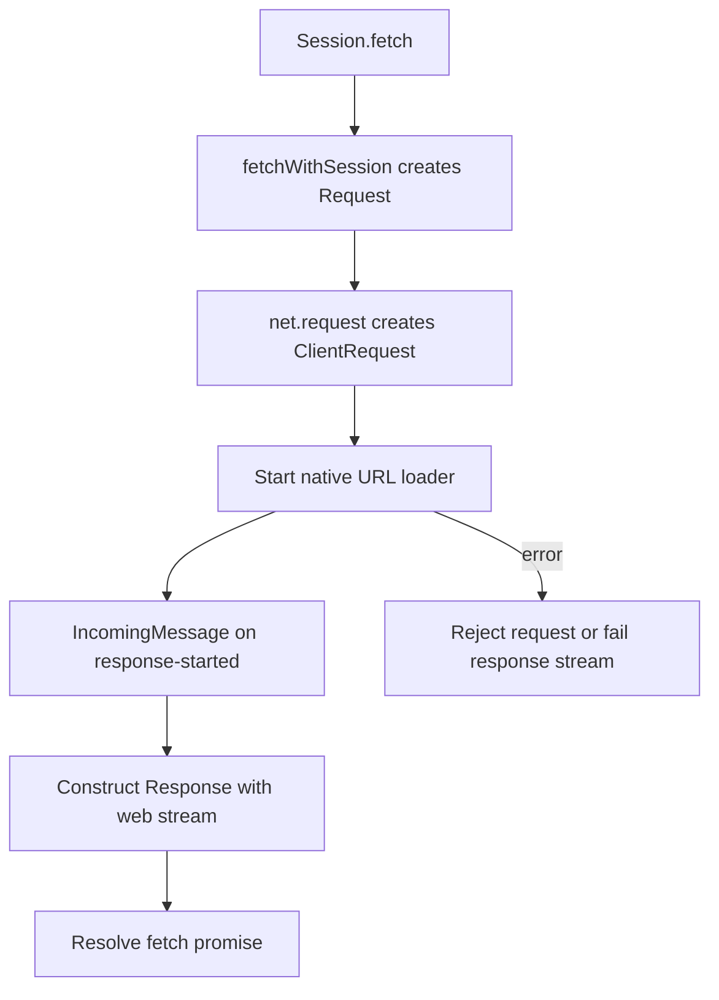

## Overview

Session is the context used by Electron's browser-side fetch and protocol interfaces. The default `net.fetch` forwards to `session.defaultSession.fetch`, while a specific Session invokes the same adapter with itself as the request context. Custom protocol handlers are also selected through a session's protocol object. [[Windows and Navigation]] covers document loading; this page follows explicit network requests and the request/response adapters behind protocol handlers.

Sources: [lib/browser/api/net.ts:8-20](repo://lib/browser/api/net.ts#L8-L20), [lib/browser/api/session.ts:44-46](repo://lib/browser/api/session.ts#L44-L46), [lib/browser/api/protocol.ts:159-180](repo://lib/browser/api/protocol.ts#L159-L180)

## Choose or reuse a session

The session module exposes `fromPartition`, `fromPath` and a defaultSession getter implemented as `fromPartition('')`. Native partition selection uses the default browser context for an empty string, a persistent context for names beginning with `persist:`, and an in-memory context for other names. The persistent prefix is removed before the browser context is selected. `fromPath` requires a nonempty absolute path and reports a TypeError when either condition fails.

Sources: [lib/browser/api/session.ts:114-120](repo://lib/browser/api/session.ts#L114-L120), [shell/browser/api/electron_api_session.cc:1712-1749](repo://shell/browser/api/electron_api_session.cc#L1712-L1749)

`Session::CreateFrom` first returns an existing live Session associated with the browser context. Otherwise it allocates one, calls its JavaScript `_init`, and emits `session-created` after obtaining the wrapper. An exception during initialization triggers the uncaught-exception path and prevents a successful return. The JavaScript initialization installs the listeners described in [[IPC Dispatch]], so a session participates in communication routing as well as requests.

Sources: [shell/browser/api/electron_api_session.cc:1683-1709](repo://shell/browser/api/electron_api_session.cc#L1683-L1709), [lib/browser/api/session.ts:25-26](repo://lib/browser/api/session.ts#L25-L26)

## Adapt fetch to ClientRequest

`fetchWithSession` first constructs a standard Request from its input and initialization options. A constructor error rejects the deferred promise. It then derives an origin header and adjusts `same-origin` credentials to `include` when there is no origin, because the source notes that same-origin credentials cannot be set without one. Method, URL, credentials, cache, referrer policy, redirect mode and the chosen session become ClientRequest options.

Sources: [lib/browser/api/net-fetch.ts:18-27](repo://lib/browser/api/net-fetch.ts#L18-L27), [lib/browser/api/net-fetch.ts:75-88](repo://lib/browser/api/net-fetch.ts#L75-L88)

The adapter uses `allowAnyProtocol`, applies `bypassCustomProtocolHandlers` to the underlying URL loader options and copies request headers. It sets `Sec-Fetch-Mode` when the mode can be represented; the default cors mode is omitted when no origin exists. `net.request` requires application readiness before constructing ClientRequest. During option parsing, a supplied session must be a Session instance, while a supplied partition must be a string; an explicit session takes precedence over partition selection.

Sources: [lib/browser/api/net-fetch.ts:79-99](repo://lib/browser/api/net-fetch.ts#L79-L99), [lib/browser/api/net.ts:8-13](repo://lib/browser/api/net.ts#L8-L13), [lib/common/api/net-client-request.ts:303-316](repo://lib/common/api/net-client-request.ts#L303-L316)

Sources: [lib/browser/api/session.ts:44-46](repo://lib/browser/api/session.ts#L44-L46), [lib/browser/api/net.ts:8-13](repo://lib/browser/api/net.ts#L8-L13), [lib/browser/api/net-fetch.ts:18-27](repo://lib/browser/api/net-fetch.ts#L18-L27), [lib/browser/api/net-fetch.ts:79-124](repo://lib/browser/api/net-fetch.ts#L79-L124), [lib/common/api/net-client-request.ts:426-457](repo://lib/common/api/net-client-request.ts#L426-L457)

## Stream bodies and handle cancellation

On a response event, the adapter constructs Headers from IncomingMessage headers, joining array values with commas. HEAD responses and status codes 101, 204, 205 and 304 receive a null body; other responses expose the incoming stream through `Readable.toWeb`. The resulting Response retains the native response privately as `__original_resp`. The fetch promise resolves at response construction, while later body data continues through the stream.

Sources: [lib/browser/api/net-fetch.ts:101-116](repo://lib/browser/api/net-fetch.ts#L101-L116), [lib/common/api/net-client-request.ts:443-452](repo://lib/common/api/net-client-request.ts#L443-L452)

For an upload body, the adapter pipes the web stream to a writable view of ClientRequest and ends the request when piping completes; without a body it ends immediately. Native response data is stored on IncomingMessage, and completion supplies the stream's end marker. A URL loader error destroys an existing response stream and fails the request. This distinguishes errors before the fetch promise resolves from failures observed while consuming an already-returned body.

Sources: [lib/browser/api/net-fetch.ts:118-124](repo://lib/browser/api/net-fetch.ts#L118-L124), [lib/common/api/net-client-request.ts:443-457](repo://lib/common/api/net-client-request.ts#L443-L457)

An already-aborted Request rejects before creating ClientRequest. For a later abort, the signal listener marks the operation locally aborted, rejects with the signal reason or an AbortError, attempts body cancellation when applicable and calls `r.abort()`. Response handling checks that local flag before constructing a Response. The listener is registered once, matching the single cancellation transition supported by the adapter.

Sources: [lib/browser/api/net-fetch.ts:29-73](repo://lib/browser/api/net-fetch.ts#L29-L73), [lib/browser/api/net-fetch.ts:101-102](repo://lib/browser/api/net-fetch.ts#L101-L102)

## Register a protocol handler

`Protocol.handle` intercepts built-in `http`, `https` and `file` schemes, and registers other schemes through the general protocol registration method. The public module's convenience methods act on `defaultSession.protocol`; a different Session exposes its own protocol object. Handler installation throws when native registration reports failure. `unhandle` and `isProtocolHandled` make the same built-in-versus-custom distinction when choosing the native operation.

Sources: [lib/browser/api/protocol.ts:13-13](repo://lib/browser/api/protocol.ts#L13-L13), [lib/browser/api/protocol.ts:111-113](repo://lib/browser/api/protocol.ts#L111-L113), [lib/browser/api/protocol.ts:146-180](repo://lib/browser/api/protocol.ts#L146-L180)

Each incoming protocol request becomes a Request with URL, headers, method, referrer and converted upload data. A literal `null` origin header is removed. Streamed bodies set duplex to `half`. The adapter awaits the application handler, then converts its response body back into a Node readable stream and passes headers, status code, status text and any original response MIME type to the native callback. That private original-response reference connects the fetch adapter to protocol response forwarding.

Sources: [lib/browser/api/protocol.ts:111-139](repo://lib/browser/api/protocol.ts#L111-L139), [lib/browser/api/net-fetch.ts:109-115](repo://lib/browser/api/net-fetch.ts#L109-L115)

## Upload formats and protocol failures

Upload conversion returns null when no data exists and avoids creating a stream for a single raw buffer. Otherwise it consumes chunks in order, supporting raw bytes, file ranges, data pipes and blobs. Blob retrieval uses the default session because the source explains that this API's implementation relies on global state rather than a session context. An unknown chunk type throws, allowing request conversion to fail through the handler adapter's error path.

Sources: [lib/browser/api/protocol.ts:15-89](repo://lib/browser/api/protocol.ts#L15-L89)

Response validation checks for a nonnull object, accepts an error response, and checks the types of explicitly owned status, statusText, headers and body properties. A supplied nonnull body must be a ReadableStream. Invalid responses return `ERR_UNEXPECTED` (-9); an error Response returns `ERR_FAILED` (-2). Exceptions during conversion or handler execution are logged and also return `ERR_UNEXPECTED`, separating JavaScript adapter failures from a handler deliberately returning an error Response.

Sources: [lib/browser/api/protocol.ts:10-11](repo://lib/browser/api/protocol.ts#L10-L11), [lib/browser/api/protocol.ts:92-108](repo://lib/browser/api/protocol.ts#L92-L108), [lib/browser/api/protocol.ts:127-147](repo://lib/browser/api/protocol.ts#L127-L147)
