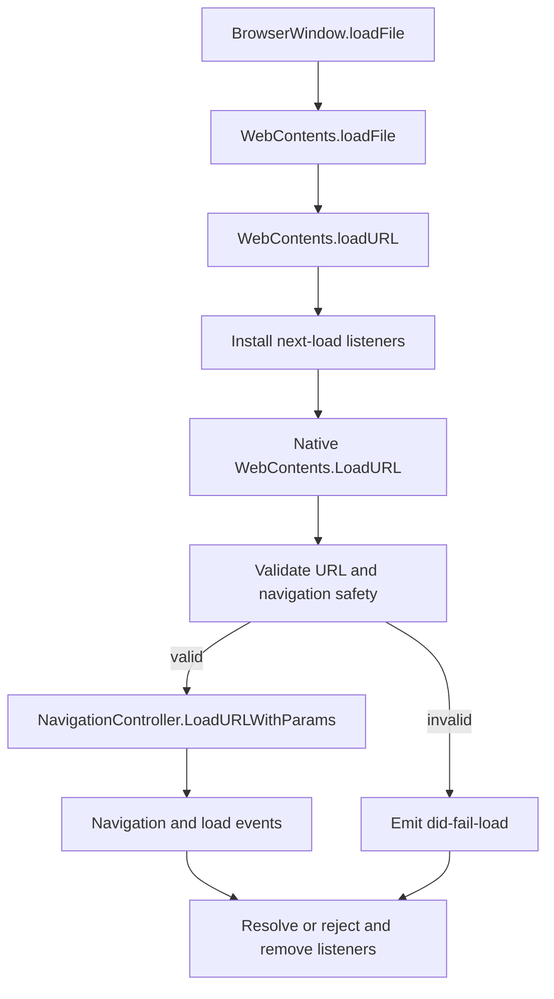

## Overview

BrowserWindow connects a native desktop window to a WebContentsView and its WebContents. The JavaScript window wrapper adds event behavior and convenience methods, while WebContents owns URL loading and its promise. [[Quickstart]] shows the application-facing creation sequence; this page follows the underlying objects through navigation, completion, failure and destruction.

Sources: [shell/browser/api/electron_api_browser_window.cc:67-98](repo://shell/browser/api/electron_api_browser_window.cc#L67-L98), [lib/browser/api/browser-window.ts:8-38](repo://lib/browser/api/browser-window.ts#L8-L38), [lib/browser/api/browser-window.ts:131-155](repo://lib/browser/api/browser-window.ts#L131-L155), [lib/browser/api/web-contents.ts:427-432](repo://lib/browser/api/web-contents.ts#L427-L432)

## Construct and associate the objects

Native construction creates a WebContentsView from web preferences, saves references to the view and its WebContents, installs observers and sets the owner window. After JavaScript initialization, it inserts the WebContentsView before BaseWindow's content view in paint order. The comment explains the consequence: views added to BrowserWindow's content view paint above its web content. Window options are applied after this setup is complete.

Sources: [shell/browser/api/electron_api_browser_window.cc:67-98](repo://shell/browser/api/electron_api_browser_window.cc#L67-L98)

The wrapper inherits from BaseWindow and calls the parent's initialization. It captures the window ID in a nonwritable property so it remains accessible after underlying window destruction. Its `setBounds` wrapper merges supplied fields with current bounds before calling the native method. Focus and blur events are also emitted on `app`, making the same window lifecycle visible to application-level listeners.

Sources: [lib/browser/api/browser-window.ts:1-38](repo://lib/browser/api/browser-window.ts#L1-L38)

## Convert a file load to navigation

`BrowserWindow.loadFile` and `loadURL` forward directly to WebContents. The file method requires a string, resolves it relative to the application path established in [[Application Startup]], and formats a file URL with optional query, search and hash values. It then uses the same URL-loading path as an explicit URL. Reload, sending messages and developer-tools operations are likewise forwarded, so changes to their WebContents implementations affect the window convenience methods.

Sources: [lib/browser/api/browser-window.ts:131-170](repo://lib/browser/api/browser-window.ts#L131-L170), [lib/browser/api/web-contents.ts:324-337](repo://lib/browser/api/web-contents.ts#L324-L337), [lib/browser/init.ts:141-141](repo://lib/browser/init.ts#L141-L141)

Before calling `_loadURL`, the WebContents wrapper creates a promise through `_awaitNextLoad` and registers completion and failure listeners. It also attaches a no-op rejection handler to silence unhandled-rejection reporting, but returns the original promise to the caller. A caller that awaits the load still observes rejection; attaching that internal catch does not turn failure into successful navigation.

Sources: [lib/browser/api/web-contents.ts:342-360](repo://lib/browser/api/web-contents.ts#L342-L360), [lib/browser/api/web-contents.ts:410-432](repo://lib/browser/api/web-contents.ts#L410-L432)

Sources: [lib/browser/api/browser-window.ts:141-143](repo://lib/browser/api/browser-window.ts#L141-L143), [lib/browser/api/web-contents.ts:324-432](repo://lib/browser/api/web-contents.ts#L324-L432), [shell/browser/api/electron_api_web_contents.cc:2331-2404](repo://shell/browser/api/electron_api_web_contents.cc#L2331-L2404)

## Native request options and reentrancy

The native loader rejects invalid or excessively long URLs by emitting `did-fail-load` with `ERR_INVALID_URL`. It builds Chromium navigation parameters from the supplied options: referrer, user agent, extra headers, POST data, a base URL for data URLs and an ignore-cache reload setting. POST data selects the HTTP POST load type; a base URL selects the data load type. These transformations happen before the controller receives the navigation.

Sources: [shell/browser/api/electron_api_web_contents.cc:2331-2372](repo://shell/browser/api/electron_api_web_contents.cc#L2331-L2372)

Starting another navigation while an existing initiating call is still on the stack is explicitly guarded. If deletion is unsafe or the controller is navigating to a pending entry, Electron emits `ERR_FAILED` and returns. Otherwise it discards noncommitted entries and calls `LoadURLWithParams`. That call can emit JavaScript events which destroy the object, so the implementation captures a weak pointer before calling it and checks both object and WebContents lifetime afterward. User activation is notified only if the objects still exist, supporting beforeunload handling.

Sources: [shell/browser/api/electron_api_web_contents.cc:2374-2404](repo://shell/browser/api/electron_api_web_contents.cc#L2374-L2404)

## Resolve or reject the load

The promise records the first main-frame failure and ignores subframe failures for that purpose. A failure before navigation starts finishes immediately. On `did-finish-load`, it resolves unless an error was recorded. Rejection constructs an Error containing the description and URL and attaches `errno`, `code` and `url` properties. Both success and failure remove all listeners installed for that load, so completed requests do not keep watching future navigations.

Sources: [lib/browser/api/web-contents.ts:342-360](repo://lib/browser/api/web-contents.ts#L342-L360), [lib/browser/api/web-contents.ts:383-389](repo://lib/browser/api/web-contents.ts#L383-L389), [lib/browser/api/web-contents.ts:410-423](repo://lib/browser/api/web-contents.ts#L410-L423)

After the first main-frame navigation starts, a second navigation to a different document rejects the pending load with `ERR_ABORTED`. Same-document navigation is treated separately so history-state or hash changes during page load do not abort it. If loading stops without a finish or failure event, the fallback creates `ERR_FAILED`; destruction uses that same fallback listener. This covers cases where the normal event pair never arrives, including the bad-scheme scenario identified in the source comment.

Sources: [lib/browser/api/web-contents.ts:363-408](repo://lib/browser/api/web-contents.ts#L363-L408), [lib/browser/api/web-contents.ts:418-423](repo://lib/browser/api/web-contents.ts#L418-L423)

## Window events and teardown

BrowserWindow delays an unresponsive notification by 50 milliseconds, cancels it on responsiveness, and suppresses emission if the window is destroyed or disabled. A nonprevented close schedules a five-second unresponsive timer after a microtask; WebContents destruction clears that timer. Visibility tracking computes visible as shown and not minimized, then emits an internal visibility change only when that combined state changes across show, hide, minimize, maximize or restore events.

Sources: [lib/browser/api/browser-window.ts:40-81](repo://lib/browser/api/browser-window.ts#L40-L81)

Native teardown removes observers and destroys remaining WebContents when the BrowserWindow is destroyed directly. Conversely, WebContents destruction clears the native pointer and immediately closes the window. These directions explain why the wrapper checks object lifetime before forwarding certain events. Application-wide decisions about whether closing the final window quits the process remain in the lifecycle covered by [[Application Startup]].

Sources: [shell/browser/api/electron_api_browser_window.cc:101-117](repo://shell/browser/api/electron_api_browser_window.cc#L101-L117), [lib/browser/api/browser-window.ts:40-65](repo://lib/browser/api/browser-window.ts#L40-L65), [lib/browser/init.ts:186-191](repo://lib/browser/init.ts#L186-L191)

## Control child windows

`setWindowOpenHandler` stores a callback whose response must be a nonnull object with action `allow` or `deny`. Invalid responses log an error and prevent the opening; denial prevents it without accepting options. An allow response can supply constructor overrides, an `outlivesOpener` boolean and a custom creation function. Without a registered handler, this wrapper returns its default response rather than applying an implicit denial.

Sources: [lib/browser/api/web-contents.ts:435-477](repo://lib/browser/api/web-contents.ts#L435-L477)

The guest-window manager reuses an existing live WebContents for a matching frame name. Otherwise it applies parsed features and constructor overrides, then calls a supplied creation function or constructs a BrowserWindow. A custom creator must return the provided guest WebContents when one was supplied. Unless `outlivesOpener` is set, the guest is destroyed when the opener's current render view is deleted; the source identifies that relationship as Electron convention.

Sources: [lib/browser/guest-window-manager.ts:40-99](repo://lib/browser/guest-window-manager.ts#L40-L99), [lib/browser/guest-window-manager.ts:104-130](repo://lib/browser/guest-window-manager.ts#L104-L130)
