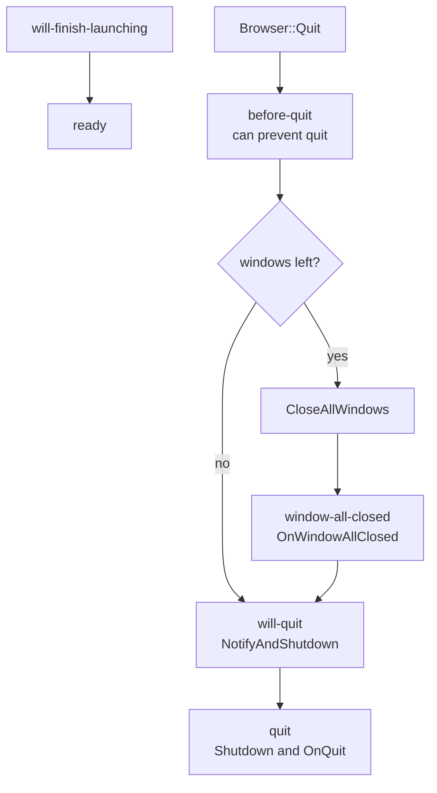

## Overview

The `app` object is a native object, and most of its events are emitted by C++. `Browser` is the process-wide singleton that tracks launch and quit, and it notifies `App`, which emits the matching JavaScript event. `lib/browser/api/app.ts` adds only a few wrappers on top of the native object. The windows an app opens are described in [[Browser Windows]].

Sources: [shell/browser/browser.cc:179-200](repo://shell/browser/browser.cc#L179-L200), [shell/browser/api/electron_api_app.cc:612-624](repo://shell/browser/api/electron_api_app.cc#L612-L624), [lib/browser/api/app.ts:6-8](repo://lib/browser/api/app.ts#L6-L8)

## Launch

`Browser::WillFinishLaunching` notifies the observers, and `App` emits `will-finish-launching` from that call. `Browser::DidFinishLaunching` creates the user data directory, sets the ready flag, and resolves the ready promise before it notifies the observers. `App::OnFinishLaunching` then emits `ready` with the launch information.

Sources: [shell/browser/browser.cc:179-181](repo://shell/browser/browser.cc#L179-L181), [shell/browser/browser.cc:183-200](repo://shell/browser/browser.cc#L183-L200), [shell/browser/api/electron_api_app.cc:612-615](repo://shell/browser/api/electron_api_app.cc#L612-L615), [shell/browser/api/electron_api_app.cc:617-624](repo://shell/browser/api/electron_api_app.cc#L617-L624)

On Linux and Windows the `ready` event fires later, in `PreMainMessageLoopRun`, and the code comment there gives the reason for it.

Sources: [shell/browser/browser.cc:42-46](repo://shell/browser/browser.cc#L42-L46), [shell/browser/browser.cc:217-219](repo://shell/browser/browser.cc#L217-L219)

`app.whenReady()` is bound to `Browser::WhenReady`. It creates the promise the first time it is called, and resolves it at once if the app is already ready.

Sources: [shell/browser/browser.cc:204-210](repo://shell/browser/browser.cc#L204-L210), [shell/browser/api/electron_api_app.cc:1741](repo://shell/browser/api/electron_api_app.cc#L1741)

## Quitting

`Browser::Quit` returns at once if a quit is already in progress. Otherwise it calls `HandleBeforeQuit`, which notifies the observers of `before-quit`. The app can prevent the quit from that event. When no windows remain, it calls `NotifyAndShutdown`; otherwise it closes every window and the quit continues as the windows close.

Sources: [shell/browser/browser.cc:86-98](repo://shell/browser/browser.cc#L86-L98), [shell/browser/browser.cc:246-251](repo://shell/browser/browser.cc#L246-L251), [shell/browser/api/electron_api_app.cc:572-576](repo://shell/browser/api/electron_api_app.cc#L572-L576)

`App::OnWillQuit` emits `will-quit`, which can also be prevented. `NotifyAndShutdown` runs that notification before it calls `Shutdown`, and a prevented `will-quit` cancels the quit. `Shutdown` then notifies `OnQuit`, and `App::OnQuit` emits `quit` with the exit code and cleans up the process singleton.

Sources: [shell/browser/api/electron_api_app.cc:579-583](repo://shell/browser/api/electron_api_app.cc#L579-L583), [shell/browser/browser.cc:232-243](repo://shell/browser/browser.cc#L232-L243), [shell/browser/browser.cc:125-132](repo://shell/browser/browser.cc#L125-L132), [shell/browser/api/electron_api_app.cc:589-597](repo://shell/browser/api/electron_api_app.cc#L589-L597)

Sources: [shell/browser/browser.cc:86-98](repo://shell/browser/browser.cc#L86-L98), [shell/browser/browser.cc:125-132](repo://shell/browser/browser.cc#L125-L132), [shell/browser/browser.cc:232-243](repo://shell/browser/browser.cc#L232-L243), [shell/browser/browser.cc:259-268](repo://shell/browser/browser.cc#L259-L268), [shell/browser/api/electron_api_app.cc:572-597](repo://shell/browser/api/electron_api_app.cc#L572-L597)

## Window-all-closed

When the last window closes, `Browser::OnWindowAllClosed` shuts down at once if the app is exiting, and completes the quit if one is in progress. Otherwise it only notifies the observers, which emit `window-all-closed`. In that last branch the browser does not quit by itself, so the app decides whether to call `app.quit()`.

Sources: [shell/browser/browser.cc:259-268](repo://shell/browser/browser.cc#L259-L268), [shell/browser/api/electron_api_app.cc:585-587](repo://shell/browser/api/electron_api_app.cc#L585-L587)

## Single-instance lock

`App::RequestSingleInstanceLock` returns true at once if the lock is held. Otherwise it creates the user data directory and passes `App::OnSecondInstance` as the callback. That callback emits `second-instance` with the second process's argument list, its working directory and any additional data.

Sources: [shell/browser/api/electron_api_app.cc:1039-1050](repo://shell/browser/api/electron_api_app.cc#L1039-L1050), [shell/browser/api/electron_api_app.cc:1023-1031](repo://shell/browser/api/electron_api_app.cc#L1023-L1031)

If another process already holds the singleton, `NotifyOtherProcessOrCreate` sends it the new command line. The current process only starts watching the socket when no other process answers, and on Linux it passes the activation token along with the notification.

Sources: [shell/browser/api/electron_api_app.cc:1066-1084](repo://shell/browser/api/electron_api_app.cc#L1066-L1084)

## Command-line checks

`CheckCommandLineArguments` returns false when an argument that looks like a URL is followed by any argument other than `--`. The Windows entry point calls it before it starts Chromium, and it is there to block a known protocol-handler exploit.

Sources: [shell/app/command_line_args.cc:44-55](repo://shell/app/command_line_args.cc#L44-L55), [shell/app/electron_main_win.cc:225-226](repo://shell/app/electron_main_win.cc#L225-L226)

`IsSandboxEnabled` is true when `--enable-sandbox` is given, or when `--no-sandbox` is absent. The sandbox decisions in [[Browser Process Startup]] and [[Process Model]] use this function.

Sources: [shell/app/command_line_args.cc:57-59](repo://shell/app/command_line_args.cc#L57-L59), [shell/common/options_switches.h:233](repo://shell/common/options_switches.h#L233)

## The JavaScript wrapper

`lib/browser/api/app.ts` takes the native `app` from the `electron_browser_app` binding and wraps the accessibility and badge-count accessors. It also forwards `certificate-error` and `select-client-certificate` from `app` to the `webContents` that raised them.

Sources: [lib/browser/api/app.ts:6-8](repo://lib/browser/api/app.ts#L6-L8), [lib/browser/api/app.ts:19-27](repo://lib/browser/api/app.ts#L19-L27), [lib/browser/api/app.ts:110-116](repo://lib/browser/api/app.ts#L110-L116)
