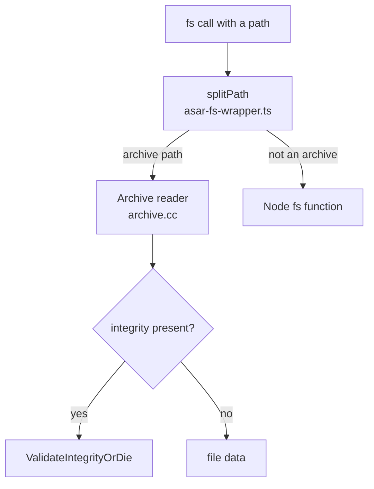

## Overview

An app's files can be packed into one ASAR archive, and Electron reads them in three places: a C++ reader that opens the archive and checks its integrity, a Node-side wrapper that makes the `fs` module read from archives, and a browser URL loader that serves archive files to the network stack. Build-time fuses decide how strictly the first two behave.

Sources: [shell/common/asar/archive.cc:167-200](repo://shell/common/asar/archive.cc#L167-L200), [lib/node/asar-fs-wrapper.ts:70-74](repo://lib/node/asar-fs-wrapper.ts#L70-L74), [shell/browser/net/asar/asar_url_loader_factory.cc:15-24](repo://shell/browser/net/asar/asar_url_loader_factory.cc#L15-L24)

## Opening an archive

`Archive::Init` may run only once, enforced by a `CHECK`. If the file is not valid, it logs a warning unless the error is "not found", and returns false.

Sources: [shell/common/asar/archive.cc:189-200](repo://shell/common/asar/archive.cc#L189-L200)

`GetOrCreateAsarArchive` keeps a cache keyed by path, so a second request for the same archive returns the open object. A failed `Init` leaves nothing in the cache, and the function returns null.

Sources: [shell/common/asar/asar_util.cc:47-76](repo://shell/common/asar/asar_util.cc#L47-L76)

## Checking integrity

The archive's header can carry an `integrity` object with an algorithm, a hash, a block size and a list of block hashes. `Archive` reads that object only when the `embedded_asar_integrity_validation` fuse is on. Each file's entry then keeps its own integrity payload, which the URL loader uses below.

Sources: [shell/common/asar/archive.cc:91-93](repo://shell/common/asar/archive.cc#L91-L93), [shell/common/asar/archive.cc:121-137](repo://shell/common/asar/archive.cc#L121-L137), [shell/common/asar/archive.cc:270-272](repo://shell/common/asar/archive.cc#L270-L272)

`ValidateIntegrityOrDie` compares a SHA-256 hash of the input with the expected value and calls `LOG(FATAL)` on a mismatch or on an unsupported algorithm, so a modified archive stops the process rather than loading.

Sources: [shell/common/asar/asar_util.cc:137-148](repo://shell/common/asar/asar_util.cc#L137-L148)

The same fuse also covers the V8 snapshot. When the fuse is on and a snapshot is loaded, `ValidateV8Snapshot` checks the snapshot's SHA-256 hash.

Sources: [shell/app/electron_main_delegate.cc:212-224](repo://shell/app/electron_main_delegate.cc#L212-L224)

## Reading archive files from JavaScript

`wrapFsWithAsar` replaces the `fs` methods with versions that first split the path. `splitPath` returns `isAsar: false` when asar is disabled, and otherwise separates the archive file from the path inside it.

Sources: [lib/node/asar-fs-wrapper.ts:290-311](repo://lib/node/asar-fs-wrapper.ts#L290-L311), [lib/node/asar-fs-wrapper.ts:70-74](repo://lib/node/asar-fs-wrapper.ts#L70-L74)

`overrideAPISync` and `overrideAPI` wrap a single function. They take the path from one argument and run `splitPath` on it. `dlopen` and `.node` loading are wrapped by the same synchronous helper.

Sources: [lib/node/asar-fs-wrapper.ts:185-190](repo://lib/node/asar-fs-wrapper.ts#L185-L190), [lib/node/asar-fs-wrapper.ts:209-212](repo://lib/node/asar-fs-wrapper.ts#L209-L212), [lib/node/asar-fs-wrapper.ts:1234-1239](repo://lib/node/asar-fs-wrapper.ts#L1234-L1239)

Asar is turned off per process by `process.noAsar`, or by `ELECTRON_NO_ASAR` in processes other than the browser and renderer. The check runs in `splitPath` before any archive lookup.

Sources: [lib/node/asar-fs-wrapper.ts:15-18](repo://lib/node/asar-fs-wrapper.ts#L15-L18), [lib/node/asar-fs-wrapper.ts:70-74](repo://lib/node/asar-fs-wrapper.ts#L70-L74)

## Serving archive files to the network stack

`AsarURLLoaderFactory::Create` returns a remote `URLLoaderFactory` that deletes itself when its last receiver disconnects. When a file has integrity data, the loader wraps its data source in an `AsarFileValidator`, which checks each block as it is read. The request path that reaches this loader is in [[Protocols and Network Requests]].

Sources: [shell/browser/net/asar/asar_url_loader_factory.cc:15-24](repo://shell/browser/net/asar/asar_url_loader_factory.cc#L15-L24), [shell/browser/net/asar/asar_url_loader.cc:155-166](repo://shell/browser/net/asar/asar_url_loader.cc#L155-L166), [shell/browser/net/asar/asar_file_validator.cc:43-56](repo://shell/browser/net/asar/asar_file_validator.cc#L43-L56)

Sources: [lib/node/asar-fs-wrapper.ts:185-190](repo://lib/node/asar-fs-wrapper.ts#L185-L190), [shell/common/asar/archive.cc:121-137](repo://shell/common/asar/archive.cc#L121-L137), [shell/common/asar/asar_util.cc:137-148](repo://shell/common/asar/asar_util.cc#L137-L148)

## Fuses

Fuses are one-byte flags that are compiled into the binary. `build/fuses/fuses.json5` lists them with their defaults, and its `_comment` says a fuse is never removed or given a new meaning, only marked as removed. The two that govern asar are off by default.

Sources: [build/fuses/fuses.json5:2](repo://build/fuses/fuses.json5#L2), [build/fuses/build.py:44](repo://build/fuses/build.py#L44)

| Fuse | Default | Effect on asar |
| --- | --- | --- |
| `embedded_asar_integrity_validation` | `0` | Reads archive integrity data and checks the V8 snapshot |
| `only_load_app_from_asar` | `0` | Limits the app search paths to `app.asar` |

Sources: [build/fuses/fuses.json5:2](repo://build/fuses/fuses.json5#L2), [build/fuses/fuses.json5:9-10](repo://build/fuses/fuses.json5#L9-L10), [shell/common/asar/archive.cc:121-122](repo://shell/common/asar/archive.cc#L121-L122), [shell/app/electron_main_delegate.cc:216-218](repo://shell/app/electron_main_delegate.cc#L216-L218)

`only_load_app_from_asar` changes the search paths that the browser gives Node. When the fuse is on, the list is only `app.asar`; otherwise it also includes `app` and `default_app.asar`.

Sources: [shell/common/node_bindings.cc:680-699](repo://shell/common/node_bindings.cc#L680-L699)

`build/fuses/build.py` writes the fuse wire into C++: a sentinel, the fuse version, the number of fuses and one byte per fuse from the defaults. It also writes an `Is<Name>Enabled` getter for each fuse. In builds with DCHECKs on, a getter first checks a `--set-fuse-<name>` switch, and otherwise reads its byte from the wire.

Sources: [build/fuses/build.py:44](repo://build/fuses/build.py#L44), [build/fuses/build.py:59-61](repo://build/fuses/build.py#L59-L61), [build/fuses/build.py:73-88](repo://build/fuses/build.py#L73-L88)
