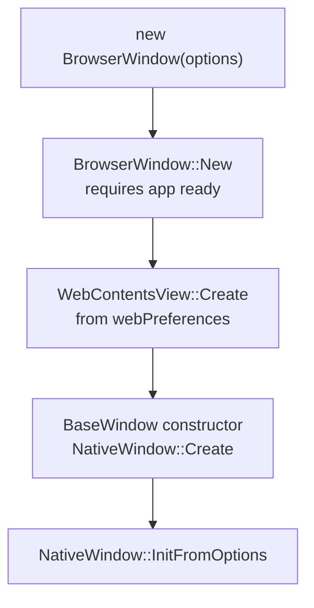

## Overview

`BaseWindow` and `BrowserWindow` are JavaScript classes that sit on native classes registered by two bindings. A `BaseWindow` owns one `NativeWindow`, which is the platform window. A `BrowserWindow` adds a `WebContentsView` inside that window, so the page is drawn in it. The JavaScript side sets up the prototype chain and wraps a few methods and events.

Sources: [lib/browser/api/browser-window.ts:4-6](repo://lib/browser/api/browser-window.ts#L4-L6), [lib/browser/api/base-window.ts:6-8](repo://lib/browser/api/base-window.ts#L6-L8), [shell/browser/api/electron_api_base_window.cc:96-124](repo://shell/browser/api/electron_api_base_window.cc#L96-L124), [shell/browser/api/electron_api_browser_window.cc:28-34](repo://shell/browser/api/electron_api_browser_window.cc#L28-L34)

## Creating a BrowserWindow

`BrowserWindow::New` refuses to run before `Browser::Get()->is_ready()` is true, which is set when the app's ready event is dispatched ([[App Lifecycle and Command Line]]). It accepts at most one argument, the options object. With no options it uses an empty object. It then constructs the window.

Sources: [shell/browser/api/electron_api_browser_window.cc:293-310](repo://shell/browser/api/electron_api_browser_window.cc#L293-L310)

The constructor reads `webPreferences` and passes it to `WebContentsView::Create`. It sets `show` to true unless the caller gave a value, and it copies a `webContents` option into the preferences as a hidden value. The constructor then keeps a weak reference to the `WebContents`, observes it, and records the window as its owner.

Sources: [shell/browser/api/electron_api_browser_window.cc:56-85](repo://shell/browser/api/electron_api_browser_window.cc#L56-L85)

After the `WebContentsView` is inserted as the first child of the window's contents view, the constructor calls `InitFromOptions`. The comment says the window is initialized after everything else has been set up.

Sources: [shell/browser/api/electron_api_browser_window.cc:86-98](repo://shell/browser/api/electron_api_browser_window.cc#L86-L98)

## The base constructor

The `BaseWindow` constructor takes the parent window from `options.parent`. An offscreen window is forced to be frameless, and the constructor then calls `NativeWindow::Create` with the options and the parent. It adds an observer to the native window, sets an empty content view, and sets the icon when one is given.

Sources: [shell/browser/api/electron_api_base_window.cc:96-124](repo://shell/browser/api/electron_api_base_window.cc#L96-L124)

The argument-taking `BaseWindow` constructor calls `InitWithArgs` and then `InitFromOptions`. `BrowserWindow` uses the constructor without arguments and calls `InitFromOptions` itself at the end.

Sources: [shell/browser/api/electron_api_base_window.cc:126-131](repo://shell/browser/api/electron_api_base_window.cc#L126-L131), [shell/browser/api/electron_api_browser_window.cc:97-98](repo://shell/browser/api/electron_api_browser_window.cc#L97-L98)

## Platform window classes

`NativeWindow::Create` picks the platform class. On macOS it returns a `NativeWindowMac`, and elsewhere it returns a `NativeWindowViews`.

Sources: [shell/browser/native_window_mac.mm:1879-1882](repo://shell/browser/native_window_mac.mm#L1879-L1882), [shell/browser/native_window_views.cc:1950-1954](repo://shell/browser/native_window_views.cc#L1950-L1954)

The `NativeWindow` constructor reads the options that cannot change later: the title bar style, transparency, larger-than-screen support, the modal flag for windows with a parent, and whether a frame is shown. A frame is only drawn when the title bar style is `normal`.

Sources: [shell/browser/native_window.cc:100-112](repo://shell/browser/native_window.cc#L100-L112)

`NativeWindowViews` sets the title and the menu bar's auto-hide flag from the options as it is constructed.

Sources: [shell/browser/native_window_views.cc:198-205](repo://shell/browser/native_window_views.cc#L198-L205)

`NativeWindow::InitFromOptions` applies the rest of the options: the position and center, the size constraints, and the closable, movable, shadow and opacity flags.

Sources: [shell/browser/native_window.cc:137-190](repo://shell/browser/native_window.cc#L137-L190)

Sources: [shell/browser/api/electron_api_browser_window.cc:293-310](repo://shell/browser/api/electron_api_browser_window.cc#L293-L310), [shell/browser/api/electron_api_browser_window.cc:56-70](repo://shell/browser/api/electron_api_browser_window.cc#L56-L70), [shell/browser/api/electron_api_base_window.cc:111-113](repo://shell/browser/api/electron_api_base_window.cc#L111-L113), [shell/browser/api/electron_api_browser_window.cc:98](repo://shell/browser/api/electron_api_browser_window.cc#L98)

The JavaScript prototype forwards `blur` and `focus` from the window to the `app`, as `browser-window-blur` and `browser-window-focus`. It also makes `id` read-only so it stays valid after the native window is destroyed.

Sources: [lib/browser/api/browser-window.ts:17-21](repo://lib/browser/api/browser-window.ts#L17-L21), [lib/browser/api/browser-window.ts:33-38](repo://lib/browser/api/browser-window.ts#L33-L38)

The `loadURL`, `loadFile` and `send` methods on `BrowserWindow` are forwarded to `webContents`. The page that a window shows is therefore set up in [[Web Contents]].

Sources: [lib/browser/api/browser-window.ts:133-134](repo://lib/browser/api/browser-window.ts#L133-L134), [lib/browser/api/browser-window.ts:141-142](repo://lib/browser/api/browser-window.ts#L141-L142), [lib/browser/api/browser-window.ts:149-150](repo://lib/browser/api/browser-window.ts#L149-L150)
