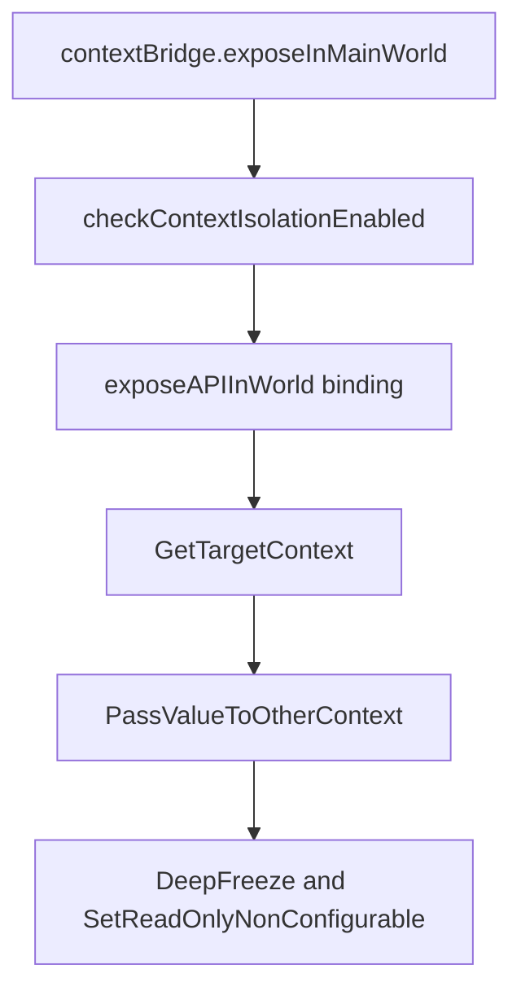

## Overview

`contextBridge` lets a preload script hand an API to the page, which runs in the main world, while the preload runs in an isolated world. The JavaScript layer checks that context isolation is on and forwards each call to a native binding. The native side copies the value into the target world, as a proxy for functions and a rebuilt copy for data, and then freezes it.

Sources: [lib/renderer/api/context-bridge.ts:1-20](repo://lib/renderer/api/context-bridge.ts#L1-L20), [shell/renderer/api/electron_api_context_bridge.cc:808-823](repo://shell/renderer/api/electron_api_context_bridge.cc#L808-L823)

Sources: [lib/renderer/api/context-bridge.ts:3-11](repo://lib/renderer/api/context-bridge.ts#L3-L11), [shell/renderer/api/electron_api_context_bridge.cc:733-768](repo://shell/renderer/api/electron_api_context_bridge.cc#L733-L768), [shell/renderer/api/electron_api_context_bridge.cc:808-823](repo://shell/renderer/api/electron_api_context_bridge.cc#L808-L823)

## The public API

`exposeInMainWorld` passes world 0, which is the main world, to the binding. `exposeInIsolatedWorld` takes an explicit world ID, and `executeInMainWorld` runs a script in the main world. Each one first runs `checkContextIsolationEnabled`, which throws when the process is not context-isolated.

Sources: [lib/renderer/api/context-bridge.ts:3-19](repo://lib/renderer/api/context-bridge.ts#L3-L19)

`GetTargetContext` maps the world ID to a context. For render frames the ID is 0 for the main world or another isolated world ID. Service workers support only their one isolated context and the main worker context, and any other ID is invalid.

Sources: [shell/renderer/api/electron_api_context_bridge.cc:770-790](repo://shell/renderer/api/electron_api_context_bridge.cc#L770-L790)

## Exposing a value

`ExposeAPI` refuses to bind a key that already exists on the target window and throws the error to the caller. It then copies the value into the target world with `PassValueToOtherContext`, using the source global as the parent.

Sources: [shell/renderer/api/electron_api_context_bridge.cc:733-756](repo://shell/renderer/api/electron_api_context_bridge.cc#L733-L756)

Objects are frozen before they are set. `DeepFreeze` freezes every object reachable from the proxy, unless the proxy is a typed array. The key is then set as read-only and non-configurable. The `ContextBridgeMutability` feature, which is off by default, sets the key as a plain writable property instead.

Sources: [shell/renderer/api/electron_api_context_bridge.cc:758-768](repo://shell/renderer/api/electron_api_context_bridge.cc#L758-L768), [shell/renderer/api/electron_api_context_bridge.cc:35-39](repo://shell/renderer/api/electron_api_context_bridge.cc#L35-L39), [shell/renderer/api/electron_api_context_bridge.cc:66-90](repo://shell/renderer/api/electron_api_context_bridge.cc#L66-L90)

## How values cross

`PassValueToOtherContextInner` stops with a `TypeError` once the value nests deeper than `kMaxRecursion`, which is 1000 levels. Each kind of value then has its own branch. A function becomes a proxy that calls the original in its own world. A promise becomes a proxy promise, and a native error is rebuilt in the destination world with its message.

Sources: [shell/renderer/api/electron_api_context_bridge.cc:59](repo://shell/renderer/api/electron_api_context_bridge.cc#L59), [shell/renderer/api/electron_api_context_bridge.cc:153-170](repo://shell/renderer/api/electron_api_context_bridge.cc#L153-L170), [shell/renderer/api/electron_api_context_bridge.cc:196-200](repo://shell/renderer/api/electron_api_context_bridge.cc#L196-L200), [shell/renderer/api/electron_api_context_bridge.cc:240-242](repo://shell/renderer/api/electron_api_context_bridge.cc#L240-L242), [shell/renderer/api/electron_api_context_bridge.cc:358-360](repo://shell/renderer/api/electron_api_context_bridge.cc#L358-L360)

`ProxyFunctionWrapper` is the function that runs when the page calls a proxied function. It takes the calling context from the isolate and passes its arguments across.

Sources: [shell/renderer/api/electron_api_context_bridge.cc:492-500](repo://shell/renderer/api/electron_api_context_bridge.cc#L492-L500)

Arrays and plain objects are rebuilt in the destination world. `IsPlainObject` decides which objects are plain: it excludes dates, regular expressions, promises, maps, sets, and the boxed primitive types.

Sources: [shell/renderer/api/electron_api_context_bridge.cc:378-380](repo://shell/renderer/api/electron_api_context_bridge.cc#L378-L380), [shell/renderer/api/electron_api_context_bridge.cc:433-436](repo://shell/renderer/api/electron_api_context_bridge.cc#L433-L436), [shell/renderer/api/electron_api_context_bridge.cc:91-100](repo://shell/renderer/api/electron_api_context_bridge.cc#L91-L100)

## Internal overrides

`internalContextBridge` is attached to `contextBridge` only when the binding reports `_isDebug`. It can replace a global value in another world, with or without dynamic properties, and it can install a getter and setter as a property. These are the functions behind `OverrideGlobalValueFromIsolatedWorld` and `OverrideGlobalPropertyFromIsolatedWorld`.

Sources: [lib/renderer/api/context-bridge.ts:24-39](repo://lib/renderer/api/context-bridge.ts#L24-L39), [shell/renderer/api/electron_api_context_bridge.cc:834-840](repo://shell/renderer/api/electron_api_context_bridge.cc#L834-L840), [shell/renderer/api/electron_api_context_bridge.cc:867-872](repo://shell/renderer/api/electron_api_context_bridge.cc#L867-L872)
