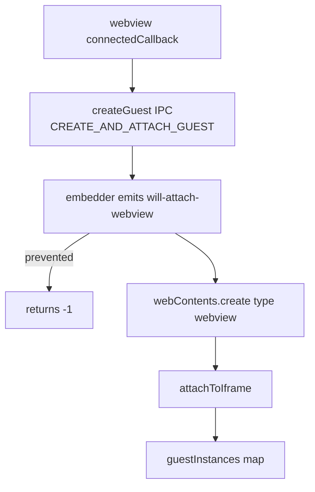

## Overview

A `webview` element is a custom element in the embedder's page that asks the browser to create a guest web contents and attach it to an iframe. `lib/renderer/web-view` defines the element and its attributes, and `lib/browser/guest-view-manager.ts` creates, tracks and detaches the guests. `window.open` children take a separate path through `lib/browser/guest-window-manager.ts`.

Sources: [lib/renderer/web-view/web-view-element.ts:17-19](repo://lib/renderer/web-view/web-view-element.ts#L17-L19), [lib/browser/guest-view-manager.ts:83-100](repo://lib/browser/guest-view-manager.ts#L83-L100), [lib/browser/guest-window-manager.ts:1-7](repo://lib/browser/guest-window-manager.ts#L1-L7)

Sources: [lib/renderer/web-view/web-view-element.ts:51-64](repo://lib/renderer/web-view/web-view-element.ts#L51-L64), [lib/renderer/web-view/guest-view-internal.ts:21-31](repo://lib/renderer/web-view/guest-view-internal.ts#L21-L31), [lib/browser/guest-view-manager.ts:289-291](repo://lib/browser/guest-view-manager.ts#L289-L291), [lib/browser/guest-view-manager.ts:83-104](repo://lib/browser/guest-view-manager.ts#L83-L104), [lib/browser/guest-view-manager.ts:186-206](repo://lib/browser/guest-view-manager.ts#L186-L206)

## The element

`WebViewElement` is defined inside a special scope, and `customElements.define` registers it as `webview`. The element implements `connectedCallback`, `attributeChangedCallback` and `disconnectedCallback`, and `disconnectedCallback` detaches the guest.

Sources: [lib/renderer/web-view/web-view-element.ts:17-19](repo://lib/renderer/web-view/web-view-element.ts#L17-L19), [lib/renderer/web-view/web-view-element.ts:51-80](repo://lib/renderer/web-view/web-view-element.ts#L51-L80), [lib/renderer/web-view/web-view-element.ts:93-102](repo://lib/renderer/web-view/web-view-element.ts#L93-L102)

`WebViewImpl.createGuest` passes the element and its instance ID to the shared `createGuest` helper, which sends `GUEST_VIEW_MANAGER_CREATE_AND_ATTACH_GUEST` with the embedder frame's token. The call is asynchronous and resolves to the guest instance ID.

Sources: [lib/renderer/web-view/web-view-impl.ts:105-107](repo://lib/renderer/web-view/web-view-impl.ts#L105-L107), [lib/renderer/web-view/guest-view-internal.ts:21-31](repo://lib/renderer/web-view/guest-view-internal.ts#L21-L31)

## Creating the guest

The browser handles the message with `createGuest`, which builds the web preferences from the embedder and the element's parameters. It emits `will-attach-webview` on the embedder first, and the embedder can prevent the attach, in which case the function returns -1.

Sources: [lib/browser/guest-view-manager.ts:289-291](repo://lib/browser/guest-view-manager.ts#L289-L291), [lib/browser/guest-view-manager.ts:83-98](repo://lib/browser/guest-view-manager.ts#L83-L98)

The guest is an ordinary `WebContents` created with type `webview` and the embedder. The browser stores it in `guestInstances` under its ID, with the element instance ID and the embedder, and it removes the entry when the guest is destroyed.

Sources: [lib/browser/guest-view-manager.ts:100-118](repo://lib/browser/guest-view-manager.ts#L100-L118)

Before the new guest is attached, `createGuest` looks up any older guest that the same element was using in `embedderElementsMap`, under the key of the embedder ID and the element instance ID, and calls `detachFromOuterFrame` on it. It then calls `setEmbedder`, watches the embedder, adds the guest to the webview manager, and attaches it to the iframe.

Sources: [lib/browser/guest-view-manager.ts:186-206](repo://lib/browser/guest-view-manager.ts#L186-L206)

## Preferences

`makeWebPreferences` reads the `webpreferences` attribute of the element with the same parser that `window.open` uses for its features string. The guest preferences then include `sandbox` set to true.

Sources: [lib/browser/guest-view-manager.ts:25-31](repo://lib/browser/guest-view-manager.ts#L25-L31), [lib/browser/guest-view-manager.ts:55](repo://lib/browser/guest-view-manager.ts#L55)

## Detaching

`detachGuest` removes the guest from the webview manager and from `guestInstances`, and deletes the element's key from `embedderElementsMap`. It does nothing when the caller is not the embedder that owns the guest. The element's `disconnectedCallback` and the guest's `destroyed` event both lead here.

Sources: [lib/browser/guest-view-manager.ts:208-223](repo://lib/browser/guest-view-manager.ts#L208-L223), [lib/renderer/web-view/guest-view-internal.ts:34-35](repo://lib/renderer/web-view/guest-view-internal.ts#L34-L35), [lib/renderer/web-view/web-view-element.ts:72-80](repo://lib/renderer/web-view/web-view-element.ts#L72-L80)

## Window.open children

`window.open` does not use the guest map. `openGuestWindow` in `guest-window-manager.ts` takes the embedder, the guest and the open arguments, and it can call a `createWindow` function that the app supplies. Otherwise it creates a `BrowserWindow` itself. Frame names are kept in a map from the name to the child's web contents.

Sources: [lib/browser/guest-window-manager.ts:20-38](repo://lib/browser/guest-window-manager.ts#L20-L38), [lib/browser/guest-window-manager.ts:64-81](repo://lib/browser/guest-window-manager.ts#L64-L81), [lib/browser/api/web-contents.ts:439-443](repo://lib/browser/api/web-contents.ts#L439-L443)

Messages between the webview element and the guest, such as method calls and property access, go through the `GUEST_VIEW_MANAGER_CALL` and property channels. Those channels are described in [[Inter-Process Messaging]].

Sources: [lib/renderer/web-view/guest-view-internal.ts:38-51](repo://lib/renderer/web-view/guest-view-internal.ts#L38-L51), [lib/browser/guest-view-manager.ts:304-306](repo://lib/browser/guest-view-manager.ts#L304-L306)
