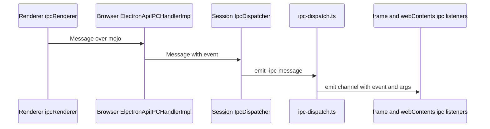

## Overview

A message from `ipcRenderer` goes through a mojo interface to the browser process. There, the session's dispatcher emits it as an event, and `lib/browser/ipc-dispatch.ts` delivers it to the listeners of the frame and the web contents. `invoke` and `sendSync` add a reply path on top of the same route.

Sources: [lib/renderer/api/ipc-renderer.ts:5-15](repo://lib/renderer/api/ipc-renderer.ts#L5-L15), [shell/renderer/api/electron_api_ipc_renderer.cc:68-80](repo://shell/renderer/api/electron_api_ipc_renderer.cc#L68-L80), [shell/browser/electron_api_ipc_handler_impl.cc:44-55](repo://shell/browser/electron_api_ipc_handler_impl.cc#L44-L55), [lib/browser/ipc-dispatch.ts:58-75](repo://lib/browser/ipc-dispatch.ts#L58-L75)

Sources: [shell/renderer/api/electron_api_ipc_renderer.cc:68-80](repo://shell/renderer/api/electron_api_ipc_renderer.cc#L68-L80), [shell/browser/electron_api_ipc_handler_impl.cc:44-55](repo://shell/browser/electron_api_ipc_handler_impl.cc#L44-L55), [shell/browser/api/ipc_dispatcher.h:33-37](repo://shell/browser/api/ipc_dispatcher.h#L33-L37), [lib/browser/ipc-dispatch.ts:59-74](repo://lib/browser/ipc-dispatch.ts#L59-L74)

## Renderer side

`lib/renderer/api/ipc-renderer.ts` gets its implementation from `getIPCRenderer`, and `send` passes the `internal` flag, which is false for app code, with the channel and the argument array. `sendSync` and `invoke` follow the same pattern. The binding for a frame is created by `createForRenderFrame`.

Sources: [lib/renderer/api/ipc-renderer.ts:5-15](repo://lib/renderer/api/ipc-renderer.ts#L5-L15), [lib/renderer/api/ipc-renderer.ts:21-27](repo://lib/renderer/api/ipc-renderer.ts#L21-L27), [lib/renderer/ipc-renderer-bindings.ts:6-16](repo://lib/renderer/ipc-renderer-bindings.ts#L6-L16), [shell/renderer/api/electron_api_ipc_renderer.cc:266-273](repo://shell/renderer/api/electron_api_ipc_renderer.cc#L266-L273)

The native `Send` serializes the arguments into a `blink::CloneableMessage` and sends it through the frame's `ElectronApiIPC` remote, with the `internal` flag. If the context has been released, the call throws instead.

Sources: [shell/renderer/api/electron_api_ipc_renderer.cc:68-80](repo://shell/renderer/api/electron_api_ipc_renderer.cc#L68-L80)

`sendToHost` uses `MessageHost`, which carries no `internal` flag, and the browser emits it on the sender web contents as `-ipc-message-host`. `sendSync` calls `MessageSync` and waits for the result, which it deserializes into a V8 value.

Sources: [shell/renderer/api/electron_api_ipc_renderer.cc:148-162](repo://shell/renderer/api/electron_api_ipc_renderer.cc#L148-L162), [shell/renderer/api/electron_api_ipc_renderer.cc:172-182](repo://shell/renderer/api/electron_api_ipc_renderer.cc#L172-L182)

`invoke` calls the remote `Invoke` with a callback, and the browser replies through that callback. The result is returned to JavaScript as a promise, which rejects with `Error invoking remote method` if the handler reported an error.

Sources: [shell/renderer/api/electron_api_ipc_renderer.cc:82-100](repo://shell/renderer/api/electron_api_ipc_renderer.cc#L82-L100), [lib/renderer/api/ipc-renderer.ts:21-27](repo://lib/renderer/api/ipc-renderer.ts#L21-L27)

## Browser side: dispatch

`ElectronApiIPCHandlerImpl::Message` builds an IPC event for the session and passes it to `Session::Message`. `IpcDispatcher::Message` then emits `-ipc-message` on the session with that event, the channel and the arguments.

Sources: [shell/browser/electron_api_ipc_handler_impl.cc:44-55](repo://shell/browser/electron_api_ipc_handler_impl.cc#L44-L55), [shell/browser/api/ipc_dispatcher.h:33-37](repo://shell/browser/api/ipc_dispatcher.h#L33-L37)

`addIpcDispatchListeners` attaches the `-ipc-message` listener to each session object, which the session constructor calls. For a frame event, it attaches a reply function to the event, emits `ipc-message` on the sender web contents, and then emits the channel on each ipc emitter that the frame lookup returns. Internal channels go to `ipcMainInternal` instead.

Sources: [lib/browser/ipc-dispatch.ts:58-75](repo://lib/browser/ipc-dispatch.ts#L58-L75), [lib/browser/ipc-dispatch.ts:44-53](repo://lib/browser/ipc-dispatch.ts#L44-L53), [lib/browser/api/session.ts:26](repo://lib/browser/api/session.ts#L26)

The frame lookup returns two emitters: the `ipc` of the `WebFrameMain` found from the frame tree node, and the `ipc` of the web contents. The code comment says the lookup by tree node ensures that messages a frame sends while it is unloading are still received.

Sources: [lib/browser/ipc-dispatch.ts:44-53](repo://lib/browser/ipc-dispatch.ts#L44-L53)

`ipcMain.handle` stores a handler in a map keyed by channel. It throws if the channel already has one, or if the handler is not a function.

Sources: [lib/browser/ipc-main-impl.ts:15-23](repo://lib/browser/ipc-main-impl.ts#L15-L23)

## Browser side: invoke and sync

For `invoke`, `ElectronApiIPCHandlerImpl::Invoke` builds an event that carries the callback and emits `-ipc-invoke`. The dispatcher's `Invoke` does the emit.

Sources: [shell/browser/electron_api_ipc_handler_impl.cc:56-71](repo://shell/browser/electron_api_ipc_handler_impl.cc#L56-L71), [shell/browser/api/ipc_dispatcher.h:40-46](repo://shell/browser/api/ipc_dispatcher.h#L40-L46)

The `-ipc-invoke` listener looks for the first target in the frame's emitters that has a handler for the channel. It calls that handler, and sends the result or the error back through the event's reply channel. An error is logged in the browser and its text is sent to the renderer.

Sources: [lib/browser/ipc-dispatch.ts:76-100](repo://lib/browser/ipc-dispatch.ts#L76-L100), [lib/browser/ipc-dispatch.ts:10-16](repo://lib/browser/ipc-dispatch.ts#L10-L16)

The `-ipc-message-sync` listener adds a return-value slot to the event and emits the message to the sender and the ipc emitters, like `send`. It logs a warning when neither the web contents nor the frame's emitters have a listener for the channel.

Sources: [lib/browser/ipc-dispatch.ts:110-133](repo://lib/browser/ipc-dispatch.ts#L110-L133)

The library's own channels use the same route with `internal` set to true. `ipc-renderer-internal.ts` sets that flag, and the dispatcher sends those messages to `ipcMainInternal`. The renderer setup that loads this module is described in [[Renderer Initialization and Preload]].

Sources: [lib/renderer/ipc-renderer-internal.ts:5-6](repo://lib/renderer/ipc-renderer-internal.ts#L5-L6), [lib/browser/ipc-dispatch.ts:59-62](repo://lib/browser/ipc-dispatch.ts#L59-L62)
