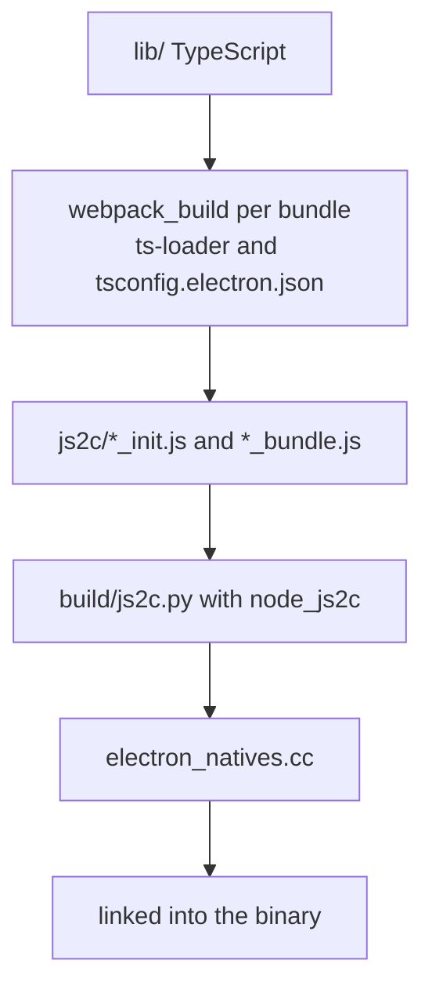

## Overview

The TypeScript in `lib/` is compiled into one bundle per process type, and each bundle is then converted into C++ source that the binary links. The bundles are webpack builds run by GN, and a separate step, `build/js2c.py`, packs their output into `electron_natives.cc`, so the binary carries the JavaScript itself.

Sources: [BUILD.gn:165-172](repo://BUILD.gn#L165-L172), [BUILD.gn:237-268](repo://BUILD.gn#L237-L268), [build/js2c.py:7-14](repo://build/js2c.py#L7-L14)

Sources: [build/webpack/webpack.gni:1-30](repo://build/webpack/webpack.gni#L1-L30), [build/webpack/webpack.config.base.js:137-146](repo://build/webpack/webpack.config.base.js#L137-L146), [BUILD.gn:237-272](repo://BUILD.gn#L237-L272)

## Inputs of each bundle

The source list for each bundle comes from `filenames.auto.gni`. The file's header says it is generated and must not be edited by hand, and the script `gen-filenames.ts` is the one that writes it. Each `webpack_build` target names its list as `inputs`.

Sources: [filenames.auto.gni:1](repo://filenames.auto.gni#L1), [script/gen-filenames.ts:7](repo://script/gen-filenames.ts#L7), [BUILD.gn:165-172](repo://BUILD.gn#L165-L172)

## The webpack template

`webpack_build` runs the `webpack` npm binary with a config file for the target, and it passes `--output-filename` and `--output-path` from the `out_file`. It passes the generated `buildflags.h` as an environment variable, and it sets the mode to `production` when the build is official and `development` otherwise.

Sources: [build/webpack/webpack.gni:1-30](repo://build/webpack/webpack.gni#L1-L30)

The base config reads the `BUILDFLAG_INTERNAL_*` lines of `buildflags.h` and passes each flag to `DefinePlugin` as a boolean define.

Sources: [build/webpack/webpack.config.base.js:44-50](repo://build/webpack/webpack.config.base.js#L44-L50)

`.ts` files go through `ts-loader` with `tsconfig.electron.json`, which compiles `lib` with `rootDir` set to `lib` and includes the typings. Modules listed as ignored go to `null-loader`. Bundles whose target deletes the Node globals get `Buffer`, `global` and `process` from a provider module.

Sources: [build/webpack/webpack.config.base.js:137-146](repo://build/webpack/webpack.config.base.js#L137-L146), [tsconfig.electron.json:1-10](repo://tsconfig.electron.json#L1-L10), [build/webpack/webpack.config.base.js:62-69](repo://build/webpack/webpack.config.base.js#L62-L69)

Each bundle has a config file that sets its target. The browser config, for example, names the `browser` target and always has Node.

Sources: [build/webpack/webpack.config.browser.js:1-4](repo://build/webpack/webpack.config.browser.js#L1-L4)

## Packing into C++

`electron_js2c` depends on every bundle, on the Node `node_js2c` target, and lists the eight init and bundle files as its sources. Its output is `electron_natives.cc`.

Sources: [BUILD.gn:237-272](repo://BUILD.gn#L237-L272)

`build/js2c.py` takes the path of the `node_js2c` tool, the root directory, the natives output file and the JavaScript files. It runs the tool with `--only-js` and the root directory, and the tool writes the bundles into the natives file.

Sources: [build/js2c.py:7-14](repo://build/js2c.py#L7-L14)

The tool is built with `electron_js2c_toolchain`, which is chosen per target platform, and the file sets it to the host toolchain in several cross-compile cases.

Sources: [build/js2c_toolchain.gni:9-13](repo://build/js2c_toolchain.gni#L9-L13), [build/js2c_toolchain.gni:28-28](repo://build/js2c_toolchain.gni#L28-L28)

## The default app

The default app uses `typescript_build`, which runs `tsc` with `tsconfig.default_app.json` and writes one `.js` file for each source. It is a separate target from the bundles, and the `default_app_asar` target at its own line packs the default app's files.

Sources: [BUILD.gn:283-291](repo://BUILD.gn#L283-L291), [build/tsc.gni:3-45](repo://build/tsc.gni#L3-L45), [BUILD.gn:303](repo://BUILD.gn#L303)
