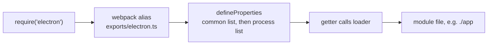

## Overview

Every `require('electron')` call in a process resolves to one exports object, and that object is built at startup from the module lists of that process. Webpack points the `electron` names at a per-process exports file, the Node module cache maps them to one fake module, and each list entry becomes a lazy property whose getter calls the entry's loader.

Sources: [build/webpack/webpack.config.base.js:117-124](repo://build/webpack/webpack.config.base.js#L117-L124), [lib/common/init.ts:80-100](repo://lib/common/init.ts#L80-L100), [lib/common/define-properties.ts:8-17](repo://lib/common/define-properties.ts#L8-L17)

## Name resolution

Each webpack bundle aliases `electron`, `electron/main`, `electron/renderer`, `electron/common` and `electron/utility` to the `api/exports/electron.ts` file of its target, so the bundle compiles that file in place of the names. The same aliases are listed for every target, which makes `electron/main` available in the renderer bundle too, and the alias carries no process check.

Sources: [build/webpack/webpack.config.base.js:34](repo://build/webpack/webpack.config.base.js#L34), [build/webpack/webpack.config.base.js:119-124](repo://build/webpack/webpack.config.base.js#L119-L124)

At run time, `lib/common/init.ts` creates a fake module for each name and puts it in `Module._cache`. Its `exports` is a getter that calls `require('electron')`, so every alias resolves to the same object. `electron/main` is only added in the browser, `electron/renderer` in the renderer and `electron/utility` in utility processes.

Sources: [lib/common/init.ts:80-100](repo://lib/common/init.ts#L80-L100)

`Module._resolveFilename` is then patched so that all five names resolve to the single `electron` filename, and other requests pass through to Node's own resolver.

Sources: [lib/common/init.ts:102-119](repo://lib/common/init.ts#L102-L119)

## Exports per process

Each process builds its own exports object from the lists that its process can use. The browser and renderer add the common list, which holds `nativeImage` and `shell`, before their own list. Utility, sandboxed renderer and preload realm use only their own list.

Sources: [lib/common/api/module-list.ts:1-5](repo://lib/common/api/module-list.ts#L1-L5), [lib/browser/api/exports/electron.ts:7-8](repo://lib/browser/api/exports/electron.ts#L7-L8), [lib/renderer/api/exports/electron.ts:7-8](repo://lib/renderer/api/exports/electron.ts#L7-L8)

| Process | Exports file | Lists, in order |
| --- | --- | --- |
| Browser | `lib/browser/api/exports/electron.ts` | common, then browser |
| Renderer | `lib/renderer/api/exports/electron.ts` | common, then renderer |
| Utility | `lib/utility/api/exports/electron.ts` | utility Node list |
| Sandboxed renderer | `lib/sandboxed_renderer/api/exports/electron.ts` | sandboxed list |
| Preload realm | `lib/preload_realm/api/exports/electron.ts` | preload list |

Sources: [lib/browser/api/exports/electron.ts:1-8](repo://lib/browser/api/exports/electron.ts#L1-L8), [lib/renderer/api/exports/electron.ts:1-8](repo://lib/renderer/api/exports/electron.ts#L1-L8), [lib/utility/api/exports/electron.ts:6](repo://lib/utility/api/exports/electron.ts#L6), [lib/sandboxed_renderer/api/exports/electron.ts:6](repo://lib/sandboxed_renderer/api/exports/electron.ts#L6), [lib/preload_realm/api/exports/electron.ts:6](repo://lib/preload_realm/api/exports/electron.ts#L6), [lib/common/api/module-list.ts:1-5](repo://lib/common/api/module-list.ts#L1-L5)

The browser list is the longest of these. It defines each main-process module by name, such as `app`, `BrowserWindow`, `ipcMain` and `webContents`, and each loader reads its module file on demand. The renderer list defines the renderer modules, including `ipcRenderer`, `contextBridge` and `webFrame`.

Sources: [lib/browser/api/module-list.ts:3-43](repo://lib/browser/api/module-list.ts#L3-L43), [lib/renderer/api/module-list.ts:2-9](repo://lib/renderer/api/module-list.ts#L2-L9)

The utility list holds `net` and `systemPreferences`, and the sandboxed list covers `contextBridge`, `crashReporter` and `ipcRenderer` with loaders that point at the renderer's implementations.

Sources: [lib/utility/api/module-list.ts:2-5](repo://lib/utility/api/module-list.ts#L2-L5), [lib/sandboxed_renderer/api/module-list.ts:1-12](repo://lib/sandboxed_renderer/api/module-list.ts#L1-L12)

## Lazy properties

`defineProperties` gives each list entry an enumerable getter that calls the entry's loader. If the loaded module has an `__esModule` flag and a `default` export, the getter returns the default, so a module can be written as an ES module. Nothing is loaded until a property is read, so an entry that a program never reads does not run its loader.

Sources: [lib/common/define-properties.ts:1-17](repo://lib/common/define-properties.ts#L1-L17)

Sources: [build/webpack/webpack.config.base.js:119-124](repo://build/webpack/webpack.config.base.js#L119-L124), [lib/browser/api/exports/electron.ts:7-8](repo://lib/browser/api/exports/electron.ts#L7-L8), [lib/common/define-properties.ts:8-15](repo://lib/common/define-properties.ts#L8-L15)

## Keeping the lists in order

Each list file asks for alphabetical order, and the browser list's first line says that changing it also requires an update to a `module-keys` file. No file of that name exists under `lib/`, `build/`, `script/`, `shell/` or `spec/`, so that note has nothing to update here.

Sources: [lib/browser/api/module-list.ts:1](repo://lib/browser/api/module-list.ts#L1), [lib/renderer/api/module-list.ts:1](repo://lib/renderer/api/module-list.ts#L1), [lib/common/api/module-list.ts:1](repo://lib/common/api/module-list.ts#L1)

To expose a module to a process, add an entry with its loader to that process's list, in alphabetical order. Each entry's native side is described in [[Exposing Native Code to JavaScript]], and [[Process Model]] lists the processes each list reaches.

Sources: [lib/browser/api/module-list.ts:3-43](repo://lib/browser/api/module-list.ts#L3-L43), [lib/renderer/api/module-list.ts:2-9](repo://lib/renderer/api/module-list.ts#L2-L9)
