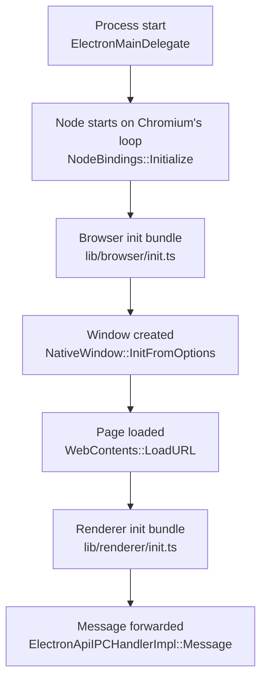

## Overview

Electron lets you write desktop apps in JavaScript, HTML and CSS. It is built on Node.js and Chromium, and the source tree follows Chromium's separation of code into processes and layers.

Sources: [README.md:9-12](repo://README.md#L9-L12), [docs/development/source-code-directory-structure.md:3-4](repo://docs/development/source-code-directory-structure.md#L3-L4)

The C++ code lives under `shell/`, and the JavaScript that runs in each process lives under `lib/`. This page maps the parts and the main flow; each part is detailed on its own page.

Sources: [docs/development/source-code-directory-structure.md:25](repo://docs/development/source-code-directory-structure.md#L25), [docs/development/source-code-directory-structure.md:55](repo://docs/development/source-code-directory-structure.md#L55)

## Parts

| Area | What it does | Page |
| --- | --- | --- |
| Startup | Boots the browser process and starts Node on Chromium's loop | [[Browser Process Startup]] |
| Process types | Picks the init bundle each process runs | [[Process Model]] |
| Module registration | Maps `require('electron')` to modules | [[Module Registration]] |
| Native bindings | Exposes C++ classes to JavaScript | [[Exposing Native Code to JavaScript]] |
| ASAR | Reads app files from archives | [[ASAR Archives and Fuses]] |
| App | Lifecycle events and command line | [[App Lifecycle and Command Line]] |
| Windows | `BrowserWindow` and `BaseWindow` | [[Browser Windows]] |
| Web contents | Loads pages and forwards their events | [[Web Contents]] |
| Protocols | Custom schemes and main-process requests | [[Protocols and Network Requests]] |
| IPC | Messages between processes | [[Inter-Process Messaging]] |
| Renderer | Renderer setup and preload scripts | [[Renderer Initialization and Preload]] |
| Context bridge | Passes values across isolated worlds | [[Context Bridge]] |
| Sandbox | Sandboxed renderer setup | [[Sandboxed Renderers]] |
| Guests | `webview` and `window.open` children | [[Webviews and Guest Views]] |
| Utility | `utilityProcess` children | [[Utility Processes]] |
| Build | GN build from source | [[Building from Source]] |
| JavaScript bundling | Compiles `lib/` into the binary | [[Bundling the JavaScript Layer]] |
| Patches | Patches to Chromium and Node | [[Patches to Chromium and Node]] |
| Tests | Spec suites and lint | [[Tests and Linting]] |
| Releases | Versioning, builds and publishing | [[Release Pipeline]] |
| API docs | `docs/api` to type definitions | [[API Docs and Type Definitions]] |

Sources: [docs/development/source-code-directory-structure.md:14-44](repo://docs/development/source-code-directory-structure.md#L14-L44)

## Main flow

Sources: [shell/app/electron_main_delegate.cc:264-270](repo://shell/app/electron_main_delegate.cc#L264-L270), [shell/common/node_bindings.cc:587-598](repo://shell/common/node_bindings.cc#L587-L598), [shell/common/node_bindings.cc:702](repo://shell/common/node_bindings.cc#L702), [lib/browser/init.ts:12-17](repo://lib/browser/init.ts#L12-L17), [shell/browser/native_window.cc:137-142](repo://shell/browser/native_window.cc#L137-L142), [shell/browser/api/electron_api_web_contents.cc:2331-2336](repo://shell/browser/api/electron_api_web_contents.cc#L2331-L2336), [lib/renderer/init.ts:47-50](repo://lib/renderer/init.ts#L47-L50), [shell/browser/electron_api_ipc_handler_impl.cc:44-55](repo://shell/browser/electron_api_ipc_handler_impl.cc#L44-L55)

1. [[Browser Process Startup]]: the browser process starts in `ElectronMainDelegate`, and `NodeBindings::Initialize` starts Node on Chromium's loop.
2. [[Process Model]]: each process loads the init bundle named `electron/js2c/<process type>_init`, and the browser bundle is `lib/browser/init.ts`.
3. [[Module Registration]]: `lib/browser/init.ts` restores `process.argv` and loads the common init, which then serves `require('electron')` from the module lists.
4. [[Browser Windows]]: `NativeWindow::InitFromOptions` creates the native window from the options object.
5. [[Web Contents]]: `WebContents::LoadURL` validates the URL and starts loading the page.
6. [[Renderer Initialization and Preload]]: `lib/renderer/init.ts` loads the common init and the IPC renderer setup before the page runs.
7. [[Inter-Process Messaging]]: `ElectronApiIPCHandlerImpl::Message` receives each `ipcRenderer.send` in the browser process and passes it to the session's IPC dispatch.

Sources: [shell/app/electron_main_delegate.cc:264-270](repo://shell/app/electron_main_delegate.cc#L264-L270), [shell/common/node_bindings.cc:587-598](repo://shell/common/node_bindings.cc#L587-L598), [shell/common/node_bindings.cc:662-668](repo://shell/common/node_bindings.cc#L662-L668), [shell/common/node_bindings.cc:702](repo://shell/common/node_bindings.cc#L702), [lib/browser/init.ts:12-17](repo://lib/browser/init.ts#L12-L17), [lib/browser/api/module-list.ts:4-8](repo://lib/browser/api/module-list.ts#L4-L8), [shell/browser/native_window.cc:137-142](repo://shell/browser/native_window.cc#L137-L142), [shell/browser/api/electron_api_web_contents.cc:2331-2336](repo://shell/browser/api/electron_api_web_contents.cc#L2331-L2336), [lib/renderer/init.ts:47-50](repo://lib/renderer/init.ts#L47-L50), [lib/renderer/init.ts:64](repo://lib/renderer/init.ts#L64), [shell/browser/electron_api_ipc_handler_impl.cc:44-55](repo://shell/browser/electron_api_ipc_handler_impl.cc#L44-L55)

## Design decisions

Node's timers and `process.nextTick` only run when Node's libuv loop is polled, and that loop is driven by Chromium's loop. The common init therefore wraps `setImmediate`, `setTimeout` and `process.nextTick` so that each call activates the loop first.

Sources: [lib/common/init.ts:8-20](repo://lib/common/init.ts#L8-L20)

The renderer warns on every `require('vm')` call, because the module is unsupported there: it conflicts with Blink's V8 context.

Sources: [lib/renderer/init.ts:10-16](repo://lib/renderer/init.ts#L10-L16)

Each process loads its own init bundle by name, `electron/js2c/<process type>_init`, and the process type is set from the kind of process (browser or renderer) in `NodeBindings`. Every process therefore starts from the same set of JavaScript files, chosen by its role.

Sources: [shell/common/node_bindings.cc:662-668](repo://shell/common/node_bindings.cc#L662-L668), [shell/common/node_bindings.cc:702](repo://shell/common/node_bindings.cc#L702)
