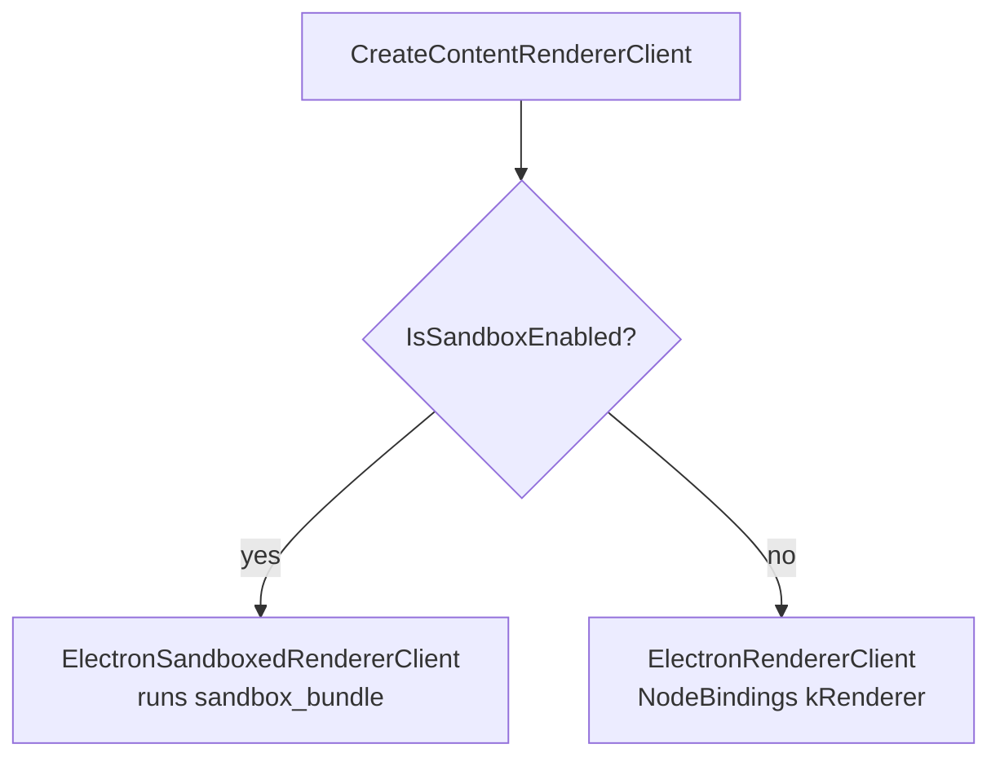

## Overview

Electron runs several kinds of process, and each kind starts its own JavaScript environment. The C++ side gives every Node environment a `BrowserEnvironment` value, which names the init bundle that Node loads for it. Sandboxed renderers and isolated worlds load their own bundles instead of an init file.

Sources: [shell/common/node_bindings.h:119](repo://shell/common/node_bindings.h#L119), [shell/common/node_bindings.cc:662-676](repo://shell/common/node_bindings.cc#L662-L676)

## Process kinds

| Process | C++ owner | Environment | Init source |
| --- | --- | --- | --- |
| Browser | `ElectronBrowserMainParts` | `kBrowser` | `lib/browser/init.ts` |
| Renderer | `ElectronRendererClient` | `kRenderer` | `lib/renderer/init.ts` |
| Sandboxed renderer | `ElectronSandboxedRendererClient` | none, runs `sandbox_bundle` | `lib/sandboxed_renderer/init.ts` |
| Utility | `NodeService` | `kUtility` | `lib/utility/init.ts` |
| Worker | `WebWorkerObserver` | `kWorker` | `lib/worker/init.ts` |
| Isolated world | `RendererClientBase` | none, runs `isolated_bundle` | `lib/isolated_renderer/init.ts` |

Sources: [shell/browser/electron_browser_main_parts.cc:175-179](repo://shell/browser/electron_browser_main_parts.cc#L175-L179), [shell/renderer/electron_renderer_client.cc:36-41](repo://shell/renderer/electron_renderer_client.cc#L36-L41), [shell/renderer/electron_sandboxed_renderer_client.cc:128-133](repo://shell/renderer/electron_sandboxed_renderer_client.cc#L128-L133), [shell/services/node/node_service.cc:88-92](repo://shell/services/node/node_service.cc#L88-L92), [shell/renderer/web_worker_observer.cc:40-44](repo://shell/renderer/web_worker_observer.cc#L40-L44), [shell/renderer/renderer_client_base.cc:603-607](repo://shell/renderer/renderer_client_base.cc#L603-L607), [filenames.auto.gni:198](repo://filenames.auto.gni#L198), [filenames.auto.gni:210](repo://filenames.auto.gni#L210)

## Choosing a renderer client

`ElectronMainDelegate::CreateContentRendererClient` checks `IsSandboxEnabled` on the command line and creates either the sandboxed client or the normal one.

Sources: [shell/app/electron_main_delegate.cc:463-473](repo://shell/app/electron_main_delegate.cc#L463-L473), [shell/app/command_line_args.h:13](repo://shell/app/command_line_args.h#L13)

Sources: [shell/app/electron_main_delegate.cc:463-473](repo://shell/app/electron_main_delegate.cc#L463-L473), [shell/renderer/electron_renderer_client.cc:36-41](repo://shell/renderer/electron_renderer_client.cc#L36-L41), [shell/renderer/electron_sandboxed_renderer_client.cc:128-133](repo://shell/renderer/electron_sandboxed_renderer_client.cc#L128-L133)

## Init bundle names

`NodeBindings::CreateEnvironment` converts the environment to a name, `browser`, `renderer`, `worker` or `utility`, and adds `electron/js2c/<name>_init` to Node's arguments as the script to run. The browser, renderer and worker bundles are webpack builds that GN writes into `js2c`, one output file per init source.

Sources: [shell/common/node_bindings.cc:662-676](repo://shell/common/node_bindings.cc#L662-L676), [shell/common/node_bindings.cc:702](repo://shell/common/node_bindings.cc#L702), [BUILD.gn:171](repo://BUILD.gn#L171), [BUILD.gn:180](repo://BUILD.gn#L180), [BUILD.gn:189](repo://BUILD.gn#L189), [BUILD.gn:198](repo://BUILD.gn#L198)

The browser init restores `process.argv` and then loads the common init, which runs after the steps in [[Browser Process Startup]]. The renderer, worker and utility inits also load the common init, so each of them gets the same common setup.

Sources: [lib/browser/init.ts:12-17](repo://lib/browser/init.ts#L12-L17), [lib/renderer/init.ts:47-50](repo://lib/renderer/init.ts#L47-L50), [lib/worker/init.ts:5-10](repo://lib/worker/init.ts#L5-L10)

The sandboxed renderer does not get its preload list from the page; it asks the browser with `BROWSER_SANDBOX_LOAD` and receives the preload scripts and its `process` object back. The handler is in the browser process, and [[Sandboxed Renderers]] follows this handshake in full.

Sources: [lib/sandboxed_renderer/init.ts:16-22](repo://lib/sandboxed_renderer/init.ts#L16-L22), [lib/browser/rpc-server.ts:89](repo://lib/browser/rpc-server.ts#L89)

Isolated worlds and the preload realm each compile their own bundle from the renderer client. The isolated bundle gets the isolated API object as its argument, and the preload realm gets the binding.

Sources: [shell/renderer/renderer_client_base.cc:603-607](repo://shell/renderer/renderer_client_base.cc#L603-L607), [shell/renderer/preload_realm_context.cc:180-186](repo://shell/renderer/preload_realm_context.cc#L180-L186)

The utility init reads its entry script from the hidden value `_serviceStartupScript` on `process`, then defines `parentPort` on the process object. The worker init names its module `electron/js2c/worker_init`.

Sources: [lib/utility/init.ts:6-23](repo://lib/utility/init.ts#L6-L23), [lib/worker/init.ts:16-18](repo://lib/worker/init.ts#L16-L18)

