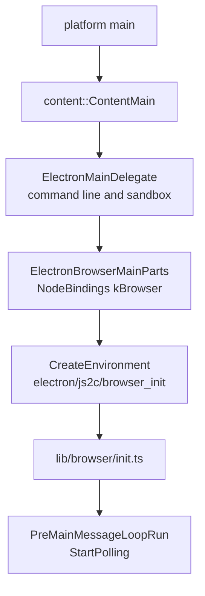

## Overview

The browser process begins in each platform's `main` function, which hands control to Chromium's `content::ContentMain` with an `ElectronMainDelegate`. Chromium then creates `ElectronBrowserMainParts`, which owns a `NodeBindings` for the browser environment. Node runs the browser init bundle, `lib/browser/init.ts`, as its first script.

Sources: [shell/app/electron_main_linux.cc:29-43](repo://shell/app/electron_main_linux.cc#L29-L43), [shell/app/electron_main_win.cc:230-235](repo://shell/app/electron_main_win.cc#L230-L235), [shell/app/electron_main_mac.cc:51-83](repo://shell/app/electron_main_mac.cc#L51-L83), [shell/browser/electron_browser_main_parts.cc:175-179](repo://shell/browser/electron_browser_main_parts.cc#L175-L179)

## Platform entry points

Linux creates the delegate on the stack and returns the result of `content::ContentMain`. Windows does the same, with the parameters held in a `ContentMainParams` object. macOS calls `ElectronMain` from its `main`.

Sources: [shell/app/electron_main_linux.cc:42-43](repo://shell/app/electron_main_linux.cc#L42-L43), [shell/app/electron_main_win.cc:230-235](repo://shell/app/electron_main_win.cc#L230-L235), [shell/app/electron_main_mac.cc:51-83](repo://shell/app/electron_main_mac.cc#L51-L83)

## Command line and sandbox checks

`BasicStartupComplete` runs first. On Windows it writes a newline on the browser side, because the terminal returns before the process exits and the output would otherwise share the prompt's line.

Sources: [shell/app/electron_main_delegate.cc:264-276](repo://shell/app/electron_main_delegate.cc#L264-L276)

When the process runs as root, the delegate stops with a fatal log unless `--no-sandbox` is set, because Electron does not support running the sandbox as root. `IsSandboxEnabled` is the same check that later selects the renderer client.

Sources: [shell/app/electron_main_delegate.cc:309-312](repo://shell/app/electron_main_delegate.cc#L309-L312), [shell/app/electron_main_delegate.cc:466-470](repo://shell/app/electron_main_delegate.cc#L466-L470)

`PreSandboxStartup` runs before Chromium's sandbox is set up. Its first job is to move the user data directory when the `--user-data-dir` switch is given, so that later path lookups see the override.

Sources: [shell/app/electron_main_delegate.cc:334-342](repo://shell/app/electron_main_delegate.cc#L334-L342)

`PreBrowserMain` sets up the feature list and Mojo core before the service manager reads its feature flags. On Linux it also sets the activation token that the desktop environment passes in an environment variable.

Sources: [shell/app/electron_main_delegate.cc:418-434](repo://shell/app/electron_main_delegate.cc#L418-L434)

`RunProcess` hands the relauncher process to `relauncher::RelauncherMain`.

Sources: [shell/app/electron_main_delegate.cc:481-490](repo://shell/app/electron_main_delegate.cc#L481-L490)

## Starting Node in the browser process

`ElectronBrowserMainParts` is constructed with a `NodeBindings` for the `kBrowser` environment, and it is also where field trials and, on POSIX systems, the SIGCHLD handler are set up. Node's own setup happens later, in `PostEarlyInitialization`.

Sources: [shell/browser/electron_browser_main_parts.cc:175-179](repo://shell/browser/electron_browser_main_parts.cc#L175-L179), [shell/browser/electron_browser_main_parts.cc:207-224](repo://shell/browser/electron_browser_main_parts.cc#L207-L224)

`PostEarlyInitialization` creates the V8 environment on the libuv loop that the NodeBindings owns. It then calls `NodeBindings::Initialize` and `CreateEnvironment`, which creates the Node environment that runs the init script.

Sources: [shell/browser/electron_browser_main_parts.cc:225-241](repo://shell/browser/electron_browser_main_parts.cc#L225-L241)

`NodeBindings::Initialize` reads the Electron command-line flags on Linux only in non-browser environments, registers Electron's built-in bindings, and initializes Node's process state. `CreateEnvironment` then names the init bundle for the process type and adds it to Node's arguments, which makes `lib/browser/init.ts` the script that Node runs first in the browser process.

Sources: [shell/common/node_bindings.cc:587-600](repo://shell/common/node_bindings.cc#L587-L600), [shell/common/node_bindings.cc:629-630](repo://shell/common/node_bindings.cc#L629-L630), [shell/common/node_bindings.cc:662-676](repo://shell/common/node_bindings.cc#L662-L676), [shell/common/node_bindings.cc:702](repo://shell/common/node_bindings.cc#L702)

When the init file starts, it restores `process.argv`, which the environment changed so that Node could load the file, and then loads the common init. The common init wraps the timers and `process.nextTick` so that each call activates the libuv loop first.

Sources: [lib/browser/init.ts:12-17](repo://lib/browser/init.ts#L12-L17), [lib/common/init.ts:8-20](repo://lib/common/init.ts#L8-L20)

The last startup step before the main loop runs is `PreMainMessageLoopRun`, which calls `PrepareEmbedThread` and `StartPolling` on the NodeBindings.

Sources: [shell/browser/electron_browser_main_parts.cc:425-430](repo://shell/browser/electron_browser_main_parts.cc#L425-L430)

Sources: [shell/app/electron_main_linux.cc:42-43](repo://shell/app/electron_main_linux.cc#L42-L43), [shell/app/electron_main_delegate.cc:264-270](repo://shell/app/electron_main_delegate.cc#L264-L270), [shell/browser/electron_browser_main_parts.cc:175-179](repo://shell/browser/electron_browser_main_parts.cc#L175-L179), [shell/browser/electron_browser_main_parts.cc:225-241](repo://shell/browser/electron_browser_main_parts.cc#L225-L241), [shell/common/node_bindings.cc:702](repo://shell/common/node_bindings.cc#L702), [lib/browser/init.ts:12-17](repo://lib/browser/init.ts#L12-L17), [shell/browser/electron_browser_main_parts.cc:425-430](repo://shell/browser/electron_browser_main_parts.cc#L425-L430)

Once the init bundle has run, the app's quit handling emits `exit` on the Node process. The app's own lifecycle events are described in [[App Lifecycle and Command Line]].

Sources: [lib/browser/init.ts:43-45](repo://lib/browser/init.ts#L43-L45)
