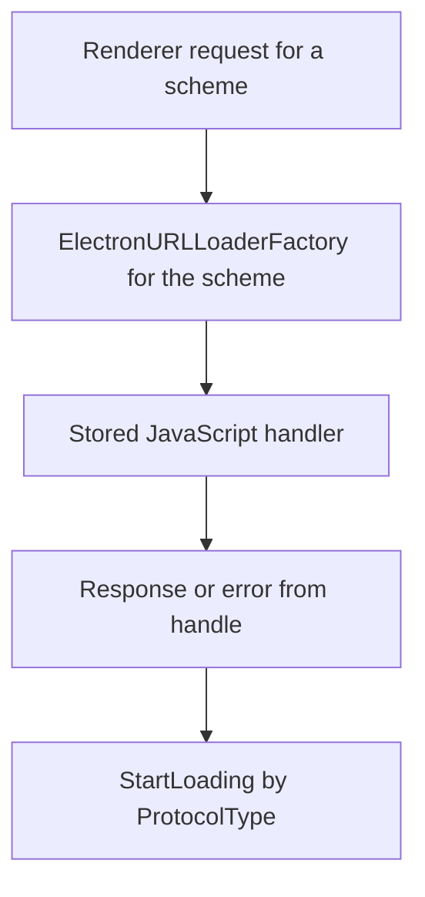

## Overview

A custom scheme gets its requests from a handler that the app registers. `protocol.handle` in JavaScript picks one of two native registrations. For `http`, `https` and `file`, Electron intercepts the scheme. For any other scheme, it registers a new one. `ProtocolRegistry` stores both kinds, and it adds one URL loader factory per scheme to the set of non-network URL loader factories.

Sources: [lib/browser/api/protocol.ts:13](repo://lib/browser/api/protocol.ts#L13), [lib/browser/api/protocol.ts:111-113](repo://lib/browser/api/protocol.ts#L111-L113), [shell/browser/protocol_registry.cc:23-47](repo://shell/browser/protocol_registry.cc#L23-L47)

## Registering a handler

`isBuiltInScheme` decides the native call. `handle` uses `interceptProtocol` for the three built-in schemes and `registerProtocol` for the rest, and both are bound to the `kFree` protocol type. The native side records the handler in a map keyed by scheme, and the map insert fails when the scheme already has a handler.

Sources: [lib/browser/api/protocol.ts:13](repo://lib/browser/api/protocol.ts#L13), [shell/browser/api/electron_api_protocol.cc:318-319](repo://shell/browser/api/electron_api_protocol.cc#L318-L319), [shell/browser/api/electron_api_protocol.cc:333-334](repo://shell/browser/api/electron_api_protocol.cc#L333-L334), [shell/browser/protocol_registry.cc:66-69](repo://shell/browser/protocol_registry.cc#L66-L69), [shell/browser/protocol_registry.cc:83-86](repo://shell/browser/protocol_registry.cc#L83-L86)

The JavaScript `handle` wraps the app's function in a callback for the native side. It turns the request into a `Request` object, and it converts the returned `Response` into the native shape. A response that fails validation or has type `error` becomes an error code, and an exception in the handler is logged and becomes `ERR_UNEXPECTED`.

Sources: [lib/browser/api/protocol.ts:111-148](repo://lib/browser/api/protocol.ts#L111-L148)

## Routing a request to its factory

`RegisterURLLoaderFactories` fills the map of non-network factories. When the `grant_file_protocol_extra_privileges` fuse is on, it puts the asar factory in place of the `file` factory, or adds one when file access is allowed. The asar factory reads archive files, as [[ASAR Archives and Fuses]] describes. It then adds an `ElectronURLLoaderFactory` for every registered scheme.

Sources: [shell/browser/protocol_registry.cc:23-47](repo://shell/browser/protocol_registry.cc#L23-L47), [build/fuses/fuses.json5:12](repo://build/fuses/fuses.json5#L12)

Navigations are a separate path. `CreateNonNetworkNavigationURLLoaderFactory` looks up the scheme for a navigation, and it returns the asar factory for `file` when the fuse is on, or a new `ElectronURLLoaderFactory` for a registered scheme.

Sources: [shell/browser/protocol_registry.cc:48-64](repo://shell/browser/protocol_registry.cc#L48-L64)

## Calling the handler

`ElectronURLLoaderFactory::CreateLoaderAndStart` clones the factory, so that a redirect can start a new request on it. It then runs the stored handler with the request and a callback that continues in `StartLoading`.

Sources: [shell/browser/net/electron_url_loader_factory.cc:411-432](repo://shell/browser/net/electron_url_loader_factory.cc#L411-L432)

`StartLoading` branches on the `ProtocolType` that was registered. Buffer and string responses come from the data the handler returns, `file` responses are loaded through `StartLoadingFile`, `http` starts a request in `StartLoadingHttp`, and `stream` goes through `StartLoadingStream`. The enum comment describes `free` as the type for returning any kind of response.

Sources: [shell/browser/net/electron_url_loader_factory.cc:446-452](repo://shell/browser/net/electron_url_loader_factory.cc#L446-L452), [shell/browser/net/electron_url_loader_factory.cc:531-581](repo://shell/browser/net/electron_url_loader_factory.cc#L531-L581), [shell/browser/net/electron_url_loader_factory.h:41-48](repo://shell/browser/net/electron_url_loader_factory.h#L41-L48)

Sources: [shell/browser/net/electron_url_loader_factory.cc:411-432](repo://shell/browser/net/electron_url_loader_factory.cc#L411-L432), [shell/browser/net/electron_url_loader_factory.cc:446-452](repo://shell/browser/net/electron_url_loader_factory.cc#L446-L452), [lib/browser/api/protocol.ts:111-148](repo://lib/browser/api/protocol.ts#L111-L148)

Requests that the main process makes itself go through the `net` module. `net.request` throws unless the app is ready, and it returns a `ClientRequest`. `net.fetch` forwards to the default session's `fetch`.

Sources: [lib/browser/api/net.ts:8-17](repo://lib/browser/api/net.ts#L8-L17)
