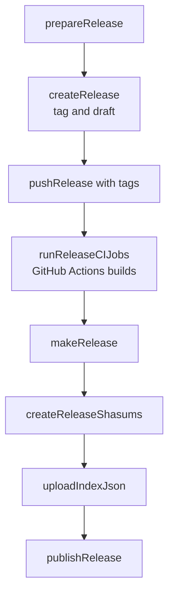

## Overview

A release runs in two parts. `prepare-release.ts` creates a tag and a draft GitHub release, pushes the branch, and starts the CI builds. `release.ts` then checks the assets those builds uploaded and publishes the draft. Uploads go through the scripts in `script/release/uploaders`.

Sources: [script/release/prepare-release.ts:213-222](repo://script/release/prepare-release.ts#L213-L222), [script/release/release.ts:414-436](repo://script/release/release.ts#L414-L432)

## Preparing a release

`prepareRelease` runs four steps in order: it finds the target branch and the new version, creates the release, pushes the release with its tags, and starts the CI builds.

Sources: [script/release/prepare-release.ts:213-222](repo://script/release/prepare-release.ts#L213-L222)

`createRelease` generates the release notes, creates the tag, and checks for an existing draft for the same tag. It aborts if one exists, and otherwise creates a draft with the notes as its body, marked as a prerelease when the version is one.

Sources: [script/release/prepare-release.ts:76-100](repo://script/release/prepare-release.ts#L76-L100), [script/release/prepare-release.ts:103-108](repo://script/release/prepare-release.ts#L103-L108), [script/release/prepare-release.ts:147-155](repo://script/release/prepare-release.ts#L147-L155)

The release notes come from `getReleaseNotes`, which skips the notes for nightlies and returns a fixed message for them. For other releases it asks the notes generator for the range between the previous point and the target branch.

Sources: [script/release/prepare-release.ts:58-74](repo://script/release/prepare-release.ts#L58-L74), [script/release/notes/index.ts:151-158](repo://script/release/notes/index.ts#L151-L158)

`pushRelease` pushes `HEAD` to the branch with `--follow-tags`, and it exits with status 1 when the push fails. `tagRelease` creates an annotated tag with the version as its name, and it exits the same way on failure.

Sources: [script/release/prepare-release.ts:168-182](repo://script/release/prepare-release.ts#L168-L182), [script/release/prepare-release.ts:192-206](repo://script/release/prepare-release.ts#L192-L206)

`runReleaseBuilds` calls `runReleaseCIJobs` with `ghRelease` set. `githubActionsCall` starts a GitHub Actions workflow named `<job>.yml` on the branch, with the parameter `run-<job>` set to true.

Sources: [script/release/prepare-release.ts:184-190](repo://script/release/prepare-release.ts#L184-L190), [script/release/run-release-ci-jobs.ts:29-40](repo://script/release/run-release-ci-jobs.ts#L29-L40), [script/release/run-release-ci-jobs.ts:57](repo://script/release/run-release-ci-jobs.ts#L57)

## Checking and publishing

`validateRelease` fetches the draft for the version and checks its assets. `makeRelease` does the full publish, and its steps run in this order: fetch the draft, upload the Node shasums, create the release's `SHASUMS256.txt`, fetch the draft again, validate its assets, upload `index.json`, and publish.

Sources: [script/release/release.ts:408-412](repo://script/release/release.ts#L408-L412), [script/release/release.ts:414-436](repo://script/release/release.ts#L414-L432)

The code comment before the `index.json` upload gives the reason for its place: `index.json` goes live on upload, so it is uploaded as late as possible, and it must be uploaded before the final publish so no published release is missing from it.

Sources: [script/release/release.ts:422-427](repo://script/release/release.ts#L422-L427)

`createReleaseShasums` deletes any existing `SHASUMS256.txt` asset before it creates the new one.

Sources: [script/release/release.ts:308-322](repo://script/release/release.ts#L308-L322)

`verifyDraftGitHubReleaseAssets` fetches an authenticated URL for each asset of the draft, to check the shasums. `verifyShasumsForRemoteFiles` hashes the remote files to verify the shasums.

Sources: [script/release/release.ts:438-446](repo://script/release/release.ts#L438-L446), [script/release/release.ts:533-540](repo://script/release/release.ts#L533-L540)

`publishRelease` sets `make_latest` only for a non-prerelease whose tag is not older than the current latest release, and then sets `draft` to false.

Sources: [script/release/release.ts:382-405](repo://script/release/release.ts#L382-L405)

Sources: [script/release/prepare-release.ts:213-222](repo://script/release/prepare-release.ts#L213-L222), [script/release/run-release-ci-jobs.ts:29-40](repo://script/release/run-release-ci-jobs.ts#L29-L40), [script/release/release.ts:414-436](repo://script/release/release.ts#L414-L432)

## Uploaders

`upload.py` uploads each built artifact with `upload_electron`. The artifacts include the Electron zip, the symbols, the debug and dSYM archives, ChromeDriver, mksnapshot and FFmpeg, and each one goes through the same helper.

Sources: [script/release/uploaders/upload.py:47-76](repo://script/release/uploaders/upload.py#L47-L76), [script/release/uploaders/upload.py:126-141](repo://script/release/uploaders/upload.py#L126-L141), [script/release/uploaders/upload.py:334-345](repo://script/release/uploaders/upload.py#L334-L345)

`upload_sha256_checksum` is the helper for the checksum file. Files are stored through `store_artifact`, which runs `azput`.

Sources: [script/release/uploaders/upload.py:372-380](repo://script/release/uploaders/upload.py#L372-L380), [script/lib/util.py:143-147](repo://script/lib/util.py#L143-L147)

`upload-index-json.py` fetches `index.json` content with a retry count, writes the index file to the output directory, and stores it under `headers/dist`.

Sources: [script/release/uploaders/upload-index-json.py:27-29](repo://script/release/uploaders/upload-index-json.py#L27-L29), [script/release/uploaders/upload-index-json.py:55-75](repo://script/release/uploaders/upload-index-json.py#L55-L75)
