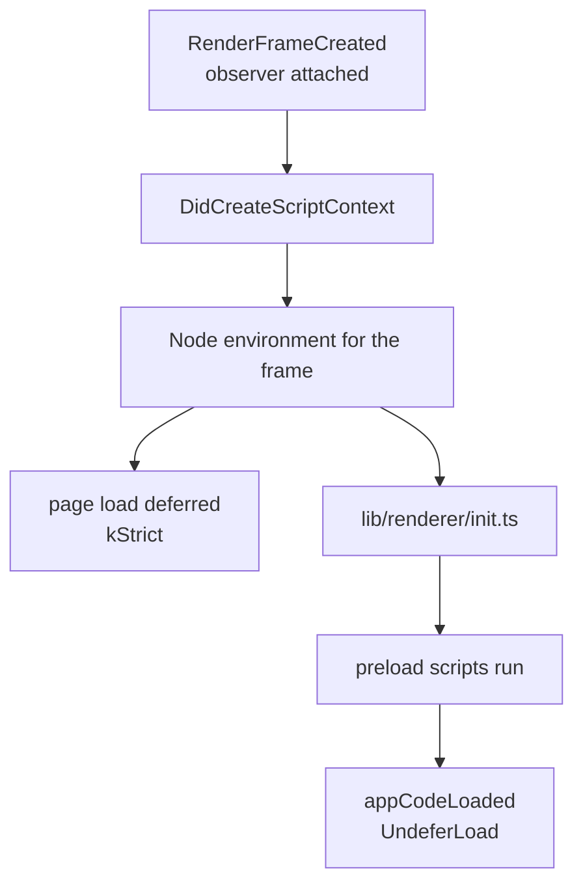

## Overview

A renderer gets its Node environment when Blink creates the frame's script context, not when the process starts. The client creates the environment, holds the page's load until the preload scripts have run, and then runs `lib/renderer/init.ts`, which loads the preload scripts and releases the page.

Sources: [shell/renderer/electron_renderer_client.cc:92-131](repo://shell/renderer/electron_renderer_client.cc#L92-L131), [lib/renderer/init.ts:136-167](repo://lib/renderer/init.ts#L136-L167)

Sources: [shell/renderer/electron_renderer_client.cc:55-58](repo://shell/renderer/electron_renderer_client.cc#L55-L58), [shell/renderer/electron_renderer_client.cc:92-131](repo://shell/renderer/electron_renderer_client.cc#L92-L131), [lib/renderer/init.ts:136-167](repo://lib/renderer/init.ts#L136-L167)

## Frame and script context

`RenderFrameCreated` attaches an `ElectronRenderFrameObserver` to each frame. Later, `RunScriptsAtDocumentStart` and `RunScriptsAtDocumentEnd` emit `document-start` and `document-end` on the frame's `process` object, when the frame has a Node environment.

Sources: [shell/renderer/electron_renderer_client.cc:55-58](repo://shell/renderer/electron_renderer_client.cc#L55-L58), [shell/renderer/electron_renderer_client.cc:61-84](repo://shell/renderer/electron_renderer_client.cc#L61-L84)

`DidCreateScriptContext` stops early unless `ShouldLoadPreload` allows the frame. That check accepts the main frame, devtools, and sub-frames only when `node_integration_in_sub_frames` is set, and it rejects webview frames.

Sources: [shell/renderer/electron_renderer_client.cc:92-101](repo://shell/renderer/electron_renderer_client.cc#L92-L101), [shell/renderer/renderer_client_base.cc:198-210](repo://shell/renderer/renderer_client_base.cc#L198-L210)

The first allowed frame in the process initializes Node with `NodeBindings::Initialize`, and each frame then calls `node::InitializeContext` on its own context. This is why the Node environment is created per window while the bindings are shared.

Sources: [shell/renderer/electron_renderer_client.cc:105-120](repo://shell/renderer/electron_renderer_client.cc#L105-L120)

## Holding the page until preload finishes

Before it creates the environment, `DidCreateScriptContext` sets the document loader to `kStrict`. The comment gives the reason: the preload may be asynchronous, for example with ESM, and the page body must not race it. `CreateEnvironment` takes a callback that calls `UndeferLoad`, which sets the freeze mode back to `kNone`.

Sources: [shell/renderer/electron_renderer_client.cc:121-132](repo://shell/renderer/electron_renderer_client.cc#L121-L132), [shell/renderer/electron_renderer_client.cc:87-90](repo://shell/renderer/electron_renderer_client.cc#L87-L90)

The page body stays held until `appCodeLoaded` runs, and `init.ts` calls `appCodeLoaded` only after its preload loop has finished, so the preload scripts run before the page body is released.

Sources: [shell/renderer/electron_renderer_client.cc:121-132](repo://shell/renderer/electron_renderer_client.cc#L121-L132), [lib/renderer/init.ts:133-134](repo://lib/renderer/init.ts#L133-L134), [lib/renderer/init.ts:165-167](repo://lib/renderer/init.ts#L165-L167)

## The renderer init

`lib/renderer/init.ts` installs the `Module.wrapper` that gives module code `process`, `global` and `Buffer` even after the page deletes them. It restores `process.argv`, loads the common init, and reads the `nodeIntegration` web preference from the main frame.

Sources: [lib/renderer/init.ts:34-47](repo://lib/renderer/init.ts#L34-L47), [lib/renderer/init.ts:57-64](repo://lib/renderer/init.ts#L57-L64)

With `nodeIntegration` on, the init sets the module's filename and paths for `file:` pages and replaces `window.onerror` with a forwarder to `uncaughtException`. Without it, the init deletes Node's globals on the `loaded` event, but only when the page is not context-isolated.

Sources: [lib/renderer/init.ts:66-116](repo://lib/renderer/init.ts#L66-L116), [lib/renderer/init.ts:117-130](repo://lib/renderer/init.ts#L117-L130)

The init asks the browser for the preload list with `BROWSER_NONSANDBOX_LOAD`, then splits it by extension. CommonJS preloads run through `Module._load`, and a failure is logged and reported to the browser as `BROWSER_PRELOAD_ERROR`. `.mjs` preloads run through the ESM loader, and `appCodeLoaded` is called when they finish, or straight away when there are none.

Sources: [lib/renderer/init.ts:136-151](repo://lib/renderer/init.ts#L136-L151), [lib/renderer/init.ts:152-167](repo://lib/renderer/init.ts#L152-L167)

## Context isolation

`WebContentsPreferences` sets `contextIsolation` to true by default, so a new window gets the setting unless its options say otherwise. The renderer init checks `process.contextIsolated` before it deletes Node's globals, which is why isolated pages keep them. The bridge that carries values between the two worlds is described in [[Context Bridge]].

Sources: [shell/browser/web_contents_preferences.cc:118-121](repo://shell/browser/web_contents_preferences.cc#L118-L121), [lib/renderer/init.ts:117-121](repo://lib/renderer/init.ts#L117-L121)
