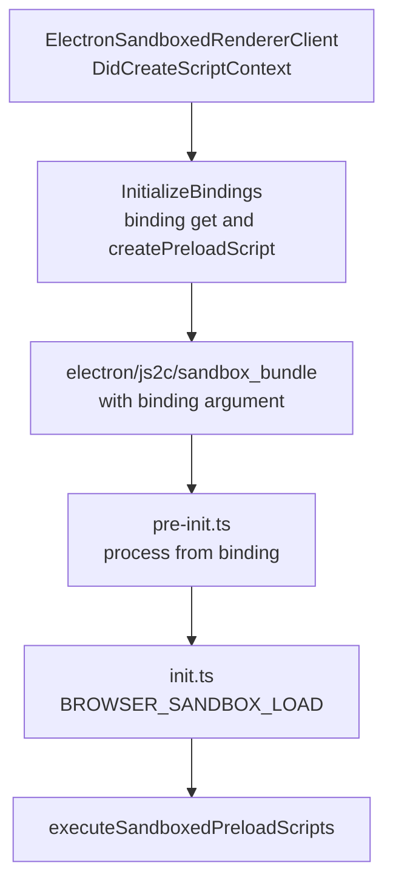

## Overview

A sandboxed renderer does not start a Node environment for the page. Its C++ client builds a `binding` object with a restricted `process`, and a bundled runtime, `electron/js2c/sandbox_bundle`, runs the preload scripts with that object. The preload list comes from the browser through a synchronous IPC call.

Sources: [shell/renderer/electron_sandboxed_renderer_client.cc:70-89](repo://shell/renderer/electron_sandboxed_renderer_client.cc#L70-L89), [shell/renderer/electron_sandboxed_renderer_client.cc:110-137](repo://shell/renderer/electron_sandboxed_renderer_client.cc#L110-L137), [lib/sandboxed_renderer/init.ts:16-22](repo://lib/sandboxed_renderer/init.ts#L16-L22)

The sandboxed client is chosen for the process by `IsSandboxEnabled`, as [[Process Model]] describes. The steps below run in the order the client and the runtime execute them.

Sources: [shell/app/electron_main_delegate.cc:463-473](repo://shell/app/electron_main_delegate.cc#L463-L473), [shell/app/command_line_args.h:13](repo://shell/app/command_line_args.h#L13)

Sources: [shell/renderer/electron_sandboxed_renderer_client.cc:110-137](repo://shell/renderer/electron_sandboxed_renderer_client.cc#L110-L137), [lib/sandboxed_renderer/pre-init.ts:10-30](repo://lib/sandboxed_renderer/pre-init.ts#L10-L30), [lib/sandboxed_renderer/init.ts:16-22](repo://lib/sandboxed_renderer/init.ts#L16-L22), [lib/sandboxed_renderer/init.ts:58-71](repo://lib/sandboxed_renderer/init.ts#L58-L71)

## The binding object

`InitializeBindings` fills a binding object with two functions, `get`, which returns an internal binding, and `createPreloadScript`, which compiles a script in the current context. It also sets a `process` object that comes from the common process bindings and the render frame, with `uptime`, `argv`, `pid`, `sandboxed` set to true and `type` set to `renderer`.

Sources: [shell/renderer/electron_sandboxed_renderer_client.cc:70-89](repo://shell/renderer/electron_sandboxed_renderer_client.cc#L70-L89), [shell/renderer/preload_utils.cc:63-71](repo://shell/renderer/preload_utils.cc#L63-L71)

`DidCreateScriptContext` checks `ShouldLoadPreload` first, the same check the normal renderer uses. It then builds the binding and runs `electron/js2c/sandbox_bundle` with the binding as its only argument.

Sources: [shell/renderer/electron_sandboxed_renderer_client.cc:110-137](repo://shell/renderer/electron_sandboxed_renderer_client.cc#L110-L137), [shell/renderer/renderer_client_base.cc:198-210](repo://shell/renderer/renderer_client_base.cc#L198-L210)

`pre-init.ts` runs first inside that bundle. It makes `process._linkedBinding` the binding's `get`, copies the binding's `process` properties onto `process`, and stores `Buffer` as a hidden value so C++ can use it to read buffers from the browser. It then gives `process` the `EventEmitter` prototype, because the webpack-created object is not an emitter.

Sources: [lib/sandboxed_renderer/pre-init.ts:10-30](repo://lib/sandboxed_renderer/pre-init.ts#L10-L30)

## Loading the preload scripts

`init.ts` requests the preload scripts and the browser's `process` values with `BROWSER_SANDBOX_LOAD`, as a synchronous call. It copies those values onto the preload process and onto the page's `process`, then runs the common renderer init.

Sources: [lib/sandboxed_renderer/init.ts:16-22](repo://lib/sandboxed_renderer/init.ts#L16-L22), [lib/sandboxed_renderer/init.ts:50-56](repo://lib/sandboxed_renderer/init.ts#L50-L56)

The init fills two module maps. `loadedModules` holds `electron` and `events`, and `loadableModules` holds `timers` and `url`, each under its plain and `node:` name. It also sets the `emit-process-event` hook that the C++ client calls, and the hook emits the event on both `process` objects.

Sources: [lib/sandboxed_renderer/init.ts:24-48](repo://lib/sandboxed_renderer/init.ts#L24-L48), [shell/renderer/electron_sandboxed_renderer_client.cc:39-40](repo://shell/renderer/electron_sandboxed_renderer_client.cc#L39-L40)

`executeSandboxedPreloadScripts` runs each script. `runPreloadScript` wraps the source in a function that takes `require`, `process`, `exports` and `module`, plus the globals `Buffer`, `global`, `setImmediate` and `clearImmediate`. The wrapper is compiled with the binding's `createPreloadScript`, and the function is called with the preload `require` bound to its context.

Sources: [lib/sandboxed_renderer/preload.ts:66-81](repo://lib/sandboxed_renderer/preload.ts#L66-L81), [lib/sandboxed_renderer/preload.ts:87-88](repo://lib/sandboxed_renderer/preload.ts#L87-L88), [lib/sandboxed_renderer/init.ts:58-71](repo://lib/sandboxed_renderer/init.ts#L58-L71)

On the browser side, the handler for `BROWSER_SANDBOX_LOAD` reads each preload file and returns its contents, along with a `process` object that holds `arch`, `platform` and a copy of the environment.

Sources: [lib/browser/rpc-server.ts:89-96](repo://lib/browser/rpc-server.ts#L89-L96)

## Which windows are sandboxed

Each window's `sandbox` preference starts unset. The `_init` of `WebContents` logs a deprecation notice for a window that has a preload, no `nodeIntegration` and no `sandbox` value, which says such a window is unsandboxed today.

Sources: [shell/browser/web_contents_preferences.cc:118-121](repo://shell/browser/web_contents_preferences.cc#L118-L121), [lib/browser/api/web-contents.ts:537-541](repo://lib/browser/api/web-contents.ts#L537-L541)

The web preferences that the browser builds for a guest view, such as a `webview`, set `sandbox` to true.

Sources: [lib/browser/guest-view-manager.ts:50-56](repo://lib/browser/guest-view-manager.ts#L50-L56)
