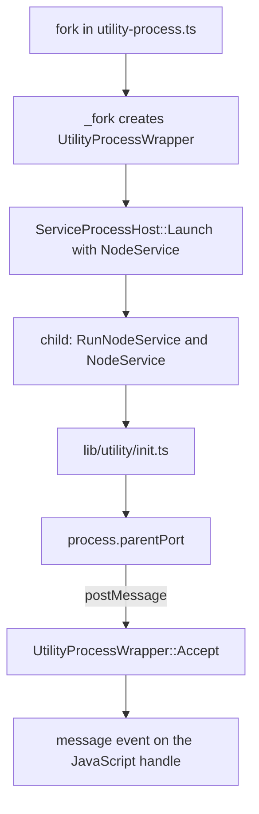

## Overview

`utilityProcess.fork` starts a Node.js child in its own process, and the parent and child talk through a mojo pipe. The parent side is `UtilityProcessWrapper`, which launches the child as a service process. The child side is a `NodeService` that runs its own Node environment, loads the entry script through `lib/utility/init.ts`, and exposes `process.parentPort` for messages.

Sources: [lib/browser/api/utility-process.ts:150-152](repo://lib/browser/api/utility-process.ts#L150-L152), [shell/browser/api/electron_api_utility_process.cc:155-170](repo://shell/browser/api/electron_api_utility_process.cc#L155-L170), [shell/services/node/node_service.cc:88-92](repo://shell/services/node/node_service.cc#L88-L92)

Sources: [lib/browser/api/utility-process.ts:93](repo://lib/browser/api/utility-process.ts#L93), [shell/browser/api/electron_api_utility_process.cc:155-170](repo://shell/browser/api/electron_api_utility_process.cc#L155-L170), [shell/utility/electron_content_utility_client.cc:102-106](repo://shell/utility/electron_content_utility_client.cc#L102-L106), [lib/utility/init.ts:8-23](repo://lib/utility/init.ts#L8-L23), [shell/browser/api/electron_api_utility_process.cc:410-424](repo://shell/browser/api/electron_api_utility_process.cc#L410-L424)

## Starting the child

`fork` creates a `ForkUtilityProcess`. Its constructor turns the `stdio` option into the streams it keeps: `pipe` creates a `PassThrough` for stdout and stderr, and `inherit` and `ignore` create none. It accepts only `inherit`, `pipe` or `ignore` for each stream, and it rejects other values.

Sources: [lib/browser/api/utility-process.ts:50-90](repo://lib/browser/api/utility-process.ts#L50-L90)

The constructor then calls the native `_fork` with the options, the module path and the arguments. It replaces the handle's `emit`, so that `exit` clears the streams and the child's `stdout` and `stderr` messages are piped into the local streams. Every other channel is emitted on the JavaScript object.

Sources: [lib/browser/api/utility-process.ts:93-131](repo://lib/browser/api/utility-process.ts#L93-L131)

`UtilityProcessWrapper::Create` refuses to run before the app is ready. The wrapper then registers for service-process events and launches the child through `ServiceProcessHost::Launch`, with a NodeService receiver and the display name "Node Utility Process" unless the options give another.

Sources: [shell/browser/api/electron_api_utility_process.cc:438-446](repo://shell/browser/api/electron_api_utility_process.cc#L438-L446), [shell/browser/api/electron_api_utility_process.cc:155-170](repo://shell/browser/api/electron_api_utility_process.cc#L155-L170)

## Setting up the child

In the child, `RunNodeService` is the function the utility client runs for the Node service. The NodeService creates its `NodeBindings` for the `kUtility` environment, and it hands the parent port to `ParentPort::Initialize` when it starts.

Sources: [shell/utility/electron_content_utility_client.cc:102-106](repo://shell/utility/electron_content_utility_client.cc#L102-L106), [shell/services/node/node_service.cc:88-92](repo://shell/services/node/node_service.cc#L88-L92), [shell/services/node/node_service.cc:117](repo://shell/services/node/node_service.cc#L117)

The utility init reads the entry script from the hidden value `_serviceStartupScript` on `process`, and it restores `process.argv` to point at that script. It then loads the common init and defines `process.parentPort` as a read-only property.

Sources: [lib/utility/init.ts:6-23](repo://lib/utility/init.ts#L6-L23)

`ParentPort` creates the native port through the `electron_utility_parent_port` binding. Its `emit` hook converts each message's ports into `MessagePortMain` objects before it emits the message to the child's listeners. Its `postMessage` sends through the native port.

Sources: [lib/utility/parent-port.ts:5-18](repo://lib/utility/parent-port.ts#L5-L18), [lib/utility/parent-port.ts:29-31](repo://lib/utility/parent-port.ts#L29-L31), [shell/common/node_bindings.cc:111](repo://shell/common/node_bindings.cc#L111), [shell/services/node/parent_port.cc:143](repo://shell/services/node/parent_port.cc#L143)

## Messages to and from the child

`UtilityProcessWrapper::PostMessage` serializes the value into a `TransferableMessage`, wraps it as a mojo message, and passes it to the connector. It does nothing when the NodeService remote is not connected.

Sources: [shell/browser/api/electron_api_utility_process.cc:332-345](repo://shell/browser/api/electron_api_utility_process.cc#L332-L345), [shell/browser/api/electron_api_utility_process.cc:378-383](repo://shell/browser/api/electron_api_utility_process.cc#L378-L383)

In the other direction, `UtilityProcessWrapper::Accept` deserializes an incoming mojo message and emits `message` on the wrapper with the value. The JavaScript `postMessage` method calls the native method, and the optional transfer list carries `MessagePortMain` objects.

Sources: [shell/browser/api/electron_api_utility_process.cc:410-424](repo://shell/browser/api/electron_api_utility_process.cc#L410-L424), [lib/browser/api/utility-process.ts:134-140](repo://lib/browser/api/utility-process.ts#L134-L140)
