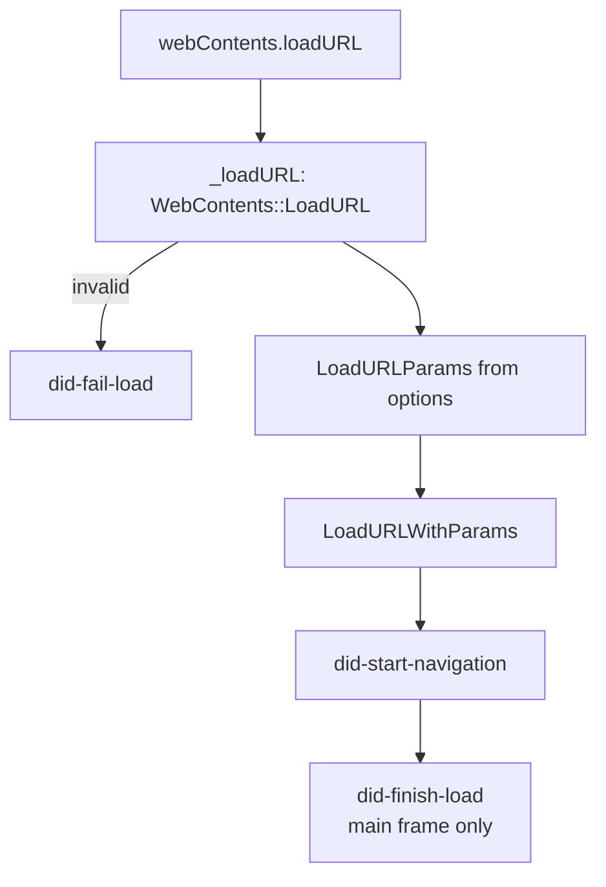

## Overview

A `webContents` object is the native `WebContents` that loads a page, plus its JavaScript wrapper in `lib/browser/api/web-contents.ts`. The wrapper finishes setup in `_init`, `loadURL` hands the request to the native `LoadURL`, and the native observers turn navigation and load steps into events. A `BrowserWindow` owns one of these objects through its `WebContentsView`.

Sources: [shell/browser/api/electron_api_web_contents.cc:4560-4571](repo://shell/browser/api/electron_api_web_contents.cc#L4560-L4571), [lib/browser/api/web-contents.ts:537-557](repo://lib/browser/api/web-contents.ts#L537-L557), [shell/browser/api/electron_api_web_contents.cc:4415](repo://shell/browser/api/electron_api_web_contents.cc#L4415), [shell/browser/api/electron_api_browser_window.cc:56-85](repo://shell/browser/api/electron_api_browser_window.cc#L56-L85)

## Creating a WebContents

`WebContents::New` creates the native object, then calls the JavaScript `_init` on it. An exception thrown by `_init` is passed to Node as an uncaught exception.

Sources: [shell/browser/api/electron_api_web_contents.cc:4560-4571](repo://shell/browser/api/electron_api_web_contents.cc#L4560-L4571)

`_init` reads the `id` once, defines it as read-only so it stays valid after the native object is destroyed, and creates an `IpcMainImpl` for the object as its `ipc` property. Each `WebContents` therefore has its own IPC channel table.

Sources: [lib/browser/api/web-contents.ts:537-556](repo://lib/browser/api/web-contents.ts#L537-L556)

`CreateFromWebPreferences` reuses an existing `WebContents` when the preferences carry a hidden `webContents` value. In that case it applies the new preferences to the existing object. Otherwise it creates a new one with `New`.

Sources: [shell/browser/api/electron_api_web_contents.cc:4614-4638](repo://shell/browser/api/electron_api_web_contents.cc#L4614-L4638)

## Loading a URL

The JavaScript `loadURL` first creates a promise that waits for the next load, with a no-op rejection handler so that an unhandled rejection is not reported. It then calls the native `_loadURL`, which is bound to `WebContents::LoadURL`, and returns the promise.

Sources: [lib/browser/api/web-contents.ts:427-433](repo://lib/browser/api/web-contents.ts#L427-L433), [shell/browser/api/electron_api_web_contents.cc:4415](repo://shell/browser/api/electron_api_web_contents.cc#L4415)

`WebContents::LoadURL` checks the URL first. An invalid URL or one longer than the maximum emits `did-fail-load` with `ERR_INVALID_URL` and returns without navigating.

Sources: [shell/browser/api/electron_api_web_contents.cc:2331-2337](repo://shell/browser/api/electron_api_web_contents.cc#L2331-L2337)

Next it turns the options into `NavigationController::LoadURLParams`. The `httpReferrer`, `extraHeaders` and `userAgent` options are copied over. `postData` switches the load type to HTTP POST, and `baseURLForDataURL` switches it to a data load. `reloadIgnoringCache` makes the reload bypass the cache.

Sources: [shell/browser/api/electron_api_web_contents.cc:2340-2379](repo://shell/browser/api/electron_api_web_contents.cc#L2340-L2379)

Before it navigates, `LoadURL` refuses the load if the object is not safe to delete or a navigation is already pending, and emits `did-fail-load` with `ERR_FAILED`. Otherwise it discards any uncommitted entry and calls `LoadURLWithParams`. The comment at that call warns that the call can run JavaScript that destroys the object, so `LoadURL` checks its weak pointer afterwards.

Sources: [shell/browser/api/electron_api_web_contents.cc:2381-2401](repo://shell/browser/api/electron_api_web_contents.cc#L2381-L2401)

## Navigation and load events

`DidStartNavigation` sets the `is_safe_to_delete_` flag to false for the duration of the event, and `LoadURL` checks that flag before it starts a navigation. It then emits `did-start-navigation` through `EmitNavigationEvent`.

Sources: [shell/browser/api/electron_api_web_contents.cc:2027-2031](repo://shell/browser/api/electron_api_web_contents.cc#L2027-L2031)

`DidStartLoading` emits `did-start-loading`. `DidFinishLoad` emits `did-frame-finish-load` for every frame, and it emits `did-finish-load` only for the main frame. `DidFailLoad` emits `did-fail-load` with the error code and the URL.

Sources: [shell/browser/api/electron_api_web_contents.cc:1901-1916](repo://shell/browser/api/electron_api_web_contents.cc#L1901-L1916), [shell/browser/api/electron_api_web_contents.cc:1918-1937](repo://shell/browser/api/electron_api_web_contents.cc#L1918-L1937), [shell/browser/api/electron_api_web_contents.cc:1939-1941](repo://shell/browser/api/electron_api_web_contents.cc#L1939-L1941)

Sources: [lib/browser/api/web-contents.ts:427-433](repo://lib/browser/api/web-contents.ts#L427-L433), [shell/browser/api/electron_api_web_contents.cc:2331-2395](repo://shell/browser/api/electron_api_web_contents.cc#L2331-L2395), [shell/browser/api/electron_api_web_contents.cc:2027-2031](repo://shell/browser/api/electron_api_web_contents.cc#L2027-L2031), [shell/browser/api/electron_api_web_contents.cc:1901-1916](repo://shell/browser/api/electron_api_web_contents.cc#L1901-L1916)

`webContents.send` forwards to the main frame's `send`, so a message to the page is delivered by the frame object. The channel path is described in [[Inter-Process Messaging]], and requests that the load makes to the network are described in [[Protocols and Network Requests]].

Sources: [lib/browser/api/web-contents.ts:125-127](repo://lib/browser/api/web-contents.ts#L125-L127)
