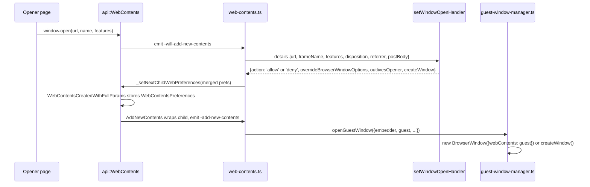

## Overview

Pages can create more pages in two ways. `window.open` (and links with `target="_blank"`) asks Chromium for a new top-level browsing context; Electron answers with a new `BrowserWindow`, after giving the app's `setWindowOpenHandler` a chance to deny or reshape it. The `<webview>` tag embeds a separate `webContents`, a *guest*, inside the embedder's page as an inner frame, driven from the renderer by a custom element and from the main process by the guest view manager. Both paths are mostly TypeScript in `lib/browser` sitting on hooks in `api::WebContents` ([[WebContents and Navigation]]), and both refuse to let a child loosen its parent's security preferences.

Sources: [lib/browser/guest-window-manager.ts:1-7](repo://lib/browser/guest-window-manager.ts#L1-L7), [lib/browser/guest-view-manager.ts:82-104](repo://lib/browser/guest-view-manager.ts#L82-L104)

## window.open

### Two entry points

Chromium reports new windows in two ways, and Electron funnels both into `openGuestWindow`.

Sources: [lib/browser/api/web-contents.ts:624-663](repo://lib/browser/api/web-contents.ts#L624-L663), [lib/browser/api/web-contents.ts:721-753](repo://lib/browser/api/web-contents.ts#L721-L753)

| Path | Trigger | C++ hook | JS event |
| --- | --- | --- | --- |
| Scripted open | `window.open` from the page, creating a `content::WebContents` with an opener | `IsWebContentsCreationOverridden`, then `WebContentsCreatedWithFullParams`, then `AddNewContents` | `-will-add-new-contents`, then `-add-new-contents` |
| Browser-side open | A link or `OpenURLFromTab` with a disposition other than the current tab | `OpenURLFromTab` / `OnCreateWindow` | `-new-window` |

Sources: [shell/browser/api/electron_api_web_contents.cc:1138-1191](repo://shell/browser/api/electron_api_web_contents.cc#L1138-L1191), [shell/browser/api/electron_api_web_contents.cc:1239-1290](repo://shell/browser/api/electron_api_web_contents.cc#L1239-L1290)

### The scripted path

Sources: [lib/browser/api/web-contents.ts:669-753](repo://lib/browser/api/web-contents.ts#L669-L753), [shell/browser/api/electron_api_web_contents.cc:1149-1200](repo://shell/browser/api/electron_api_web_contents.cc#L1149-L1200), [shell/browser/api/electron_api_web_contents.cc:1239-1278](repo://shell/browser/api/electron_api_web_contents.cc#L1239-L1278)

`IsWebContentsCreationOverridden` emits `-will-add-new-contents` before Chromium creates anything. If the event was prevented, Chromium is redirected to `CreateCustomWebContents`, which returns null, so `window.open` returns `null` in the page. Otherwise the JS listener computes the child's web preferences and passes them down with `_setNextChildWebPreferences`. When Chromium then creates the child, `WebContentsCreatedWithFullParams` records the URL, frame name, referrer, features and body in a `ChildWebContentsTracker` and attaches a `WebContentsPreferences` built from the pending preferences, which the new renderer picks up. `MaybeOverrideCreateParamsForNewWindow` uses the same pending preferences to give an offscreen child an offscreen view.

Sources: [shell/browser/api/electron_api_web_contents.cc:1149-1237](repo://shell/browser/api/electron_api_web_contents.cc#L1149-L1237)

`AddNewContents` wraps the new contents with `CreateAndTake` (as `window` or `offscreen`), runs `HandleNewRenderFrame` for the already-created `about:blank` frame so preferences like the background colour apply even if the window never navigates, and emits `-add-new-contents`. If a listener prevents that, the child is destroyed. The JS listener accepts only the `foreground-tab`, `new-window` and `background-tab` dispositions and hands the rest to `openGuestWindow`.

Sources: [shell/browser/api/electron_api_web_contents.cc:1239-1278](repo://shell/browser/api/electron_api_web_contents.cc#L1239-L1278), [lib/browser/api/web-contents.ts:721-753](repo://lib/browser/api/web-contents.ts#L721-L753)

### The window open handler

`setWindowOpenHandler` stores one function. `_callWindowOpenHandler` returns defaults when there is none. A response that is not an object, is `null`, or has an `action` other than `allow` or `deny` prevents the open and logs an error. `deny` prevents it silently. `allow` returns the `overrideBrowserWindowOptions` (when an object), `outlivesOpener` (when a boolean) and `createWindow` (when a function). An exception thrown by the handler prevents the open and is rethrown.

Sources: [lib/browser/api/web-contents.ts:435-477](repo://lib/browser/api/web-contents.ts#L435-L477), [lib/browser/api/web-contents.ts:685-691](repo://lib/browser/api/web-contents.ts#L685-L691)

### Building the child's options

`parseFeatures` turns the feature string (`"width=500,height=400,nodeIntegration=no"`) into window options and web preferences. Known numeric keys (`x`, `y`, `width`, `height`, min and max sizes, `opacity`, plus `top`, `left`, `innerWidth`, `innerHeight`) are parsed as integers; `yes`, `1`, `true` or a bare key become `true`, and `no`, `0`, `false` become `false`. Only `zoomFactor`, `nodeIntegration`, `javascript`, `contextIsolation` and `webviewTag` are taken as web preferences; `resizable` is dropped because the spec says such windows are always resizable, and `left` and `top` become `x` and `y`.

Sources: [lib/browser/parse-features-string.ts:16-107](repo://lib/browser/parse-features-string.ts#L16-L107)

`makeWebPreferences` merges three layers in order. First come the preferences parsed from the page's feature string, which are untrusted. Then, for each of `contextIsolation: true`, `javascript: false`, `nodeIntegration: false`, `sandbox: true`, `webviewTag: false`, `nodeIntegrationInSubFrames: false` and `enableWebSQL: false`, the parent's value is copied whenever the parent has that secure value. Last come the handler's overrides, considered "elevated" because they come from the main process. A page therefore cannot turn on Node or turn off the sandbox for its child, but the app can.

Sources: [lib/browser/guest-window-manager.ts:140-175](repo://lib/browser/guest-window-manager.ts#L140-L175), [lib/browser/api/web-contents.ts:696-718](repo://lib/browser/api/web-contents.ts#L696-L718)

### openGuestWindow

`openGuestWindow` merges `show: true`, 800 by 600, the parsed feature options and the handler's overrides. If a live window already holds the same frame name it simply loads the URL there, as the spec requires for repeated `window.open` calls with one target. With a `createWindow` function the app builds the window itself and must attach the provided guest, or `Invalid webContents` is thrown. Otherwise it creates a `BrowserWindow` around the guest. On the browser-side path there is no guest yet, so the new window loads the URL itself with the referrer and any POST body, whose `content-type` header (multipart with its boundary, or URL-encoded) is derived from the first data chunk. Finally the embedder emits `did-create-window`.

Sources: [lib/browser/guest-window-manager.ts:29-102](repo://lib/browser/guest-window-manager.ts#L29-L102), [lib/browser/guest-window-manager.ts:177-213](repo://lib/browser/guest-window-manager.ts#L177-L213)

### Lifetime

Unless `outlivesOpener` is set, the child is destroyed when the opener's current render view is deleted, which is Electron convention rather than browser behaviour. Named children are registered by frame name and unregistered when destroyed.

Sources: [lib/browser/guest-window-manager.ts:104-138](repo://lib/browser/guest-window-manager.ts#L104-L138), [shell/browser/api/electron_api_web_contents.cc:1830-1844](repo://shell/browser/api/electron_api_web_contents.cc#L1830-L1844)

## The webview tag

### Defining the element in the page

In every main frame whose preferences have `webviewTag` (and that is not itself a webview), `webViewInit` loads `guest-view-internal`. Without context isolation it registers the element directly. With context isolation it stores `guestViewInternal` as a hidden value on the window, and `RendererClientBase::SetupMainWorldOverrides` passes it across the [[Context Bridge]] into the main world, where the isolated bundle calls `setupWebView`, so the element class is defined in the page's own world ([[Renderer Process Initialization]]). Inside a webview, the init instead reports focus and blur to the browser.

Sources: [lib/renderer/web-view/web-view-init.ts:22-42](repo://lib/renderer/web-view/web-view-init.ts#L22-L42), [shell/renderer/renderer_client_base.cc:568-609](repo://shell/renderer/renderer_client_base.cc#L568-L609), [lib/isolated_renderer/init.ts:1-10](repo://lib/isolated_renderer/init.ts#L1-L10)

`setupWebView` waits for the document to leave the `loading` state, then defines `webview` inside `allowGuestViewElementDefinition`, the only scope where Blink accepts that embedder-reserved name. Afterwards it deletes the lifecycle callbacks and `observedAttributes` from the class so page code cannot call them.

Sources: [lib/renderer/web-view/web-view-element.ts:87-125](repo://lib/renderer/web-view/web-view-element.ts#L87-L125), [shell/renderer/renderer_client_base.cc:611-627](repo://shell/renderer/renderer_client_base.cc#L611-L627)

### The element and its iframe

Each `<webview>` has a `WebViewImpl` kept in a private `WeakMap`. It attaches an open shadow root containing a full-size `<iframe>`, marked with the hidden `isWebView` value so the renderer knows not to inject Electron into it, and exposes that frame's `contentWindow`. Attributes such as `src`, `partition`, `preload`, `nodeintegration`, `allowpopups` and `webpreferences` are observed; when the element is connected, the `src` attribute's parse creates the guest, and disconnecting the element detaches it and resets the iframe, because attachment turns the local frame into a remote one.

Sources: [lib/renderer/web-view/web-view-element.ts:15-85](repo://lib/renderer/web-view/web-view-element.ts#L15-L85), [lib/renderer/web-view/web-view-impl.ts:35-111](repo://lib/renderer/web-view/web-view-impl.ts#L35-L111)

`createGuest` sends the iframe's frame token, a new element instance id and every attribute value with the internal `GUEST_VIEW_MANAGER_CREATE_AND_ATTACH_GUEST` invoke. A result of `-1` dispatches `destroyed`; a guest that arrives after the element was removed is detached at once to avoid zombie frames. Methods and properties on the element (`loadURL`, `goBack`, `getURL` and the rest, listed in `web-view-methods`) are forwarded with `GUEST_VIEW_MANAGER_CALL`, `_PROPERTY_GET` and `_PROPERTY_SET`, synchronously or asynchronously as listed.

Sources: [lib/renderer/web-view/guest-view-internal.ts:21-52](repo://lib/renderer/web-view/guest-view-internal.ts#L21-L52), [lib/renderer/web-view/web-view-impl.ts:105-111](repo://lib/renderer/web-view/web-view-impl.ts#L105-L111), [lib/renderer/web-view/web-view-impl.ts:183-237](repo://lib/renderer/web-view/web-view-impl.ts#L183-L237)

### The guest view manager

`lib/browser/guest-view-manager.ts`, loaded at startup, handles those messages. Every handler first checks that the sender has `webviewTag` enabled and throws `<webview> disabled` otherwise, and every method, property and guest lookup is checked against allow lists and against the guest's `hostWebContents`, so one page cannot drive another page's guests.

Sources: [lib/browser/guest-view-manager.ts:258-358](repo://lib/browser/guest-view-manager.ts#L258-L358), [lib/browser/init.ts:79-80](repo://lib/browser/init.ts#L79-L80)

`createGuest` builds the guest's web preferences from the attributes (`nodeintegration`, `plugins`, `allowpopups`, `disablewebsecurity`, `partition`, `preload` converted from a file URL, and a `webpreferences` string parsed like `window.open` features), then forces the same secure values the embedder has, exactly as for child windows. It emits `will-attach-webview` on the embedder with the preferences and parameters, which the app can modify or prevent. It then creates the guest with `webContents.create({ ...webPreferences, type: 'webview', embedder })`.

Sources: [lib/browser/guest-view-manager.ts:25-104](repo://lib/browser/guest-view-manager.ts#L25-L104)

The manager forwards the guest's events to the embedder as `GUEST_VIEW_INTERNAL_DISPATCH_EVENT-<viewInstanceId>`, including `sendToHost` messages as `ipc-message` and frame navigations. It relays the embedder window's visibility to the guest, replaces an older guest for the same element, registers the guest with the native `WebViewManager`, and calls `attachToIframe`. On first `did-attach` it loads `src` with the `httpreferrer` and `useragent` attributes and emits `did-attach-webview`. When the embedder is destroyed, all of its guests are detached.

Sources: [lib/browser/guest-view-manager.ts:106-204](repo://lib/browser/guest-view-manager.ts#L106-L204), [lib/browser/guest-view-manager.ts:223-256](repo://lib/browser/guest-view-manager.ts#L223-L256)

### Native side

A guest `api::WebContents` is created with a fake `chrome-guest://fake-host` site instance and a `WebViewGuestDelegate` ([[WebContents and Navigation]]). `attachToIframe` parses the frame token, and `WebViewGuestDelegate::AttachToIframe` finds the embedder's frame and calls `AttachInnerWebContents`, making the guest an inner `WebContents` hosted in that iframe. It links the guest's zoom controller to the embedder's, so zooming the embedder zooms the guest, and emits `did-attach`. Popups from the guest are created by `CreateNewGuestWindow` in the embedder's native view.

Sources: [shell/browser/api/electron_api_web_contents.cc:840-850](repo://shell/browser/api/electron_api_web_contents.cc#L840-L850), [shell/browser/api/electron_api_web_contents.cc:3612-3627](repo://shell/browser/api/electron_api_web_contents.cc#L3612-L3627), [shell/browser/web_view_guest_delegate.cc:22-129](repo://shell/browser/web_view_guest_delegate.cc#L22-L129)

`WebViewManager` is the browser context's guest manager: a map from guest instance id to the guest and its embedder, used by `ForEachGuest` to visit an embedder's guests. The `addGuest` binding also applies the guest's `zoomFactor`.

Sources: [shell/browser/web_view_manager.cc:16-50](repo://shell/browser/web_view_manager.cc#L16-L50), [shell/browser/api/electron_api_web_view_manager.cc:19-38](repo://shell/browser/api/electron_api_web_view_manager.cc#L19-L38)
