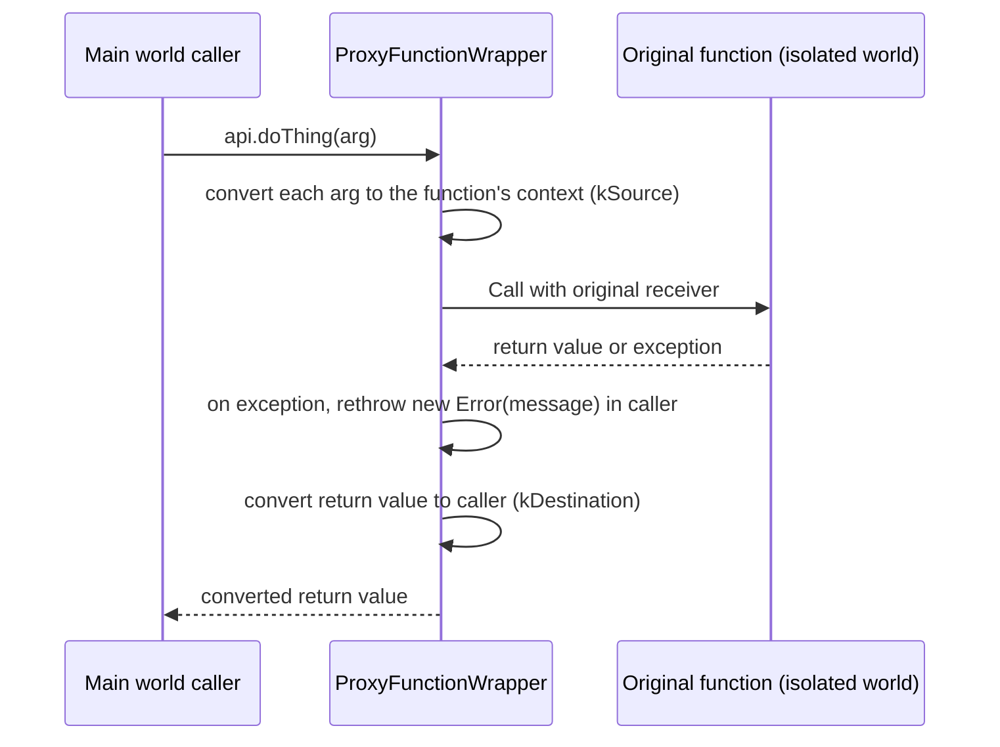

## Overview

With context isolation, a preload script and the page run in different V8 contexts of the same frame: the isolated world (id `999`) and the main world (id `0`), as set up in [[Renderer Process Initialization]]. Objects from one context must never leak into the other, because a page could then reach the preload's prototypes and through them Node or Electron internals. The context bridge is how a preload deliberately gives the page an API anyway. It does not share objects; it builds a copy or a proxy of every value in the destination context, recursively, so the page only ever holds objects created in its own world.

Sources: [shell/common/world_ids.h:12-26](repo://shell/common/world_ids.h#L12-L26), [shell/renderer/api/electron_api_context_bridge.cc:183-237](repo://shell/renderer/api/electron_api_context_bridge.cc#L183-L237), [shell/renderer/api/electron_api_context_bridge.cc:433-442](repo://shell/renderer/api/electron_api_context_bridge.cc#L433-L442)

The whole bridge is one C++ binding, `electron_renderer_context_bridge`, behind a short JS module. The same code passes values for the `<webview>` element's main-world setup and, in service workers, between the worker and its preload realm ([[Sandboxed Renderers and Preload Realm]]).

Sources: [shell/renderer/api/electron_api_context_bridge.cc:1128-1147](repo://shell/renderer/api/electron_api_context_bridge.cc#L1128-L1147), [shell/renderer/renderer_client_base.cc:588-599](repo://shell/renderer/renderer_client_base.cc#L588-L599)

## Public API

`lib/renderer/api/context-bridge.ts` exposes three methods. Each first checks `process.contextIsolated` and throws `contextBridge API can only be used when contextIsolation is enabled` otherwise.

Sources: [lib/renderer/api/context-bridge.ts:3-5](repo://lib/renderer/api/context-bridge.ts#L3-L5)

| Method | Native call |
| --- | --- |
| `exposeInMainWorld(key, api)` | `exposeAPIInWorld(0, key, api)` |
| `exposeInIsolatedWorld(worldId, key, api)` | `exposeAPIInWorld(worldId, key, api)` |
| `executeInMainWorld({ func, args })` | `executeInWorld(0, script)` |

Sources: [lib/renderer/api/context-bridge.ts:1-22](repo://lib/renderer/api/context-bridge.ts#L1-L22)

## Exposing an API

### Choosing the target context

`ExposeAPIInWorld` takes the current context as the source and asks `GetTargetContext` for the destination. In a window that is the frame's main world context for id `0`, or the context of the given world id. In a preload realm only id `0` is allowed, meaning the service worker's own context, and any other id throws `Isolated worlds are not supported in preload realms.`

Sources: [shell/renderer/api/electron_api_context_bridge.cc:770-823](repo://shell/renderer/api/electron_api_context_bridge.cc#L770-L823)

### Installing the value

`ExposeAPI` refuses to overwrite an existing global (`Cannot bind an API on top of an existing property on the window object`), converts the API with `PassValueToOtherContext`, deep-freezes the result unless it is a typed array, and defines it on the target global as read-only and non-configurable. The page therefore cannot replace or mutate what the preload exposed. The `ContextBridgeMutability` feature, disabled by default, skips the freeze and assigns a plain property.

Sources: [shell/renderer/api/electron_api_context_bridge.cc:35-39](repo://shell/renderer/api/electron_api_context_bridge.cc#L35-L39), [shell/renderer/api/electron_api_context_bridge.cc:66-89](repo://shell/renderer/api/electron_api_context_bridge.cc#L66-L89), [shell/renderer/api/electron_api_context_bridge.cc:733-768](repo://shell/renderer/api/electron_api_context_bridge.cc#L733-L768)

## Copying values: PassValueToOtherContext

### Rules by type

`PassValueToOtherContextInner` decides how each value crosses, in this order.

Sources: [shell/renderer/api/electron_api_context_bridge.cc:153-164](repo://shell/renderer/api/electron_api_context_bridge.cc#L153-L164)

| Value | What the destination receives |
| --- | --- |
| String, number, boolean, null, undefined, symbol, bigint | The same value; primitives need no copy |
| Already passed in this conversion | The cached result from `ObjectCache` |
| Function | A proxy function created in the destination (or the original, if it is being passed back to its own context) |
| Promise | A new promise in the destination that settles with the converted result |
| Native `Error` | A new `Error` with the same `message` |
| Plain array | A new array with each element converted |
| DOM `Element`, `Blob`, `VideoFrame` (window contexts only) | The destination world's wrapper for the same underlying object |
| Plain object | A new object with each enumerable own property converted (`CreateProxyForAPI`) |
| Anything else | A structured-clone copy (`blink::CloneableMessage`), which throws for unclonable values |

Sources: [shell/renderer/api/electron_api_context_bridge.cc:153-237](repo://shell/renderer/api/electron_api_context_bridge.cc#L153-L237), [shell/renderer/api/electron_api_context_bridge.cc:239-354](repo://shell/renderer/api/electron_api_context_bridge.cc#L239-L354), [shell/renderer/api/electron_api_context_bridge.cc:356-467](repo://shell/renderer/api/electron_api_context_bridge.cc#L356-L467)

`IsPlainObject` excludes dates, regexps, maps, sets, buffers, typed arrays, proxies, module namespaces and other built-in kinds, so those fall through to structured clone instead of being walked property by property. Nesting deeper than 1000 levels throws `Electron contextBridge recursion depth exceeded.`

Sources: [shell/renderer/api/electron_api_context_bridge.cc:59](repo://shell/renderer/api/electron_api_context_bridge.cc#L59), [shell/renderer/api/electron_api_context_bridge.cc:91-115](repo://shell/renderer/api/electron_api_context_bridge.cc#L91-L115), [shell/renderer/api/electron_api_context_bridge.cc:166-176](repo://shell/renderer/api/electron_api_context_bridge.cc#L166-L176)

### Identity and cycles

A conversion carries an `ObjectCache` that maps each source object to its converted value. Objects, arrays, functions, promises and cloned values are cached as soon as they are created (`CreateProxyForAPI` caches the empty proxy before filling it), so an object reachable twice converts to one destination object and a cycle terminates instead of recursing. The cache lives only for one top-level call: a fresh one is made per `exposeInMainWorld`, per proxied function call, and per return value.

Sources: [shell/renderer/api/context_bridge/object_cache.cc:15-31](repo://shell/renderer/api/context_bridge/object_cache.cc#L15-L31), [shell/renderer/api/electron_api_context_bridge.cc:469-490](repo://shell/renderer/api/electron_api_context_bridge.cc#L469-L490), [shell/renderer/api/electron_api_context_bridge.cc:642-652](repo://shell/renderer/api/electron_api_context_bridge.cc#L642-L652)

### Objects and accessors

`CreateProxyForAPI` creates an empty object in the destination and copies each enumerable own property after converting it, with the source object as the "parent" so functions keep their receiver. By default getters are read once and their values copied. With dynamic properties enabled (used only by Electron's internal overrides), a property with `get` or `set` instead becomes an accessor on the proxy whose getter and setter are themselves proxied functions, so each read calls back into the source world.

Sources: [shell/renderer/api/electron_api_context_bridge.cc:631-729](repo://shell/renderer/api/electron_api_context_bridge.cc#L631-L729)

## Proxied functions

### Creating the proxy

A function becomes a `v8::Function` created in the destination with `ProxyFunctionWrapper` as its callback. A private `state` object, also in the destination, holds the original function, its receiver and the dynamic-properties flag under private keys, so page code cannot read them. The proxy is tagged with `electron_contextBridge_original_fn`; when such a proxy is later passed back to the context that created the original function, the bridge returns the original rather than wrapping a proxy in a proxy.

Sources: [shell/renderer/api/electron_api_context_bridge.cc:50-57](repo://shell/renderer/api/electron_api_context_bridge.cc#L50-L57), [shell/renderer/api/electron_api_context_bridge.cc:194-237](repo://shell/renderer/api/electron_api_context_bridge.cc#L194-L237)

### Calling through the proxy

Sources: [shell/renderer/api/electron_api_context_bridge.cc:492-578](repo://shell/renderer/api/electron_api_context_bridge.cc#L492-L578), [shell/renderer/api/electron_api_context_bridge.cc:578-629](repo://shell/renderer/api/electron_api_context_bridge.cc#L578-L629)

`ProxyFunctionWrapper` reads the private state, converts every argument from the calling context into the function's creation context with one shared cache (duplicate arguments stay identical), and calls the original with its stored receiver. Arguments flow the other way through the same rules, so a callback the page passes in reaches the preload as a proxy too.

Sources: [shell/renderer/api/electron_api_context_bridge.cc:492-547](repo://shell/renderer/api/electron_api_context_bridge.cc#L492-L547)

### Errors

Exceptions never cross as objects. If the original function throws, the wrapper takes the exception's `message` (or a fixed "An unknown exception occurred in the isolated context" text when the thrown value is not an object with a string message) and throws a new `Error` with that message in the caller's context. If converting the return value fails, it rethrows the conversion error's message the same way.

Sources: [shell/renderer/api/electron_api_context_bridge.cc:540-627](repo://shell/renderer/api/electron_api_context_bridge.cc#L540-L627)

`BridgeErrorTarget` says which context a conversion error is thrown in. `kSource` is used almost everywhere, because the caller asking for the conversion is the one that can catch it. `kDestination` is used only for return values and promise results, which are converted after the source function has already returned, so only the destination can still catch the error.

Sources: [shell/renderer/api/electron_api_context_bridge.h:18-31](repo://shell/renderer/api/electron_api_context_bridge.h#L18-L31)

## Promises

A promise is proxied by creating a `gin_helper::Promise` in the destination and attaching `then` and `catch` callbacks to the source promise. Each callback converts the settled value with `kDestination` and resolves or rejects the proxy. The callbacks hold the two contexts weakly and do nothing if either has been destroyed, so a navigation does not keep a world alive. If the settled value cannot be converted, the proxy rejects with an explanatory message about values "not supported by the Context Bridge".

Sources: [shell/renderer/api/electron_api_context_bridge.cc:239-354](repo://shell/renderer/api/electron_api_context_bridge.cc#L239-L354)

## executeInMainWorld

`ExecuteInWorld` runs a function in another world without exposing it: it takes `func` and optional `args` (which must be an array), serialises `func` with `Function.prototype.toString`, compiles `(<source>)` in the target context and checks the result is a function. It converts each argument into the target context, calls the copy with a `null` receiver, and converts the result back into the caller's context. Because only the source text crosses, the function's closure variables from the preload are not available in the main world. Compilation, execution and cloning failures are each rethrown in the caller as an `Error` with the original message.

Sources: [shell/renderer/api/electron_api_context_bridge.cc:920-1035](repo://shell/renderer/api/electron_api_context_bridge.cc#L920-L1035), [shell/renderer/api/electron_api_context_bridge.cc:1037-1118](repo://shell/renderer/api/electron_api_context_bridge.cc#L1037-L1118)

## Internal global overrides

Some built-ins must behave differently in Electron in *both* worlds. The internal bridge exposes `overrideGlobalValueFromIsolatedWorld`, `overrideGlobalValueWithDynamicPropsFromIsolatedWorld` and `overrideGlobalPropertyFromIsolatedWorld`; outside debug builds they are not reachable from `contextBridge` itself.

Sources: [lib/renderer/api/context-bridge.ts:24-39](repo://lib/renderer/api/context-bridge.ts#L24-L39), [shell/renderer/api/electron_api_context_bridge.cc:1140-1142](repo://shell/renderer/api/electron_api_context_bridge.cc#L1140-L1142)

`OverrideGlobalValueFromIsolatedWorld` walks a key path from the main world's global (such as `['document', 'hidden']`), converts the isolated-world value and assigns it to the last key. `OverrideGlobalPropertyFromIsolatedWorld` instead defines an accessor whose getter and setter are proxies of isolated-world functions.

Sources: [shell/renderer/api/electron_api_context_bridge.cc:825-918](repo://shell/renderer/api/electron_api_context_bridge.cc#L825-L918)

`window-setup.ts` uses them so that, with context isolation, the page's `window.close` sends `BROWSER_WINDOW_CLOSE` to the main process (for non-sandboxed, non-webview pages), `window.prompt` throws `prompt() is not supported.`, and inside a `<webview>` `document.hidden` and `document.visibilityState` follow the embedder's visibility. The DevTools inspector overrides use the same helper.

Sources: [lib/renderer/window-setup.ts:1-53](repo://lib/renderer/window-setup.ts#L1-L53), [lib/renderer/inspector.ts:15](repo://lib/renderer/inspector.ts#L15)
