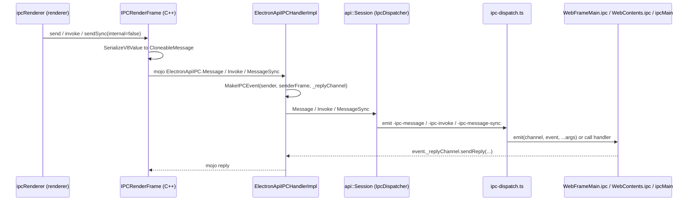

## Overview

Renderer code never calls main-process objects directly: every request is a message on a named channel. `ipcRenderer` serialises its arguments with the structured clone algorithm and sends them over a mojo interface, `electron.mojom.ElectronApiIPC`, bound per frame. In the main process the receiving C++ object turns each message into an event on the frame's `Session`, and `lib/browser/ipc-dispatch.ts` re-emits it on the `WebFrameMain`, `WebContents` and global `ipcMain` emitters. Messages the other way travel over a second interface, `ElectronRenderer`. Electron's own internal features (preload loading, `webFrame` methods, the guest view manager) use the same pipes with an `internal` flag that routes them to a private emitter.

Sources: [shell/common/api/api.mojom:8-56](repo://shell/common/api/api.mojom#L8-L56), [lib/browser/ipc-dispatch.ts:58-75](repo://lib/browser/ipc-dispatch.ts#L58-L75)

Sources: [shell/renderer/api/electron_api_ipc_renderer.cc:66-182](repo://shell/renderer/api/electron_api_ipc_renderer.cc#L66-L182), [shell/browser/electron_api_ipc_handler_impl.cc:44-115](repo://shell/browser/electron_api_ipc_handler_impl.cc#L44-L115), [shell/browser/api/ipc_dispatcher.h:25-83](repo://shell/browser/api/ipc_dispatcher.h#L25-L83), [lib/browser/ipc-dispatch.ts:58-151](repo://lib/browser/ipc-dispatch.ts#L58-L151)

## The mojo interfaces

| Interface | Direction | Methods |
| --- | --- | --- |
| `ElectronApiIPC` | Renderer to browser | `Message`, `Invoke` (with reply), `MessageSync` (`[Sync]`, with reply), `ReceivePostMessage`, `MessageHost` |
| `ElectronRenderer` | Browser to renderer | `Message`, `ReceivePostMessage`, `TakeHeapSnapshot` |

Sources: [shell/common/api/api.mojom:8-56](repo://shell/common/api/api.mojom#L8-L56)

Every call carries a `blink.mojom.CloneableMessage` (or `TransferableMessage` when ports travel with it), so arguments are structured-cloned: functions, DOM objects and prototypes do not survive the trip.

Sources: [shell/renderer/api/electron_api_ipc_renderer.cc:75-80](repo://shell/renderer/api/electron_api_ipc_renderer.cc#L75-L80), [shell/browser/api/electron_api_web_frame_main.cc:273-288](repo://shell/browser/api/electron_api_web_frame_main.cc#L273-L288)

The browser only exposes `ElectronApiIPC` to frames that may have Electron at all: the primary main frame of a `WebContents`, or any frame when `nodeIntegrationInSubFrames` is on. Each binding creates a new `ElectronApiIPCHandlerImpl`, which deletes itself when the connection drops or the `WebContents` is destroyed.

Sources: [shell/browser/electron_browser_client.cc:1452-1468](repo://shell/browser/electron_browser_client.cc#L1452-L1468), [shell/browser/electron_api_ipc_handler_impl.cc:20-42](repo://shell/browser/electron_api_ipc_handler_impl.cc#L20-L42)

## Renderer side

### ipcRenderer and ipcRendererInternal

`lib/renderer/api/ipc-renderer.ts` and `lib/renderer/ipc-renderer-internal.ts` are the same thin class over one native object, differing only in the `internal` flag (`false` for the public module, `true` for Electron's own). `invoke` unwraps the `{ error, result }` reply and throws `Error invoking remote method '<channel>': <error>` when the handler failed.

Sources: [lib/renderer/api/ipc-renderer.ts:1-34](repo://lib/renderer/api/ipc-renderer.ts#L1-L34), [lib/renderer/ipc-renderer-internal.ts:1-26](repo://lib/renderer/ipc-renderer-internal.ts#L1-L26)

The native object comes from the `electron_renderer_ipc` binding: `createForRenderFrame()` in a frame and `createForServiceWorker()` in a service worker's preload realm (see [[Sandboxed Renderers and Preload Realm]]).

Sources: [lib/renderer/ipc-renderer-bindings.ts:1-17](repo://lib/renderer/ipc-renderer-bindings.ts#L1-L17), [shell/renderer/api/electron_api_ipc_renderer.cc:266-278](repo://shell/renderer/api/electron_api_ipc_renderer.cc#L266-L278)

### The native IPC object

`IPCBase` implements `send`, `sendSync`, `sendToHost`, `invoke` and `postMessage` over an associated remote of `ElectronApiIPC`. Each method serialises its arguments and calls the matching mojo method. `invoke` returns a promise resolved by the mojo reply. `sendSync` uses the `[Sync]` call, blocking the renderer's thread until the main process answers, then deserialises the result. `postMessage` disentangles each transferable `MessagePort` into a `MessagePortChannel` and throws `Invalid value for transfer` for anything else.

Sources: [shell/renderer/api/electron_api_ipc_renderer.cc:66-106](repo://shell/renderer/api/electron_api_ipc_renderer.cc#L66-L106), [shell/renderer/api/electron_api_ipc_renderer.cc:108-193](repo://shell/renderer/api/electron_api_ipc_renderer.cc#L108-L193)

`IPCRenderFrame` gets the remote from the frame's associated interfaces and drops it when the frame is destroyed or the script context it was created in is released. `IPCServiceWorker` gets it through the worker's `ServiceWorkerData` and drops it when the worker thread stops. After that, every method throws `IPC method called after context was released`.

Sources: [shell/renderer/api/electron_api_ipc_renderer.cc:38-39](repo://shell/renderer/api/electron_api_ipc_renderer.cc#L38-L39), [shell/renderer/api/electron_api_ipc_renderer.cc:199-260](repo://shell/renderer/api/electron_api_ipc_renderer.cc#L199-L260)

## Main process side

### Building the event

`ElectronApiIPCHandlerImpl` resolves the frame's `Session` from the frame's browser context and, for each call, builds a `gin_helper::internal::Event` with `type: 'frame'`, `sender` (the `WebContents`), a `senderFrame` getter, `frameId`, `processId` and `frameTreeNodeId`, a hidden `internal` flag, and for `Invoke` and `MessageSync` a `_replyChannel`. It then hands the event to the session's `Message`, `Invoke`, `MessageSync`, `ReceivePostMessage` or `MessageHost`.

Sources: [shell/browser/electron_api_ipc_handler_impl.cc:44-125](repo://shell/browser/electron_api_ipc_handler_impl.cc#L44-L125), [shell/browser/electron_api_ipc_handler_impl.cc:127-181](repo://shell/browser/electron_api_ipc_handler_impl.cc#L127-L181)

If the session, the `WebContents` or its JS wrapper no longer exists, no event is emitted, but a pending reply is always answered with an error ("Session does not exist", "WebContents does not exist", "WebContents was destroyed") so a renderer awaiting `invoke` or `sendSync` is never left hanging. The `ReplyChannel` destructor does the same with "reply was never sent" if JS drops the event without replying.

Sources: [shell/browser/electron_api_ipc_handler_impl.cc:127-159](repo://shell/browser/electron_api_ipc_handler_impl.cc#L127-L159), [shell/common/gin_helper/reply_channel.cc:35-64](repo://shell/common/gin_helper/reply_channel.cc#L35-L64)

### IpcDispatcher and the session

`Session` inherits `IpcDispatcher<Session>`, a template whose methods emit `-ipc-message`, `-ipc-invoke`, `-ipc-message-sync`, `-ipc-message-host` and `-ipc-ports` on the session's JS object. For `-ipc-ports` it first entangles the incoming ports into main-process `MessagePort` objects. The session's JS constructor calls `addIpcDispatchListeners(this)`, so every session (see [[Sessions, Protocols and Networking]]) routes its own frames' messages.

Sources: [shell/browser/api/ipc_dispatcher.h:25-83](repo://shell/browser/api/ipc_dispatcher.h#L25-L83), [shell/browser/api/electron_api_session.h:67](repo://shell/browser/api/electron_api_session.h#L67), [lib/browser/api/session.ts:26](repo://lib/browser/api/session.ts#L26)

### Dispatch order

For a frame event, `getIpcEmittersForFrameEvent` returns three emitters in priority order: the `WebFrameMain`'s `ipc` (looked up by frame tree node id, so messages sent while a frame is being swapped still arrive), the `WebContents`'s `ipc`, and the global `ipcMain`. All three are `IpcMainImpl` instances.

Sources: [lib/browser/ipc-dispatch.ts:33-53](repo://lib/browser/ipc-dispatch.ts#L33-L53), [lib/browser/api/web-frame-main.ts:6-12](repo://lib/browser/api/web-frame-main.ts#L6-L12), [lib/browser/api/ipc-main.ts:1-5](repo://lib/browser/api/ipc-main.ts#L1-L5)

| Event | Internal flag set | Frame event | Service worker event |
| --- | --- | --- | --- |
| `-ipc-message` | `ipcMainInternal.emit` | adds `event.reply`; emits `ipc-message` on the `WebContents`, then the channel on all three emitters | emits on the `ServiceWorkerMain`'s `ipc` |
| `-ipc-invoke` | handler from `ipcMainInternal` | first emitter whose `_invokeHandlers` has the channel | the worker's `ipc` |
| `-ipc-message-sync` | `ipcMainInternal.emit` | adds `returnValue` setter and `event.reply`; warns when nothing listens; emits `ipc-message-sync`, then all three | the worker's `ipc` |
| `-ipc-ports` | not used | wraps ports in `MessagePortMain`, emits on all three | the worker's `ipc` |
| `-ipc-message-host` | not used | re-emitted on the `WebContents` for its embedder | not used |

Sources: [lib/browser/ipc-dispatch.ts:58-151](repo://lib/browser/ipc-dispatch.ts#L58-L151)

### Replies

`event.reply(channel, ...args)` sends back to the exact frame with `sender.sendToFrame([processId, frameId], ...)`. Setting `event.returnValue` calls `_replyChannel.sendReply`, which completes the renderer's blocked `sendSync`. For `invoke`, the handler's return value (awaited) is sent as `{ result }`; a thrown error is logged as `Error occurred in handler for '<channel>'` and sent as `{ error: error.toString() }`, and a missing handler produces `No handler registered for '<channel>'`. Only the error's string form crosses the process boundary.

Sources: [lib/browser/ipc-dispatch.ts:10-22](repo://lib/browser/ipc-dispatch.ts#L10-L22), [lib/browser/ipc-dispatch.ts:76-108](repo://lib/browser/ipc-dispatch.ts#L76-L108)

`IpcMainImpl.handle` throws when a second handler is registered for the same channel, `handleOnce` removes itself before running, and a no-op `error` listener prevents an `error` channel from throwing as an unhandled `EventEmitter` error.

Sources: [lib/browser/ipc-main-impl.ts:5-35](repo://lib/browser/ipc-main-impl.ts#L5-L35)

## Main to renderer

`webContents.send`, `postMessage` and `_sendInternal` forward to the main frame; `sendToFrame` looks up a frame by id or `[processId, frameId]`. `WebFrameMain.send` serialises the arguments and calls `ElectronRenderer.Message` on a remote it binds lazily, once the render frame is live, and resets on disconnect.

Sources: [lib/browser/api/web-contents.ts:121-148](repo://lib/browser/api/web-contents.ts#L121-L148), [lib/browser/api/web-frame-main.ts:14-43](repo://lib/browser/api/web-frame-main.ts#L14-L43), [shell/browser/api/electron_api_web_frame_main.cc:273-326](repo://shell/browser/api/electron_api_web_frame_main.cc#L273-L326)

In the renderer, `ElectronApiServiceImpl` (created for every frame, see [[Renderer Process Initialization]]) binds its receiver at `DidCreateDocumentElement`. `Message` and `ReceivePostMessage` enter the context returned by `GetContext` (the isolated world when context isolation is on), entangle any ports, and call `EmitIPCEvent`, which runs microtasks afterwards and calls `onMessage` on the hidden `ipcNative` object. `ipc-native-setup.ts` defines that object: it emits the channel on `ipcRendererInternal` or `ipcRenderer` with an event `{ sender, ports }`.

Sources: [shell/renderer/electron_api_service_impl.cc:64-130](repo://shell/renderer/electron_api_service_impl.cc#L64-L130), [shell/renderer/electron_ipc_native.cc:19-80](repo://shell/renderer/electron_ipc_native.cc#L19-L80), [lib/renderer/ipc-native-setup.ts:1-14](repo://lib/renderer/ipc-native-setup.ts#L1-L14)

## Internal channels

Electron's internal channels are listed in `IPC_MESSAGES`: preload loading (`BROWSER_SANDBOX_LOAD`, `BROWSER_NONSANDBOX_LOAD`, `BROWSER_PRELOAD_ERROR`), process and frame queries, the guest view manager's `GUEST_VIEW_MANAGER_*` calls, `RENDERER_WEB_FRAME_METHOD`, and inspector hooks.

Sources: [lib/common/ipc-messages.ts:1-28](repo://lib/common/ipc-messages.ts#L1-L28)

The main process registers synchronous handlers with `ipcMainUtils.handleSync`, which sets `returnValue` to `[null, result]` or `[error]`; `lib/browser/rpc-server.ts` holds most of them. To call into a renderer and await an answer, `invokeInWebContents` sends `command` with a fresh request id and waits for `<command>_RESPONSE_<id>`, rejecting replies from any other `WebContents`; `webContents.insertCSS` and the other `webFrame` methods work this way.

Sources: [lib/browser/ipc-main-internal-utils.ts:1-38](repo://lib/browser/ipc-main-internal-utils.ts#L1-L38), [lib/browser/rpc-server.ts:89-112](repo://lib/browser/rpc-server.ts#L89-L112), [lib/browser/api/web-contents.ts:150-160](repo://lib/browser/api/web-contents.ts#L150-L160)

## Message ports

`ipcRenderer.postMessage(channel, message, [port])` transfers DOM `MessagePort`s; the main process receives them as `MessagePortMain` objects in `event.ports`. `MessageChannelMain` creates a pair of native ports in the main process, and `MessagePortMain` wraps each one, converting nested ports on every `message` event.

Sources: [shell/renderer/api/electron_api_ipc_renderer.cc:108-147](repo://shell/renderer/api/electron_api_ipc_renderer.cc#L108-L147), [lib/browser/message-port-main.ts:1-28](repo://lib/browser/message-port-main.ts#L1-L28), [lib/browser/api/message-channel.ts:1-16](repo://lib/browser/api/message-channel.ts#L1-L16)

The native `MessagePort` wraps a mojo `Connector` whose incoming calls are paused until `start()`. A started, entangled port pins its JS wrapper, as the spec treats entangled ports as strongly referenced, so it is not collected while messages can still arrive. `close()` (also triggered by a connection error) replaces the pipe with a dead one, unpins the wrapper and emits `close`. Transferring a port that is null, already neutered or listed twice throws `Port at index <i> is ...`.

Sources: [shell/browser/api/message_port.cc:120-190](repo://shell/browser/api/message_port.cc#L120-L190), [shell/browser/api/message_port.cc:206-279](repo://shell/browser/api/message_port.cc#L206-L279)
