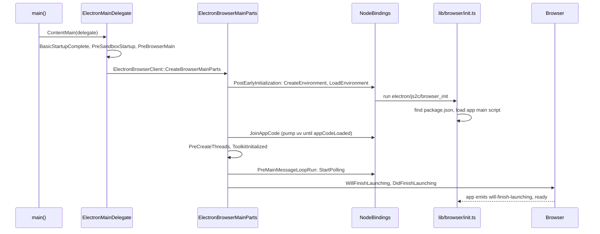
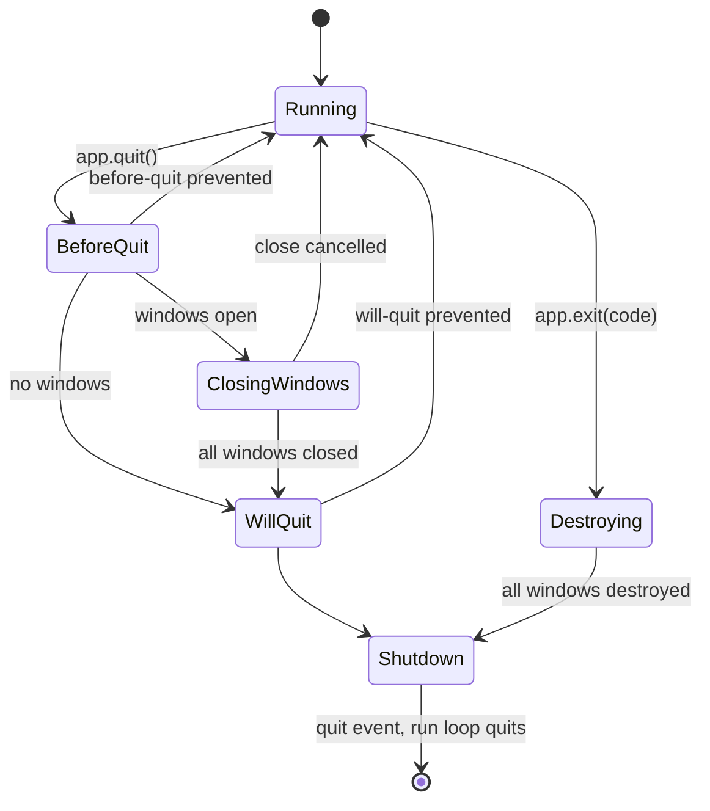

## Overview

The main (browser) process is where an Electron app's `main` script runs and where every window, session and native API lives. Its startup is Chromium's browser startup with Electron hooks inserted at fixed points: the platform `main()` hands control to Chromium's `ContentMain`, `ElectronMainDelegate` configures the process, and `ElectronBrowserMainParts` builds a Node.js environment, runs the app's script, and then drives the `ready` and quit sequence through the `Browser` singleton. How Node's libuv loop keeps running alongside Chromium's message loop once the app is up is covered in [[Node.js Integration and Event Loop]].

Sources: [shell/app/electron_main_linux.cc:29-44](repo://shell/app/electron_main_linux.cc#L29-L44), [shell/browser/electron_browser_client.cc:845-847](repo://shell/browser/electron_browser_client.cc#L845-L847), [shell/browser/electron_browser_main_parts.cc:175-184](repo://shell/browser/electron_browser_main_parts.cc#L175-L184)

Sources: [shell/app/electron_main_linux.cc:29-44](repo://shell/app/electron_main_linux.cc#L29-L44), [shell/browser/electron_browser_main_parts.cc:225-280](repo://shell/browser/electron_browser_main_parts.cc#L225-L280), [shell/browser/electron_browser_main_parts.cc:425-476](repo://shell/browser/electron_browser_main_parts.cc#L425-L476), [shell/browser/api/electron_api_app.cc:613-624](repo://shell/browser/api/electron_api_app.cc#L613-L624)

## Entry point and run-as-node

`electron_main_linux.cc` (and its macOS and Windows counterparts) is the process's `main()`. It fixes the stdio streams, gives `argv` to libuv, initialises both `base::CommandLine` and `ElectronCommandLine`, and then picks one of two programs. When the `run_as_node` fuse is on and `ELECTRON_RUN_AS_NODE` is set to a non-empty value, it runs `NodeMain()` and behaves as a plain Node.js binary. Otherwise it constructs an `ElectronMainDelegate` and calls `content::ContentMain`, which is the same `main()` for the browser, renderer, GPU and utility processes.

Sources: [shell/app/electron_main_linux.cc:20-44](repo://shell/app/electron_main_linux.cc#L20-L44), [shell/common/electron_constants.h:24](repo://shell/common/electron_constants.h#L24), [shell/app/electron_main_mac.cc:54](repo://shell/app/electron_main_mac.cc#L54), [shell/app/electron_main_win.cc:161](repo://shell/app/electron_main_win.cc#L161)

`NodeMain` honours the other fuses too: when the `node_options` fuse is off it removes `NODE_OPTIONS` and `NODE_EXTRA_CA_CERTS` from the environment before Node starts. On macOS it also checks that the parent process has the same code signature, so another app cannot use run-as-node mode to bypass the sandbox's ban on custom arguments.

Sources: [shell/app/node_main.cc:123-140](repo://shell/app/node_main.cc#L123-L140)

## ElectronMainDelegate

Chromium calls the delegate in every process before any process-specific code runs.

Sources: [shell/app/electron_main_linux.cc:42-43](repo://shell/app/electron_main_linux.cc#L42-L43), [shell/app/electron_main_delegate.cc:334-336](repo://shell/app/electron_main_delegate.cc#L334-L336)

| Hook | What Electron does |
| --- | --- |
| `BasicStartupComplete` | Enables stack dumping when `ELECTRON_ENABLE_STACK_DUMPING` is set, adds `--no-sandbox` when `ELECTRON_DISABLE_SANDBOX` is set, registers path providers, and on Linux refuses to run as root with the sandbox on |
| `PreSandboxStartup` | Applies `--user-data-dir`, initialises logging and crash keys, loads the resource bundle for child processes, starts Crashpad in child processes, and for the browser process appends `--allow-file-access-from-files` |
| `PreBrowserMain` | Initialises the feature list and mojo core |
| `GetBrowserV8SnapshotFilename` | Returns `browser_v8_context_snapshot.bin` when the browser-specific snapshot fuse is on |
| `CreateContentBrowserClient` and the other `Create*Client` methods | Return Electron's client for each process type |

Sources: [shell/app/electron_main_delegate.cc:264-332](repo://shell/app/electron_main_delegate.cc#L264-L332), [shell/app/electron_main_delegate.cc:334-444](repo://shell/app/electron_main_delegate.cc#L334-L444), [shell/app/electron_main_delegate.cc:451-479](repo://shell/app/electron_main_delegate.cc#L451-L479)

In the main process Crashpad is not started here: the code waits "for JS to call crashReporter.start()". Renderers pick their client from the sandbox switch, which is where [[Renderer Process Initialization]] and [[Sandboxed Renderers and Preload Realm]] begin.

Sources: [shell/app/electron_main_delegate.cc:370-378](repo://shell/app/electron_main_delegate.cc#L370-L378), [shell/app/electron_main_delegate.cc:462-473](repo://shell/app/electron_main_delegate.cc#L462-L473)

## ElectronBrowserMainParts

### Construction

`ElectronBrowserClient::CreateBrowserMainParts` returns the single `ElectronBrowserMainParts`. Its constructor creates a `BrowserProcessImpl` (Electron's stand-in for Chrome's `g_browser_process`), a `NodeBindings` for the browser environment, `ElectronBindings` on the same libuv loop, and the `Browser` object; a `DCHECK` forbids a second instance.

Sources: [shell/browser/electron_browser_client.cc:845-847](repo://shell/browser/electron_browser_client.cc#L845-L847), [shell/browser/electron_browser_main_parts.cc:172-192](repo://shell/browser/electron_browser_main_parts.cc#L172-L192)

### Running the app's code in PostEarlyInitialization

The app's JavaScript runs very early, before Chromium creates its threads. `PostEarlyInitialization` creates the `JavascriptEnvironment` only after the proxy resolver has set up its own V8 environment, then creates the Node environment, sets unhandled rejections to `warn-with-error-code`, binds Electron's extra `process` APIs, creates the microtasks runner, and calls `LoadEnvironment`. `JoinAppCode` then pumps the libuv loop until the app script calls back through `process.appCodeLoaded` (or the browser starts shutting down), so an ES module entry point with top-level `await` finishes before startup continues.

Sources: [shell/browser/electron_browser_main_parts.cc:225-261](repo://shell/browser/electron_browser_main_parts.cc#L225-L261), [shell/common/node_bindings.cc:895-924](repo://shell/common/node_bindings.cc#L895-L924)

Because the app may have changed command-line switches, the app name or the user data directory while its script ran, the rest of `PostEarlyInitialization` reinitialises the feature list, field trials and logging.

Sources: [shell/browser/electron_browser_main_parts.cc:262-280](repo://shell/browser/electron_browser_main_parts.cc#L262-L280)

### Threads, toolkit and the message loop

`PreCreateThreads` loads the resource bundle for the requested `--lang` (on Linux by temporarily setting `LC_ALL`), sets the application locale on both Electron and Chromium, and notifies `Browser` observers. `ToolkitInitialized` installs the Linux UI, GDK pixbuf and dark mode manager on Linux and the views delegate everywhere.

Sources: [shell/browser/electron_browser_main_parts.cc:282-356](repo://shell/browser/electron_browser_main_parts.cc#L282-L356), [shell/browser/electron_browser_main_parts.cc:388-423](repo://shell/browser/electron_browser_main_parts.cc#L388-L423)

`PreMainMessageLoopRun` starts Node's embed thread and polling, locks the URL scheme registries (so `protocol.registerSchemesAsPrivileged` must happen before this point), sets up extensions and the WebUI factory, starts remote debugging over a pipe or port when asked, and outside macOS calls `Browser::WillFinishLaunching` and `DidFinishLaunching`. On macOS those calls come from the application delegate instead. `WillRunMainMessageLoop` hands `Browser` the quit closure of the run loop.

Sources: [shell/browser/electron_browser_main_parts.cc:425-493](repo://shell/browser/electron_browser_main_parts.cc#L425-L493)

`PostCreateMainMessageLoop` configures OS key storage (os_crypt on Linux, the keychain service name `"<app name> Safe Storage"` on macOS) and, on POSIX, installs signal handlers that call `Browser::Quit` on `SIGINT` or `SIGTERM`.

Sources: [shell/browser/electron_browser_main_parts.cc:495-547](repo://shell/browser/electron_browser_main_parts.cc#L495-L547)

## lib/browser/init.ts

The Node environment's first script is the webpack bundle of `lib/browser/init.ts`. It removes itself from `process.argv`, loads the common init, gives the native event emitter Node's `EventEmitter.prototype`, installs the uncaught-exception dialog, re-emits the app's `quit` as `process` `exit`, sets a Squirrel.Windows app user model ID when an `update.exe` sits next to the executable, and replaces `process.exit` with `app.exit`. It then loads the RPC server and guest view manager used by [[IPC Between Main and Renderer]] and [[Child Windows and webview Guests]].

Sources: [lib/browser/init.ts:12-80](repo://lib/browser/init.ts#L12-L80)

Finding the app is a loop over the hidden `appSearchPaths` (`app.asar`, `app`, `default_app.asar`, or `app.asar` alone under the `only_load_app_from_asar` fuse): the first directory under `resourcesPath` with a loadable `package.json` wins. With no match it throws `Unable to find a valid app` and exits with code 1. The package's `version`, `productName` or `name`, `desktopName` and `v8Flags` are applied to the app, and `app.setAppPath` records the directory. How reading from an archive works is in [[ASAR Archives]].

Sources: [lib/browser/init.ts:82-141](repo://lib/browser/init.ts#L82-L141), [shell/common/node_bindings.cc:680-700](repo://shell/common/node_bindings.cc#L680-L700)

Before the app's code runs, `init.ts` preloads the `protocol`, `service-worker-main`, `web-contents`, `web-frame-main` and `web-contents-view` modules so their prototypes are ready when `ready` fires, quits on `window-all-closed` when it is the only listener, and installs the default menu on `will-finish-launching` so it exists before any window. Finally it loads `main` (default `index.js`): through Node's ESM loader for `"type": "module"` or `.mjs` entries, calling `appCodeLoaded` when the import settles, otherwise synchronously with `Module._load`.

Sources: [lib/browser/init.ts:143-227](repo://lib/browser/init.ts#L143-L227)

## The app object

`lib/browser/api/app.ts` takes the native `app` from the `electron_browser_app` linked binding, makes it an `EventEmitter`, and adds JS-side properties: `name`, `badgeCount`, `accessibilitySupportEnabled`, `commandLine` (wrapping `electron_common_command_line`), `applicationMenu` (delegating to `Menu`), and the dock menu on macOS. The binding pattern is explained in [[Native Bindings and the gin_helper Layer]].

Sources: [lib/browser/api/app.ts:1-71](repo://lib/browser/api/app.ts#L1-L71)

The native `App` is a `BrowserObserver`. Each `Browser` notification becomes an event, and for cancellable ones the return value of `Emit` (true when a listener called `preventDefault`) is written back.

Sources: [shell/browser/api/electron_api_app.cc:573-583](repo://shell/browser/api/electron_api_app.cc#L573-L583)

| Browser notification | App event |
| --- | --- |
| `OnWillFinishLaunching` | `will-finish-launching` |
| `OnFinishLaunching` | `ready` (with launch info) |
| `OnBeforeQuit` | `before-quit` (cancellable) |
| `OnWillQuit` | `will-quit` (cancellable) |
| `OnWindowAllClosed` | `window-all-closed` |
| `OnQuit` | `quit` (with exit code) |
| `OnOpenFile`, `OnOpenURL`, `OnActivate` | `open-file`, `open-url`, `activate` |

Sources: [shell/browser/api/electron_api_app.cc:573-624](repo://shell/browser/api/electron_api_app.cc#L573-L624)

`Browser::DidFinishLaunching` creates the user data directory, marks the browser ready, resolves the promise returned by `app.whenReady()` (creating an already-resolved one if asked later), and notifies observers.

Sources: [shell/browser/browser.cc:183-211](repo://shell/browser/browser.cc#L183-L211)

## Quitting

`app.quit()` calls `Browser::Quit`. It emits `before-quit`; if not prevented, it either shuts down at once when no windows exist or asks every window to close. A window whose `beforeunload` cancels the close also cancels the quit. When the last window closes during a quit, `NotifyAndShutdown` emits `will-quit`, and unless prevented `Shutdown` emits `quit` and runs the main loop's quit closure. If the loop does not exist yet, the closure runs as soon as `WillRunMainMessageLoop` provides it.

Sources: [shell/browser/browser.cc:86-98](repo://shell/browser/browser.cc#L86-L98), [shell/browser/browser.cc:125-141](repo://shell/browser/browser.cc#L125-L141), [shell/browser/browser.cc:225-267](repo://shell/browser/browser.cc#L225-L267)

Sources: [shell/browser/browser.cc:86-141](repo://shell/browser/browser.cc#L86-L141), [shell/browser/browser.cc:232-267](repo://shell/browser/browser.cc#L232-L267)

`app.exit(code)` (and `process.exit`, which is mapped to it) skips the events: it stores the exit code and destroys all windows without asking, then shuts down. Before the message loop exists, `SetExitCode` fails and the process calls `exit(code)` directly.

Sources: [shell/browser/browser.cc:100-123](repo://shell/browser/browser.cc#L100-L123), [shell/browser/electron_browser_main_parts.cc:194-205](repo://shell/browser/electron_browser_main_parts.cc#L194-L205)

After the loop ends, `PostMainMessageLoopRun` shuts down every session's download manager and every utility process started through `utilityProcess` while Node still runs, so their `exit` events can still be emitted, as [[Utility Process]] describes. It then destroys the microtasks runner, stops Node, and destroys all browser contexts.

Sources: [shell/browser/electron_browser_main_parts.cc:549-606](repo://shell/browser/electron_browser_main_parts.cc#L549-L606)
