## Overview

Almost every Electron API is a C++ class wrapping a Chromium or platform object, plus a thin TypeScript module. Three layers connect them. Each C++ file registers a Node *linked binding*, an `Initialize` function that fills an exports object. The `gin_helper` library (on top of Chromium's `gin`) turns C++ classes into JS objects: wrappers, constructors, event emitters, promises and type converters. And per-process module lists in `lib/` decide which bindings `require('electron')` exposes. This page follows a class through those layers; individual APIs are on their own pages.

Sources: [shell/browser/api/electron_api_tray.cc:450-465](repo://shell/browser/api/electron_api_tray.cc#L450-L465), [lib/browser/api/tray.ts:1-3](repo://lib/browser/api/tray.ts#L1-L3), [lib/browser/api/exports/electron.ts:1-8](repo://lib/browser/api/exports/electron.ts#L1-L8)

```mermaid
flowchart LR
  nodeCpp["C++ class<br>(Wrappable + Constructible + EventEmitterMixin)"] --> nodeInit["Initialize(exports, ...)"]
  nodeInit --> nodeMacro["NODE_LINKED_BINDING_CONTEXT_AWARE(electron_browser_tray, Initialize)"]
  nodeMacro --> nodeReg["NodeBindings::RegisterBuiltinBindings"]
  nodeReg --> nodeLinked["process._linkedBinding('electron_browser_tray')"]
  nodeLinked --> nodeTs["lib/browser/api/tray.ts"]
  nodeTs --> nodeList["browserModuleList entry 'Tray'"]
  nodeList --> nodeExports["require('electron').Tray"]
```

Sources: [shell/browser/api/electron_api_tray.cc:450-465](repo://shell/browser/api/electron_api_tray.cc#L450-L465), [shell/common/node_bindings.cc:115-128](repo://shell/common/node_bindings.cc#L115-L128), [shell/common/node_bindings.cc:531-547](repo://shell/common/node_bindings.cc#L531-L547), [lib/browser/api/module-list.ts:37](repo://lib/browser/api/module-list.ts#L37)

## Linked bindings

### Registering a binding

A binding file ends with `NODE_LINKED_BINDING_CONTEXT_AWARE(<name>, Initialize)`. `Initialize` receives an exports object and the context and sets functions, constructors or singletons on it with a `gin_helper::Dictionary`. Electron does not rely on static constructors to register these: `node_bindings.cc` forward-declares `_register_<name>()` for every name in its binding lists and `RegisterBuiltinBindings` calls only the lists allowed in the current process type, so a renderer cannot load a browser-only binding. Adding an API therefore means adding its name to the right list, as the project's own guide describes.

Sources: [shell/common/node_bindings.cc:53-128](repo://shell/common/node_bindings.cc#L53-L128), [shell/common/node_bindings.cc:531-547](repo://shell/common/node_bindings.cc#L531-L547), [docs/development/creating-api.md:128-149](repo://docs/development/creating-api.md#L128-L149)

The per-process lists and the processes that load them are on [[Node.js Integration and Event Loop]].

Sources: [shell/common/node_bindings.cc:53-113](repo://shell/common/node_bindings.cc#L53-L113)

### Looking a binding up

With Node, JS calls `process._linkedBinding('electron_browser_tray')`. In sandboxed renderers and preload realms, where there is no Node, `process._linkedBinding` is replaced with `binding.get`, which finds the linked module and calls its context-aware register function itself, caching the exports per context ([[Sandboxed Renderers and Preload Realm]]).

Sources: [lib/browser/api/tray.ts:1-3](repo://lib/browser/api/tray.ts#L1-L3), [lib/sandboxed_renderer/pre-init.ts:10-11](repo://lib/sandboxed_renderer/pre-init.ts#L10-L11), [shell/renderer/preload_utils.cc:36-61](repo://shell/renderer/preload_utils.cc#L36-L61)

## Wrapping C++ objects

### Wrappable

A wrappable class owns a JS wrapper object whose internal field points back at the C++ instance. `gin_helper::Wrappable<T>` builds the wrapper from a function template cached per isolate (filled by `T::BuildPrototype`); `DeprecatedWrappable<T>`, copied from Chromium and slated for removal, creates or returns the wrapper on demand through `GetWrapper(isolate)`. Converters for any wrappable subclass mean a `T*` can be returned to or accepted from JS directly: `ToV8` returns the wrapper (or `null`), `FromV8` unwraps it and checks the wrapper info.

Sources: [shell/common/gin_helper/wrappable.h:28-146](repo://shell/common/gin_helper/wrappable.h#L28-L146)

### Constructible

Classes users create with `new` also inherit `Constructible<T>` and define `New(...)` and `FillObjectTemplate`. `GetConstructor` builds a constructor function template bound to `T::New` once per isolate, sets the class name from `T::GetClassName()`, fills the prototype, and, when `T` is also an event emitter, makes the constructor inherit the event emitter template. Such classes must not define the usual `GetObjectTemplateBuilder`, which is never called for them.

Sources: [shell/common/gin_helper/constructible.h:17-90](repo://shell/common/gin_helper/constructible.h#L17-L90)

`Tray` shows the full pattern. It inherits `DeprecatedWrappable`, `EventEmitterMixin`, `Constructible`, `CleanedUpAtExit` and `Pinnable`. `Tray::New` throws `Cannot create Tray before app is ready`, validates the GUID argument, wraps construction in a `TryCatch` so an exception thrown during construction is rethrown to JS, then creates the handle and pins it. `FillObjectTemplate` lists the JS methods with `gin::ObjectTemplateBuilder`, and `Initialize` exports the constructor.

Sources: [shell/browser/api/electron_api_tray.h:38-52](repo://shell/browser/api/electron_api_tray.h#L38-L52), [shell/browser/api/electron_api_tray.cc:65-94](repo://shell/browser/api/electron_api_tray.cc#L65-L94), [shell/browser/api/electron_api_tray.cc:414-461](repo://shell/browser/api/electron_api_tray.cc#L414-L461)

### Lifetime helpers

| Helper | What it does |
| --- | --- |
| `Pinnable<T>` | `Pin` holds the wrapper in a `v8::Global` so it is not collected (a tray icon must survive with no JS reference); `Unpin` releases it |
| `SelfKeepAlive<T>` | Holds a `cppgc::Persistent` to a cppgc-managed object until `Clear` |
| `CleanedUpAtExit` | Objects destroyed just before the isolate is disposed, because weak finalisers do not run at isolate teardown |
| `TrackableObject<T>` | Gives each object an integer id in a per-class `KeyWeakMap`, finds it with `FromWeakMapID` or `FromWrappedClass`, and marks a wrapper destroyed by clearing its internal field |

Sources: [shell/common/gin_helper/pinnable.h:15-32](repo://shell/common/gin_helper/pinnable.h#L15-L32), [shell/common/gin_helper/self_keep_alive.h:12-32](repo://shell/common/gin_helper/self_keep_alive.h#L12-L32), [shell/common/gin_helper/cleaned_up_at_exit.h:10-25](repo://shell/common/gin_helper/cleaned_up_at_exit.h#L10-L25), [shell/common/gin_helper/trackable_object.h:54-128](repo://shell/common/gin_helper/trackable_object.h#L54-L128)

Because a wrapper may outlive the native object it wraps, APIs check before acting. `Tray::CheckAlive` throws `Tray is destroyed` once the icon is gone, and `CleanedUpAtExit` objects run `DoCleanup` from `JavascriptEnvironment::DestroyMicrotasksRunner` during shutdown ([[Main Process Startup and App Lifecycle]]).

Sources: [shell/browser/api/electron_api_tray.cc:404-412](repo://shell/browser/api/electron_api_tray.cc#L404-L412), [shell/browser/javascript_environment.cc:151-162](repo://shell/browser/javascript_environment.cc#L151-L162)

## Events from C++

### Inheriting EventEmitter

Native objects are real Node `EventEmitter`s. The main process's init calls `setEventEmitterPrototype(EventEmitter.prototype)` on the `electron_browser_event_emitter` binding, and `GetEventEmitterTemplate` creates a function template whose prototype's prototype is that object. `EventEmitterMixin` and `Constructible` make each class's constructor inherit this template, so `on`, `once` and `emit` come from Node's own implementation.

Sources: [lib/browser/init.ts:19](repo://lib/browser/init.ts#L19), [shell/browser/api/electron_api_event_emitter.cc:30-48](repo://shell/browser/api/electron_api_event_emitter.cc#L30-L48), [shell/common/gin_helper/event_emitter_template.cc:17-42](repo://shell/common/gin_helper/event_emitter_template.cc#L17-L42), [shell/browser/event_emitter_mixin.h:57-72](repo://shell/browser/event_emitter_mixin.h#L57-L72)

### Emit and EmitWithoutEvent

`EventEmitterMixin<T>::Emit(name, args...)` creates a `gin_helper::internal::Event`, calls `wrapper.emit(name, event, args...)`, and returns whether a listener called `event.preventDefault()`; this is how cancellable events like `before-quit` report back. `EmitWithoutEvent` passes only the arguments, as `Tray` does for `click`.

Sources: [shell/browser/event_emitter_mixin.h:26-52](repo://shell/browser/event_emitter_mixin.h#L26-L52), [shell/browser/api/electron_api_app.cc:573-577](repo://shell/browser/api/electron_api_app.cc#L573-L577), [shell/browser/api/electron_api_tray.cc:96-102](repo://shell/browser/api/electron_api_tray.cc#L96-L102)

Both go through `gin_helper::EmitEvent`, which converts every argument with `gin::ConvertToV8` and calls `CallMethodWithArgs`. That function returns `false` without calling anything when no Node environment is current, opens a `node::CallbackScope`, runs a microtask checkpoint, and calls the method with `node::MakeCallback` so pending Node ticks run too. A listener that throws makes the call return `false`.

Sources: [shell/common/gin_helper/event_emitter_caller.h:28-42](repo://shell/common/gin_helper/event_emitter_caller.h#L28-L42), [shell/common/gin_helper/event_emitter_caller.cc:11-41](repo://shell/common/gin_helper/event_emitter_caller.cc#L11-L41)

## Converting values

### Converters

Arguments and return values of bound methods are converted by `gin::Converter<T>` specialisations, one per type, in `shell/common/gin_converters` (geometry, URLs, file paths, accelerators, network types, `base::Value`, native images and many more). For example, `gfx::Rect` is read from any object with numeric `x`, `y`, `width` and `height`, and a missing field makes the conversion, and therefore the call, fail.

Sources: [shell/common/gin_converters/gfx_converter.h:25-33](repo://shell/common/gin_converters/gfx_converter.h#L25-L33), [shell/common/gin_converters/gfx_converter.cc:98-111](repo://shell/common/gin_converters/gfx_converter.cc#L98-L111)

### Dictionary

`gin_helper::Dictionary` is the workhorse for option objects. Unlike `gin::Dictionary`, its `Get` is const, accepts any key type, and checks the key exists first, so a missing key reports failure even when reading into a `v8::Local<v8::Value>`. It adds `ValueOrDefault`, `GetOptional`, and `GetHidden` and `SetHidden`, which store values under `v8::Private` keys that page or app code cannot see; Electron uses those hidden values for things like `isWebView` and the app search paths.

Sources: [shell/common/gin_helper/dictionary.h:25-112](repo://shell/common/gin_helper/dictionary.h#L25-L112), [shell/renderer/renderer_client_base.cc:110-113](repo://shell/renderer/renderer_client_base.cc#L110-L113)

## Promises

`gin_helper::Promise<T>` wraps a `v8::Promise::Resolver`. It is move-only and must be destroyed on the thread that created it. `Resolve` and `Reject` run inside a `SettleScope` that enters the promise's context and runs microtasks when it closes. `ResolvePromise` and `RejectPromise` are the thread-safe forms: in the browser process, called off the UI thread, they post the settlement to the UI thread. `ResolvedPromise` returns an already-settled promise. `Browser::WhenReady`, behind `app.whenReady()`, keeps one such promise and resolves it when launching finishes.

Sources: [shell/common/gin_helper/promise.h:23-132](repo://shell/common/gin_helper/promise.h#L23-L132), [shell/common/gin_helper/promise.cc:48-54](repo://shell/common/gin_helper/promise.cc#L48-L54), [shell/browser/browser.cc:203-211](repo://shell/browser/browser.cc#L203-L211)

## The JS layer

### Wrapper modules

Each module in `lib/*/api` takes what its binding exports and adds what is easier in JS. `tray.ts` re-exports the constructor unchanged; `app.ts` makes the native `app` an `EventEmitter` and adds properties and a `commandLine` object; `web-contents.ts` adds methods to the native `WebContents` prototype.

Sources: [lib/browser/api/tray.ts:1-3](repo://lib/browser/api/tray.ts#L1-L3), [lib/browser/api/app.ts:6-48](repo://lib/browser/api/app.ts#L6-L48), [lib/browser/api/web-contents.ts:116-131](repo://lib/browser/api/web-contents.ts#L116-L131)

### Module lists and the electron export

Each process type has a module list of `{ name, loader }` entries: `browserModuleList`, `rendererModuleList`, the sandboxed and preload realm lists, and `commonModuleList` (`nativeImage`, `shell`). The process's `api/exports/electron.ts` calls `defineProperties` with its lists; every entry becomes an enumerable getter that runs the loader on access and unwraps ES module defaults. Modules therefore load lazily, the first time an app touches `electron.Tray`.

Sources: [lib/browser/api/module-list.ts:1-43](repo://lib/browser/api/module-list.ts#L1-L43), [lib/renderer/api/module-list.ts:1-9](repo://lib/renderer/api/module-list.ts#L1-L9), [lib/common/api/module-list.ts:1-5](repo://lib/common/api/module-list.ts#L1-L5), [lib/common/define-properties.ts:1-17](repo://lib/common/define-properties.ts#L1-L17), [lib/browser/api/exports/electron.ts:1-8](repo://lib/browser/api/exports/electron.ts#L1-L8)

Webpack resolves `electron` inside Electron's own bundles to that exports file, and `lib/common/init.ts` makes `require('electron')` from app code return the same object ([[Build System, Patches and JS Bundling]] covers the bundles). A new API also needs its TypeScript ambient type for `_linkedBinding`, a `docs/api` page from which `electron.d.ts` is generated, and its sources in `filenames.gni`.

Sources: [build/webpack/webpack.config.base.js:117-124](repo://build/webpack/webpack.config.base.js#L117-L124), [lib/common/init.ts:80-119](repo://lib/common/init.ts#L80-L119), [docs/development/creating-api.md:7-39](repo://docs/development/creating-api.md#L7-L39), [docs/development/creating-api.md:128-136](repo://docs/development/creating-api.md#L128-L136)
