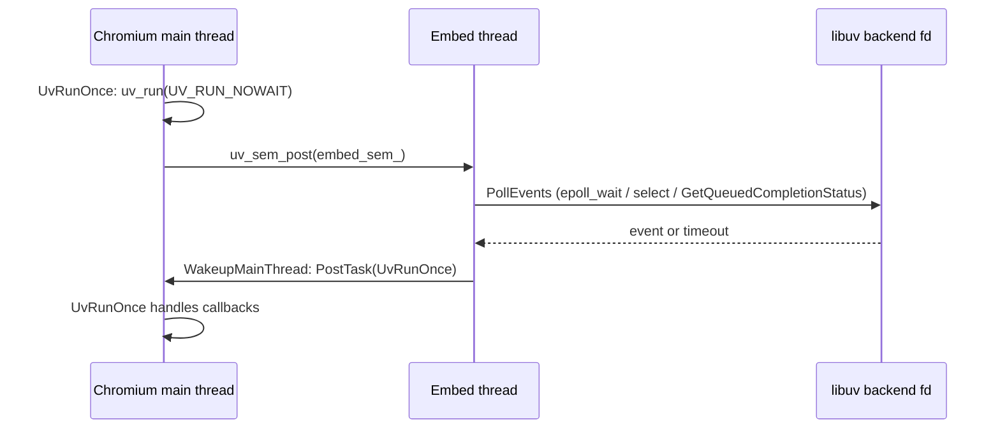

## Overview

Electron runs Node.js inside Chromium processes rather than beside them. Chromium owns each process's main thread and message loop; Node expects to own a libuv loop on that same thread. `NodeBindings` (in `shell/common`) bridges the two: it creates a Node environment on a V8 context Electron or Blink already made, and keeps libuv running by polling it from a separate "embed" thread that posts work back to Chromium's loop. The same class serves four environments (`kBrowser`, `kRenderer`, `kUtility`, `kWorker`), and the differences between them are mostly flags chosen in `Initialize` and `CreateEnvironment`.

Sources: [shell/common/node_bindings.h:107-130](repo://shell/common/node_bindings.h#L107-L130), [shell/common/node_bindings.cc:476-529](repo://shell/common/node_bindings.cc#L476-L529)

This page covers the shared machinery. When each process calls it is on [[Main Process Startup and App Lifecycle]], [[Renderer Process Initialization]] and [[Utility Process]]; how the Electron modules it registers are written is on [[Native Bindings and the gin_helper Layer]].

Sources: [shell/browser/electron_browser_main_parts.cc:225-261](repo://shell/browser/electron_browser_main_parts.cc#L225-L261), [shell/renderer/electron_renderer_client.cc:155-175](repo://shell/renderer/electron_renderer_client.cc#L155-L175)

## Creating an environment

### Initialize: once per process

`NodeBindings::Initialize` runs before the first environment. It explicitly registers Electron's built-in bindings (see the binding lists below), sanitises `NODE_OPTIONS`, builds Node's argv from a filtered copy of the command line, and calls `node::InitializeOncePerProcess`. The flags it passes tell Node not to initialise V8, cppgc or its own V8 platform, because Chromium (or `JavascriptEnvironment`) already has. Stdio inheritance is enabled except in utility processes, renderers skip Node's default signal handling, and the `node_options` fuse off adds `kDisableNodeOptionsEnv`. Node's WebAssembly trap handler is disabled because V8 crashes if it is enabled twice.

Sources: [shell/common/node_bindings.cc:587-651](repo://shell/common/node_bindings.cc#L587-L651)

### Which Node options are accepted

Only a small set of command-line switches reach Node outside run-as-node mode. `IsAllowedOption` accepts debug switches (`--inspect`, `--inspect-brk`, `--debug-port` and friends) only when the `node_cli_inspect` fuse is on, `--expose-internals` only in unpackaged apps, and a fixed list of others (`--trace-warnings`, `--no-deprecation`, `--dns-result-order` and so on). Renderers and workers always get `--no-experimental-fetch`, so Node's `fetch` does not conflict with Blink's.

Sources: [shell/common/node_bindings.cc:353-393](repo://shell/common/node_bindings.cc#L353-L393), [shell/common/node_bindings.cc:555-585](repo://shell/common/node_bindings.cc#L555-L585)

`SetNodeOptions` filters `NODE_OPTIONS` itself. With the fuse off the variable (and `NODE_EXTRA_CA_CERTS`) is removed with a warning. With it on, OpenSSL and FIPS options are always dropped "owing to constraints like BoringSSL", and a packaged app keeps only `--http-parser` and `--max-http-header-size`.

Sources: [shell/common/node_bindings.cc:395-456](repo://shell/common/node_bindings.cc#L395-L456)

### CreateEnvironment: once per context

`CreateEnvironment` picks the process type string, and in the browser stores the hidden `appSearchPaths` used by `lib/browser/init.ts`. It inserts `electron/js2c/<type>_init` as argv[1], so Node's bootstrap runs Electron's bundled init script for that process type. It stores the `node::IsolateData` in a fixed embedder slot of the context (cleared again by the environment's deleter) and creates the environment with `kNoGlobalSearchPaths` and `kNoRegisterESMLoader`.

Sources: [shell/common/node_bindings.cc:653-741](repo://shell/common/node_bindings.cc#L653-L741), [shell/common/node_bindings.cc:826-842](repo://shell/common/node_bindings.cc#L826-L842)

Renderers and workers also get `kNoBrowserGlobals` and `kNoCreateInspector`: Blink already defines `setImmediate`, `queueMicrotask` and similar globals, and only one ESM loader can exist per isolate. With the `node_cli_inspect` fuse off, `kNoStartDebugSignalHandler` stops Node from listening for `SIGUSR1`.

Sources: [shell/common/node_bindings.cc:711-734](repo://shell/common/node_bindings.cc#L711-L734)

### Isolate settings

| Setting | Browser and utility | Renderer and worker |
| --- | --- | --- |
| Abort on uncaught exception | Browser never aborts; utility behaves like Node | Never aborts |
| Microtask policy | `kExplicit` | Keeps the isolate's current policy (Blink's `kScoped`) |
| Message listener | Node's | Node's removed; `ErrorMessageListener` clears the async hooks stack |
| Promise rejection and stack trace callbacks | Node's | Blink's |
| Wasm and eval codegen checks | Node | Blink first (CSP), then Node if a Node context exists |

Sources: [shell/common/node_bindings.cc:742-810](repo://shell/common/node_bindings.cc#L742-L810), [shell/common/node_bindings.cc:295-326](repo://shell/common/node_bindings.cc#L295-L326)

The dynamic `import()` and `import.meta` hooks are installed on the isolate for every process. In a renderer they defer to Blink unless the calling context belongs to the isolated world with a Node environment, so page scripts use Blink's module loader while preload code uses Node's.

Sources: [shell/common/node_bindings.cc:214-293](repo://shell/common/node_bindings.cc#L214-L293), [shell/common/node_bindings.cc:805-810](repo://shell/common/node_bindings.cc#L805-L810)

Fatal V8 errors and out-of-memory errors are logged and recorded as crash keys (`electron.v8-fatal.*`, `electron.v8-oom.*`) before the process crashes, so crash reports carry the location and message.

Sources: [shell/common/node_bindings.cc:161-198](repo://shell/common/node_bindings.cc#L161-L198)

### LoadEnvironment and the node_init preload

`LoadEnvironment` calls `node::LoadEnvironment` with `OnNodePreload` as the preload callback and then emits `loaded` on `process`. `OnNodePreload` sets `process.resourcesPath`, `process.helperExecPath`, and `process.versions.electron` and `.chrome` as read-only values, then runs the `electron/js2c/node_init` bundle with `process` and `require`.

Sources: [shell/common/node_bindings.cc:855-858](repo://shell/common/node_bindings.cc#L855-L858), [shell/common/node_bindings.cc:994-1022](repo://shell/common/node_bindings.cc#L994-L1022)

That bundle, `lib/node/init.ts`, wraps `fs` with archive support (see [[ASAR Archives]]), swaps in Blink's `fetch`, `Response`, `Request` and related globals when the renderer saved them as `blink*`, makes `child_process.fork` set `ELECTRON_RUN_AS_NODE=1` (and use the helper executable on macOS) so forked children behave like Node, and filters `Module._nodeModulePaths` so a module inside `resourcesPath` never resolves `node_modules` outside it.

Sources: [lib/node/init.ts:1-59](repo://lib/node/init.ts#L1-L59)

## Running libuv beside Chromium

### The embed thread

libuv only runs when someone calls `uv_run`. Electron calls it from Chromium's main thread, but only when there is work, which it learns from a second thread. `PrepareEmbedThread` adds a dummy async handle so the loop never exits for lack of handles, then starts `EmbedThreadRunner`. `StartPolling` remembers the main thread's task runner and runs the loop once.

Sources: [shell/common/node_bindings.cc:860-893](repo://shell/common/node_bindings.cc#L860-L893)

Sources: [shell/common/node_bindings.cc:926-992](repo://shell/common/node_bindings.cc#L926-L992)

`UvRunOnce` enters the Node context, opens an explicit microtasks scope, runs `uv_run(UV_RUN_NOWAIT)`, and posts the semaphore so the embed thread polls again. The embed thread waits on the semaphore, calls the platform's `PollEvents`, and posts `UvRunOnce` to the main thread. The loop is therefore only ever run on the main thread, and the embed thread never touches JS. If the environment has gone (a navigation destroyed it while the message loop lives on) `UvRunOnce` returns without running. The destructor sets `embed_closed_`, wakes the thread through the dummy handle, and joins it.

Sources: [shell/common/node_bindings.cc:926-992](repo://shell/common/node_bindings.cc#L926-L992), [shell/common/node_bindings.cc:480-497](repo://shell/common/node_bindings.cc#L480-L497)

The loop is configured with `UV_LOOP_INTERRUPT_ON_IO_CHANGE`, so starting a new handle interrupts the embed thread's poll and it recomputes its timeout. Workers get their own loop; every other environment uses `uv_default_loop()`.

Sources: [shell/common/node_bindings.cc:513-529](repo://shell/common/node_bindings.cc#L513-L529)

### Platform backends

`NodeBindings::Create` is defined once per platform, each returning a subclass with its own `PollEvents`.

Sources: [shell/common/node_bindings_linux.cc:35-38](repo://shell/common/node_bindings_linux.cc#L35-L38), [shell/common/node_bindings.cc:980-990](repo://shell/common/node_bindings.cc#L980-L990)

| Platform | Class | How it waits |
| --- | --- | --- |
| Linux | `NodeBindingsLinux` | `epoll_wait` on a private epoll set holding libuv's backend fd, with `uv_backend_timeout` |
| macOS | `NodeBindingsMac` | `select` on the backend fd with the backend timeout |
| Windows | `NodeBindingsWin` | `GetQueuedCompletionStatus` on libuv's IOCP, then reposts the completion so libuv can handle it |

Sources: [shell/common/node_bindings_linux.cc:11-38](repo://shell/common/node_bindings_linux.cc#L11-L38), [shell/common/node_bindings_mac.cc:24-50](repo://shell/common/node_bindings_mac.cc#L24-L50), [shell/common/node_bindings_win.cc:14-54](repo://shell/common/node_bindings_win.cc#L14-L54)

On a single-core Windows machine the constructor replaces libuv's completion port with one allowing two concurrent threads, "to avoid cpu pegging likely caused by a busy loop in PollEvents". `PrepareEmbedThread` and `StartPolling` return early on a second call so only one thread ever polls the port.

Sources: [shell/common/node_bindings_win.cc:14-30](repo://shell/common/node_bindings_win.cc#L14-L30), [shell/common/node_bindings.cc:860-886](repo://shell/common/node_bindings.cc#L860-L886)

### Waking the loop from JavaScript

Because libuv only runs on demand, a `process.nextTick` or `setImmediate` callback queued from a Chromium task could wait indefinitely. `lib/common/init.ts` wraps `process.nextTick`, `setImmediate`, `setTimeout` and `setInterval` so each call first runs `process.activateUvLoop()`. The wrapped timers become globals only in the browser and utility processes, since renderers with Node integration delete Node's globals.

Sources: [lib/common/init.ts:8-62](repo://lib/common/init.ts#L8-L62)

`activateUvLoop` is bound by `ElectronBindings::BindTo`. It records the current environment once and sends an async handle; the callback opens a `node::CallbackScope` for each pending environment, which drains Node's tick queue and microtasks.

Sources: [shell/common/api/electron_bindings.cc:34-38](repo://shell/common/api/electron_bindings.cc#L34-L38), [shell/common/api/electron_bindings.cc:72-111](repo://shell/common/api/electron_bindings.cc#L72-L111)

## The browser's JavascriptEnvironment

In the main process there is no Blink, so `JavascriptEnvironment` creates the isolate. It applies `--js-flags`, creates a `node::MultiIsolatePlatform` because gin's platform depends on Chromium's task scheduler, which has not started yet, initialises gin on it, registers the isolate with the platform and the uv loop, and enters a fresh `node::NewContext`. `JavascriptEnvironment::GetIsolate()` is how browser-side C++ finds that isolate later.

Sources: [shell/browser/javascript_environment.cc:59-142](repo://shell/browser/javascript_environment.cc#L59-L142)

The main process uses the `kExplicit` microtask policy, and `CreateMicrotasksRunner` adds a `MicrotasksRunner` as a task observer on the UI thread. After every Chromium task, `DidProcessTask` opens a `node::CallbackScope` so Node performs the microtask checkpoint; the comment explains that letting both Chromium and Node checkpoint caused contention that delayed Node callbacks. `DestroyMicrotasksRunner` runs `gin_helper::CleanedUpAtExit::DoCleanup` before removing the observer at shutdown.

Sources: [shell/browser/javascript_environment.cc:144-162](repo://shell/browser/javascript_environment.cc#L144-L162), [shell/browser/microtasks_runner.cc:14-34](repo://shell/browser/microtasks_runner.cc#L14-L34)

## Built-in Electron bindings per process

`RegisterBuiltinBindings` calls the `_register_<name>` function of every binding allowed in the current process, instead of relying on static constructors.

Sources: [shell/common/node_bindings.cc:115-128](repo://shell/common/node_bindings.cc#L115-L128)

| List | Registered in | Examples |
| --- | --- | --- |
| `ELECTRON_BROWSER_BINDINGS` | Browser | `electron_browser_app`, `electron_browser_window`, `electron_browser_web_contents`, `electron_browser_session`, `electron_common_net` |
| `ELECTRON_COMMON_BINDINGS` | Every process | `electron_common_asar`, `electron_common_clipboard`, `electron_common_native_image`, `electron_common_v8_util` |
| `ELECTRON_RENDERER_BINDINGS` | Renderer | `electron_renderer_ipc`, `electron_renderer_context_bridge`, `electron_renderer_web_frame` |
| `ELECTRON_UTILITY_BINDINGS` | Utility | `electron_utility_parent_port`, `electron_common_net`, `electron_browser_event_emitter` |
| `ELECTRON_TESTING_BINDINGS` | DCHECK builds | `electron_common_testing` |

Sources: [shell/common/node_bindings.cc:53-128](repo://shell/common/node_bindings.cc#L53-L128), [shell/common/node_bindings.cc:531-547](repo://shell/common/node_bindings.cc#L531-L547)

## The common init script

Every bundle with Node (browser, renderer, utility, worker) loads `lib/common/init.ts`. Besides the timer wrappers, it gives Windows a `process.stdin` that always returns EOF, and inserts fake `electron`, `electron/common` and the process-specific `electron/main`, `electron/renderer` or `electron/utility` entries into `Module._cache`, whose `exports` getter returns the bundled `electron` module. `Module._resolveFilename` maps all five names to `electron`; the comment notes the split names exist "for TypeScript purposes" only.

Sources: [lib/common/init.ts:64-119](repo://lib/common/init.ts#L64-L119), [lib/browser/init.ts:16-17](repo://lib/browser/init.ts#L16-L17)

## Shutdown

`stop_and_close_uv_loop` (used for worker loops) stops the loop, closes any handle not already closing, pumps the loop until every close callback has run, and checks the loop is dead before closing it. `UvHandle<T>` exists so handles are always closed through `uv_close` and freed in the close callback.

Sources: [shell/common/node_bindings.cc:134-157](repo://shell/common/node_bindings.cc#L134-L157), [shell/common/node_bindings.h:33-96](repo://shell/common/node_bindings.h#L33-L96)
