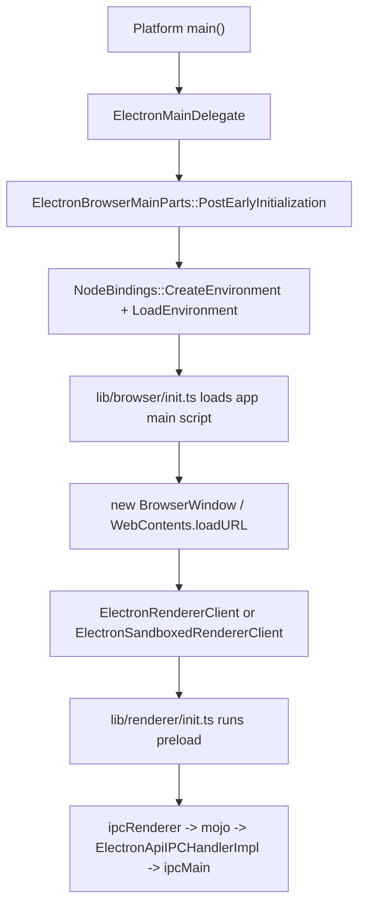

## Overview

This repository is the Electron runtime itself: the framework that "lets you write cross-platform desktop applications using JavaScript, HTML and CSS", built on Node.js and Chromium. It is not a standalone program but an embedder of Chromium's content layer. The C++ in `shell/` supplies the delegate and client classes Chromium calls into, wires a Node.js environment into the browser, renderer, worker and utility processes, and exposes native features as JS objects. The TypeScript in `lib/` is the JS API layer apps import as `electron`.

Sources: [README.md:9-12](repo://README.md#L9-L12)

Every process starts in the same executable. `ElectronMainDelegate` hands Chromium the client object for each process type, and picks a different renderer client depending on whether the frame is sandboxed.

Sources: [shell/app/electron_main_delegate.cc:451-473](repo://shell/app/electron_main_delegate.cc#L451-L473)

```cpp
content::ContentRendererClient*
ElectronMainDelegate::CreateContentRendererClient() {
  auto* command_line = base::CommandLine::ForCurrentProcess();

  if (IsSandboxEnabled(command_line)) {
    renderer_client_ = std::make_unique<ElectronSandboxedRendererClient>();
  } else {
    renderer_client_ = std::make_unique<ElectronRendererClient>();
  }

  return renderer_client_.get();
}
```

Sources: [shell/app/electron_main_delegate.cc:462-473](repo://shell/app/electron_main_delegate.cc#L462-L473)

## Parts of the repository

| Area | What it does | Page |
| --- | --- | --- |
| `shell/app` | Platform `main()` entry points, `ElectronMainDelegate`, run-as-node | [[Main Process Startup and App Lifecycle]] |
| `shell/common/node_bindings*` | Embeds Node in each process and runs its libuv loop beside Chromium's | [[Node.js Integration and Event Loop]] |
| `shell/renderer`, `lib/renderer`, `lib/isolated_renderer` | Renderer client hooks, preload scripts, isolated worlds | [[Renderer Process Initialization]] |
| `shell/renderer/electron_sandboxed_renderer_client*`, `lib/sandboxed_renderer`, `lib/preload_realm` | Preloads without Node, service worker preload realm | [[Sandboxed Renderers and Preload Realm]] |
| `lib/*/ipc-*`, `shell/browser/electron_api_ipc_handler_impl*` | `ipcRenderer` / `ipcMain` messaging over mojo | [[IPC Between Main and Renderer]] |
| `shell/renderer/api/electron_api_context_bridge*` | Copies values between isolated and main worlds | [[Context Bridge]] |
| `shell/common/gin_helper`, `shell/common/gin_converters` | Turns C++ classes into JS modules | [[Native Bindings and the gin_helper Layer]] |
| `shell/browser/native_window*`, `shell/browser/api/electron_api_*window*` | `BaseWindow`, `BrowserWindow`, views | [[Windows, Views and WebContentsView]] |
| `shell/browser/api/electron_api_web_contents*` | Pages, frames, navigation, devtools | [[WebContents and Navigation]] |
| `lib/browser/guest-*`, `lib/renderer/web-view` | `window.open` and `<webview>` | [[Child Windows and webview Guests]] |
| `shell/browser/net`, `electron_api_session*`, `electron_api_protocol*` | Sessions, custom protocols, `webRequest`, `net` | [[Sessions, Protocols and Networking]] |
| `shell/common/asar`, `lib/node/asar-fs-wrapper.ts` | Reading apps packed as `.asar` | [[ASAR Archives]] |
| `shell/services/node`, `lib/utility` | `utilityProcess.fork` | [[Utility Process]] |
| `lib/browser/api/menu*`, `tray`, `dialog` | Native menus, tray icons, dialogs | [[Menus, Tray and Dialogs]] |
| `BUILD.gn`, `build/`, `patches/`, `DEPS` | GN targets, webpack bundles, Chromium/Node patches, fuses | [[Build System, Patches and JS Bundling]] |
| `script/release` | Version bump, draft release, upload, publish | [[Release Pipeline]] |
| `spec/`, `script/spec-runner.js` | Test suites and how to run them | [[Building, Running and Testing Electron]] |

Sources: [shell/app/electron_main_delegate.cc:445-479](repo://shell/app/electron_main_delegate.cc#L445-L479), [BUILD.gn:165-237](repo://BUILD.gn#L165-L237), [patches/config.json:1-16](repo://patches/config.json#L1-L16)

## Main flow



Sources: [shell/browser/electron_browser_main_parts.cc:225-261](repo://shell/browser/electron_browser_main_parts.cc#L225-L261), [shell/common/node_bindings.cc:662-705](repo://shell/common/node_bindings.cc#L662-L705), [lib/browser/init.ts:82-114](repo://lib/browser/init.ts#L82-L114), [lib/browser/init.ts:204-222](repo://lib/browser/init.ts#L204-L222), [shell/browser/electron_api_ipc_handler_impl.cc:44-56](repo://shell/browser/electron_api_ipc_handler_impl.cc#L44-L56)

1. The platform entry point starts Chromium's content main with `ElectronMainDelegate`, which creates `ElectronBrowserClient` for the main process and the matching client for every child: [[Main Process Startup and App Lifecycle]].
2. In `PostEarlyInitialization`, `ElectronBrowserMainParts` builds a `JavascriptEnvironment`, asks `NodeBindings` to create a Node environment, binds Electron's extra `process` APIs, and loads it: [[Node.js Integration and Event Loop]].
3. `NodeBindings::CreateEnvironment` inserts the script `electron/js2c/browser_init` into Node's argv, so Node runs `lib/browser/init.ts`, which searches `app.asar`, `app` and `default_app.asar` under `resourcesPath` for a `package.json` and loads its `main` script: [[ASAR Archives]] covers the archive lookup.
4. The app creates a `BrowserWindow`, which owns a `WebContents` that loads a URL: [[Windows, Views and WebContentsView]] and [[WebContents and Navigation]].
5. Chromium starts a renderer, whose client creates a Node environment for the frame (unless sandboxed) and runs the preload: [[Renderer Process Initialization]] and [[Sandboxed Renderers and Preload Realm]].
6. Renderer code calls `ipcRenderer`, which reaches `ElectronApiIPCHandlerImpl::Message` in the main process and is re-emitted on `ipcMain`: [[IPC Between Main and Renderer]].

Sources: [shell/common/node_bindings.cc:662-705](repo://shell/common/node_bindings.cc#L662-L705), [lib/browser/init.ts:82-114](repo://lib/browser/init.ts#L82-L114), [shell/renderer/electron_renderer_client.cc:155-175](repo://shell/renderer/electron_renderer_client.cc#L155-L175), [lib/browser/ipc-dispatch.ts:59-75](repo://lib/browser/ipc-dispatch.ts#L59-L75)

## Design decisions

### JS layer compiled into the binary

The `lib/` code never ships as loose files. `BUILD.gn` declares one `webpack_build` per process type (`browser`, `renderer`, `worker`, `sandboxed_renderer`, `isolated_renderer`, `node`, `utility`, `preload_realm`), and the `electron_js2c` action turns those bundles into embedded sources. Each bundle's entry is `lib/<target>/init.ts`, and the `electron` module resolves to that target's `api/exports/electron.ts`, so `require('electron')` returns a different module list in each process. The details are in [[Build System, Patches and JS Bundling]].

Sources: [BUILD.gn:165-268](repo://BUILD.gn#L165-L268), [build/webpack/webpack.config.base.js:29-34](repo://build/webpack/webpack.config.base.js#L29-L34), [build/webpack/webpack.config.base.js:117-127](repo://build/webpack/webpack.config.base.js#L117-L127)

### Native objects exposed through linked bindings

Each C++ API registers itself as a Node linked binding, for example `NODE_LINKED_BINDING_CONTEXT_AWARE(electron_browser_tray, Initialize)`, and the JS layer fetches it with `process._linkedBinding(...)`; `lib/browser/init.ts` does the same to give the C++ event emitter Node's `EventEmitter.prototype`. [[Native Bindings and the gin_helper Layer]] explains the wrapper classes behind this.

Sources: [shell/browser/api/electron_api_tray.cc:465](repo://shell/browser/api/electron_api_tray.cc#L465), [lib/browser/init.ts:19](repo://lib/browser/init.ts#L19)

### Main process keeps running on errors

The main process installs an `uncaughtException` handler that shows a dialog instead of quitting, unless the app installed its own, and it sets Node's `unhandled_rejections` to `warn-with-error-code` "We do not want to crash the main process on unhandled rejections". `process.exit` is mapped to `app.exit`, "which quits gracefully".

Sources: [lib/browser/init.ts:21-38](repo://lib/browser/init.ts#L21-L38), [lib/browser/init.ts:73-74](repo://lib/browser/init.ts#L73-L74), [shell/browser/electron_browser_main_parts.cc:239-246](repo://shell/browser/electron_browser_main_parts.cc#L239-L246)

### Secure defaults in web preferences

`WebContentsPreferences` resets `node_integration_` to `false` and `context_isolation_` to `true`, so page code and preload code live in separate worlds unless the app opts out; [[Context Bridge]] is how a preload hands values to the page across that boundary.

Sources: [shell/browser/web_contents_preferences.cc:114-120](repo://shell/browser/web_contents_preferences.cc#L114-L120)

### Patched dependencies and fuses

Electron builds inside a Chromium checkout and applies its own patch sets to Chromium, V8, Node, BoringSSL, Squirrel.Mac and other dependencies; `patches/config.json` maps each patch directory to the repository it applies to. Packaged apps can flip compile-time "fuses" in the binary (run as node, `NODE_OPTIONS`, embedded asar integrity, only load app from asar, and others); the schema comment says never to remove a fuse or change its meaning. For instance, `only_load_app_from_asar` narrows the app search path to `app.asar` alone.

Sources: [patches/config.json:1-16](repo://patches/config.json#L1-L16), [build/fuses/fuses.json5:1-13](repo://build/fuses/fuses.json5#L1-L13), [shell/common/node_bindings.cc:680-700](repo://shell/common/node_bindings.cc#L680-L700)
