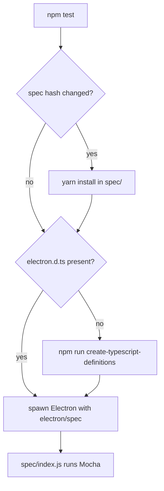

## Overview

Electron is not built on its own: it is a directory (`src/electron`) inside a Chromium checkout, fetched and built with Chromium's tools. This page walks a contributor from an empty folder to a built binary, a running app and a passing test run. What the build actually compiles (GN targets, the webpack bundles, patches) is in [[Build System, Patches and JS Bundling]]; the overall layout of the code is in [[Electron Architecture Overview]].

Sources: [docs/development/build-instructions-gn.md:15-30](repo://docs/development/build-instructions-gn.md#L15-L30)

The project's own guide recommends Electron's Build Tools to automate the setup; the steps below are the manual path it describes, using GN for project generation and ninja for building.

Sources: [docs/development/build-instructions-gn.md:17-21](repo://docs/development/build-instructions-gn.md#L17-L21)

## Get the code

1. Install `depot_tools`. On Windows also set `DEPOT_TOOLS_WIN_TOOLCHAIN=0` so it uses your local Visual Studio.
2. Optionally set `GIT_CACHE_PATH` to share a git cache between checkouts.
3. Configure and sync the checkout. `gclient` reads the `DEPS` file in `src/electron` to fetch Chromium, Node.js and the other dependencies at the pinned revisions.

Sources: [docs/development/build-instructions-gn.md:32-57](repo://docs/development/build-instructions-gn.md#L32-L57), [docs/development/build-instructions-gn.md:86-89](repo://docs/development/build-instructions-gn.md#L86-L89)

```sh
mkdir electron && cd electron
gclient config --name "src/electron" --unmanaged https://github.com/electron/electron
gclient sync --with_branch_heads --with_tags
```

Sources: [docs/development/build-instructions-gn.md:61-66](repo://docs/development/build-instructions-gn.md#L61-L66)

After a `git pull` in `src/electron`, run `gclient sync -f` so every dependency matches `DEPS` again.

Sources: [docs/development/build-instructions-gn.md:86-97](repo://docs/development/build-instructions-gn.md#L86-L97)

## Build

Set `CHROMIUM_BUILDTOOLS_PATH` to `src/buildtools`, generate an output directory from one of the argument files in `build/args`, then build the `electron` target with ninja.

Sources: [docs/development/build-instructions-gn.md:99-127](repo://docs/development/build-instructions-gn.md#L99-L127), [docs/development/build-instructions-gn.md:163-170](repo://docs/development/build-instructions-gn.md#L163-L170)

```sh
cd src
export CHROMIUM_BUILDTOOLS_PATH=`pwd`/buildtools
gn gen out/Testing --args="import(\"//electron/build/args/testing.gn\")"
ninja -C out/Testing electron
```

Sources: [docs/development/build-instructions-gn.md:99-170](repo://docs/development/build-instructions-gn.md#L99-L170)

The `testing.gn` arguments import `all.gn` and build a non-debug, non-component binary with `dcheck_always_on = true` and `symbol_level = 1`, so DCHECKs fire during tests. `release.gn` is the configuration for shipping builds. To change arguments later, run `gn args out/Testing`; `gn args out/Testing --list` shows every option.

Sources: [build/args/testing.gn:1-7](repo://build/args/testing.gn#L1-L7), [docs/development/build-instructions-gn.md:158-161](repo://docs/development/build-instructions-gn.md#L158-L161)

The build compiles Chromium's `content/` layer with Blink and V8 alongside Electron, so the first build takes a long time. `ninja -C out/Release electron:electron_dist_zip` packages a distributable zip.

Sources: [docs/development/build-instructions-gn.md:178-198](repo://docs/development/build-instructions-gn.md#L178-L198)

## Run the build

The binary lands in the output directory: `out/Testing/Electron.app/Contents/MacOS/Electron` on macOS, `out/Testing/electron.exe` on Windows, `out/Testing/electron` on Linux. From `src/electron`, `npm start` runs `script/start.js`, which spawns that binary with the remaining arguments, inherits stdio, exits with its exit code, and forwards `SIGINT`, `SIGTERM` and `SIGUSR2` to it. `npm run repl` passes `--interactive`.

Sources: [script/start.js:1-19](repo://script/start.js#L1-L19), [package.json:90-91](repo://package.json#L90-L91)

The scripts find the binary through `getOutDir` in `script/lib/utils.js`. It uses `ELECTRON_OUT_DIR` when set (and throws when that directory does not exist), otherwise the first of `Testing`, `Release`, `Default`, `Debug` that exists under `src/out`.

Sources: [script/lib/utils.js:15-62](repo://script/lib/utils.js#L15-L62)

Started without an app path, Electron falls back to the bundled `default_app.asar`, the last entry of the main process's app search paths described in [[Main Process Startup and App Lifecycle]].

Sources: [shell/common/node_bindings.cc:680-683](repo://shell/common/node_bindings.cc#L680-L683)

## Run the tests

### What the runner does

`npm test` runs `script/spec-runner.js`; its `pretest` hook first regenerates the TypeScript definitions. The runner knows one runner, `main` ("Main process specs"), selected with `--runners`.

Sources: [package.json:87-92](repo://package.json#L87-L92), [script/spec-runner.js:42-67](repo://script/spec-runner.js#L42-L67)



Sources: [script/spec-runner.js:69-108](repo://script/spec-runner.js#L69-L108), [script/spec-runner.js:194-222](repo://script/spec-runner.js#L194-L222)

The runner hashes `spec/package.json`, `spec/yarn.lock`, the runner itself and `spec/node_modules`, and reinstalls the spec dependencies with a pinned yarn only when the hash in `spec/.hash` differs. Native test modules are built against the headers in `out/<dir>/gen/node_headers`. It then launches the built Electron with `electron/spec` as the app; on Linux the launch is wrapped in `script/dbus_mock.py`.

Sources: [script/spec-runner.js:121-129](repo://script/spec-runner.js#L121-L129), [script/spec-runner.js:194-222](repo://script/spec-runner.js#L194-L222), [script/spec-runner.js:224-287](repo://script/spec-runner.js#L224-L287)

`--electronVersion` (a version, `latest` or `latest@<major>`) downloads a released Electron with `@electron/fiddle-core` and runs the specs against it instead of your build; only the `main` runner is allowed with it.

Sources: [script/spec-runner.js:48-90](repo://script/spec-runner.js#L48-L90), [script/spec-runner.js:194-201](repo://script/spec-runner.js#L194-L201)

### Inside the spec app

`spec/index.js` is the app's main script. It makes uncaught exceptions exit instead of showing a dialog, disables security warnings, exposes `gc`, keeps the app alive when windows close, uses fake media devices and host resolver rules for `localhost2`, and registers the privileged test schemes (`app`, `zoom`, `sw`, `cors`, `stream` and others) before ready.

Sources: [spec/index.js:9-59](repo://spec/index.js#L9-L59)

On ready it loads `ts-node` and Mocha, skips every test whose full title is in `spec/disabled-tests.json`, runs `defer()` cleanup functions before regular `afterEach` hooks, uses the TAP reporter with a 30 s timeout by default, and adds every `*-spec.ts` or `*-spec.js` file. The process exits with the failure count. Under `CI`, `.only` is forbidden and each test is retried up to three times.

Sources: [spec/index.js:61-127](repo://spec/index.js#L61-L127), [spec/index.js:137-191](repo://spec/index.js#L137-L191)

### Choosing which specs run

| Option | Effect |
| --- | --- |
| `-g`, `--grep <pattern>` | Mocha grep on test titles |
| `-i`, `--invert` | Invert the grep |
| `--files <paths>` | Only these spec files (relative to `electron/` or absolute); fails if none match |
| `npm run test -match=menu` | Only files whose path matches the regex |
| `MOCHA_GREP`, `MOCHA_INVERT` | Grep set through the environment, used for sharding |
| `MOCHA_REPORTER`, `MOCHA_MULTI_REPORTERS`, `MOCHA_TIMEOUT` | Reporter and timeout overrides |
| `ELECTRON_TEST_RESULTS_DIR` | Writes `test-results-<runner>.xml` there |

Sources: [spec/index.js:64-168](repo://spec/index.js#L64-L168), [script/spec-runner.js:131-149](repo://script/spec-runner.js#L131-L149)

## Lint and format

`npm run lint` runs `script/lint.js` over every language and then the docs checks. Each language has its own script: `lint:js`, `lint:cpp`, `lint:objc`, `lint:py`, `lint:gn`, `lint:markdown`, plus `lint:clang-format` and `lint:clang-tidy`. `lint:docs` runs remark, checks JS and TS snippets in the Markdown, regenerates the type definitions, checks the fiddles, relative links and API history.

Sources: [package.json:64-78](repo://package.json#L64-L78)

A husky pre-commit hook runs `lint-staged`: it fixes JS and TS with `script/lint.js`, regenerates `filenames.auto.gni` through `script/gen-filenames.ts`, runs clang-format on C++ and Objective-C, runs `gn-check` and `gn-format` on GN files, and lints patch files with `script/check-patch-diff.ts`.

Sources: [package.json:85-89](repo://package.json#L85-L89), [package.json:101-133](repo://package.json#L101-L133)
