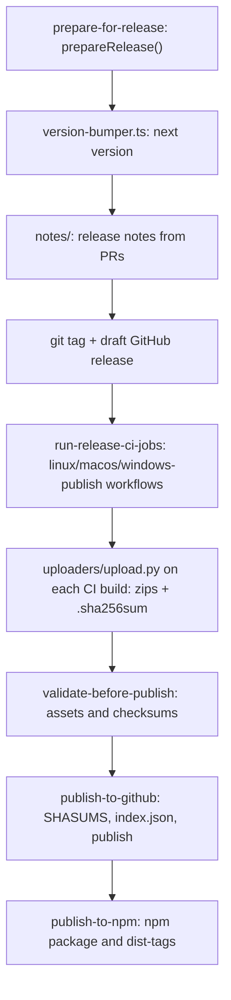

## Overview

An Electron release is a git tag, a GitHub release carrying the built binaries for every platform, checksum files and headers on Electron's artifact CDN, and an npm package that downloads the right binary at install time. The scripts in `script/release` produce all of that. They are not run by hand: the project's README says each is "called by Sudowoodo at various points in the Electron release process", and warns that the scripts are old and may have undocumented effects. The flow has four stages: prepare (bump, notes, tag, draft, CI builds), upload (each CI build attaches its artifacts), validate and publish to GitHub, and publish to npm. How a build itself is configured is on [[Build System, Patches and JS Bundling]].

Sources: [script/release/bin/README.md:1-58](repo://script/release/bin/README.md#L1-L58)

Sources: [script/release/prepare-release.ts:213-222](repo://script/release/prepare-release.ts#L213-L222), [script/release/run-release-ci-jobs.ts:15-60](repo://script/release/run-release-ci-jobs.ts#L15-L60), [script/release/uploaders/upload.py:47-163](repo://script/release/uploaders/upload.py#L47-L163), [script/release/release.ts:408-433](repo://script/release/release.ts#L408-L433), [script/release/bin/publish-to-npm.ts:153-236](repo://script/release/bin/publish-to-npm.ts#L153-L236)

## Release scripts

| Script | Purpose |
| --- | --- |
| `prepare-for-release` | Create the tag and kick off all release builds on GitHub Actions |
| `print-next-version` | Print the version the next release would use |
| `run-release-build` | Re-run specific release builds after a failure |
| `validate-before-publish` | Check all assets exist, checksums match, and headers and symbols are on their CDNs |
| `publish-to-github` | Upload header SHASUMs, update `index.json`, publish the GitHub release |
| `publish-to-npm` | Publish the npm package |
| `cleanup-release` | Delete the draft release and the tag of a failed version; the only case where a tag is deleted, since tags are immutable once published |

Sources: [script/release/bin/README.md:12-58](repo://script/release/bin/README.md#L12-L58)

## Versions

### Bump types

The bump type is one of `nightly`, `alpha`, `beta`, `minor` or `stable`. `version-bumper.ts` reads the current version and computes the next. From a prerelease (nightly, alpha or beta) it can move to the next nightly, alpha or beta, or to the stable version with the same numbers. From a stable version it can go to a nightly, the next minor, or the next patch with `stable`, and refuses alpha or beta. With `--dryRun` it only prints the result, which is how `print-next-version` works.

Sources: [script/release/types.ts:7-11](repo://script/release/types.ts#L7-L11), [script/release/version-bumper.ts:20-100](repo://script/release/version-bumper.ts#L20-L100), [script/release/prepare-release.ts:208-211](repo://script/release/prepare-release.ts#L208-L211)

### Nightlies

A nightly version is `<version>-nightly.<date>`. On `main` the base is the next major after the last major released from `main`; on a stable branch it is the next patch. Nightly releases go to a separate GitHub repository, `electron/nightlies`, and `release.ts` picks that repository whenever the package version contains `nightly`.

Sources: [script/release/version-utils.ts:56-68](repo://script/release/version-utils.ts#L56-L68), [script/release/types.ts:1-5](repo://script/release/types.ts#L1-L5), [script/release/release.ts:25-31](repo://script/release/release.ts#L25-L31)

## Preparing a release

### prepareRelease

`prepareRelease` works on the target branch (or the current one). It computes the new version as a dry run, then `createRelease` bumps for real, generates release notes, creates an annotated tag, checks that no draft for that tag exists (exiting if one does), and creates a draft GitHub release named `electron <version>` targeting the branch, or `main` for nightlies. It then pushes `HEAD` with `--follow-tags` and starts the release builds.

Sources: [script/release/prepare-release.ts:29-111](repo://script/release/prepare-release.ts#L29-L111), [script/release/prepare-release.ts:146-222](repo://script/release/prepare-release.ts#L146-L222)

Prereleases are marked as such, and their release body starts with a note telling users which npm package or tag to install: `electron-nightly` for nightlies, `electron@alpha` or `electron@beta` otherwise. Nightlies get no generated notes, only a pointer to compare tags.

Sources: [script/release/prepare-release.ts:58-74](repo://script/release/prepare-release.ts#L58-L74), [script/release/prepare-release.ts:113-144](repo://script/release/prepare-release.ts#L113-L144)

### Starting CI builds

`runReleaseCIJobs` dispatches the `linux-publish`, `macos-publish` and `windows-publish` GitHub Actions workflows on `refs/tags/<version>`, with `upload-to-storage` set to `0` for a GitHub release (and `1` for builds that only upload to storage), and logs the run URL of each.

Sources: [script/release/run-release-ci-jobs.ts:12-76](repo://script/release/run-release-ci-jobs.ts#L12-L76), [script/release/prepare-release.ts:184-190](repo://script/release/prepare-release.ts#L184-L190)

## Release notes

### Choosing the range

`getReleaseNotes(range)` accepts `begin..end` or just `end`. Without a beginning it finds the previous point: the newest supported tag earlier on the same branch (only stable tags when the current tag is stable), otherwise the newest stable release on an earlier stabilization branch, walking back past branches that never had a stable release.

Sources: [script/release/notes/index.ts:118-170](repo://script/release/notes/index.ts#L118-L170)

### Collecting notes

`getNotes` gathers the commits in the range with their pull requests, using a cache directory (`NOTES_CACHE_PATH` or `.cache`) for GitHub responses. A commit and its revert inside the same range cancel each other. Each commit's note comes from the `release-clerk[bot]` comment on its pull request: `**No Release Notes**` means none, and a `**Release Notes Persisted**` comment carries the quoted note text. Commits with no note, "No notes", or a version-bump note are dropped.

Sources: [script/release/notes/notes.ts:46-47](repo://script/release/notes/notes.ts#L46-L47), [script/release/notes/notes.ts:123-163](repo://script/release/notes/notes.ts#L123-L163), [script/release/notes/notes.ts:510-564](repo://script/release/notes/notes.ts#L510-L564)

Commit messages are parsed for the project's conventions: a `semantic:` prefix sets the type (defaulting to `fix`), `(#123)` or "Merge pull request" or "Backport of" links the pull request, "This reverts commit" marks a revert, and a `BREAKING CHANGE` line marks a breaking change. For backports, `getMergedTrops` reads the `merged/<branch>` labels and the `trop[bot]` comments to find the same change on other branches.

Sources: [script/release/notes/notes.ts:165-225](repo://script/release/notes/notes.ts#L165-L225), [script/release/notes/notes.ts:442-475](repo://script/release/notes/notes.ts#L442-L475)

### Rendering

Notes are sorted into breaking changes, features (`feat`, `feature`), fixes, other changes, documentation (`doc`, `docs`) and unknown. The output is a Markdown document `# Release Notes for <version>` with a section per group; documentation changes collapse into one line of links, and `--unique` drops changes that also landed on other branches. Unknown notes produce a warning that they must be fixed before releasing, and the command-line form throws on it.

Sources: [script/release/notes/notes.ts:24-27](repo://script/release/notes/notes.ts#L24-L27), [script/release/notes/notes.ts:572-602](repo://script/release/notes/notes.ts#L572-L602), [script/release/notes/notes.ts:750-785](repo://script/release/notes/notes.ts#L750-L785), [script/release/notes/index.ts:160-215](repo://script/release/notes/index.ts#L160-L215)

## Uploading artifacts

### From each CI build

Each release build runs `uploaders/upload.py`, which first refuses to continue if the tag does not match the built version. For a GitHub upload the release must exist and must still be a draft unless `--overwrite` is passed. It uploads the renamed `dist.zip` and `symbols.zip`, platform debug symbols (`dsym` zips on macOS, `pdb` on Windows, `debug` and libc++ objects on Linux), `electron-api.json` and `electron.d.ts` from the macOS x64 build, the libc++ headers and Hunspell dictionaries from Linux x64, and the ffmpeg, chromedriver and mksnapshot zips (the x64 mksnapshot for Arm targets). For a new release it also runs the symbol upload and, on Windows, the Node headers upload.

Sources: [script/release/uploaders/upload.py:47-163](repo://script/release/uploaders/upload.py#L47-L163)

### Per-file checksums

`upload_electron` zeroes zip timestamps for reproducibility, uploads the file to the GitHub release through `upload-to-github.ts`, and stores a `<file>.sha256sum` in the artifact store's `checksums-scratchpad/<version>` prefix. With `--upload_to_storage` it stores the file under `release-builds/<version>_<date>` instead of uploading to GitHub.

Sources: [script/release/uploaders/upload.py:334-383](repo://script/release/uploaders/upload.py#L334-L383)

## Validating and publishing

### Validation

`getDraftRelease` requires exactly one draft for the version, a prerelease flag on betas, and a body longer than 50 characters without `(placeholder)`. `validateReleaseAssets` checks every expected asset name for the version is attached, then verifies hashes: for a draft it fetches authenticated redirect URLs for each GitHub asset and compares their SHA-256 with the published sums, and it does the same for the Node headers and checksum files on `artifacts.electronjs.org/headers/dist/<version>/`. Any mismatch exits.

Sources: [script/release/release.ts:38-126](repo://script/release/release.ts#L38-L126), [script/release/release.ts:227-234](repo://script/release/release.ts#L227-L234), [script/release/release.ts:438-531](repo://script/release/release.ts#L438-L531)

### Publishing to GitHub

`makeRelease` uploads the Node SHASUMS to the artifact CDN, merges every per-file `.sha256sum` from the scratchpad into `SHASUMS256.txt` and attaches it to the draft (replacing an older one), re-reads the draft and validates it, and only then uploads `index.json`. The comment explains the ordering: `index.json` goes live as soon as it is uploaded, so it is uploaded as late as possible to reduce the chance it lists a release that fails to publish, but before publishing so no published release is missing from it. Finally `publishRelease` clears the draft flag and marks a stable release as GitHub's latest only if its tag is not older than the current latest.

Sources: [script/release/release.ts:250-338](repo://script/release/release.ts#L250-L338), [script/release/release.ts:382-406](repo://script/release/release.ts#L382-L406), [script/release/release.ts:414-433](repo://script/release/release.ts#L414-L433)

### Publishing to npm

`publish-to-npm` packs the npm package for the version and test-installs the tarball, checking that requiring it returns a path to a binary that exists, before publishing (skipped if that version is already on npm). Nightlies are published as `electron-nightly`, tagged `latest` from `main` or `nightly-<branch>` otherwise. Other releases use the branch name as the tag (`alpha-<branch>` or `beta-<branch>` for prereleases), refuse to run on `main`, and then move the `latest`, `beta` or `alpha` dist-tag only when the new version is newer than the one it points at.

Sources: [script/release/bin/publish-to-npm.ts:153-236](repo://script/release/bin/publish-to-npm.ts#L153-L236)
