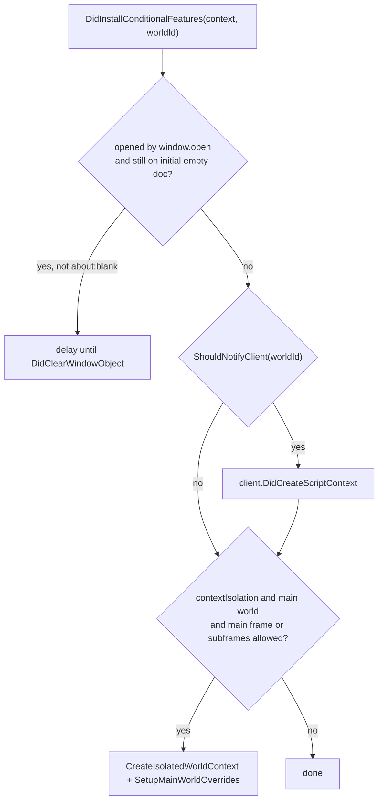

## Overview

A renderer is a Chromium child process that runs one or more web frames. Electron adds three things to it: the preload scripts an app configures, optional Node.js APIs, and the `electron` renderer modules (`ipcRenderer`, `contextBridge`, `webFrame`). All of that is installed when Blink creates a script context for a frame. The C++ side decides *which* context gets Node and when, using world ids and web preferences; the JS side (`lib/renderer/init.ts`) loads the preloads into that context.

Sources: [shell/renderer/electron_renderer_client.cc:92-178](repo://shell/renderer/electron_renderer_client.cc#L92-L178), [lib/renderer/init.ts:133-168](repo://lib/renderer/init.ts#L133-L168)

`ElectronMainDelegate` creates `ElectronRendererClient` for renderers without the sandbox switch; sandboxed renderers get `ElectronSandboxedRendererClient`, described in [[Sandboxed Renderers and Preload Realm]]. Both derive from `RendererClientBase`, which holds the behaviour they share. How values cross from the isolated world to the page is the subject of [[Context Bridge]].

Sources: [shell/app/electron_main_delegate.cc:462-473](repo://shell/app/electron_main_delegate.cc#L462-L473)

## Worlds and contexts

Every frame has a main world (id `0`), where the page's own scripts run. With `contextIsolation` on (the default), Electron creates a second world with id `999`, `ISOLATED_WORLD_ID`, chosen "far away from 0 to not collide with any other world IDs created internally by Chrome". Extension worlds start at `1 << 20`.

Sources: [shell/common/world_ids.h:12-26](repo://shell/common/world_ids.h#L12-L26), [shell/browser/web_contents_preferences.cc:114-120](repo://shell/browser/web_contents_preferences.cc#L114-L120)

`RendererClientBase::GetContext` returns the context Electron's code lives in: the isolated world's context when the frame has context isolation, otherwise the main world's. Preloads, `ipcRenderer` and the Node environment all live in that context.

Sources: [shell/renderer/renderer_client_base.cc:536-546](repo://shell/renderer/renderer_client_base.cc#L536-L546)

## Which frames get Electron

`ShouldLoadPreload` gates everything: a frame gets a Node environment and preloads only if it is the main frame, a DevTools or DevTools-extension page, or `nodeIntegrationInSubFrames` is on, and in every case only if the frame is not a `<webview>` frame. A frame is a webview frame when its `frameElement` carries the hidden `isWebView` value set by the webview implementation; webview guests get their own renderer setup, as [[Child Windows and webview Guests]] describes.

Sources: [shell/renderer/renderer_client_base.cc:198-210](repo://shell/renderer/renderer_client_base.cc#L198-L210), [shell/renderer/renderer_client_base.cc:548-566](repo://shell/renderer/renderer_client_base.cc#L548-L566)

## Process start: RendererClientBase

When the client is constructed it reads scheme lists passed by the browser process on the command line (`--standard-schemes`, `--secure-schemes`, `--cors-schemes`, `--streaming-schemes`, `--service-worker-schemes`) and registers them with `url` and Blink, so schemes the app registered with `protocol.registerSchemesAsPrivileged` behave the same in the renderer. It also stores the renderer client id used to build each context's `process.contextId`.

Sources: [shell/renderer/renderer_client_base.cc:138-174](repo://shell/renderer/renderer_client_base.cc#L138-L174), [shell/renderer/renderer_client_base.cc:186-196](repo://shell/renderer/renderer_client_base.cc#L186-L196)

`RenderThreadStarted` enables the `MessagePortCloseEvent` feature, sets up extensions and the spellchecker when built in, allows the `webview` and `browserplugin` custom element names, registers fetch, service worker, CSP-bypassing and code cache schemes, and, when the `grant_file_protocol_extra_privileges` fuse is on, lets `file:` use service workers and the fetch API.

Sources: [shell/renderer/renderer_client_base.cc:212-297](repo://shell/renderer/renderer_client_base.cc#L212-L297)

For every new frame, `RenderFrameCreated` attaches the autofill agent, `ContentSettingsObserver`, the print helper, extension helpers, and `ElectronApiServiceImpl`, the mojo endpoint the browser uses to send messages into the frame (see [[IPC Between Main and Renderer]]). `ElectronRendererClient` adds an `ElectronRenderFrameObserver` first. `DidClearWindowObject` executes `void 0` so every page gets a script context even if it has no script.

Sources: [shell/renderer/renderer_client_base.cc:306-342](repo://shell/renderer/renderer_client_base.cc#L306-L342), [shell/renderer/renderer_client_base.cc:358-362](repo://shell/renderer/renderer_client_base.cc#L358-L362), [shell/renderer/electron_renderer_client.cc:55-59](repo://shell/renderer/electron_renderer_client.cc#L55-L59)

## ElectronRenderFrameObserver

### Choosing the world

The observer turns Blink's per-world context notifications into calls on the client.

Sources: [shell/renderer/electron_render_frame_observer.cc:150-156](repo://shell/renderer/electron_render_frame_observer.cc#L150-L156), [shell/renderer/electron_render_frame_observer.cc:122-127](repo://shell/renderer/electron_render_frame_observer.cc#L122-L127)

Sources: [shell/renderer/electron_render_frame_observer.cc:70-148](repo://shell/renderer/electron_render_frame_observer.cc#L70-L148)

`ShouldNotifyClient` picks the one world that gets Electron. With context isolation (on a main frame, or a subframe with `nodeIntegrationInSubFrames`) it is the isolated world; otherwise the main world. A subframe with node integration still on `about:blank` is skipped, because a Node environment created there would raise illegal access errors when it is cleaned up after the real `src` loads.

Sources: [shell/renderer/electron_render_frame_observer.cc:191-211](repo://shell/renderer/electron_render_frame_observer.cc#L191-L211)

The main-world notification is what creates the isolated world. `CreateIsolatedWorldContext` names it "Electron Isolated Context" (the name shown in the DevTools console's context menu), gives it the document's security origin, and runs `void 0` in it; Blink then reports the new isolated context and the client sets it up. `SetupMainWorldOverrides` runs only when `webviewTag` is on: it hands the main world the `isolated_bundle` with an `isolatedApi` object so the `<webview>` element can be defined in the page's world.

Sources: [shell/renderer/electron_render_frame_observer.cc:138-147](repo://shell/renderer/electron_render_frame_observer.cc#L138-L147), [shell/renderer/electron_render_frame_observer.cc:173-189](repo://shell/renderer/electron_render_frame_observer.cc#L173-L189), [shell/renderer/renderer_client_base.cc:568-609](repo://shell/renderer/renderer_client_base.cc#L568-L609), [lib/isolated_renderer/init.ts:1-10](repo://lib/isolated_renderer/init.ts#L1-L10)

### Delayed initialization for window.open

A child window from `window.open` inherits its parent's preferences and Chromium initialises its JS context at once, before the browser can override the preferences for the real navigation. Initialising Node then would give the child the wrong settings, for example node integration despite `nodeIntegration=no`. So while such a window is still on its initial empty document (and the URL is not `about:blank`, which never navigates further), the observer sets `has_delayed_node_initialization_` and returns; `DidClearWindowObject` runs the deferred initialisation once the real document arrives.

Sources: [shell/renderer/electron_render_frame_observer.cc:70-120](repo://shell/renderer/electron_render_frame_observer.cc#L70-L120)

## DidCreateScriptContext: one Node environment per frame

`ElectronRendererClient::DidCreateScriptContext` builds the Node environment for the chosen context.

Sources: [shell/renderer/electron_renderer_client.cc:92-104](repo://shell/renderer/electron_renderer_client.cc#L92-L104)

1. Return unless `ShouldLoadPreload` allows this frame; record the frame in `injected_frames_`.
2. On the first frame only, initialise `NodeBindings` and prepare the embed thread ([[Node.js Integration and Event Loop]]).
3. Call `node::InitializeContext` on the Blink context.
4. Defer loading the document body (`LoaderFreezeMode::kStrict`) so a preload, even an async ES module, finishes before the page's content loads.
5. Create the environment, passing `UndeferLoad` as the `appCodeLoaded` callback.
6. Save Blink's `fetch`, `Response`, `FormData`, `Request`, `Headers` and `EventSource` as `blink*` globals, since Node deletes `fetch` when its own is disabled; `lib/node/init.ts` restores them.
7. Force context-aware native modules, set unhandled rejections to `warn-with-error-code`, bind Electron's `process` extras and `isMainFrame`, `contextIsolated`, `contextId`, and load the environment.
8. If no environment drives the uv loop yet, make this one drive it and start polling.

Sources: [shell/renderer/electron_renderer_client.cc:87-178](repo://shell/renderer/electron_renderer_client.cc#L87-L178), [shell/renderer/renderer_client_base.cc:186-196](repo://shell/renderer/renderer_client_base.cc#L186-L196)

When the context is released, `WillReleaseScriptContext` emits `exit` on that environment's `process`, stops it from driving the uv loop if it did (the main frame "may be replaced"), and destroys it inside an explicit microtasks scope. `RunScriptsAtDocumentStart` and `RunScriptsAtDocumentEnd` emit `document-start` and `document-end` on `process`.

Sources: [shell/renderer/electron_renderer_client.cc:61-85](repo://shell/renderer/electron_renderer_client.cc#L61-L85), [shell/renderer/electron_renderer_client.cc:180-208](repo://shell/renderer/electron_renderer_client.cc#L180-L208)

## lib/renderer/init.ts

### Module system adjustments

The renderer bundle runs first in the new environment. It warns when the `vm` module is loaded (it "conflicts with Blink's V8::Context internal logic"), and replaces `Module.wrapper` so every CommonJS module, preloads included, receives `process`, `global` and `Buffer` as wrapper arguments. That keeps those names available in preloads even after they are deleted from the page's globals; the comment notes this relies on a Node patch and on the webpack `ProvidePlugin` supplying the same variables to Electron's own bundles.

Sources: [lib/renderer/init.ts:8-47](repo://lib/renderer/init.ts#L8-L47), [build/webpack/webpack.config.base.js:63-69](repo://build/webpack/webpack.config.base.js#L63-L69)

### Node integration or not

With `nodeIntegration` on, `init.ts` gives the page a global `module` and `require`, sets `__filename` and `__dirname` to the HTML file for `file:` pages (handling Windows drive letters and network shares) or to a fake `electron.asar/renderer` path otherwise, points module resolution at the app path, and forwards `window.onerror` to `process`'s `uncaughtException` when listeners exist.

Sources: [lib/renderer/init.ts:56-116](repo://lib/renderer/init.ts#L56-L116)

With it off and context isolation also off, Node and the page share one world, so on `loaded` it deletes `process`, `Buffer`, `setImmediate`, `clearImmediate`, `global`, `root` and `GLOBAL` from the page's globals. The preloads keep them through the module wrapper.

Sources: [lib/renderer/init.ts:117-131](repo://lib/renderer/init.ts#L117-L131)

### Common renderer setup

`common-init.ts` (shared with the sandboxed bundle) installs the native IPC listener, overrides inspector APIs on `devtools:` pages, runs `windowSetup` on ordinary pages, initialises the `<webview>` element in main frames, runs `webFrameInit`, and in main frames schedules the security warnings.

Sources: [lib/renderer/common-init.ts:1-48](repo://lib/renderer/common-init.ts#L1-L48)

### Loading the preloads

`init.ts` asks the main process for preload paths with a synchronous internal IPC, `BROWSER_NONSANDBOX_LOAD`. The handler returns the session's frame preloads plus the `webPreferences.preload` of the sending `WebContents`, keeping only absolute paths.

Sources: [lib/renderer/init.ts:136](repo://lib/renderer/init.ts#L136), [lib/browser/rpc-server.ts:52-70](repo://lib/browser/rpc-server.ts#L52-L70), [lib/browser/rpc-server.ts:104-107](repo://lib/browser/rpc-server.ts#L104-L107)

CommonJS preloads load synchronously with `Module._load`; `.mjs` preloads load in order through Node's ESM loader. A preload that throws is logged and reported as `BROWSER_PRELOAD_ERROR`, which the main process re-emits as the `WebContents` `preload-error` event. When all preloads have run (immediately if there are no ESM ones), `appCodeLoaded` fires, which calls `UndeferLoad` and lets the page body load.

Sources: [lib/renderer/init.ts:133-168](repo://lib/renderer/init.ts#L133-L168), [lib/browser/rpc-server.ts:109-112](repo://lib/browser/rpc-server.ts#L109-L112), [shell/renderer/electron_renderer_client.cc:87-90](repo://shell/renderer/electron_renderer_client.cc#L87-L90)

## Security warnings

`securityWarnings` waits for the page's `load` event and only logs when running from an unpackaged Electron binary (the executable path ends in `Electron`, `electron` or `electron.exe`), unless `ELECTRON_DISABLE_SECURITY_WARNINGS` or `ELECTRON_ENABLE_SECURITY_WARNINGS` is set in the environment or on `window`. It then fetches the last web preferences from the main process and warns about node integration with remote content, disabled web security, insecure resources, allowed insecure content, experimental features, `enableBlinkFeatures`, an insecure or missing CSP, and allowed popups.

Sources: [lib/renderer/security-warnings.ts:18-50](repo://lib/renderer/security-warnings.ts#L18-L50), [lib/renderer/security-warnings.ts:264-293](repo://lib/renderer/security-warnings.ts#L264-L293)

## Web workers

Dedicated workers get Node only when the browser passed `--node-integration-in-worker`. Service workers, shared workers and main-thread worklets never get it, "owing to an inability to customize sandbox policies in these workers given that they're run out-of-process". A thread-local `WebWorkerObserver` creates a `kWorker` `NodeBindings` with its own uv loop, saves Blink's fetch globals, binds Electron's `process` extras, loads the environment and starts polling.

Sources: [shell/renderer/electron_renderer_client.cc:210-248](repo://shell/renderer/electron_renderer_client.cc#L210-L248), [shell/renderer/web_worker_observer.cc:23-107](repo://shell/renderer/web_worker_observer.cc#L23-L107)

The worker bundle, `lib/worker/init.ts`, mirrors the renderer: it loads the common init, exposes `module` and `require`, restores Blink's fetch, and sets `__filename`, `__dirname` and module paths from the worker's `file:` location or the app path.

Sources: [lib/worker/init.ts:1-50](repo://lib/worker/init.ts#L1-L50)
