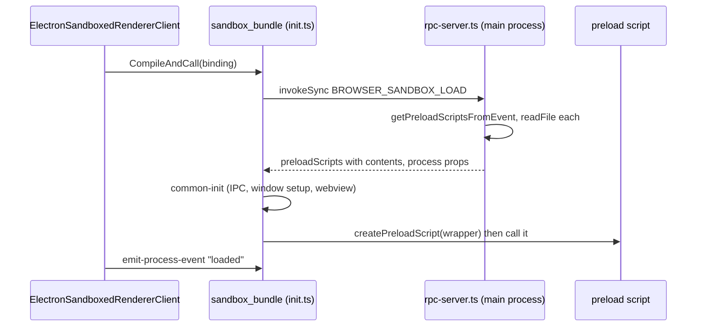

## Overview

A sandboxed renderer runs under Chromium's OS sandbox and has no Node.js environment at all. It still runs the app's preload scripts and still offers `contextBridge`, `ipcRenderer`, `webFrame` and a few other modules, but the preloads see a small hand-built `require` and `process` instead of Node's. The same machinery, with a different bundle, runs preloads for service workers inside a ShadowRealm-based "preload realm". This page follows both; the shared frame plumbing (`RendererClientBase`, `ElectronRenderFrameObserver`, world selection) is on [[Renderer Process Initialization]].

Sources: [shell/renderer/electron_sandboxed_renderer_client.cc:62-139](repo://shell/renderer/electron_sandboxed_renderer_client.cc#L62-L139), [lib/sandboxed_renderer/init.ts:1-71](repo://lib/sandboxed_renderer/init.ts#L1-L71)

## When a renderer is sandboxed

`WebContentsPreferences::IsSandboxed` returns the explicit `sandbox` preference when set; otherwise the renderer is sandboxed unless `nodeIntegration` or `nodeIntegrationInWorker` is on. A renderer for a cross-origin subframe can also be sandboxed when `nodeIntegrationInSubFrames` is off. In either case the browser appends the `--enable-sandbox` switch; otherwise it appends `--no-sandbox` and `--no-zygote`.

Sources: [shell/browser/web_contents_preferences.cc:280-286](repo://shell/browser/web_contents_preferences.cc#L280-L286), [shell/browser/web_contents_preferences.cc:308-325](repo://shell/browser/web_contents_preferences.cc#L308-L325)

In the renderer, `ElectronMainDelegate::CreateContentRendererClient` reads that switch and creates `ElectronSandboxedRendererClient` instead of `ElectronRendererClient`.

Sources: [shell/app/electron_main_delegate.cc:462-473](repo://shell/app/electron_main_delegate.cc#L462-L473)

## ElectronSandboxedRendererClient

### The binding object

The client has no `NodeBindings` instance; its constructor only registers Electron's built-in bindings so they can be looked up by name. For each frame that passes `ShouldLoadPreload`, `DidCreateScriptContext` builds a plain `binding` object and calls the `electron/js2c/sandbox_bundle` script with it as its only parameter, then emits `loaded`.

Sources: [shell/renderer/electron_sandboxed_renderer_client.cc:62-66](repo://shell/renderer/electron_sandboxed_renderer_client.cc#L62-L66), [shell/renderer/electron_sandboxed_renderer_client.cc:110-139](repo://shell/renderer/electron_sandboxed_renderer_client.cc#L110-L139)

| Member | Provided by | Purpose |
| --- | --- | --- |
| `binding.get(name)` | `preload_utils::GetBinding` | Returns a linked binding's exports, cached per context |
| `binding.createPreloadScript(src)` | `preload_utils::CreatePreloadScript` | Compiles and runs a source string in the current context |
| `binding.process` | `ElectronBindings::BindProcess`, `RendererClientBase::BindProcess` | Memory, CPU and version helpers, `isMainFrame`, `contextIsolated`, `contextId`, plus `uptime`, `argv`, `pid`, `sandboxed: true`, `type: 'renderer'` |

Sources: [shell/renderer/electron_sandboxed_renderer_client.cc:70-90](repo://shell/renderer/electron_sandboxed_renderer_client.cc#L70-L90), [shell/renderer/preload_utils.cc:36-76](repo://shell/renderer/preload_utils.cc#L36-L76)

`GetBinding` is adapted from Node's own lookup: it finds the module with `node::binding::get_linked_module`, calls its context-aware register function on a fresh exports object, and caches the result in a hidden `native-binding-cache` object on the global. An unknown name throws `No such binding`. This is how the sandboxed bundle reaches the same C++ modules a Node-enabled renderer reaches through `process._linkedBinding`; [[Native Bindings and the gin_helper Layer]] describes those modules.

Sources: [shell/renderer/preload_utils.cc:16-61](repo://shell/renderer/preload_utils.cc#L16-L61)

### Process events without Node

Without Node there is no `process` emitter in C++ to call. Instead `sandboxed_renderer/init.ts` stores a callback under the hidden key `emit-process-event` on the global, and the client's `InvokeEmitProcessEvent` looks it up and calls it for `loaded`, `document-start`, `document-end` and `exit`. The callback emits the event on both the bundle's internal `process` and the preload-visible one.

Sources: [shell/renderer/electron_sandboxed_renderer_client.cc:37-58](repo://shell/renderer/electron_sandboxed_renderer_client.cc#L37-L58), [shell/renderer/electron_sandboxed_renderer_client.cc:98-171](repo://shell/renderer/electron_sandboxed_renderer_client.cc#L98-L171), [lib/sandboxed_renderer/init.ts:41-48](repo://lib/sandboxed_renderer/init.ts#L41-L48)

## The sandbox bundle

### Pre-initialisation

The bundle is built with `alwaysHasNode: false`, so webpack supplies browser shims for `Buffer` and `process`, and it is wrapped in a `try` block and an optional profiling delay. Its first import, `pre-init.ts`, sets `process._linkedBinding` to `binding.get`, copies `binding.process` onto the shim, stores the `Buffer` shim as a hidden global so C++ can deserialise buffers sent from the browser, and turns the shim `process` into a real `EventEmitter`.

Sources: [build/webpack/webpack.config.sandboxed_renderer.js:1-6](repo://build/webpack/webpack.config.sandboxed_renderer.js#L1-L6), [build/webpack/webpack.config.base.js:71-107](repo://build/webpack/webpack.config.base.js#L71-L107), [lib/sandboxed_renderer/pre-init.ts:1-30](repo://lib/sandboxed_renderer/pre-init.ts#L1-L30)

### Fetching preloads from the main process

A sandboxed renderer cannot read files, so `init.ts` asks the main process for the preload *source*, not paths, with the synchronous internal message `BROWSER_SANDBOX_LOAD`. The handler in `rpc-server.ts` collects the same preloads as for unsandboxed frames (the session's frame or service-worker preloads, plus `webPreferences.preload` for frames, absolute paths only), reads each file as UTF-8, and returns its contents or the read error. It also returns `process` values the sandbox cannot compute itself: `arch`, `platform`, a copy of `env`, `version`, `versions`, and `execPath` set to the helper executable.

Sources: [lib/sandboxed_renderer/init.ts:14-22](repo://lib/sandboxed_renderer/init.ts#L14-L22), [lib/browser/rpc-server.ts:52-102](repo://lib/browser/rpc-server.ts#L52-L102)

Sources: [shell/renderer/electron_sandboxed_renderer_client.cc:110-139](repo://shell/renderer/electron_sandboxed_renderer_client.cc#L110-L139), [lib/sandboxed_renderer/init.ts:14-71](repo://lib/sandboxed_renderer/init.ts#L14-L71), [lib/browser/rpc-server.ts:89-102](repo://lib/browser/rpc-server.ts#L89-L102)

The renderer IPC used here is described in [[IPC Between Main and Renderer]]. After the reply, `init.ts` copies the returned values onto both `process` objects and runs the same `common-init.ts` as unsandboxed renderers.

Sources: [lib/sandboxed_renderer/init.ts:50-56](repo://lib/sandboxed_renderer/init.ts#L50-L56), [lib/renderer/common-init.ts:1-48](repo://lib/renderer/common-init.ts#L1-L48)

### What a sandboxed preload can require

`preloadRequire` resolves only names in two maps and throws `module not found` for anything else.

Sources: [lib/sandboxed_renderer/preload.ts:46-57](repo://lib/sandboxed_renderer/preload.ts#L46-L57)

| Already loaded | Loaded on first use |
| --- | --- |
| `electron`, `electron/common`, `electron/renderer`, `events`, `node:events` | `timers`, `node:timers`, `url`, `node:url` |

Sources: [lib/sandboxed_renderer/init.ts:24-39](repo://lib/sandboxed_renderer/init.ts#L24-L39)

`electron` here is the sandboxed bundle's own export list: `contextBridge`, `crashReporter`, `ipcRenderer`, `nativeImage`, `webFrame` and `webUtils`.

Sources: [lib/sandboxed_renderer/api/module-list.ts:1-26](repo://lib/sandboxed_renderer/api/module-list.ts#L1-L26)

### Running each preload

`runPreloadScript` wraps the preload source in `(function(require, process, exports, module, Buffer, global, setImmediate, clearImmediate) { ... })`, compiles it in the frame's context through `createPreloadScript`, and calls it with the restricted `require`, the preload `process`, fresh `exports` and `module` objects, and the exposed globals. The preload `process` is a separate `EventEmitter` that forwards `noDeprecation`, offers `getProcessMemoryInfo` over IPC, and exposes `_linkedBinding` only when the `unsafely-expose-electron-internals-for-testing` switch is present.

Sources: [lib/sandboxed_renderer/preload.ts:19-82](repo://lib/sandboxed_renderer/preload.ts#L19-L82), [lib/sandboxed_renderer/init.ts:58-71](repo://lib/sandboxed_renderer/init.ts#L58-L71)

Preloads run in order and synchronously. A preload whose file could not be read, or that throws, is logged and reported as `BROWSER_PRELOAD_ERROR`, which becomes the `preload-error` event on the `WebContents`; the remaining preloads still run.

Sources: [lib/sandboxed_renderer/preload.ts:84-101](repo://lib/sandboxed_renderer/preload.ts#L84-L101), [lib/browser/rpc-server.ts:109-112](repo://lib/browser/rpc-server.ts#L109-L112)

## Service worker preload realm

### When it is created

Service workers can have preloads too (`type: 'service-worker'` session preloads). The browser only adds the `--service-worker-preload` switch to a renderer when its session already has a service worker preload registered "prior to startup". With that switch, `WillEvaluateServiceWorkerOnWorkerThread` creates a thread-local `ServiceWorkerData` for the worker and calls `preload_realm::OnCreatePreloadableV8Context`; `WillDestroyServiceWorkerContextOnWorkerThread` deletes it.

Sources: [shell/browser/electron_browser_client.cc:586-596](repo://shell/browser/electron_browser_client.cc#L586-L596), [shell/renderer/electron_sandboxed_renderer_client.cc:173-213](repo://shell/renderer/electron_sandboxed_renderer_client.cc#L173-L213)

### Building the realm

`OnCreatePreloadableV8Context` creates a new `kShadowRealm` `DOMWrapperWorld`, a `ShadowRealmGlobalScope` owned by the worker, and a new `v8::Context` that shares the worker's microtask queue. A `PreloadRealmLifetimeController` ties the realm to the worker's lifetime: it stores itself in an embedder slot of both contexts (so `GetPreloadRealmContext` and `GetInitiatorContext` can find one from the other), registers the realm with the worker debugger under the path `electron-preload-realm`, and tears the realm down when the worker's context is destroyed.

Sources: [shell/renderer/preload_realm_context.cc:39-121](repo://shell/renderer/preload_realm_context.cc#L39-L121), [shell/renderer/preload_realm_context.cc:202-289](repo://shell/renderer/preload_realm_context.cc#L202-L289)

### The preload realm bundle

`RunInitScript` builds the same kind of `binding` object as a sandboxed frame (with `process.type` set to `service-worker` and `contextIsolated` to true) and runs `electron/js2c/preload_realm_bundle`.

Sources: [shell/renderer/preload_realm_context.cc:152-187](repo://shell/renderer/preload_realm_context.cc#L152-L187)

`lib/preload_realm/init.ts` reuses `pre-init.ts` and `preload.ts` from the sandbox bundle: it fetches preloads with `BROWSER_SANDBOX_LOAD` (the handler picks the session's service-worker preloads because the event's type is `service-worker`), and runs them with an even smaller `require` (`electron`, `events`, `url`) and only `Buffer` and `global` as extra globals. Its `electron` module exposes `contextBridge`, `ipcRenderer` and `nativeImage`, so a service worker preload can bridge values into the worker's own context, as [[Context Bridge]] describes.

Sources: [lib/preload_realm/init.ts:1-58](repo://lib/preload_realm/init.ts#L1-L58), [lib/preload_realm/api/module-list.ts:1-14](repo://lib/preload_realm/api/module-list.ts#L1-L14), [lib/browser/rpc-server.ts:52-70](repo://lib/browser/rpc-server.ts#L52-L70)
