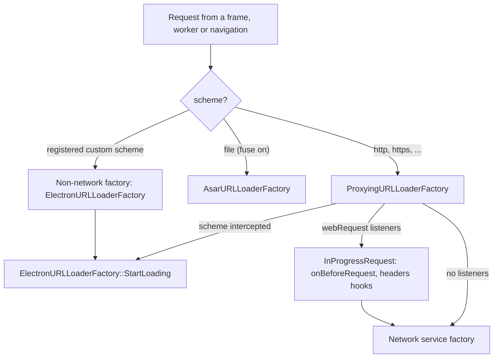

## Overview

A `Session` is Electron's JS face of an `ElectronBrowserContext`, Chromium's unit of browsing state: cookies, cache, storage, preferences, permissions, preload scripts and network context. Every `webContents` belongs to exactly one session, and every request a page or the `net` module makes is loaded through that session's factories. Three Electron features sit on that request path: custom protocols (`protocol.handle` and the older `register*Protocol` APIs), `webRequest` hooks, and the main-process HTTP client (`net.request`, `net.fetch`, `session.fetch`). Loading `file:` URLs and paths inside `.asar` archives is on [[ASAR Archives]].

Sources: [shell/browser/api/electron_api_session.cc:1683-1729](repo://shell/browser/api/electron_api_session.cc#L1683-L1729), [shell/browser/electron_browser_client.cc:1309-1376](repo://shell/browser/electron_browser_client.cc#L1309-L1376)

## Sessions and browser contexts

### Partitions

`Session::FromPartition` maps a partition string to a browser context: the empty string is the default context, `persist:<name>` is an on-disk context, and any other name is an in-memory context. `ElectronBrowserContext::From` keeps one context per `(partition, in_memory)` key in a map, so the same partition always yields the same context; `fromPath` keys a context by an absolute directory instead and rejects an empty path.

Sources: [shell/browser/api/electron_api_session.cc:484](repo://shell/browser/api/electron_api_session.cc#L484), [shell/browser/api/electron_api_session.cc:1712-1740](repo://shell/browser/api/electron_api_session.cc#L1712-L1740), [shell/browser/electron_browser_context.cc:869-897](repo://shell/browser/electron_browser_context.cc#L869-L897)

`Session::CreateFrom` returns the existing `Session` for a context if one is alive, otherwise allocates a cppgc-managed `Session`, calls its JS `_init`, and emits `session-created` on `app`. `_init` attaches the IPC dispatch listeners ([[IPC Between Main and Renderer]]), so each session routes messages from its own frames.

Sources: [shell/browser/api/electron_api_session.cc:1683-1710](repo://shell/browser/api/electron_api_session.cc#L1683-L1710), [lib/browser/api/session.ts:25-42](repo://lib/browser/api/session.ts#L25-L42)

### What a context holds

The context constructor reads the `cache` option (and the `--disable-http-cache` and disk-cache-size switches), places persistent partitions under `<sessionData>/Partitions/<name>`, creates a `ProtocolRegistry` and a cookie change notifier, and for persistent contexts starts the extension system. `InitPrefs` reads `Preferences` JSON from the context's path synchronously and registers the prefs Electron uses (last file-dialog directory, download directory, DevTools state, zoom levels, proxy config).

Sources: [shell/browser/electron_browser_context.cc:357-410](repo://shell/browser/electron_browser_context.cc#L357-L410), [shell/browser/electron_browser_context.cc:422-470](repo://shell/browser/electron_browser_context.cc#L422-L470)

### Permissions

`ElectronPermissionManager` backs `setPermissionRequestHandler` and `setPermissionCheckHandler`. Without a request handler every requested permission is *granted* (MIDI sysex and geolocation also get their process-level opt-ins); with one, the handler is called once per permission with `requestingUrl` and `isMainFrame` added to the details, and the responses are collected into one reply. Without a check handler every check passes except the deprecated synchronous clipboard read.

Sources: [shell/browser/electron_permission_manager.cc:181-233](repo://shell/browser/electron_permission_manager.cc#L181-L233), [shell/browser/electron_permission_manager.cc:308-343](repo://shell/browser/electron_permission_manager.cc#L308-L343)

## Custom protocols

### Privileged schemes

`protocol.registerSchemesAsPrivileged` must run before `ready` and throws otherwise. For each scheme it applies the requested privileges to the browser process's URL registries: `standard` (also registered as web-safe), `secure`, `bypassCSP`, `corsEnabled`, `allowServiceWorkers`, `stream` and `codeCache` (which requires `standard`). It also appends each list to the browser's command line (`--standard-schemes`, `--secure-schemes` and so on), which child processes inherit, so renderers register the same schemes at start ([[Renderer Process Initialization]]). The browser locks the scheme registries in `PreMainMessageLoopRun`, which is why this must happen early.

Sources: [shell/browser/api/electron_api_protocol.cc:40-84](repo://shell/browser/api/electron_api_protocol.cc#L40-L84), [shell/browser/api/electron_api_protocol.cc:110-189](repo://shell/browser/api/electron_api_protocol.cc#L110-L189), [shell/browser/api/electron_api_protocol.cc:348-358](repo://shell/browser/api/electron_api_protocol.cc#L348-L358), [shell/browser/electron_browser_main_parts.cc:431-432](repo://shell/browser/electron_browser_main_parts.cc#L431-L432)

### Registering and intercepting

Each session's `Protocol` object writes to its context's `ProtocolRegistry`, which keeps two maps from scheme to `(ProtocolType, handler)`: registered handlers for new schemes and intercept handlers that replace built-in ones. Registering a scheme twice, or unregistering one that is not there, fails. The module-level `protocol` functions forward to `session.defaultSession.protocol`.

Sources: [shell/browser/api/electron_api_protocol.cc:199-253](repo://shell/browser/api/electron_api_protocol.cc#L199-L253), [shell/browser/protocol_registry.cc:66-98](repo://shell/browser/protocol_registry.cc#L66-L98), [lib/browser/api/protocol.ts:159-183](repo://lib/browser/api/protocol.ts#L159-L183)

### protocol.handle

`protocol.handle(scheme, handler)` is a JS layer over the free-form protocol type. For `http`, `https` and `file` it intercepts; for anything else it registers. Each native request is turned into a WHATWG `Request`: upload data becomes a body (a single raw buffer directly, otherwise a `ReadableStream` that concatenates raw bytes, file ranges, piped streams and blobs read from the default session), and an `origin: null` header is dropped. The handler's `Response` is validated and converted back into `{ data, headers, statusCode, statusText, mimeType }` with the body as a Node stream. An invalid response or a thrown error fails the request with `ERR_UNEXPECTED` (-9), and `Response.error()` fails it with `ERR_FAILED` (-2).

Sources: [lib/browser/api/protocol.ts:13-90](repo://lib/browser/api/protocol.ts#L13-L90), [lib/browser/api/protocol.ts:92-147](repo://lib/browser/api/protocol.ts#L92-L147)

### How handlers are reached

Sources: [shell/browser/protocol_registry.cc:23-64](repo://shell/browser/protocol_registry.cc#L23-L64), [shell/browser/electron_browser_client.cc:1045-1070](repo://shell/browser/electron_browser_client.cc#L1045-L1070), [shell/browser/net/proxying_url_loader_factory.cc:781-854](repo://shell/browser/net/proxying_url_loader_factory.cc#L781-L854)

Registered custom schemes are not network schemes, so Chromium asks the embedder for their factories. `ElectronBrowserClient` forwards those calls to the registry, which returns an `ElectronURLLoaderFactory` for each registered scheme and, when the `grant_file_protocol_extra_privileges` fuse is on, replaces the `file:` factory with the asar-aware one. Intercepted schemes are network schemes and are caught later, in the proxying factory.

Sources: [shell/browser/protocol_registry.cc:23-64](repo://shell/browser/protocol_registry.cc#L23-L64), [shell/browser/electron_browser_client.cc:1045-1070](repo://shell/browser/electron_browser_client.cc#L1045-L1070), [shell/browser/electron_browser_client.cc:1139](repo://shell/browser/electron_browser_client.cc#L1139), [shell/browser/electron_browser_client.cc:1222](repo://shell/browser/electron_browser_client.cc#L1222)

### Turning a handler's answer into a response

`ElectronURLLoaderFactory` calls the JS handler and finishes in `StartLoading` with whatever the handler passed back. No argument fails with `ERR_NOT_IMPLEMENTED`, and `{ error }` fails with that net error code. A redirect status with a `Location` header is turned into an explicit redirect, because with the network service a `Location` header alone no longer redirects. Otherwise the `ProtocolType` decides how to read the answer: `kBuffer`, `kString`, `kFile`, `kHttp` (fetch another URL), `kStream`, or `kFree`, which infers the kind from the object; the code marks every type except `kFree` as deprecated.

Sources: [shell/browser/net/electron_url_loader_factory.h:41-48](repo://shell/browser/net/electron_url_loader_factory.h#L41-L48), [shell/browser/net/electron_url_loader_factory.cc:446-530](repo://shell/browser/net/electron_url_loader_factory.cc#L446-L530), [shell/browser/net/electron_url_loader_factory.cc:529-590](repo://shell/browser/net/electron_url_loader_factory.cc#L529-L590)

## webRequest

### Installing the proxy

`ElectronBrowserClient::WillCreateURLLoaderFactory` runs for every URL loader factory Chromium creates for a context. When no `webRequest` listener is set and extensions are built in, it lets the extensions WebRequest API proxy the factory instead. Otherwise it appends a `ProxyingURLLoaderFactory` in front of the real one, passing the session's `WebRequest`, the registry's intercept handlers and, for navigations, extension navigation data. That data is created even for browser-initiated navigations, because Electron lets `webRequest` see requests from the browser process too.

Sources: [shell/browser/electron_browser_client.cc:1309-1376](repo://shell/browser/electron_browser_client.cc#L1309-L1376)

### Per-request flow

`ProxyingURLLoaderFactory::CreateLoaderAndStart` first checks the intercept handlers (unless the request asked to bypass custom protocol handlers) and hands matching schemes to `ElectronURLLoaderFactory::StartLoading`. Service worker scripts on `file:` URLs are loaded through the asar loader, since Chromium's service worker loader refuses `file:` scripts. With no `webRequest` listeners the request passes straight to the original factory; otherwise an `InProgressRequest` runs it through the hooks.

Sources: [shell/browser/net/proxying_url_loader_factory.cc:781-854](repo://shell/browser/net/proxying_url_loader_factory.cc#L781-L854)

### Listeners

`WebRequest` keeps at most one listener per event, each with a URL filter. `onBeforeRequest`, `onBeforeSendHeaders` and `onHeadersReceived` are *response* listeners: the request is parked in `blocked_requests_`, the listener gets the details and a callback, and the loader waits (`ERR_IO_PENDING`) until the callback runs. For `onBeforeRequest`, `{ cancel: true }` fails the request with `ERR_BLOCKED_BY_CLIENT` and `{ redirectURL }` redirects it. `onSendHeaders`, `onBeforeRedirect`, `onResponseStarted`, `onErrorOccurred` and `onCompleted` are notification-only.

Sources: [shell/browser/api/electron_api_web_request.cc:302-357](repo://shell/browser/api/electron_api_web_request.cc#L302-L357), [shell/browser/api/electron_api_web_request.cc:359-461](repo://shell/browser/api/electron_api_web_request.cc#L359-L461)

## The net module

### net.request and ClientRequest

`net.request` throws `net module can only be used after app is ready` and otherwise returns a `ClientRequest`, a Node `Writable`. It builds a URL from either `url` or `protocol`/`host`/`hostname`/`port`/`path` (defaulting to `http://localhost`), validates headers, and on first write or `end` creates the native loader with `createURLLoader`. Loader events (`response-started`, `data`, `complete`, `error`, `login`, `redirect`, upload and download progress) drive the request and its `IncomingMessage`. Under the `manual` redirect policy a `redirect` event must be answered with `followRedirect()` or the request is aborted.

Sources: [lib/browser/api/net.ts:8-27](repo://lib/browser/api/net.ts#L8-L27), [lib/common/api/net-client-request.ts:229-260](repo://lib/common/api/net-client-request.ts#L229-L260), [lib/common/api/net-client-request.ts:426-512](repo://lib/common/api/net-client-request.ts#L426-L512)

### SimpleURLLoaderWrapper

The native loader is `SimpleURLLoaderWrapper`. In the browser process it resolves the `session` or `partition` option to a browser context (default session otherwise), pins itself until it completes, and picks a factory per URL: an intercepted or registered custom protocol handler first (checked explicitly so `file:` can be intercepted), then the asar factory for `file:`, then the context's network factory. In a utility process it uses the process's shared factory instead, which is how `net` works there ([[Utility Process]]).

Sources: [shell/common/api/electron_api_url_loader.cc:484-523](repo://shell/common/api/electron_api_url_loader.cc#L484-L523), [shell/common/api/electron_api_url_loader.cc:698-720](repo://shell/common/api/electron_api_url_loader.cc#L698-L720)

### net.fetch and session.fetch

`net.fetch` calls `session.defaultSession.fetch`, and `session.fetch` calls `fetchWithSession`, a WHATWG `fetch` built on `ClientRequest`. It honours an `AbortSignal` (rejecting and cancelling the body), defaults `same-origin` credentials to `include` when there is no origin, sends `Sec-Fetch-Mode`, copies headers, allows non-HTTP schemes (so `fetch` can reach custom protocols) unless `bypassCustomProtocolHandlers` is set, pipes the request body, and resolves with a `Response` whose body is the `IncomingMessage` as a web stream (null for 101, 204, 205, 304 and `HEAD`).

Sources: [lib/browser/api/net.ts:15-17](repo://lib/browser/api/net.ts#L15-L17), [lib/browser/api/session.ts:44-46](repo://lib/browser/api/session.ts#L44-L46), [lib/browser/api/net-fetch.ts:18-125](repo://lib/browser/api/net-fetch.ts#L18-L125), [lib/common/api/net-client-request.ts:201-206](repo://lib/common/api/net-client-request.ts#L201-L206)
