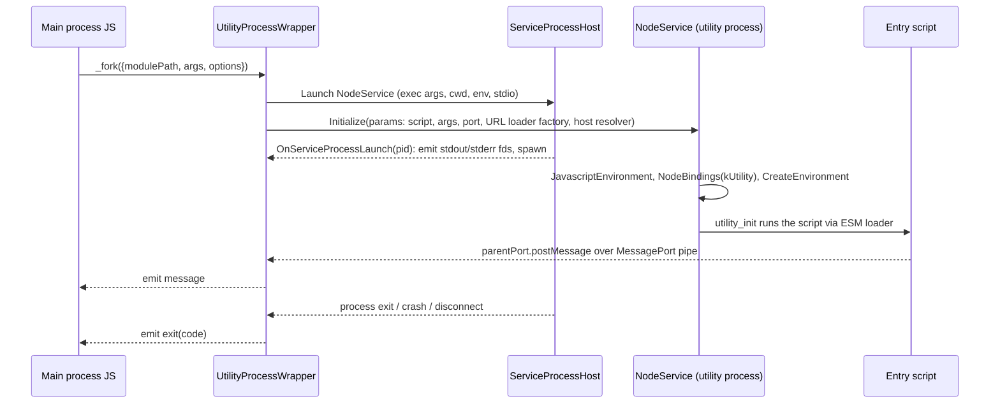

## Overview

`utilityProcess.fork(modulePath, args, options)` starts a Node.js script in a separate process, much like `child_process.fork`, but the child is a Chromium utility process launched through `content::ServiceProcessHost`. That gives it Chromium's process management (crash reporting, task manager naming, termination observers), a structured-clone message channel to the main process that can carry `MessagePort`s, and access to the network service through Electron's `net` module. Inside the child, Electron runs a `NodeService` that creates a Node environment just as the main process does ([[Node.js Integration and Event Loop]]) and runs the script with `process.parentPort` for messaging.

Sources: [lib/browser/api/utility-process.ts:150-152](repo://lib/browser/api/utility-process.ts#L150-L152), [shell/browser/api/electron_api_utility_process.cc:158-238](repo://shell/browser/api/electron_api_utility_process.cc#L158-L238), [shell/services/node/node_service.cc:108-194](repo://shell/services/node/node_service.cc#L108-L194)

Sources: [shell/browser/api/electron_api_utility_process.cc:158-257](repo://shell/browser/api/electron_api_utility_process.cc#L158-L257), [shell/services/node/node_service.cc:108-194](repo://shell/services/node/node_service.cc#L108-L194), [lib/utility/init.ts:38-50](repo://lib/utility/init.ts#L38-L50)

## The mojo service

`shell/services/node/public/mojom/node_service.mojom` defines the contract. `NodeServiceParams` carries the script path, `args`, `exec_args`, a `MessagePortDescriptor` for the message channel, a `URLLoaderFactory` and `HostResolver` from the browser, and whether to use the network observer. `NodeService.Initialize` is the only method, and `NodeServiceClient.OnV8FatalError` reports fatal errors back. The interface is declared with `ServiceSandbox=kNoSandbox`, so the utility process is not sandboxed.

Sources: [shell/services/node/public/mojom/node_service.mojom:13-31](repo://shell/services/node/public/mojom/node_service.mojom#L13-L31)

`ElectronContentUtilityClient` registers `RunNodeService` among the services a utility process can run, so the launch request reaches a `NodeService`.

Sources: [shell/utility/electron_content_utility_client.cc:102-104](repo://shell/utility/electron_content_utility_client.cc#L102-L104), [shell/utility/electron_content_utility_client.cc:155](repo://shell/utility/electron_content_utility_client.cc#L155)

## Forking from the main process

### Option checks in JS

`ForkUtilityProcess` validates its arguments before calling the native `_fork`. The entry script is required; `args` may be omitted with options in its place; `execArgv` must be an array and `serviceName` and `cwd` strings. `stdio` may be a string (`inherit`, `ignore` or `pipe`, applied to stdout and stderr) or a three-element array whose first entry must be `ignore`, because writing to the child's stdin is not supported. A `pipe` entry creates a `PassThrough` stream that later receives the child's output.

Sources: [lib/browser/api/utility-process.ts:9-93](repo://lib/browser/api/utility-process.ts#L9-L93)

### UtilityProcessWrapper::Create

The native side throws `utilityProcess cannot be created before app is ready.`, reads `modulePath`, `args` and the options (`env`, `execArgv`, `serviceName`, `cwd`, `respondToAuthRequestsFromMainProcess`, `stdio` defaulting to `["ignore", "inherit", "inherit"]`, and on macOS `allowLoadingUnsignedLibraries`), creates the wrapper and pins it so it survives until the process exits.

Sources: [shell/browser/api/electron_api_utility_process.cc:437-508](repo://shell/browser/api/electron_api_utility_process.cc#L437-L508)

### Launching

The constructor first prepares stdio. For `pipe` it creates an OS pipe and keeps the read end; for `ignore` it opens `/dev/null` (or `NUL` on Windows). On POSIX the write ends are remapped onto the child's descriptors 1 and 2; on Windows they are passed as the child's stdout and stderr handles. `inherit` leaves the stream alone.

Sources: [shell/browser/api/electron_api_utility_process.cc:67-156](repo://shell/browser/api/electron_api_utility_process.cc#L67-L156)

It then observes service processes and calls `ServiceProcessHost::Launch` with the display name (default "Node Utility Process"), `execArgv` as extra command-line switches, the working directory, and the environment. A custom `env` replaces the parent's environment; with none the child inherits it. On macOS `allowLoadingUnsignedLibraries` launches the child as the plugin helper.

Sources: [shell/browser/api/electron_api_utility_process.cc:158-195](repo://shell/browser/api/electron_api_utility_process.cc#L158-L195)

Messages use a separate pipe rather than the service interface "so that we can support queuing of messages without having to block other interfaces". The wrapper keeps one end of a `MessagePortDescriptorPair` behind a `mojo::Connector` and sends the other in the params. It also asks the system network context (not a session's) for a trusted URL loader factory and a host resolver, optionally with a network observer so authentication requests can be answered in the main process, and calls `Initialize`.

Sources: [shell/browser/api/electron_api_utility_process.cc:197-238](repo://shell/browser/api/electron_api_utility_process.cc#L197-L238)

When the process starts, `OnServiceProcessLaunch` records the pid in a global map, emits `stdout` and `stderr` with the read descriptors (the JS wrapper turns each into a `net.Socket` piped into its `PassThrough`), and emits `spawn`.

Sources: [shell/browser/api/electron_api_utility_process.cc:244-257](repo://shell/browser/api/electron_api_utility_process.cc#L244-L257), [lib/browser/api/utility-process.ts:93-120](repo://lib/browser/api/utility-process.ts#L93-L120)

## Inside the utility process

### NodeService::Initialize

`NodeService` owns a `NodeBindings` for the `kUtility` environment. `Initialize` runs once: it binds the client remote, gives the message port to the `ParentPort` singleton, stores the URL loader factory and host resolver in `URLLoaderBundle`, creates a `JavascriptEnvironment`, and initialises Node. It then creates the environment with the program path prepended to `args` (so `process.argv0` is right) and the user's `execArgv`.

Sources: [shell/services/node/node_service.cc:88-147](repo://shell/services/node/node_service.cc#L88-L147)

It replaces the fatal error handler with one that sends a Node report to the main process through `OnV8FatalError` (emitted there as `error` with `FatalError`) and records crash keys. A process exit handler closes the parent port, destroys the microtasks runner and resets the service receiver with the reason `process_exit_termination` before Node's default exit. Unhandled rejections are set to `warn-with-error-code`, Electron's `process` extras are bound, the entry script path is stored as the hidden `_serviceStartupScript`, and after the microtasks runner exists the environment is loaded and polling starts.

Sources: [shell/services/node/node_service.cc:35-51](repo://shell/services/node/node_service.cc#L35-L51), [shell/services/node/node_service.cc:149-194](repo://shell/services/node/node_service.cc#L149-L194), [shell/browser/api/electron_api_utility_process.cc:425-428](repo://shell/browser/api/electron_api_utility_process.cc#L425-L428)

Unlike the browser and renderer, the utility environment lets Node abort on an uncaught exception, so the process behaves like a standard Node runtime and exits with the matching code.

Sources: [shell/common/node_bindings.cc:749-758](repo://shell/common/node_bindings.cc#L749-L758)

### lib/utility/init.ts

The `utility_init` bundle puts the real entry script back into `process.argv[1]`, loads the common init, gives native emitters Node's `EventEmitter.prototype`, and defines a read-only `process.parentPort`. It loads the script with Node's ESM loader, so both CommonJS and ES modules work, and reports a failed import as an uncaught exception.

Sources: [lib/utility/init.ts:1-50](repo://lib/utility/init.ts#L1-L50)

The utility process's `electron` module exports `net` and `systemPreferences`. Its `net` uses the factory from `URLLoaderBundle`, as described in [[Sessions, Protocols and Networking]].

Sources: [lib/utility/api/module-list.ts:1-5](repo://lib/utility/api/module-list.ts#L1-L5), [shell/common/api/electron_api_url_loader.cc:484-487](repo://shell/common/api/electron_api_url_loader.cc#L484-L487), [shell/services/node/node_service.cc:53-86](repo://shell/services/node/node_service.cc#L53-L86)

## Messaging

### Main process to child

`child.postMessage(message, transfer)` serialises the message with structured clone, checks every transferable is a valid `MessagePortMain` (throwing `Port at index <i> is not a valid port`), disentangles the ports into the message, and writes it to the connector. Messages sent before the child is ready queue in the pipe; once the service has disconnected, `postMessage` does nothing.

Sources: [lib/browser/api/utility-process.ts:134-140](repo://lib/browser/api/utility-process.ts#L134-L140), [shell/browser/api/electron_api_utility_process.cc:332-384](repo://shell/browser/api/electron_api_utility_process.cc#L332-L384)

### Child to main process

In the child, `ParentPort` wraps its end in a `Connector` paused at start. The JS wrapper mirrors Node's worker ports: adding the first `message` listener calls `start()`, removing the last calls `pause()`, so messages wait until someone listens. Incoming messages are emitted as `message` with `data` and `ports` converted to `MessagePortMain` objects. `parentPort.postMessage` serialises and sends back; the main-process wrapper's `Accept` emits each as `message` on the `UtilityProcess` object.

Sources: [shell/services/node/parent_port.cc:34-107](repo://shell/services/node/parent_port.cc#L34-L107), [lib/utility/parent-port.ts:1-32](repo://lib/utility/parent-port.ts#L1-L32), [lib/utility/init.ts:18-36](repo://lib/utility/init.ts#L18-L36), [shell/browser/api/electron_api_utility_process.cc:410-423](repo://shell/browser/api/electron_api_utility_process.cc#L410-L423)

The message pipes are the same `MessagePort` machinery the main process uses for renderers ([[IPC Between Main and Renderer]]), which is why a `MessageChannelMain` port can be handed to a utility process and then on to a renderer.

Sources: [shell/browser/api/message_port.cc:193-238](repo://shell/browser/api/message_port.cc#L193-L238), [shell/services/node/parent_port.cc:94-97](repo://shell/services/node/parent_port.cc#L94-L97)

## Exit and termination

### Exit events

`HandleTermination` runs at most once per process, whichever signal arrives first: the service disconnecting with reason `process_exit_termination` (a normal `process.exit`), the `ServiceProcessHost` observer reporting a normal termination or a crash for this pid, or `Shutdown`. It removes the pid from the map, closes the message pipe, emits `exit` with the exit code and unpins the wrapper. The JS wrapper then drops its handle and its stdout and stderr streams.

Sources: [shell/browser/api/electron_api_utility_process.cc:259-330](repo://shell/browser/api/electron_api_utility_process.cc#L259-L330), [lib/browser/api/utility-process.ts:94-109](repo://lib/browser/api/utility-process.ts#L94-L109)

### kill()

`kill()` terminates the process with a normal exit result and makes sure it is reaped; the code notes the utility process is not sandboxed, so no zygote is involved on Linux. Because the termination is graceful from the user's point of view, an exit code of `SIGTERM` or `SIGKILL` after `kill()` is reported as `0` on POSIX. `kill()` returns `false` when the process has already exited.

Sources: [shell/browser/api/electron_api_utility_process.cc:386-401](repo://shell/browser/api/electron_api_utility_process.cc#L386-L401), [shell/browser/api/electron_api_utility_process.cc:271-287](repo://shell/browser/api/electron_api_utility_process.cc#L271-L287), [lib/browser/api/utility-process.ts:142-147](repo://lib/browser/api/utility-process.ts#L142-L147)

### App shutdown

When the app quits, `ElectronBrowserMainParts::PostMainMessageLoopRun` iterates the utility processes running `NodeService`, finds each wrapper by pid with `FromProcessId`, and calls `Shutdown(0)` while Node is still alive in the main process, so every `exit` event is still delivered ([[Main Process Startup and App Lifecycle]]).

Sources: [shell/browser/electron_browser_main_parts.cc:561-588](repo://shell/browser/electron_browser_main_parts.cc#L561-L588), [shell/browser/api/electron_api_utility_process.cc:430-435](repo://shell/browser/api/electron_api_utility_process.cc#L430-L435)
